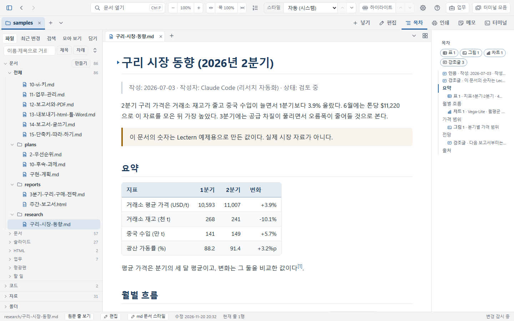
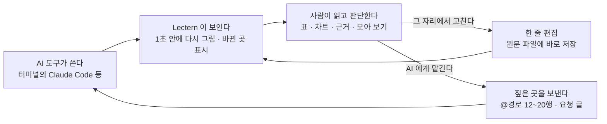
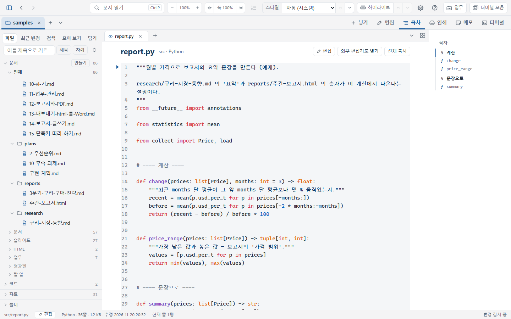
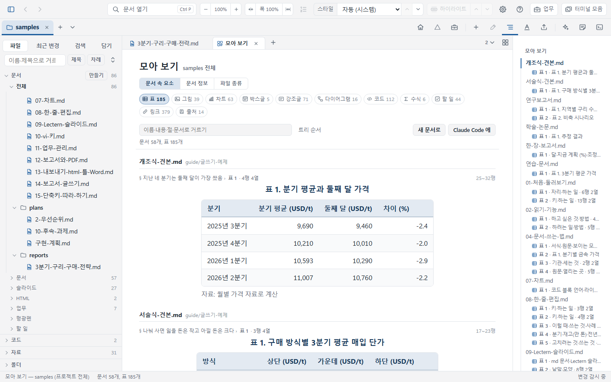
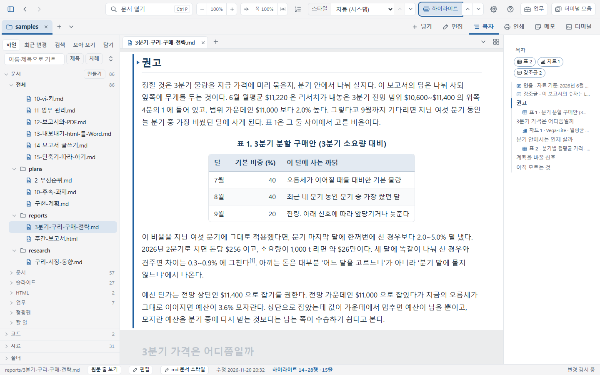
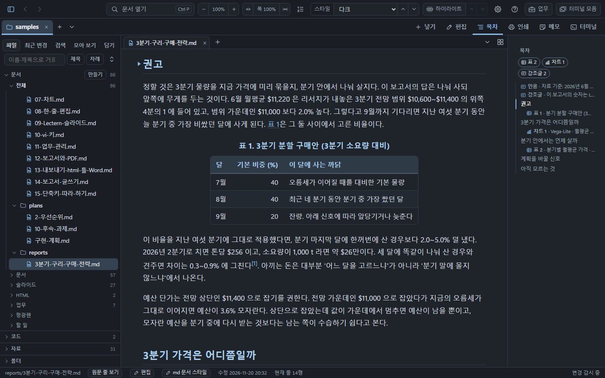

# Lectern (렉턴)

Lectern(렉턴, 독서대)은 **AI 도구가 쓰고, 사람이 읽고 판단하는 리서치 작업대**입니다. Markdown 을 중심으로 AI 와 함께 일하는 통합 리서치 작업 환경(Integrated Research Work Environment)을 지향하며, 지금은 Windows 용 로컬 앱입니다.



> **English**: Lectern is a research workbench where AI tools write and people read and decide. It aims to be an Integrated Research Work Environment centred on Markdown; today it is a local Windows app. Claude Code (or Codex, Antigravity, OpenCode) works in a terminal inside Lectern and writes reports and data into a project folder; Lectern shows them as readable documents within a second, lets you point the AI at exact lines, and lets you fix text in place. The interface and the user guide (**F1**) are in English — it follows the Windows display language, or choose **Settings (Ctrl+,) → Language → English**. Download the installer from [Releases](https://github.com/samiblog/lectern/releases/latest). MIT licensed.

**[최신 판 내려받기 (Releases)](https://github.com/samiblog/lectern/releases/latest)** — `Lectern-버전-setup.exe` 하나로 설치합니다. Python 은 필요 없고, 누구나 무료로 씁니다 (MIT).

## 왜 Lectern 인가

AI 도구(Claude Code 등)는 몇 분 만에 보고서 초안·분석 노트·표를 폴더에 써 냅니다. 그런데 그 결과를 **사람이 읽고 검토하는 자리**는 대개 코드 편집기나 터미널입니다. 거기서는 표가 표로, 차트가 차트로 보이지 않고, 어디가 바뀌었는지 알기 어렵고, "이 문단을 고쳐 줘" 라고 짚어 주기도 번거롭습니다.

Lectern 은 그 사이를 메웁니다. 리서처와 보고서를 쓰는 사람이 AI 의 결과물을 **문서로 읽고, 근거를 따라가고, 고칠 곳을 짚고, 그 자리에서 고치는** 작업대입니다.

## 핵심 생각

| 생각 | 뜻 |
|---|---|
| **폴더가 프로젝트, 파일이 원본** | 따로 저장소나 데이터베이스가 없습니다. 문서·자료·메모·업무 기록이 모두 프로젝트 폴더의 파일(대부분 Markdown)로 남아, AI 도구가 그대로 읽고 다시 씁니다. |
| **나눠 맡는다** | 초안은 AI 가, 계산은 코드가, 판단은 사람이 합니다. Lectern 은 사람 쪽의 자리 — 읽고 검토하고 결정하는 곳입니다. |
| **한 화면의 고리** | 같은 창의 터미널에서 AI 도구가 일하고, 바뀐 문서는 1초 안에 다시 그려지며, 읽다가 짚은 곳(`@보고서.md 12~20행`)을 다시 AI 에게 보냅니다. |
| **읽는 모양 그대로 고친다** | 원문 기호를 보지 않고, 보이는 문서의 그 줄에서 고칩니다. 제목·목록·표의 칸·캡션 번호는 모양을 지킨 채 바뀝니다. |
| **경계를 지킨다** | 파일은 사람이 고를 때만, 그 파일만 바꿉니다. 고른 폴더 밖은 보지 않고, 코드를 실행하지 않으며, 스스로 인터넷에 요청하지 않습니다 (문서 속 인터넷 그림만 예외 — 설정으로 끔). 터미널은 사람이 친 명령만 돌립니다. |

### 한 화면의 고리



## 무엇을 하나

기능을 하나하나 적는 대신 영역마다 무엇을 돕는지만 적습니다. 자세한 것은 앱 안의 사용설명서(**F1**)에 있습니다.

| 영역 | 돕는 일 |
|---|---|
| **읽기** | Markdown·HTML 문서를 읽기 좋은 모양으로 — 숫자가 맞춰진 표, 코드, 수식, 다이어그램(Mermaid), 차트(Vega-Lite·ECharts·Plotly·Graphviz). 바뀐 곳은 잠깐 표시되고, 프로젝트 전체의 표·그림·할 일·링크·출처를 한곳에 모아 봅니다. 코드는 읽기 화면으로, CSV·엑셀은 거르고 정렬하고 통계를 내는 표와 빠른 차트로. |
| **쓰기** | 읽는 화면에서 줄을 더하고 옮기고 지우고 종류를 바꾸며, 표·그림·강조글·박스글·주·참조를 넣습니다. 표·그림의 캡션 번호와 상호 참조, 목차는 저절로 맞습니다. 필요하면 원문 전체를 여는 편집 모드. |
| **AI 도구와 함께** | 프로젝트마다 터미널(여러 개, 모든 프로젝트를 한 화면에 모으는 터미널 모음). 고른 줄의 위치와 요청 글을 터미널에 넣고(Enter 는 사람이), AI 가 Lectern 에서 잘 보이는 문서·보고서다운 글을 쓰게 하는 작성 안내·글쓰기 스타일·다듬기 점검·내 문체 노트를 건넵니다. Claude Code·Codex·Antigravity·OpenCode 를 지원합니다. |
| **내보내기** | A4 보고서 양식이나 지면 틀(공문·연구보고서·학술 논문 등)로 PDF·인쇄, 그림이 안에 든 html 한 파일, 회사 양식을 빌린 Word. |
| **Lectern 슬라이드** | Markdown 으로 쓰는 슬라이드 — 템플릿을 골라 장을 잇고, 발표하고, PowerPoint(pptx)나 브라우저 발표 html 로 냅니다. pptx 를 Lectern 슬라이드로 옮기는 스킬도 들어 있습니다. |
| **업무 관리** | 폴더마다 `WORK.md` 한 파일이 업무 카드입니다. 상위 폴더에서 업무 나무·칸반·간트·달력으로 모아 보고, 일정 알림을 받습니다. |

| 코드 읽기 화면 | 모아 보기 |
|---|---|
|  |  |

| 장 하이라이트 | 어두운 스타일 |
|---|---|
|  |  |

## 지향점 — 마름모형 리서치

Lectern 이 길게 보고 가는 방향은 **좁게 정의하고, 넓게 쌓고, 정확하게 깎는** 리서치 방법입니다. 주제와 핵심 질문, 평가 기준은 사람이 먼저 정하고(좁게), 조사와 분석은 AI 와 코드로 넓고 빠르게 하고(쌓기), 합성과 최종 결과물에서는 주장마다 근거를 대조하며 사람의 검토를 모읍니다(깎기). AI 리서치의 품질은 모델의 성능보다 **무엇을 어떻게 검증하는가**에서 정해진다는 생각입니다.

지금의 Lectern 은 이 방법을 강제하지 않습니다. 단계마다 쓸 수 있는 도구 — 자료 보기와 검색, 모아 보기, 담기와 보내기, 바뀐 곳 표시, 인쇄와 발표 — 를 먼저 갖추는 중입니다. 방향과 지금 위치는 [docs/VISION.md](docs/VISION.md) 에 있습니다.

## 배우는 곳

| 무엇 | 어디 |
|---|---|
| 사용설명서 | 앱에서 **F1** — 따로 창에 뜨는 문서 50개의 트리 (장 열 개: 시작하기·화면·읽기·쓰기·Lectern 슬라이드·내보내기·AI 도구와 함께·업무 관리·설정·참고). 표 중심이고 모든 문서에서 찾을 수 있습니다. |
| 단축키 | 앱에서 **Ctrl+/** (자주 쓰는 스무 가지부터), 이름으로 찾아 바로 하기는 **Ctrl+Shift+P** |
| 예제 | 앱에서 **Shift+F1** — 보기만 하는 예제 프로젝트 ([samples/](samples/)) |

## 설치

[Releases](https://github.com/samiblog/lectern/releases/latest) 의 `Lectern-버전-setup.exe` 를 실행합니다.

- 관리자 권한 없이 지금 사용자에게만 설치됩니다 (`%LOCALAPPDATA%\Programs\Lectern`). 새 판은 같은 자리에 덮어 설치합니다.
- 설치할 때 '탐색기 폴더 우클릭에 Lectern으로 열기'와 바탕화면 바로가기를 고를 수 있습니다.
- 창을 그리는 Microsoft Edge WebView2 런타임이 필요합니다 — Windows 11 과 대부분의 Windows 10 에 있고, 없으면 설치 중에 알려 줍니다.
- 코드 서명이 없어 처음 실행할 때 'Windows의 PC 보호' 창이 뜰 수 있습니다 — '추가 정보 → 실행'.
- 제거는 'Windows 설정 → 앱'. 설정(`%APPDATA%\Lectern`)은 남아 다시 설치하면 그대로입니다.

## 소스에서 실행하기

Python 3.10 이상(3.12 이상 권장)과 Windows 10/11 이 필요합니다. JS 라이브러리는 `web/vendor/` 에 들어 있어 npm 은 필요 없습니다.

```bat
git clone https://github.com/samiblog/lectern.git
cd lectern
python -m venv .venv
.venv\Scripts\activate
pip install -r requirements.txt

run.bat C:\work\my-project          :: 창으로 열기 (run.bat . 은 지금 폴더)
dev.bat                             :: 개발용: 예제를 브라우저 모드로 (http://127.0.0.1:8765)
```

인터넷이 막힌 PC 에서는, 인터넷이 되는 PC 에서 같은 Python 판으로 `pip download -r requirements.txt -d wheels` 를 받아 옮긴 뒤 `pip install --no-index --find-links wheels -r requirements.txt` 로 설치합니다. 의존성 판은 `==` 로 고정되어 있습니다. 요구사항 파일 첫 줄의 `coding: utf-8` 은 지우지 마세요 — 오래된 pip 가 한국어 Windows 에서 파일을 읽지 못합니다.

실행 파일과 설치 파일은 `build.bat` 이 만듭니다 (`requirements-dev.txt`, 설치 파일은 Inno Setup 6 이 있을 때).

## 개발

Claude Code 로 이어서 작업한다면 [CLAUDE.md](CLAUDE.md) 부터 읽습니다. 구조는 `docs/ARCHITECTURE.md`, 설계의 까닭은 `docs/DECISIONS.md`, 다음 할 일은 `docs/ROADMAP.md`, 점검 방법은 `docs/TESTING.md`, 판마다 바뀐 것은 `docs/HISTORY.md` 에 있습니다.

```bat
pip install -r requirements-dev.txt
python -m pytest -q              :: 단위 시험 (약 1분)
python tools\ui_edges.py -j 4    :: 화면 가장자리 점검 (playwright 필요)
python tools\ui_smoke.py         :: 화면 회귀 점검
```

## 라이선스

Lectern 은 [MIT 라이선스](LICENSE)입니다. 누구나 무료로 쓰고, 고치고, 배포할 수 있습니다 (저작권 표시를 남겨 주세요). 있는 그대로 제공되며, 사용으로 생긴 문제에 대해 보증이나 책임을 지지 않습니다.

설치 파일에는 Python, pywebview, Flask, waitress, watchdog, markdown-it, Mermaid, Vega, ECharts, Plotly, Graphviz(Viz.js), KaTeX, highlight.js, DOMPurify, xterm.js, CodeMirror 등 오픈소스 소프트웨어가 들어 있습니다. 저작권 표시와 라이선스 전문은 [THIRD-PARTY-NOTICES.md](THIRD-PARTY-NOTICES.md), `web/vendor/` 의 원문 라이선스는 `web/vendor/licenses/` 에 있습니다.
