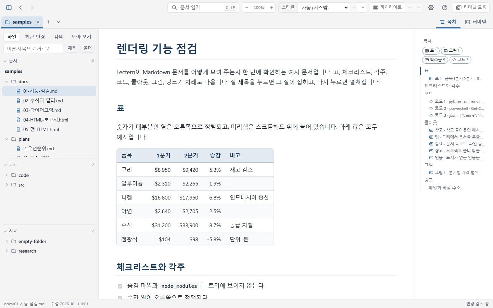
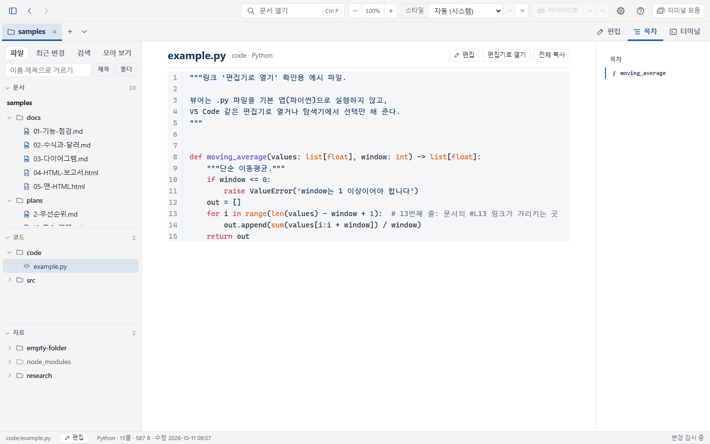
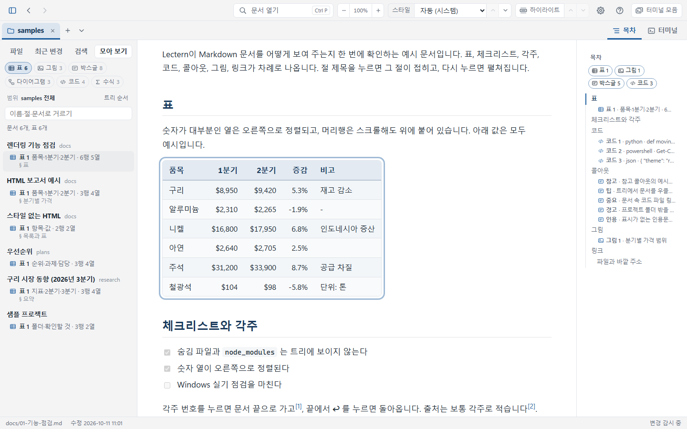
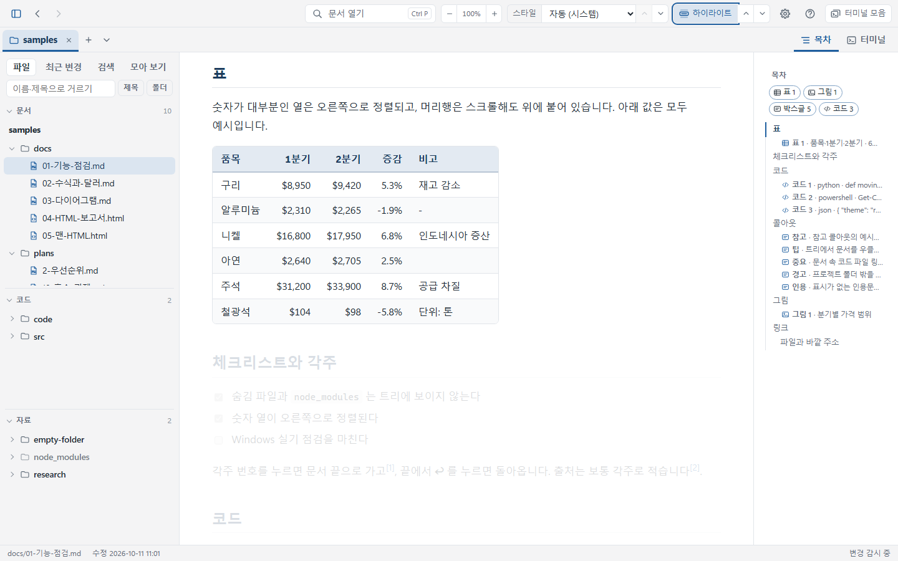
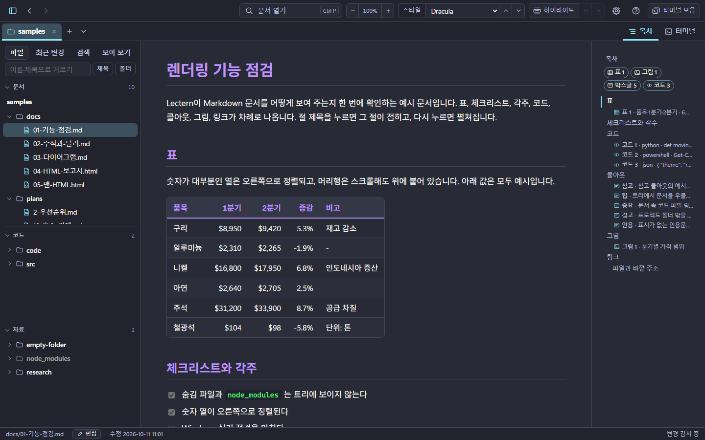
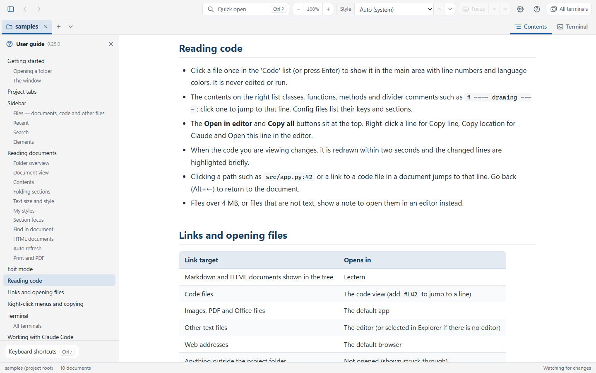

# Lectern (렉턴)

Lectern(렉턴, 독서대)은 Claude Code나 Claude가 프로젝트 폴더에 만든 문서를 **사람이 한눈에 훑어보고 읽는** Windows용 로컬 뷰어입니다.
읽기가 중심이라 문서는 편집 모드에서 직접 저장할 때만 고치고, 스스로 인터넷에 연결하지 않으며(문서 속 인터넷 그림만 예외, 설정으로 끌 수 있음), 고른 프로젝트 폴더 안만 봅니다.
Markdown과 HTML 문서를 봅니다. HTML 문서는 보기만 하고 스크립트는 돌리지 않습니다.



> **English**: Lectern is a Windows viewer for skimming and reading the Markdown and HTML documents that Claude Code writes into a project folder. Its interface is available in English — it follows the Windows display language, or choose **Settings (Ctrl+,) → Language → English**. Press **F1** in the app for the English user guide. Download the installer from [Releases](https://github.com/samiblog/lectern/releases/latest). MIT licensed.

## 내려받기

**[최신 판 내려받기 (Releases)](https://github.com/samiblog/lectern/releases/latest)** — `Lectern-버전-setup.exe` 를 실행하면 Python 없이 설치됩니다 (아래 '설치 파일로 설치하기'). 누구나 무료로 쓸 수 있습니다 (MIT 라이선스).

## 무엇을 하나

- **프로젝트 탭**: 폴더마다 탭 하나. 탭을 누르면 왼쪽 트리와 본문이 그 프로젝트의 것으로 바뀌고, 탭마다 보던 문서와 위치가 그대로 남습니다. 뒤에 있는 탭의 문서가 바뀌면 탭에 점이 붙습니다
- **폴더 개요**: 방금 바뀐 문서(시간 레일), 하위 폴더, 문서마다 제목·요약·수정 시각
- **왼쪽 트리**: 파일 이름(마우스를 올리면 문서 제목), 필터, 열어 보기 전에 바뀐 문서에 호박색 점
- **문서·코드·자료**: 사이드바 '파일' 탭을 '문서'(트리)·'코드'(소스·스크립트·설정)·'자료'(PDF·엑셀·그림 등) 세 묶음으로 나눠 보입니다. 묶음마다 접을 수 있고, 코드와 자료는 탐색기처럼 두 번 누르면 엽니다 (실행 파일은 실행하지 않고 탐색기에서 선택만). '폴더' 버튼을 켜면 모두 폴더 구조 그대로 한 트리에. 이름 앞에는 종류 아이콘
- **자동 새로고침**: Claude가 문서를 쓰는 동안 1초 안에 반영, 보던 위치 유지. 바뀐 문단·표는 잠깐 배경색으로 표시되고, 화면 밖이면 상태줄의 '바뀐 곳 N곳' 버튼으로 차례로 갑니다
- **코드 읽기 화면**: '코드' 목록에서 코드 파일을 누르면 본문 자리에 줄 번호와 언어 색으로 보이고, 오른쪽 목차에 클래스·함수가 나옵니다 (고치거나 실행하지 않음)
- **모아 보기**: 사이드바 '모아 보기' 탭에서 프로젝트(또는 고른 폴더)의 표·그림·박스글·다이어그램·코드·수식을 종류마다 문서별로 모아 봅니다. 누르면 그 문서의 그 자리로 갑니다. '파일 종류'로 바꾸면 엑셀·PDF·그림·py·ipynb 같은 형식별로 파일을 모아 봅니다
- **전체 검색**: 사이드바 '검색' 탭(Ctrl+Shift+F)에서 모든 문서와 코드의 본문을 찾고, 결과를 누르면 그 줄로 갑니다. 맨 위에는 이름이 맞는 파일(자료도)이 나옵니다. 검색 칸 아래 '문서'·'코드'·'자료' 버튼으로 찾을 곳을 고릅니다
- **읽기 좋은 본문**: 숫자 열이 정렬된 표, 코드 하이라이트·복사, 박스글(콜아웃), 각주, 수식(`$105` 같은 달러 표기는 그대로), Mermaid 다이어그램, 차트(Vega-Lite·ECharts·Plotly·Graphviz — `vega-lite`·`echarts`·`plotly`·`dot` 코드 블록), 이미지(프로젝트 안 그림과 인터넷 그림, 클릭하면 확대), 표·그림·박스글까지 담은 목차, 제목을 눌러 절 접기·펴기, 글자 크기 −·+, 한 장만 또렷하게 보는 장 하이라이트
- **스타일 24종**: 업무·보고(기본, 보고서, 사내 문서, 컨설팅, 노션풍, 고대비), 읽기·출판(종이·세피아, 책, 논문, 신문, 잡지, 원고·타자기), 개발·기술(GitHub, 문서 사이트, Solarized 라이트, Gruvbox 라이트), 어두운(다크, GitHub 다크, Nord, Solarized 다크, Dracula, One Dark, 밤 종이, 먹·완전 검정). 목록은 용도별·분위기별·밝기별 중 고른 방식으로 묶입니다(설정 창). 고른 스타일은 다음 실행에도 그대로이고, '자동'은 Windows 다크 모드를 따름
- **터미널**: 툴바 버튼(`` Ctrl+` ``)으로 오른쪽에 PowerShell 을 엽니다. 프로젝트 탭마다 셸 하나가 그 프로젝트 폴더에서 시작해, 문서를 보며 옆에서 Claude Code 를 돌릴 수 있습니다
- **터미널 모음**: 툴바의 '터미널 모음' 버튼(`` Ctrl+Shift+` ``)으로 열린 프로젝트들의 터미널을 한 화면에 격자로 모아 봅니다. 칸 머리에 프로그램이 '실행 중'인지 보여, 여러 프로젝트에서 돌린 Claude Code 를 한눈에 볼 수 있습니다
- **경로 자동 링크**: 본문의 `src/app.py:42` 처럼 실제로 있는 파일 경로를 누르면 편집기의 그 줄로 엽니다 (md·html 문서는 뷰어에서)
- **빠른 이동**: Ctrl+P 빠른 열기(문서와 코드 — 맞는 문서 먼저), Ctrl+F 문서 안 찾기(굵게·코드 같은 서식이 섞여도), 뒤로/앞으로, 트리 우클릭으로 `@경로` 복사(Claude Code 프롬프트용). 다시 열면 마지막에 보던 문서와 위치로 시작합니다
- **문서 속 절대경로**: `C:\...\chart.png` 처럼 프로젝트 안을 가리키는 절대경로 그림·링크도 열립니다 (프로젝트 밖은 막음)
- **한국어·English**: 설정 창의 '언어 · Language' 에서 화면 언어를 고릅니다 (기본은 Windows 표시 언어를 따름). 사용설명서와 설치 프로그램도 영어판이 있습니다
- **편집 모드**: 읽던 문서나 코드를 그 자리에서 고칩니다 (탭 막대 오른쪽 끝의 [편집] 켜기/끄기, 상태줄의 '편집', Ctrl+E, 우클릭 '여기를 편집'). 줄 번호·언어 색·찾아 바꾸기가 있고, Ctrl+S 로 저장하면 줄바꿈·BOM 은 그대로입니다. 읽던 곳에서 열리고, 편집하는 동안 목차가 커서가 있는 절을 따라오며, 목차·검색에서 고르면 편집기가 그 줄로 갑니다. 닫으면 편집하던 곳이 보입니다. 그사이 Claude Code 가 같은 파일을 고쳤으면 덮어쓰기 전에 묻습니다
- **사용설명서·단축키**: F1 로 앱 안의 사용설명서(왼쪽 차례, 설명서 안에서 Ctrl+F), 툴바의 **?** 버튼(Ctrl+/)으로 단축키 표를 봅니다
- **HTML 문서**: Claude가 만든 html 보고서를 트리에 `HTML` 표시와 함께 보입니다. 문서의 스타일은 그대로(스타일이 없으면 Lectern 스타일), 스크립트·인터넷 CSS는 막습니다(스크립트로 그리는 차트는 보이지 않음). `src`·`public`·`web` 같은 앱 소스 폴더의 html 은 문서로 보지 않습니다.
- 숨김 파일·폴더(`.claude`, `.git` 등)와 문서가 없는 폴더는 보이지 않습니다. `node_modules`·`dist` 같은 제외 폴더는 문서 트리·검색에 나오지 않고, '자료' 목록에만 흐리게 접혀 나옵니다 (펼칠 때 안을 읽음).

| 코드 읽기 화면 | 모아 보기 |
|---|---|
|  |  |

| 장 하이라이트 | 어두운 스타일 (Dracula) |
|---|---|
|  |  |

| English 화면 (사용설명서) |
|---|
|  |

## 설치 파일로 설치하기

[Releases](https://github.com/samiblog/lectern/releases/latest) 에서 받은 `Lectern-버전-setup.exe` 를 실행합니다. 관리자 권한 없이 지금 사용자에게만 설치됩니다(`%LOCALAPPDATA%\Programs\Lectern`). Python은 필요 없습니다.

- 시작 메뉴에 Lectern이 생깁니다. 설치할 때 '탐색기 폴더 우클릭에 Lectern으로 열기 추가'(기본 선택)와 '바탕화면 바로가기'를 고를 수 있습니다.
- 새 버전의 설치 파일을 실행하면 같은 자리에 덮어 설치됩니다. 실행 중인 Lectern은 닫도록 안내합니다.
- 제거는 'Windows 설정 → 앱'에서 합니다. 설정(`%APPDATA%\Lectern\config.json`)은 남겨 두므로 다시 설치하면 최근 폴더·스타일이 그대로입니다.
- 창을 그리는 Microsoft Edge WebView2 런타임이 필요합니다. Windows 11과 대부분의 Windows 10에는 있고, 없으면 설치 중에 알려 줍니다.
- 코드 서명이 없어서 처음 실행할 때 'Windows의 PC 보호' 경고가 뜰 수 있습니다. '추가 정보 → 실행'을 누릅니다.

## 소스에서 실행하기 (Python)

Python 3.10 이상(3.12 권장)과 Windows 10/11(WebView2 기본 포함)이 필요합니다. JS 라이브러리는 `web/vendor/` 에 들어 있어 npm은 필요 없습니다.

```bat
git clone https://github.com/samiblog/lectern.git
cd lectern
python -m venv .venv
.venv\Scripts\activate
pip install -r requirements.txt
```

### 사내망(인터넷 차단) PC에 설치할 때

인터넷이 되는 Windows PC에서 같은 Python 버전으로 wheel을 받아 옮깁니다.

```bat
:: 인터넷 되는 PC
pip download -r requirements-dev.txt -d wheels

:: 사내 PC (wheels 폴더를 복사한 뒤)
pip install --no-index --find-links wheels -r requirements-dev.txt
```

`requirements-dev.txt` 에는 테스트·빌드 도구도 들어 있습니다. 실행만 할 거라면 `requirements.txt` 로 충분합니다.
버전은 확인한 판으로 고정되어 있어서(`==`), 언제 받아도 같은 판이 설치됩니다. 두 파일 첫 줄의 `coding: utf-8` 은 지우지 마세요. 오래된 pip가 한국어 Windows에서 파일을 읽지 못합니다.

## 실행

```bat
run.bat C:\work\my-project          :: 창으로 열기 (폴더 생략 시 마지막 폴더, run.bat . 은 지금 폴더)
python app.py C:\work\my-project    :: 같은 동작 (콘솔 창이 남음)
dev.bat                             :: 개발용: samples 를 브라우저 모드로 (http://127.0.0.1:8765)
```

Claude Code 터미널에서 지금 프로젝트를 바로 띄우려면 `Lectern.exe .` (exe를 PATH에 둔 경우).

## 실행 파일·설치 파일 만들기

```bat
pip install -r requirements-dev.txt
winget install JRSoftware.InnoSetup   :: 설치 파일을 만들 때만 (한 번)
build.bat                           :: 테스트 → dist\Lectern\Lectern.exe → dist\Lectern-버전-setup.exe
python tools\context_menu.py        :: 설치 파일 없이 쓸 때 탐색기 폴더 우클릭에 'Lectern으로 열기' 등록 (해제: --remove)
```

설치 파일 대신 `dist\Lectern` 폴더째 복사해도 Python이 없는 PC에서 실행됩니다 (`Lectern.exe` 하나만으로는 안 됨). 아이콘은 `assets/lectern.svg` 를 고친 뒤 `python tools\make_icon.py` 로 다시 만듭니다.

## 사용법

### 폴더 열기
- 실행할 때 폴더를 주거나(위 '실행'), 탭 막대의 **+**(폴더 열기, Ctrl+O)로 고르면 새 탭으로 열립니다. 이미 열린 폴더면 그 탭으로 갑니다. + 옆 화살표에는 최근 연 폴더가 있습니다.
- 폴더 없이 실행하면 지난번에 열어 둔 탭들이 그대로 열립니다.
- Lectern이 떠 있을 때 탐색기 우클릭 'Lectern으로 열기'나 `run.bat 폴더`로 또 실행하면, 새 창 대신 떠 있는 창에 탭으로 열리고 그 창이 앞으로 나옵니다.

### 화면
- **탭**: 툴바 아래에 열린 프로젝트가 탭으로 나옵니다. 탭을 누르면 왼쪽 트리·최근 변경·검색과 본문이 그 프로젝트 것으로 바뀝니다 (문서는 읽던 위치 그대로). 같은 이름의 폴더는 상위 폴더 이름이 함께 보입니다. ×·가운데 버튼·Ctrl+W 로 닫고, 우클릭하면 다른 탭 모두 닫기·경로 복사·탐색기에서 보기가 있습니다. 10개까지 엽니다.
- **폴더 개요**: 처음 화면입니다. 방금 바뀐 문서, 하위 폴더, 문서마다 제목·요약·수정 시각이 나옵니다. 트리에서 폴더 이름을 누르면 그 폴더의 개요가 나옵니다.
- **문서·코드·자료 묶음**: 파일 탭은 위에서부터 '문서'(md·html 문서 트리), '코드'(py·js·ts 같은 소스, ps1·bat 스크립트, css·소스 폴더의 html, json·yaml·toml 같은 설정), '자료'(문서도 코드도 아닌 파일 — PDF·오피스·그림·데이터·압축·실행 파일 등) 세 묶음입니다. 머리줄('문서 10', '코드 3', '자료 4')을 누르면 그 묶음이 접히고, 맨 위에 펼쳐진 묶음이 남은 높이를 갖습니다 — 예를 들어 '문서'를 접으면 '코드'가 길어집니다. 묶음 사이 분리선을 끌어 높이를 바꾸고(두 번 누르면 기본), 접고 편 상태와 높이는 다음 실행에도 그대로입니다. '코드' 목록과 '자료' 목록은 똑같이 씁니다.
- **코드 읽기 화면**: '코드' 목록에서 파일을 한 번 누르면(또는 Enter) 본문 자리에 읽기 전용으로 보입니다 — 줄 번호, 언어별 색, 긴 줄은 접어서. 오른쪽 목차에는 클래스·함수·메서드와 `# ---- 그리기 ----` 같은 구분 주석(설정 파일은 위 단계 키·섹션)이 나오고, 누르면 그 줄로 갑니다. 두 번 누르면 지금처럼 편집기로 열고, 화면 위 '편집기로 열기'·'전체 복사' 버튼도 있습니다. 줄을 우클릭하면 이 줄 복사, **Claude용 위치 복사**(`@code/app.py 12~20행` — 글을 고르면 그 줄 범위), 편집기에서 이 줄 열기. 보고 있는 코드를 Claude 가 고치면 2초 안에 다시 그려지고 바뀐 줄이 잠깐 표시됩니다. 문서 속 `src/app.py:42` 같은 경로나 코드 파일 링크를 누르면 그 줄로 갑니다 (뒤로 가기로 문서에 돌아옴). Ctrl+F 로 코드 안에서도 찾습니다.
- **자료·코드 목록**: '코드'·'자료' 묶음에는 문서가 아닌 파일이 폴더별로 나옵니다. 문서와 파일 모두 이름 앞에 종류 아이콘(문서·그림·표·코드·압축·실행 파일 등)이 붙고, 문서는 파란 아이콘입니다. 거르기 칸 옆 **폴더** 버튼을 켜면 문서 트리와 파일 목록을 나누지 않고 실제 폴더 구조 그대로 한 트리에 보입니다 — 문서는 한 번 눌러 열고, 파일은 두 번 눌러 엽니다. 다시 누르면 종류별(문서·코드·자료 묶음)로 돌아갑니다. 한 번 누르면 고르고, 두 번 누르거나 Enter 를 누르면 엽니다 — PDF·오피스·그림·csv 는 기본 앱으로, 코드·글은 편집기로, 실행 파일·압축 파일은 실행하지 않고 탐색기에서 선택만 합니다. 화살표 키로 옮겨 다니고(→ 펼치기, ← 접기), 우클릭하면 편집기로 열기·탐색기에서 보기·경로 복사가 있습니다. 글자를 치면 그 글자로 시작하는 항목으로 갑니다 (같은 글자를 거듭 치면 다음 항목). 위 거르기 칸은 이 목록들에도 적용됩니다. `node_modules`·`dist`·`build` 같은 제외 폴더는 '자료'에 흐린 접힌 폴더로 나오고 펼칠 때 안을 읽습니다 — 안의 파일은 종류와 상관없이 모두 보이고(코드는 한 번 누르면 읽기 화면), 접었다 펼치면 새로 읽습니다. 개수와 거르기에는 넣지 않습니다.
- **모아 보기**: 사이드바의 '모아 보기' 탭을 누르면 위에 '표 7 · 그림 4 · 박스글 8 · 다이어그램 3 · 코드 4 · 수식 3' 처럼 종류 버튼이 나오고, 고른 종류가 문서별로 모입니다 (표는 '표 1 · 품목·1분기·2분기 · 6행 5열'과 그 절 이름, 그림은 작은 그림들 — 같은 그림을 여러 문서가 쓰면 한 번만 '+N곳'). 이름·번호는 그 문서의 목차와 같고, 누르면 그 문서의 그 자리로 가서 잠깐 테두리로 표시합니다. 거르기 칸으로 이름·절·문서를 거르고, '트리 순서' 버튼으로 최근 수정한 문서부터 볼 수 있습니다. 폴더 개요 위의 '모아 보기: 표 · 그림 …' 버튼이나 트리에서 폴더를 우클릭해 '이 폴더의 표·그림 등 모아 보기'를 고르면 그 폴더(하위 포함)만 모읍니다 ('전체'를 누르면 프로젝트 전체). 처음 열 때 문서를 읽느라 잠깐 걸리고(문서가 많으면 몇 초), 그다음에는 바뀐 문서만 다시 읽습니다. 위의 '파일 종류'를 누르면 문서·코드·자료마다 'PDF 2 · 엑셀 3 · PNG 10 · PY 12 · IPYNB 2'처럼 형식 버튼이 나오고, 고른 형식의 파일이 트리 순서(또는 최근 수정 순)로 모입니다 — 그림 파일은 작은 그림으로. 엑셀·파워포인트·워드·한글은 확장자가 달라도 한 이름으로 셉니다. '코드'·'자료' 목록에서 폴더를 우클릭해 '이 폴더의 파일을 종류별로 모아 보기'를 고르면 그 폴더만 모읍니다.
- **왼쪽 트리**: 파일 이름을 보여 주고, 마우스를 올리면 문서 제목과 경로가 나옵니다. 위 입력칸으로 거르고(제목으로도 찾음), '제목' 버튼을 켜면 파일 이름 대신 문서 제목으로 보입니다. '최근 변경' 탭은 수정한 순서이고, 위의 '문서'·'코드'·'자료' 버튼으로 보일 것을 고릅니다 (코드·자료도 고치면 맨 위로).
- **본문**: 오른쪽 목차로 이동하고, 지금 읽는 위치가 목차에 표시됩니다. 목차의 각 제목 아래에는 그 절의 표·그림·박스글(콜아웃·인용)·다이어그램·코드·수식이 '표 1 · 가격 비교 · 6행 4열'처럼 나오고, 누르면 그 자리로 가서 잠깐 테두리로 표시합니다 (접힌 절은 펼쳐짐). 목차 위의 '표 2'·'코드 5' 같은 버튼을 누르면 그 종류를 목차에서 감추고, 다시 누르면 보입니다. 제목을 누르면 그 절이 접히고 다시 누르면 펼쳐집니다. 그림을 누르면 크게 보이고, 코드 블록은 오른쪽 위 '복사' 버튼으로 복사합니다.
- **목차 폭**: 문서와 목차 사이 경계를 끌어 목차 폭을 바꿉니다 (두 번 누르면 기본 폭, 다음 실행에도 그대로).
- **글자 크기**: 툴바의 − / + 로 문서 글자를 80%~200%로 줄이고 키웁니다(단 폭도 함께 — 줄 길이는 그대로). 가운데 '100%'를 누르면 처음 크기로 돌아가고, 고른 크기는 다음 실행에도 그대로입니다. 앱 화면 전체를 키우려면 Ctrl+휠.
- **장 하이라이트**: 툴바의 '하이라이트' 버튼('스타일' 목록 오른쪽)을 누르면 지금 읽는 장만 그대로 보이고 나머지 글자·선·그림은 바탕색 쪽으로 흐려집니다. ↑·↓, PageUp·PageDown 또는 버튼 옆 ∧·∨ 로 앞뒤 장, 흐린 곳을 누르면 그 장으로 옮기고, Esc 나 버튼으로 끕니다. 본문을 우클릭해 '이 장 하이라이트'·'하이라이트 해제'를 골라도 됩니다. 장은 문서의 큰 절(제목이 하나뿐이면 그 아래 `##` 절)이고, 범위는 그 장 제목을 눌러 접을 때 숨는 범위와 같습니다. Markdown 문서에서 씁니다.
- **본문 우클릭**: 우클릭한 제목·단락·표·그림에 테두리가 생기고 복사 메뉴가 나옵니다. 텍스트·Markdown 원문 복사, 제목은 그 절 전체 원문과 절 링크, 표는 엑셀(칸이 나뉨)·워드(표 모양)에 붙일 수 있게, 그림은 PNG로 복사합니다. **Claude용 위치 복사**는 `@docs/보고서.md 40~52행` 처럼 복사되어 Claude Code 프롬프트에 붙이면 그 부분을 짚어 줄 수 있습니다. 그 밖에 '편집기에서 이 줄 열기', 다이어그램 그림 복사, 수식 LaTeX 복사, 링크 주소 복사, 같은 수준 제목 모두 접기도 있습니다. 여백을 우클릭하면 경로 복사, 편집기로 열기, 모두 접기·펴기, **인쇄 / PDF로 저장**(프린터에서 'Microsoft Print to PDF')이 있고, 글을 드래그해 둔 채 우클릭하면 '선택한 글 복사'가 맨 위에 나옵니다.
- **터미널**: 탭 막대 오른쪽 끝의 '터미널' 버튼이나 `` Ctrl+` `` 로 본문 오른쪽에 터미널이 열립니다 (창이 세로로 길면 문서 아래에 — 설정 창의 '터미널 자리'나 터미널 머리줄의 버튼으로 오른쪽·아래를 고정할 수 있습니다). 지금 탭의 프로젝트 폴더에서 Windows PowerShell 이 시작되고, 다른 탭을 고르면 그 탭의 셸로 바뀝니다 (탭마다 따로). 터미널을 여는 동안 목차는 감춰지고, 목차 버튼을 누르면 함께 보입니다. 경계를 끌어 폭을 바꾸고(두 번 누르면 기본), ✕ 나 같은 키로 닫아도 셸은 계속 돌아 다시 열면 이어집니다. 글을 끌어 고른 뒤 Ctrl+C 나 우클릭으로 복사하고, Ctrl+V 나 우클릭으로 붙여 넣습니다 (고른 글이 없을 때 Ctrl+C 는 실행 중인 명령을 멈춤). 본문·코드·트리·파일 목록의 우클릭 메뉴에서 복사 항목 옆의 터미널 버튼을 누르면 그 글(선택한 글·Claude용 위치·경로 등)이 Enter 없이 터미널에 들어갑니다 — 여러 줄이면 먼저 묻습니다 (Claude Code 처럼 붙여넣기 모드를 켠 프로그램에는 묻지 않음). 터미널 안에서는 키가 셸로 가므로 Ctrl+P·Ctrl+F 같은 앱 단축키는 본문을 누른 뒤에 씁니다 (Ctrl+Tab 은 터미널 안에서도 다음 탭). 터미널 색은 문서 스타일을 따릅니다 (바탕은 그 스타일의 코드 블록 색, Solarized·Nord·Dracula 등은 같은 이름의 터미널 색). 늘 어두운 터미널을 원하면 설정 창에서 '터미널 색을 스타일에 맞춤'을 끕니다. 밝은 터미널에서 Claude Code 를 쓸 때는 Claude Code 의 `/config` 에서 밝은 테마를 고르면 더 잘 어울립니다. 머리줄의 ↻ 는 셸을 새로 시작합니다. 탭을 닫으면 그 셸도 끝나는데, 셸에서 띄운 프로그램이 돌고 있으면 먼저 묻습니다. Lectern 을 닫으면 모든 셸과 거기서 띄운 프로그램이 함께 끝납니다.
- **터미널 모음**: 툴바의 '터미널 모음' 버튼(설정 톱니 옆, 숫자는 돌고 있는 셸 수)이나 `` Ctrl+Shift+` `` 를 누르면, 문서 화면 자리에 열린 프로젝트마다 칸 하나씩 격자로 터미널이 모입니다 (2개는 좌우, 3~4개는 2×2 …). 아직 터미널을 열지 않은 프로젝트는 '터미널 시작' 버튼을 누르면 그 폴더에서 시작합니다. 칸 머리에는 '실행 중'(셸에서 띄운 프로그램이 도는 중)·'대기'가 보입니다. 칸을 누르면 그 터미널에 입력하고, Ctrl+Tab 으로 다음 칸으로 옮깁니다. 칸 머리를 두 번 누르거나 ⛶ 버튼으로 그 칸만 크게 봅니다. 칸의 → 버튼(또는 칸 안에서 `` Ctrl+` ``)은 그 프로젝트로 가서 오른쪽 터미널을 열고, 프로젝트 탭을 누르면 그 프로젝트의 문서 화면으로 돌아갑니다.
- **스타일**: 오른쪽 위 '스타일' 목록에서 24종 중 고르면 본문과 툴바·사이드바가 함께 바뀝니다. 목록 옆 ∧·∨ 버튼을 누르면 바로 위·아래 스타일로 바뀌어 차례로 견주어 볼 수 있습니다. 목록은 설정 창(Ctrl+,)의 '스타일 목록 묶기'에서 고른 방식으로 묶입니다 — 용도별(업무·보고 / 읽기·출판 / 개발·기술 / 어두운), 분위기별(깔끔한 / 따뜻한·종이 / 색이 있는 / 어두운), 밝기별(밝은 / 종이·책 / 어두운). '자동'은 Windows 다크 모드를 따릅니다.
- **내 스타일**: `%APPDATA%\Lectern\styles` 에 CSS 파일을 두면 스타일 목록 맨 아래 '내 스타일'에 나옵니다 (파일 맨 앞 주석에 이름·밝기·바탕 스타일). 고쳐 저장하면 바로 반영됩니다. 직접 쓰지 않아도 됩니다 — 설정 창의 'Claude Code용 요청 복사'를 눌러 Claude Code 에 붙이고 원하는 모양을 적으면, AI 가 앱에 든 설명서(`web/help/styles.md`)를 읽고 만들어 줍니다. 인터넷에서 불러오는 것(@import·url)은 앱이 지웁니다.

- **사용설명서**: F1 을 누르면 사이드바와 문서 화면 위에 사용설명서가 열립니다 (폴더를 열기 전 시작 화면에서도). 왼쪽 차례를 누르면 그 장으로 가고, Ctrl+F 는 설명서 안을 찾습니다. F1·Esc·✕ 로 닫고, 문서를 열거나 프로젝트 탭을 눌러도 닫힙니다. 툴바의 **?** 버튼(Ctrl+/)은 단축키 표를 띄우고, 그 아래 '사용설명서 열기'가 있습니다.

### Claude Code와 함께 쓰기
1. Claude Code로 작업하는 프로젝트 폴더를 Lectern으로 열어 옆에 띄워 둡니다 (그 폴더의 명령 창에서 `<Lectern 폴더>\run.bat .`). 다른 프로젝트도 같은 방법으로 열면 같은 창에 탭으로 더해집니다.
2. Claude가 문서를 만들거나 고치면 1초 안에 반영됩니다. 보던 문서는 읽던 위치와 접어 둔 절을 유지한 채 다시 그려지고, 아직 열어 보지 않은 바뀐 문서에는 트리에 호박색 점이 붙습니다.
3. 같은 창의 터미널(`` Ctrl+` ``)에서 `claude` 를 실행하면 문서를 보면서 바로 옆에서 Claude Code 와 작업할 수 있습니다. 터미널은 지금 탭의 프로젝트 폴더에서 시작합니다.
4. 문서에 대해 Claude에게 물을 때는 트리에서 문서를 우클릭해 `@경로 복사`(메뉴에는 `@docs/보고서.md 복사` 처럼 실제 경로가 보임)를 고르고 프롬프트에 붙여 넣습니다. 예: `@docs/보고서.md 의 결론을 세 줄로 줄여 줘`. 같은 메뉴에 전체 경로 복사, 편집기로 열기, 탐색기에서 보기도 있습니다.

### 문서 속 링크
트리에 보이는 md·html 문서는 뷰어 안에서, 코드는 **실행하지 않고** 뷰어의 코드 읽기 화면으로(`#L42` 를 붙이면 그 줄로 — 편집기는 우클릭), 이미지·PDF·오피스 파일은 기본 앱으로, 그 밖의 글은 편집기로(`#L42` 를 붙이면 그 줄로, 편집기가 없으면 탐색기에서 선택), 웹 주소는 기본 브라우저로 열립니다. 프로젝트 폴더 밖을 가리키는 링크는 취소선으로 표시되고 열리지 않습니다.

### 알아 둘 점
- 읽기가 중심입니다. 문서를 지우거나 새로 만들지 않고, 디스크에 쓰는 것은 설정 파일(`%APPDATA%\Lectern\config.json`)과 편집 모드에서 직접 저장한 파일뿐입니다. 단, 오른쪽 터미널은 보통의 PowerShell 이라 거기서 친 명령은 그대로 실행됩니다.
- 터미널은 Windows 10(1809) 이상에서 됩니다. 셸의 화면 기록은 앱을 닫으면 사라지고, 다시 실행하면 새 셸로 시작합니다.
- 접어 둔 절은 앱을 다시 실행하면 모두 펼쳐집니다.

## 단축키

| 키 | 동작 |
|---|---|
| Ctrl+P | 문서·코드 빠르게 열기 |
| Ctrl+F | 문서 안 찾기 (개요 화면에서는 트리 필터) |
| Ctrl+Shift+F | 모든 문서·코드에서 찾기 (사이드바 '검색' 탭) |
| Ctrl+, | 설정 창 |
| Ctrl+O | 폴더 열기 (새 탭으로) |
| Ctrl+1 ~ 8 / Ctrl+9 | 그 순번의 탭 / 마지막 탭 |
| Ctrl+Tab / Ctrl+Shift+Tab | 다음 / 이전 탭 (Ctrl+PageDown / Ctrl+PageUp 도 됨) |
| Ctrl+W | 탭 닫기 |
| `` Ctrl+` `` | 오른쪽 터미널 열기/닫기 (터미널 안의 다른 키는 셸로 감) |
| `` Ctrl+Shift+` `` | 터미널 모음 열기/닫기 (모음 안에서 Ctrl+Tab 은 다음 칸) |
| Ctrl+B | 사이드바 보이기/숨기기 (폭은 사이드바 경계를 끌어 조절, 두 번 누르면 기본 폭) |
| Alt+← / Alt+→ | 뒤로 / 앞으로 (마우스 뒤로·앞으로 버튼도 됨) |
| F5 | 다시 불러오기 (선택된 탭) |
| ↑ / ↓, PageUp / PageDown | 장 하이라이트 중: 앞 장 / 뒤 장 (Esc 로 끄기) |
| Ctrl+휠 | 확대/축소 |
| F1 | 사용설명서 |
| Ctrl+/ | 단축키 표 (툴바의 ? 버튼) |
| Ctrl+E | 편집 모드 열기/닫기 (보고 있는 문서·코드) |
| Ctrl+S / Esc | 편집 모드 안: 저장 / 닫기 (Ctrl+F 찾기, Ctrl+H 바꾸기, Alt+G 줄로 가기) |

## 설정

툴바의 톱니 버튼(Ctrl+,)으로 설정 창을 엽니다: 언어 · Language(자동·한국어·English — 자동은 Windows 표시 언어), 스타일 목록 묶기(용도별·분위기별·밝기별), 마지막 위치에서 시작(기본 켜짐), 첫 단계 폴더 펼치기, 수식 표시, 인터넷 그림 표시, 터미널 색을 스타일에 맞춤. 설정은 `%APPDATA%\Lectern\config.json` 에 저장되고, 설정 창에 없는 항목은 '설정 파일 열기'로 편집기에서 고칩니다 (저장하면 반영되고, 트리에 영향을 주는 제외 폴더는 F5).

```json
{
  "exclude_dirs": ["data", "output"],
  "editor": "C:\\Users\\me\\AppData\\Local\\Programs\\Microsoft VS Code\\bin\\code.cmd",
  "math": true,
  "external_images": true
}
```

- `exclude_dirs`: 트리에서 뺄 폴더 이름 추가 (기본: node_modules, \_\_pycache\_\_, venv, env, dist, build, target, site-packages, htmlcov). 이 폴더들은 '자료' 목록에만 접혀 나옵니다
- `html_exclude_dirs`: 이 이름의 폴더 안 html 은 문서로 보지 않습니다 (기본: src, public, static, templates, web, www, frontend, out — 앱 소스의 html 이 섞이지 않게)
- `language`: 화면 언어 `auto`(기본, Windows 표시 언어)·`ko`·`en`.
- `editor`: 코드 파일 링크를 열 편집기. 비워 두면 PATH의 `code` 를 씁니다. `-g 파일:줄` 형식을 받는 편집기(VS Code, Cursor)를 가정합니다.
- `math`: `false` 면 `$` 수식을 렌더링하지 않습니다.
- `terminal_shell`: 터미널의 셸 실행 파일 전체 경로 (예: PowerShell 7 은 `"C:\\Program Files\\PowerShell\\7\\pwsh.exe"`). 비워 두면 Windows PowerShell 입니다. 바꾼 뒤 터미널의 ↻ 로 다시 시작하면 적용됩니다.
- `external_images`: 문서 속 인터넷 이미지(`https://...`)를 보여 줍니다(기본 `true`). 불러오지 못하면(주소가 없거나 사내망에서 막힌 경우) 링크로 바뀝니다. `false` 면 처음부터 링크로만 보여 주고 인터넷에 요청하지 않습니다.

경로의 역슬래시는 `\\` 로 두 번 씁니다. 파일에 문법 오류가 있으면(역슬래시 하나, 마지막 쉼표 등) Lectern은 기본 설정으로 열리고 오류 위치를 알려 주며, 파일을 고칠 때까지 설정을 저장하지 않으므로 고친 내용이 지워지지 않습니다.

## 개발

Claude Code로 이어서 작업한다면 `CLAUDE.md` 부터 읽습니다. 구조는 `docs/ARCHITECTURE.md`, 설계 이유는 `docs/DECISIONS.md`, 할 일은 `docs/ROADMAP.md`, 점검 방법은 `docs/TESTING.md` 에 있습니다.

### Claude Code로 이어 가기

1. `git clone https://github.com/samiblog/lectern.git` 으로 받습니다 (`.gitattributes` 가 .bat 줄바꿈을 지켜 줍니다).
2. 프로젝트 폴더에서 Claude Code를 엽니다. `CLAUDE.md` 는 자동으로 읽힙니다.
3. 첫 요청 예시:
   - "docs/ROADMAP.md 의 2-1을 진행하자. Windows 수동 점검표를 같이 하면서 문제를 고쳐 줘."
   - "docs/TESTING.md 의 20·20a·21(창 모드 html 링크·인쇄·설정 파일)을 같이 점검하자."

작업 중에는 이 뷰어로 Claude Code가 만드는 문서를 같이 띄워 두면, 바뀐 문서가 호박색 점으로 표시됩니다.

```bat
python -m pytest -q
python tools\ui_smoke.py     :: playwright 필요: pip install playwright && python -m playwright install chromium
```

## 라이선스

Lectern 은 [MIT 라이선스](LICENSE)입니다. 누구나 무료로 쓰고, 고치고, 배포할 수 있습니다 (저작권 표시를 남겨 주세요). 있는 그대로 제공되며, 사용으로 생긴 문제에 대해 보증이나 책임을 지지 않습니다.

설치 파일에는 Python, pywebview, Flask, watchdog, markdown-it, Mermaid, Vega, ECharts, Plotly, Graphviz(Viz.js), KaTeX, highlight.js, DOMPurify, xterm.js 등 오픈소스 소프트웨어가 들어 있습니다. 각각의 저작권 표시와 라이선스 전문은 [THIRD-PARTY-NOTICES.md](THIRD-PARTY-NOTICES.md) 에 있습니다. `web/vendor/` 의 라이브러리 원문 라이선스는 `web/vendor/licenses/`, 버전은 `web/vendor/VERSIONS.json` 에 있습니다.
