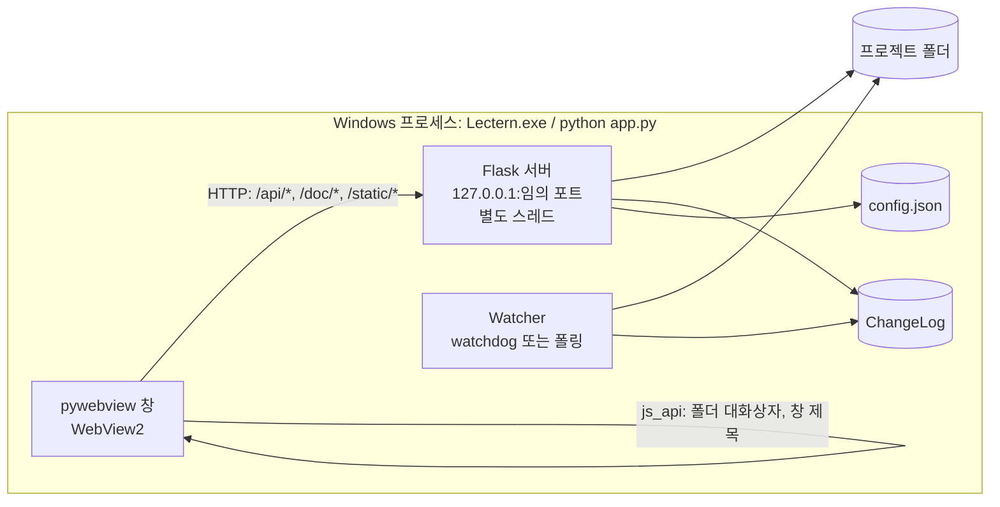
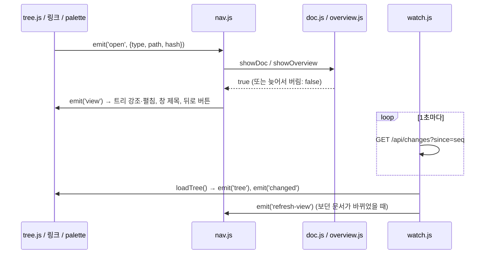

# 구조 설명

Lectern이 어떻게 돌아가는지 정리한 문서. 코드를 고치기 전에 해당 절을 읽는다.

## 1. 전체 그림



- 한 프로세스 안에 창(메인 스레드), HTTP 서버(데몬 스레드), 파일 감시(watchdog 스레드)가 함께 돈다.
- 창은 `http://127.0.0.1:<포트>/` 를 연다. 포트는 기본으로 OS가 고른다 (`--port` 로 고정 가능).
- 창에서만 가능한 기능(폴더 선택 대화상자, 창 제목)만 pywebview `js_api` 로 부르고, 나머지는 전부 HTTP API다. 그래서 `--browser` 모드에서 일반 브라우저로 같은 UI를 확인할 수 있다.

### 실행 모드

| 모드 | 명령 | 차이 |
|---|---|---|
| 창 (기본) | `python app.py [폴더]` | pywebview 창, `/api/*` 토큰 검사, 요청 로그 숨김 |
| 디버그 | `python app.py --debug [폴더]` | 창 + 개발자 도구. WebView2 기본 단축키·우클릭 메뉴도 켜짐 |
| 브라우저 | `python app.py --browser [폴더]` | 창 없이 서버만 (기본 포트 8765). 토큰 검사 없음. 폴더 선택은 경로 입력창 |

폴더 인자가 없으면 `config.json` 의 `last_folder` 를 연다. 그것도 없으면 시작 화면(폴더 열기 + 최근 폴더)이 나온다.

## 2. 백엔드 (lectern/)

### AppState (state.py)
열린 폴더(`root`, resolve된 절대경로), Watcher, ChangeLog, Config, 실행 모드, 토큰을 묶는다.
`open(folder)` 는 기존 감시를 멈추고 새 폴더 감시를 시작한 뒤 `ChangeLog` 에 구조 변경을 하나 넣고 최근 폴더를 기록한다.

### 스캔 (scanner.py)
- `scan(root, exclude, rel='')` → 트리 노드 목록. 폴더 먼저, 그다음 파일. 각각 자연 정렬(`2장 < 10장`).
  - 폴더 노드: `{type:'dir', name, path, children}`
  - 파일 노드: `{type:'file', name, path, mtime, size, title}` (`path` 는 root 기준 `/` 구분 상대경로)
- 제외 규칙: 모듈 머리 주석 참고. 제외 폴더 기본값은 `DEFAULT_EXCLUDE_DIRS`, 설정 `exclude_dirs` 로 추가(대소문자 무시).
- `resolve_inside(root, rel)` → 실제 경로 또는 `None`. `resolve()` 로 `..`·링크를 푼 뒤 root 안인지, 경로 중 숨김 요소가 없는지 확인한다. **파일을 내주는 모든 경로는 이 함수를 거친다.**
  - 제외 폴더(`node_modules` 등)는 숨김이 아니므로 링크로는 열 수 있다. 트리에만 안 나온다.

### 제목·요약 (docinfo.py)
파일 앞 16KB만 읽는다. (mtime_ns, size)가 같으면 캐시 사용.
- 제목: frontmatter `title`/`name` → 첫 H1 → 첫 제목
- 요약: frontmatter `description`/`summary` → 본문 첫 문단 (코드 블록·표·HTML·그림 줄 제외, 목록·인용 기호 제거, 160자). `작성: 2026-10-09` 같은 메타데이터 줄만 있는 문단은 다른 문단이 없을 때만 쓴다.

### 변경 감지 (changes.py)
- `Watcher` 는 watchdog `Observer` 로 root를 재귀 감시한다. watchdog가 없거나 시작에 실패하면 2초 간격 스캔 비교로 대신한다 (`backend` = `watchdog` | `polling`).
- 이벤트 필터: root 밖, 숨김(`.`), 제외 폴더 안, md가 아닌 파일은 버린다. 폴더 생성·삭제·이동은 `structure=True`, md 파일 생성·삭제·이동도 `structure=True`, 수정은 `structure=False`.
- Windows 숨김 속성은 감시 단계에서 보지 않는다 (트리 재스캔 때 걸러진다).
- `ChangeLog` 는 `(seq, path, structure)` 를 최대 5000개 보관한다. `since(seq)` 는 그 뒤의 경로 집합과 구조 변경 여부를 돌려준다. 오래된 기록이 밀려나 놓친 경우 `reset=True`.

### 링크 대상 열기 (osutil.py)
`open_path(path, line, editor)`:

| 대상 | 동작 | 반환 |
|---|---|---|
| 폴더 | 탐색기로 열기 | `folder` |
| `SAFE_DEFAULT_APP_EXT` (이미지·PDF·txt·csv·오피스·hwp 등) | `os.startfile` | `default` |
| 그 밖의 파일 (코드·스크립트·md 등) | 편집기 `<editor> -g 경로:줄` | `editor` |
| 편집기가 없거나 경로에 `&|<>^%!"` 포함 | 탐색기에서 파일 선택 (`explorer /select,`) | `reveal` |

편집기는 설정 `editor` (실행 파일 경로) → PATH의 `code` 순으로 찾는다. VS Code·Cursor처럼 `-g file:line` 을 받는 편집기를 가정한다.

### 설정 (config.py)
`%APPDATA%\Lectern\config.json` (테스트에서는 `LECTERN_CONFIG_DIR` 로 바꿈). 원자적 저장(임시 파일 → `os.replace`).

| 키 | 기본값 | 프런트에서 변경 | 설명 |
|---|---|---|---|
| `version` | `1` | 불가 | 설정 파일 형식 버전 (형식이 바뀌면 올리고 변환 코드를 둔다) |
| `recent` | `[]` | 가능 | 최근 연 폴더 (최대 10) |
| `last_folder` | `null` | 불가 | 인자 없이 실행할 때 열 폴더 |
| `theme` | `"auto"` | 가능 | `auto`·`default`·`report`·`dark` |
| `show_titles` | `true` | 가능 | 트리에 제목(끄면 파일명) |
| `sidebar_visible` / `toc_visible` | `true` | 가능 | 패널 표시 |
| `math` | `true` | 가능 | `$` 수식 렌더링 (UI 토글은 아직 없음) |
| `external_images` | `true` | 가능 | 문서 속 `http(s)` 이미지 표시. 끄면 링크로만 (UI 토글은 아직 없음) |
| `window` | `{width:1280,height:860}` | 불가 | 창 크기 (닫을 때 저장) |
| `exclude_dirs` | `[]` | 불가 | 추가 제외 폴더 이름 |
| `editor` | `null` | 불가 | 편집기 실행 파일 경로 |

'불가' 키는 `config.json` 을 직접 고쳐야 한다. 웹 페이지가 실행 파일 경로 같은 값을 바꾸지 못하게 하려는 제한이다 (`CLIENT_KEYS`).

## 3. HTTP API (server.py)

창 모드에서는 `/api/*` 요청에 `X-Token: <window.pywebview.token>` 헤더가 필요하다. 응답은 JSON, 오류는 `{error: "..."}`.
`/api/*`, `/doc/*`, `/` 응답에는 `Cache-Control: no-cache` 가 붙는다.

| 메서드·경로 | 요청 | 응답 / 설명 |
|---|---|---|
| `GET /` | | `index.html` (`{{MODE}}`, `{{VERSION}}` 치환) |
| `GET /static/<경로>` | | `web/` 정적 파일 |
| `GET /api/state` | | `{root, name, seq, mode, sep, watch, version}`. `root` 가 `null` 이면 열린 폴더 없음. `watch` 는 `watchdog`·`polling`·`none` |
| `POST /api/open` | `{path}` | 폴더 열기. 성공 시 `/api/state` 와 같은 형식, 폴더가 아니면 400 |
| `GET /api/tree` | | `{root, tree}` (스캔 결과). 폴더가 없으면 409 |
| `GET /api/overview?path=<폴더>` | | `{path, name, dirs:[{name,path,count,mtime}], files:[파일 노드+summary], recent:[파일 노드 최대 6], total}` |
| `GET /api/changes?since=<seq>` | | `{seq, paths, structure, reset, root}` |
| `GET /api/config` | | 설정 전체 |
| `POST /api/config` | 부분 객체 | `CLIENT_KEYS` 만 반영, 설정 전체 반환 |
| `POST /api/open-external` | `{path, line?}` | `{action}` — `folder`·`default`·`editor`·`reveal` |
| `POST /api/reveal` | `{path}` | 탐색기에서 선택. `{action:'reveal'}` |
| `GET /doc/<경로>` | | md는 `text/markdown; charset=utf-8` 원문, 그 밖은 파일 그대로. 숨김·밖·없음·폴더는 404 |

상태 코드: 400 잘못된 요청(필수 값 없음, JSON 객체가 아님, 폴더가 아님) · 403 토큰 불일치 또는 허용되지 않은 Host · 404 없음·숨김·프로젝트 밖 · 405 잘못된 메서드 · 409 열린 폴더 없음(`/api/tree`, `/api/overview`, `/doc/*` 등) · 500 OS가 파일 열기에 실패. `/api/*` 의 오류는 모두 `{error}` JSON이다.

## 4. 프런트엔드 (web/)

빌드 단계 없이 `<script type="module">` 로 바로 실행한다. vendor 라이브러리는 `index.html` 에서 일반 스크립트로 먼저 불러온다(전역). Mermaid(약 5MB)만 다이어그램이 있는 문서를 처음 열 때 `mermaid.js` 가 불러온다.

### 상태와 이벤트
상태는 `store.js` 의 `S` 하나에 모은다. 모듈끼리는 직접 호출 대신 `emit`/`on` 이벤트로 이어서 순환 참조를 피한다. 이벤트 목록은 `store.js` 머리 주석에 있다.



### 화면 이동 (nav.js)
- `navigate(target)` 은 현재 스크롤 위치를 기억하고 새 화면을 그린 뒤 기록에 넣는다. 뒤로/앞으로는 기억한 스크롤로 돌아간다.
- `refreshView()` 는 같은 화면을 같은 스크롤 위치로 다시 그린다. 사용자의 이동이 진행 중이면 건너뛴다 (`pending`).
- 렌더링 함수는 시작할 때 `++S.renderId` 를 받아 두고, await 뒤에 값이 바뀌었으면 결과를 버린다.

### 문서 렌더링 순서 (doc.js `showDoc`)
1. `GET /doc/<경로>` 로 원문을 받는다 (실패하면 '문서 없음' 화면).
2. `markdown.js`: frontmatter를 떼고 markdown-it으로 HTML을 만든다.
   - 플러그인: footnote, task-lists(비활성 체크박스), anchor(GitHub식 slug — 한글 유지)
   - 수식: `$…$`, `$$…$$`, `\(…\)`, `\[…\]` → KaTeX. `$` 는 pandoc 규칙(여는 `$` 뒤·닫는 `$` 앞 공백 불가, 닫는 `$` 뒤 숫자 불가, 첫 후보만 확인)이라 `$105에서 $110` 은 수식이 아니다.
   - ```` ```mermaid ```` 는 `<pre class="mermaid">` 로.
   - 코드 하이라이트는 highlight.js (언어가 지정된 블록만).
3. DOMPurify로 정화 (`SANITIZE_DOM:false`, `style`·`form` 태그 금지). frontmatter는 직접 이스케이프한 표로 앞에 붙인다.
4. 화면 밖 무대(`.lec-stage`, 본문과 같은 폭)에 넣고 후처리:
   - 이미지: 상대경로 → `/doc/<경로>?v=<시각>` (다시 그릴 때 바뀐 그림 반영), 클릭하면 확대. 외부(`http(s)://`) 이미지는 설정 `external_images` 가 켜져 있으면 `referrerpolicy=no-referrer` 로 불러오고, 오류나 15초 안에 받지 못하면 '외부 이미지를 불러오지 못했습니다' 링크로 바꾼다. 꺼져 있으면 처음부터 링크로 둔다. 그 밖의 스킴(`file:` 등)과 프로젝트 밖 경로는 표시하지 않는다.
   - 링크: `#앵커` → 문서 안 스크롤 / 다른 md → 뷰어 안에서 열기 / 폴더 → 폴더 개요 / 그 밖의 파일 → `/api/open-external` (`#L42` 는 줄 번호) / 외부 URL → 새 창(pywebview가 시스템 브라우저로 넘김) / 프로젝트 밖·막힌 스킴 → 취소선 + 안내.
   - `/` 로 시작하는 링크는 프로젝트 루트 기준으로 해석한다.
   - `> [!NOTE]` 등 → 콜아웃, 표 → 가로 스크롤 감싸기 + 숫자 열(70% 이상이 숫자) 오른쪽 정렬, 코드 블록 → 언어 표시 + 복사 버튼.
   - Mermaid 실행. 실패한 블록은 원문 + 안내로 바꾼다.
5. 무대의 내용을 `#lec-view` 로 옮기고 목차를 만든 뒤 스크롤 위치를 정한다 (유지 / 앵커 / 맨 위).
6. `S.changed` 에서 이 문서를 지우고 상태줄을 갱신, `emit('rendered')` (찾기가 열려 있으면 다시 검색).

### 사이드바 (tree.js)
- 파일 탭: 루트 행(프로젝트 개요) + 트리. 폴더 이름을 누르면 개요 화면 + 펼침, 화살표는 펼치기/접기만. 처음 열 때 첫 단계 폴더는 펼쳐 둔다.
- 필터: 입력하면 트리 대신 일치하는 문서 목록(제목+경로, 공백으로 나눈 모든 단어 포함). Enter는 첫 결과 열기, Esc는 지우기.
- 최근 변경 탭: 수정 시각 순 40개.
- 호박색 점: 열어 보기 전에 바뀐 문서(`S.changed`). 접힌 폴더는 안쪽에 바뀐 문서가 있으면 점을 단다.
- 우클릭: `@경로` 복사(Claude Code 프롬프트용), 전체 경로 복사, 편집기로 열기, 탐색기에서 보기.

### 단축키

| 키 | 동작 |
|---|---|
| Ctrl+P | 빠른 열기 (입력 전에는 최근 수정 순) |
| Ctrl+F | 문서 화면: 문서 안 찾기 / 개요 화면: 트리 필터로 이동 |
| Ctrl+O | 폴더 열기 |
| Ctrl+B | 사이드바 보이기/숨기기 |
| Alt+← / Alt+→, 마우스 뒤로/앞으로 버튼 | 뒤로 / 앞으로 |
| F5 | 트리와 현재 화면 다시 불러오기 |
| Esc | 팝업·메뉴·확대·찾기 닫기 |
| Ctrl+휠 | 확대/축소 (pywebview `zoomable`) |

### 테마 (theme.js, themes/)
- `base.css` 가 본문 규칙을 CSS 변수로 정의하고, `default.css`·`report.css`·`dark.css` 가 변수 값과 몇몇 규칙을 바꾼다. `<link id="lec-theme-css">` 의 href를 바꿔 전환한다.
- 테마마다 highlight.js 스타일(github / github-dark)과 Mermaid 테마(default / neutral / dark)를 짝지어 둔다. 전환하면 Mermaid 때문에 현재 문서를 다시 그린다.
- `auto` 는 `prefers-color-scheme` (WebView2는 Windows 앱 모드 설정을 따름)으로 기본/다크를 고른다.
- 앱 UI 색은 `app.css` 의 `--ui-*` 변수, `data-ui="dark"` 일 때 다크 값.
- 새 테마 추가: `themes/<id>.css` 작성 → `theme.js` 의 `THEMES` 에 한 줄 → `index.html` 의 `<select>` 에 option.

## 5. 보안 모델

로컬 단일 사용자 도구라는 전제에서 다음을 막는다.

| 위험 | 대책 |
|---|---|
| 다른 로컬 웹페이지가 API를 호출 | 서버는 127.0.0.1만 바인딩. 창 모드에서 `/api/*` 는 세션 토큰 필요. CORS 헤더를 주지 않으므로 다른 출처는 응답을 읽지 못함. POST는 JSON 본문만 받으므로 사전 요청 없이 보낼 수 있는 폼 요청은 400 |
| DNS 리바인딩 (외부 도메인을 127.0.0.1로 돌려 같은 출처처럼 읽기) | `Host` 헤더가 `127.0.0.1`·`localhost` 가 아니면 403 |
| 경로 조작으로 프로젝트 밖 파일 읽기 | `resolve_inside()` (resolve 후 포함 관계 검사, 숨김 요소 검사, NUL 거부) |
| 문서 속 스크립트 | DOMPurify, `style`·`form` 금지. markdown-it의 `javascript:`·`file:` 링크 차단 |
| 링크 클릭으로 코드 실행 | `osutil.open_path` 의 확장자 화이트리스트, 편집기 인자 문자 검사 |
| 웹 페이지가 실행 경로 설정을 바꿈 | `editor`·`exclude_dirs` 등은 API로 못 바꿈 (`CLIENT_KEYS`) |
| 외부로 정보 유출 | 앱은 외부 리소스를 불러오지 않음. 문서 속 외부 이미지만 예외(설정 `external_images`, 기본 켜짐): referrer를 보내지 않으므로 이미지 서버가 아는 것은 '이 PC가 그 그림을 요청했다'는 사실뿐. `srcset`·`poster`·CSS `url()` 은 지워 다른 경로의 요청을 막음 |

`/doc/*` 는 `` 태그가 헤더를 보낼 수 없어 토큰 없이 열려 있다. 127.0.0.1의 임의 포트이고 숨김·밖 경로는 막히므로 감수한다.

## 6. 배포 구조

`pyinstaller lectern.spec` (또는 `build.bat`) → onedir.

```
dist\Lectern\
  Lectern.exe
  _internal\            Python 런타임, 라이브러리
    web\                index.html, js, css, themes, vendor
```

`paths.resource_dir()` 가 `sys._MEIPASS`(= `_internal`)를 보고 `web/` 을 찾는다. 설정은 exe 옆이 아니라 `%APPDATA%\Lectern\` 에 저장된다.
WebView2 런타임은 Windows 10/11에 기본 포함되어 있다.
