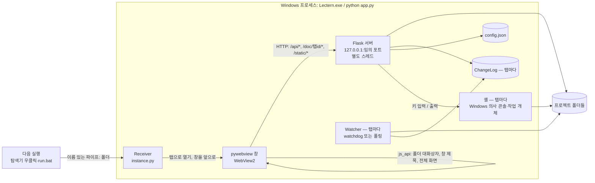
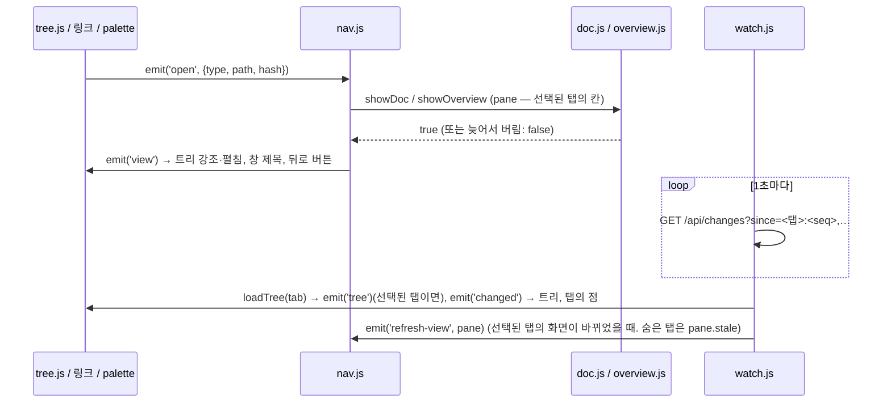

# 구조 설명

Lectern이 어떻게 돌아가는지 정리한 문서. 코드를 고치기 전에 해당 절을 읽는다.

## 1. 전체 그림



- 한 프로세스 안에 창(메인 스레드), HTTP 서버(데몬 스레드), 파일 감시(열린 프로젝트 탭마다 watchdog 스레드)가 함께 돈다. 터미널을 열면 탭마다 셸(자식 프로세스)과 그 출력을 읽는 스레드가 더해진다 (D38). 셸을 띄우기 전에 이 프로세스의 'Ctrl+C 무시' 표시를 끈다 — 자식에게 물려지기 때문이다.
- 창은 하나다. 창 모드로 또 실행하면 새 창을 띄우지 않고 이름 있는 파이프로 첫 실행에 폴더를 넘긴다 (`instance.py`, D34).
- 창은 `http://127.0.0.1:<포트>/` 를 연다. 포트는 기본으로 OS가 고른다 (`--port` 로 고정 가능).
- 창에서만 가능한 기능(폴더 선택 대화상자, 창 제목, 발표 모드의 전체 화면 `set_fullscreen` — D59)만 pywebview `js_api` 로 부르고, 나머지는 전부 HTTP API다. 그래서 `--browser` 모드에서 일반 브라우저로 같은 UI를 확인할 수 있다.

### 실행 모드

| 모드 | 명령 | 차이 |
|---|---|---|
| 창 (기본) | `python app.py [폴더]` | pywebview 창, `/api/*` 토큰 검사, 요청 로그 숨김. 프런트는 pywebview가 토큰을 넣고 `pywebviewready` 를 보낼 때까지 기다린다 (4초가 넘으면 '창과 연결하는 중' 안내). Lectern 창이 이미 떠 있으면 폴더를 그 창에 탭으로 넘기고 끝난다 |
| 디버그 | `python app.py --debug [폴더]` | 창 + 개발자 도구. WebView2 기본 단축키·우클릭 메뉴도 켜짐. 떠 있는 창에 넘기지 않고 따로 뜬다 |
| 브라우저 | `python app.py --browser [폴더]` | 창 없이 서버만 (기본 포트 8765). 토큰 검사 없음. 폴더 선택은 경로 입력창. 따로 뜬다 |

시작하면 지난 실행에 열어 둔 탭들(`tabs`·`active_tab`)을 되살린다 (없어진 폴더는 건너뜀. `tabs` 가 없는 옛 설정이면 `last_folder`). 폴더 인자가 있으면 그 폴더를 탭으로 더해 고른다 (이미 열린 폴더면 그 탭). 탭이 하나도 없으면 시작 화면(폴더 열기 + 최근 폴더)이 나온다.

## 2. 백엔드 (lectern/)

### AppState (state.py)
열린 프로젝트들(`projects` — 프로젝트 id → `Project`, 열린 순서 = 탭 순서), 선택된 탭(`active`), 탭 목록 순번(`tabs_seq`), 화면에 알릴 말(`notices`), Config, 실행 모드, 토큰을 묶는다 (D34).
- `Project` 하나가 탭 하나: 폴더(`root`, resolve된 절대경로), Watcher, ChangeLog, 스캔 캐시 (문서 트리는 `seq`, 문서 외 파일 목록은 `others_seq` 가 그대로면 다시 쓴다). id 는 실행마다 새로 만드는 무작위 8자리(`secrets.token_hex(4)`) — 주소(`/doc/<id>/…`, `?p=<id>`)에 폴더 경로가 드러나지 않고, 문서가 다른 탭의 주소를 짐작할 수 없다.
- `open(folder)` 는 이미 열린 폴더(대소문자 무시)면 그 탭을, 아니면 새 `Project` 를 만들어 감시를 시작하고 `ChangeLog` 에 구조 변경을 하나 넣는다. 연 탭이 선택되고 `tabs_seq` 가 는다 (다른 실행이 넘긴 폴더면 화면이 그 탭으로 가야 하므로 이미 열린 탭이어도). 최근 폴더와 열린 탭 목록(`tabs`·`active_tab`)을 설정에 기록한다. 탭은 `MAX_TABS`(10)개까지 (넘으면 `TooManyTabs`).
- `close_tab(id)` 는 그 감시를 멈추고, 선택된 탭이었으면 오른쪽(없으면 왼쪽) 탭을 고른다. `activate(id)` 는 선택된 탭만 바꾼다 (`tabs_seq` 는 그대로 — 화면이 고른 것이므로).
- `restore(folders, active)` 는 시작할 때 지난 탭들을 연다 (최근 폴더 순서는 바꾸지 않는다). `notify(text)` 는 화면에 한 번 보일 알림을 남긴다 — 실행 인자나 다른 실행이 넘긴 폴더를 열지 못했을 때 (창 모드에서는 콘솔이 보이지 않는다).

### 창 하나 (instance.py)
- 창 모드(`--browser`·`--debug` 가 아닐 때)는 시작하자마자 이름 있는 파이프 `\\.\pipe\Lectern-<사용자>-<설정 폴더 해시>` 에 붙어 본다. 떠 있는 창이 있으면 폴더(실행한 곳 기준 절대경로, 없으면 `null`)를 넘기고 끝난다 (`forward`). 없으면 그 파이프를 열어 두고(`listen` → `Receiver`) 창을 띄운다.
- 받는 쪽은 창이 뜬 뒤(`receiver.start`) 폴더를 탭으로 열고(`app.open_folder`), 최소화돼 있으면 되돌린 뒤 `window.show()`(Activate)로 앞으로 가져온다. 넘기는 쪽은 받는 쪽 pid 로 `AllowSetForegroundWindow` 를 불러 둔다 — Windows 는 사용자가 방금 실행한 프로그램만 창을 앞으로 가져올 수 있다. 화면은 `/api/changes` 의 `tabs_seq` 가 바뀐 것을 보고 `/api/state` 로 탭을 다시 맞춘다.
- 주고받는 것은 JSON 한 덩이씩 (`send_bytes`·`recv_bytes`, 16KB까지). pickle 을 쓰는 `send`·`recv` 는 쓰지 않는다. 파이프는 기본 보안이라 다른 사용자는 쓰지 못하고, 설정 폴더가 다른 실행(점검용 `LECTERN_CONFIG_DIR`)과도 섞이지 않는다. 디스크에는 아무것도 쓰지 않는다.

### 스캔 (scanner.py)
- `scan(root, exclude, rel='', with_info=True, html_exclude=...)` → 트리 노드 목록. 폴더 먼저, 그다음 파일. 각각 자연 정렬(`2장 < 10장`).
  - 폴더 노드: `{type:'dir', name, path, children}`
  - 파일 노드: `{type:'file', name, path, kind, mtime, size, title}` (`path` 는 root 기준 `/` 구분 상대경로, `kind` 는 `DOC_TYPES` 의 `markdown`·`html`)
  - html 은 `html_exclude`(기본 `DEFAULT_HTML_EXCLUDE_DIRS` + 설정 `html_exclude_dirs`) 이름의 폴더 안에 있으면 뺀다 (앱 소스의 `index.html` 등, D27).
- 제외 규칙: 모듈 머리 주석 참고. 제외 폴더 기본값은 `DEFAULT_EXCLUDE_DIRS`, 설정 `exclude_dirs` 로 추가(대소문자 무시).
- `scan_others(root, exclude, html_exclude)` → 문서가 아닌 파일의 트리 ('코드'·'자료' 목록, `/api/others`). 숨김·링크 규칙은 `scan()` 과 같다. 제외 폴더는 안을 훑지 않고 접힌 노드 `{type:'dir', name, path, children: None, excluded: True}` 로만 싣는다 (D49 — 파일 수에 넣지 않음). `list_dir(root, rel)` 은 제외 폴더 안의 한 단계 (`/api/others/dir`). 트리를 도는 코드(`iter_files` 등)는 `children` 이 None 일 수 있음을 본다.
- `resolve_inside(root, rel)` → 실제 경로 또는 `None`. 먼저 글자만으로(`normpath`) root 안인지 보고 — `\\서버\공유`·드라이브 경로를 `resolve()` 하면 Windows 가 그 서버에 접속하므로 (D29) — 그다음 `resolve()` 로 `..`·링크를 푼 뒤 root 안인지, 경로 중 숨김 요소가 없는지 확인한다. **파일을 내주는 모든 경로는 이 함수를 거친다.**
  - 제외 폴더(`node_modules` 등)는 숨김이 아니므로 링크로는 열 수 있다. 문서 트리에만 안 나오고, '자료' 목록에는 접힌 채 나온다 (D49).

### 제목·요약 (docinfo.py)
파일 앞 16KB(html 은 64KB)만 읽는다. (mtime_ns, size)가 같으면 캐시 사용.
- 제목: frontmatter `title`/`name` → 첫 H1 → 첫 제목
- 요약: frontmatter `description`/`summary` → 본문 첫 문단 (코드 블록·표·HTML·그림 줄 제외, 목록·인용 기호 제거, 160자). `작성: 2026-10-09` 같은 메타데이터 줄만 있는 문단은 다른 문단이 없을 때만 쓴다.
- html (`extract_html_info`, 표준 라이브러리 `html.parser`): 제목은 `<title>` → 첫 `<h1>` → 첫 제목, 요약은 `<meta name="description">` → 첫 `<p>`. 스크립트·스타일 안은 보지 않는다.

### 변경 감지 (changes.py)
- `Watcher` 는 watchdog `Observer` 로 root를 재귀 감시한다. watchdog가 없거나 시작에 실패하면 2초 간격 스캔 비교로 대신한다 (`backend` = `watchdog` | `polling`).
- 이벤트 필터: root 밖, 숨김(`.`), 제외 폴더 안은 버린다. 폴더 생성·삭제·이동은 `structure=True`, 문서(`doc_kind` — md·html) 생성·삭제·이동도 `structure=True`, 문서 수정은 `structure=False`. 문서가 아닌 파일은 생성·삭제·이동을 `others=True` 로 남기고(경로 없이) — 화면은 문서 외 파일 목록만 다시 읽고 문서 트리는 그대로 둔다 — 내용 수정은 `touch(경로)` 로 남긴다 (D50: 순번은 늘지만 `others_seq` 는 그대로라 목록은 다시 훑지 않고, `/api/changes` 의 `touched` 로 최근 변경만 다시 받는다. `Project.recent_others` 가 그 경로들의 수정 시각만 새로 읽는다). 제외 폴더 자체(그 위는 숨김도 제외도 아님)가 생기거나 지워져도 `others=True` ('자료' 목록에 접힌 채 나오므로, D49).
- Windows 숨김 속성은 감시 단계에서 보지 않는다 (트리 재스캔 때 걸러진다).
- `ChangeLog` 는 `(seq, path, structure, others)` 를 최대 5000개 보관한다. `since(seq)` 는 그 뒤의 경로 집합과 구조 변경·문서 외 파일 변경 여부를 돌려준다. 오래된 기록이 밀려나 놓친 경우 `reset=True` (structure·others 도 참). `others_seq` 는 문서 외 파일 목록이 마지막으로 바뀌었을 수 있는 순번 (structure 포함).
- 폴링 대체는 문서(수정 시각·크기)와 문서 외 파일(경로 집합)을 함께 비교한다.

### 링크 대상 열기 (osutil.py)
`open_path(path, line, editor)`:

| 대상 | 동작 | 반환 |
|---|---|---|
| 폴더 | 탐색기로 열기 | `folder` |
| `SAFE_DEFAULT_APP_EXT` (이미지·PDF·txt·csv·오피스·hwp·미디어 등) | `os.startfile` (`prefer_editor` — '편집기로 열기' — 면 편집기) | `default` |
| `REVEAL_ONLY_EXT` (실행·설치 파일, 압축, 데이터베이스, 매크로가 든 오피스 문서, 글꼴 등) | 탐색기에서 파일 선택만 — 기본 앱으로도 편집기로도 열지 않는다 | `reveal` |
| 그 밖의 파일 (코드·스크립트·md 등) | 편집기 `<editor> -g 경로:줄` | `editor` |
| 편집기가 없거나 경로에 `&|<>^%!"` 포함 | 탐색기에서 파일 선택 (`explorer /select,`) | `reveal` |

`how_to_open(name)` 은 위 규칙으로 `default`·`editor`·`reveal` 를 돌려준다. 문서 외 파일 목록이 파일마다 `open` 으로 실어 메뉴에 보인다 (편집기가 없으면 실제로는 `reveal`).

편집기는 설정 `editor` (실행 파일의 절대경로) → PATH의 `code` 순으로 찾는다. VS Code·Cursor처럼 `-g file:line` 을 받는 편집기를 가정한다.
현재 폴더에서는 찾지 않는다: `shutil.which` 앞에 `NoDefaultCurrentDirectoryInExePath=1` 을 두고, 탐색기는 `%SystemRoot%\explorer.exe` 로 띄운다. `app.py` 도 폴더 인자를 푼 뒤 앱 폴더로 `chdir` 한다. `run.bat .`·탐색기 우클릭으로 띄우면 현재 폴더가 열린 프로젝트라, 그 안의 `code.cmd`·`explorer.exe` 가 링크 한 번에 실행될 수 있었다 (D29).

### 터미널 (terminal.py, conpty.py)
오른쪽 터미널의 셸 (D38). 화면(`terminal.js`)이 열 때만 띄운다.
- `conpty.PseudoConsole(cmdline, cwd, env, cols, rows)`: Windows 의사 콘솔(ConPTY, `CreatePseudoConsole`)을 ctypes 로 — 파이프 두 개, 의사 콘솔, 작업 개체(`KILL_ON_JOB_CLOSE`). 셸은 `CREATE_SUSPENDED` 로 만들어 작업 개체에 넣고 재개한다. `STARTF_USESTDHANDLES` 와 빈 표준 핸들을 준다 (창 없는 앱의 핸들이 넘어가지 않게). `read()`(막고 기다림, 끝나면 `b''`)·`write`·`resize`·`wait`·`exit_code`·`active_processes()`(작업 개체 안 프로세스 수)·`stuck_children(min_age)`(시작하다 멈춘 프로그램 — 로더가 돌지 않았고 스레드가 모두 일시 정지, D58)·`terminate()`(작업 개체째)·`close()`. Windows 10 1809 미만이면 `AVAILABLE` 이 거짓.
- `terminal.Session`: 셸 하나. 읽는 스레드가 UTF-8 로 풀어(글자가 나뉘어 와도 이어 붙임) 버퍼에 쌓고(최근 `MAX_KEEP` 512K 글자, 앞부분을 버리면 순번 `_start` 가 는다), 지켜보는 스레드가 셸이 끝나면 종료 코드를 남기고 정리한다. `read(since, timeout)` 은 순번 `since` 다음의 출력을 `MAX_READ`(256K)까지 — 없으면 새 출력·종료·`timeout`(20초)까지 기다린다 (긴 폴링). `since` 가 버린 앞부분이면 남은 맨 앞부터 주고 `reset`. `busy()` 는 작업 개체 안에 셸 말고도 프로세스가 있는지. 멈춤을 보는 스레드가 busy 일 때만 `STUCK_CHECK`(3초)마다 `stuck_children(STUCK_AFTER — 10초)` 를 불러 `stuck` 에 두고, 바뀌면 기다리는 `read` 를 깨운다 (D58).
- `terminal.Terminals`(`AppState.terminals`): 프로젝트(탭)마다 셸 하나 — `open` 은 돌고 있는 셸이 있으면 그것을, 끝났으면 새로. 탭을 닫으면(`close_tab`) `close_project`, 앱이 끝나면(`AppState.close`) `close_all`.
- 셸: 설정 `terminal_shell` 이 실제로 있는 실행 파일의 전체 경로면 그것, 아니면 `%SystemRoot%\System32\WindowsPowerShell\v1.0\powershell.exe` (`-NoLogo`). 이름만으로 띄우지 않는다 (D29). 작업 폴더는 프로젝트 폴더, 환경 변수는 앱이 시작할 때의 값(`_START_ENV`).

### 설정 (config.py)
`%APPDATA%\Lectern\config.json` (테스트에서는 `LECTERN_CONFIG_DIR` 로 바꿈). 원자적 저장(임시 파일 → `os.replace`).
값마다 형식을 본다(`value_ok` — `DEFAULTS` 와 같은 형식, `NULLABLE` 키는 `null` 도). 형식이 틀린 값은 기본값으로 돌고 나머지는 그대로 쓰며, `load_error` 에 키와 맞는 형식을 남긴다 (화면의 `POST /api/config` 값도 형식이 틀리면 버린다, D29).
파일이 있는데 읽지 못하면(JSON 오류, 맨 바깥이 객체가 아님) `load_error` 에 이유를 남기고 기본 설정으로 돌며, 파일이 고쳐질 때까지 저장하지 않는다. 이유는 `/api/state` 의 `config_error` 로 화면에 알린다 (D21). UTF-8 BOM은 허용한다.
읽거나 바꿀 때마다 파일의 (수정 시각, 크기)를 보고, 밖에서 바뀌었으면 다시 읽는다(`_refresh`). 그래서 설정 창의 '설정 파일 열기'로 고친 값은 앱을 다시 실행하지 않아도 반영되고, 앱이 들고 있던 옛 값으로 덮어쓰지 않는다. 설정을 바꾸는 코드는 `_update(change)` 를 거친다 (다시 읽기 → 바꾸기 → 저장).

| 키 | 기본값 | 프런트에서 변경 | 설명 |
|---|---|---|---|
| `version` | `2` | 불가 | 설정 파일 형식 판 (`CONFIG_VERSION`). 올리면 `_upgrade` 에 옛 판을 바꾸는 코드를 둔다 — 2: `show_titles` 를 한 번 `false` 로 (D35). 바꾼 값은 다음에 설정을 저장할 때 파일에 쓰인다 |
| `recent` | `[]` | 불가 | 최근 연 폴더 (최대 10). 폴더를 열 때 서버가 기록 |
| `last_folder` | `null` | 불가 | 마지막으로 연 폴더. `tabs` 가 없는 옛 설정(v0.6 이하)이면 인자 없이 실행할 때 이 폴더를 연다 |
| `tabs` | `[]` | 불가 | 열어 둔 프로젝트 탭(왼쪽부터 폴더 경로). 다음 실행에 되살린다. 서버가 탭을 열고 닫고 고를 때 기록. 10개까지 |
| `active_tab` | `0` | 불가 | 선택돼 있던 탭의 순번 |
| `language` | `"auto"` | 가능 | 화면 언어: `auto`(Windows 표시 언어 — 한국어면 ko, 아니면 en)·`ko`·`en`. 설정 창 맨 위, 바꾸면 페이지를 다시 불러옴 (D46) |
| `theme` | `"auto"` | 가능 | `auto` 또는 스타일 id (`theme.js` 의 `THEMES`, 내 스타일은 `user:<파일 이름>` — D53) |
| `font_scale` | `1.0` | 가능 | 문서 글자 크기 배율 0.8~2 (툴바 − 100% +, 숫자면 정수도 됨) |
| `theme_groups` | `"use"` | 가능 | 스타일 목록을 묶는 방식: `use`(용도별)·`mood`(분위기별)·`tone`(밝기별) (설정 창, D30) |
| `show_titles` | `false` | 가능 | 트리·최근 변경에 파일 이름 대신 문서 제목 (트리의 '제목' 버튼). 기본은 파일 이름이고 마우스를 올리면 제목 |
| `sidebar_visible` / `toc_visible` | `true` | 가능 | 패널 표시 |
| `toc_hidden_parts` | `[]` | 가능 | 목차에서 감춘 구성 요소 종류 — `table`·`figure`·`box`·`diagram`·`code`·`math` (목차 머리의 종류 버튼, D39) |
| `sidebar_width` | `null` | 가능 | 사이드바 폭(px, 200~480). 경계를 끌어 바꾸고 두 번 누르면 `null`(기본 288) |
| `toc_width` | `null` | 가능 | 목차 폭(px, 160~560 — 문서 칸은 360px 이상 남김). 문서와 목차 사이 경계를 끌어 바꾸고 두 번 누르면 `null`(기본 232, D47) |
| `csv_stats` | `true` | 가능 | CSV 표 위의 통계 줄 (표 막대의 '통계' 버튼, D60) |
| `files_view` | `"kind"` | 가능 | 사이드바 파일 탭을 보는 방법 ('폴더' 버튼): `kind`(종류별 — 위에서부터 '문서' 트리·'코드'·'자료' 목록) · `folder`(폴더 구조 그대로 — 문서와 파일을 한 트리에) (D37) |
| `docs_visible` / `others_visible` / `code_visible` | `true` | 가능 | 종류별 보기의 '문서'·'자료'·'코드' 묶음을 펼쳐 둠 (머리줄을 눌러 접기, D42 — '자료'가 others, D48) |
| `search_docs` / `search_code` | `true` | 가능 | 전체 검색에서 찾을 곳 — 검색 칸 아래 '문서'·'코드' 버튼 (D44) |
| `search_others` | `true` | 가능 | 전체 검색에서 자료를 이름으로 찾음 — '자료' 버튼 (D50) |
| `recent_docs` / `recent_code` / `recent_others` | `true` | 가능 | 최근 변경 탭에 보일 것 — 위의 '문서'·'코드'·'자료' 버튼 (D50) |
| `others_height` / `code_height` | `null` | 가능 | 종류별 보기의 '자료'·'코드' 묶음 높이(px) — 펼친 첫 묶음이 아닐 때. 위 분리선을 끌어 바꾸고 두 번 누르면 `null`(파일 탭 높이의 30%·26%) |
| `terminal_width` | `null` | 가능 | 오른쪽 터미널 폭(px). 경계를 끌어 바꾸고 두 번 누르면 `null`(본문 영역의 42%) |
| `terminal_position` | `"auto"` | 가능 | 터미널 자리: `auto`(창이 세로로 길면 아래)·`side`(오른쪽)·`bottom`(문서 아래) — 설정 창·터미널 머리줄 버튼 (D52) |
| `terminal_height` | `null` | 가능 | 아래에 둔 터미널 높이(px). 경계를 끌어 바꾸고 두 번 누르면 `null`(40%) |
| `terminal_follow_style` | `true` | 가능 | 터미널 색을 문서 스타일에 맞춤. 끄면 늘 어두운 색 (설정 창) |
| `math` | `true` | 가능 | `$` 수식 렌더링 (설정 창) |
| `external_images` | `true` | 가능 | 문서 속 `http(s)` 이미지 표시. 끄면 링크로만 (설정 창. 바꾸면 페이지를 다시 불러옴 — CSP) |
| `restore_last` | `true` | 가능 | 폴더(탭)를 처음 열면 마지막에 보던 문서와 스크롤 위치로 (설정 창). 끄면 위치를 기록하지도 않는다. 탭 목록은 이 설정과 상관없이 되살린다 |
| `expand_first_level` | `true` | 가능 | 폴더를 열면 트리의 첫 단계 폴더를 펼쳐 둠 (설정 창) |
| `window` | `{width:1280,height:860}` | 불가 | 창 크기 (닫을 때 저장. 최소화·최대화한 채 닫으면 저장하지 않음. 형식이 틀리면 기본값, 720×480보다 작으면 그 크기로) |
| `exclude_dirs` | `[]` | 불가 | 추가 제외 폴더 이름 |
| `editor` | `null` | 불가 | 편집기 실행 파일 경로 |
| `terminal_shell` | `null` | 불가 | 터미널 셸 실행 파일의 전체 경로 (예: `C:\\Program Files\\PowerShell\\7\\pwsh.exe`). `null`·없는 파일·이름만이면 Windows PowerShell 5.1 (D38) |
| `html_exclude_dirs` | `[]` | 불가 | 이 이름의 폴더 안 html 은 문서로 보지 않음 (기본 목록 `src`·`public` 등에 더함, D27) |
| `projects` | `{}` | 불가 | 프로젝트(경로 소문자)별 `{doc, scroll:{문서: 위치}, docs:[문서…]}` — 마지막 문서와 문서별 스크롤 위치, 열어 둔 문서 탭들(D64 — 탭 차례, 5개까지, 없던 옛 기록은 doc 하나). 서버가 `POST /api/position` 으로 기록. 최근 20개 프로젝트, 프로젝트마다 100개 문서. 창을 나누던 때(v0.6)의 `panes`·`active` 는 읽지 않는다 (`doc` 이 그때 선택된 창의 문서라 그대로 쓴다) |

'불가' 키는 `config.json` 을 직접 고쳐야 한다. 웹 페이지가 실행 파일 경로 같은 값을 바꾸지 못하게 하려는 제한이다 (`CLIENT_KEYS`).

## 3. HTTP API (server.py)

창 모드에서는 `/api/*` 요청에 `X-Token: <window.pywebview.token>` 헤더가 필요하다. 응답은 JSON, 오류는 `{error: "..."}`.
프로젝트(탭)를 다루는 요청은 프로젝트 id 를 `p` 로 준다 (GET 은 `?p=`, POST 는 본문). 열려 있지 않은 id(닫힌 탭)는 404.
`/api/*`, `/doc/*`, `/` 응답에는 `Cache-Control: no-cache` 가 붙는다.
`/` 응답에는 스크립트(`'self' 'unsafe-eval'` — 앱 파일만, D38)·이미지·연결·글꼴·스타일(`'self' 'unsafe-inline'` — 내 스타일이 인터넷의 css 를 부르지 못하게, D53) 출처를 제한하는 CSP와 `Referrer-Policy: no-referrer` 가 붙는다 (D20).
터미널 API(`/api/term/*`)는 `X-Term: <페이지의 meta lec-term 값>` 헤더가 더 필요하다 (실행마다 새 비밀값, 브라우저 모드에서도). `Origin` 이 오면 같은 출처여야 한다. 아니면 403 (D38).
`.js`·`.mjs`·`.css`·`.svg`·`.woff2` 의 응답 형식은 서버가 정한다 (`FIXED_TYPES`). Windows의 `mimetypes` 는 레지스트리 값을 따르는데, `.js` 가 `text/plain` 으로 잡힌 PC에서는 브라우저가 모듈 스크립트를 거부해 화면이 비기 때문이다. `img-src` 는 설정 `external_images` 에 따라 바뀌므로, 설정을 바꾸면 페이지를 다시 불러와야 반영된다.

| 메서드·경로 | 요청 | 응답 / 설명 |
|---|---|---|
| `GET /` | | `index.html` (`{{MODE}}`, `{{VERSION}}`, `{{TERM}}`(터미널 비밀값), `{{LANG}}`(화면 언어 — `<html lang>`, D46) 치환) + CSP 헤더 |
| `GET /static/<경로>` | | `web/` 정적 파일 (사용설명서 `help/manual.md`·영어판 `help/manual.en.md` 포함 — 토큰 없이) |
| `GET /api/state` | | `{projects:[{id, root, name, seq, watch, position}], active, tabs_seq, max_tabs, mode, sep, version, config_error, notices:[{id, text}], samples, writing_guide}`. `projects` 는 열린 탭(왼쪽부터), `active` 는 선택된 탭 id (없으면 `null`). `position` 은 그 폴더의 `{doc, scroll}` (마지막 문서와 위치). `watch` 는 `watchdog`·`polling`·`none`. `config_error` 는 설정 파일을 읽지 못한 이유 (없으면 `null`). `notices` 는 화면이 처음 보는 id 만 한 번 보일 알림 (최근 5개). `samples` 는 예제 프로젝트 폴더(`paths.samples_dir()` — 없으면 `null`), `writing_guide` 는 화면 언어에 맞는 AI 용 작성 안내 파일 (D57) |
| `POST /api/open` | `{path}` | 폴더를 탭으로 연다 (이미 열려 있으면 그 탭). 연 탭이 선택된다. `/api/state` 와 같은 형식 + `opened`(그 탭 id). 폴더가 아니거나 탭이 10개면 400 |
| `POST /api/close` | `{p}` | 탭을 닫는다 (그 폴더의 감시를 멈춤). 이미 닫혔으면 그대로. `/api/state` 와 같은 형식 |
| `POST /api/activate` | `{p}` | 선택된 탭을 알린다 (다음 실행에 되살리고, 폴더 대화상자가 그 폴더에서 시작). `{ok:true}` |
| `GET /api/tree?p=<id>&fresh=1` | | `{root, tree}` (스캔 결과, 파일 노드의 `kind` 는 `markdown`·`html`). 변경 기록(`tree_seq` — 문서 외 파일의 내용 수정(touch)은 세지 않는다, D50)이 그대로면 마지막 스캔을 다시 쓴다. `fresh=1`(F5)은 새로 훑는다 |
| `GET /api/others?p=<id>&fresh=1` | | 문서 외 파일의 트리 `{tree, count, truncated, limit}` — 파일 노드 `{type:'file', name, path, mtime, size, open}` (`open`: `default`·`editor`·`reveal`, 두 번 누르면 열리는 방법). 문서(md·트리에 보이는 html)는 빼고, 숨김·링크 규칙은 트리와 같고, 제외 폴더는 안을 훑지 않은 접힌 노드 `{type:'dir', children: null, excluded: true}` 로만 (D49 — 파일 수에 넣지 않음). 5000개(`MAX_OTHER_FILES`)에서 멈추고 `truncated`. 파일이 생기거나 지워지지 않았으면(`others_seq`) 마지막 스캔을 다시 쓴다 |
| `GET /api/others/dir?p=<id>&path=<경로>` | | 제외 폴더 안의 한 단계 `{path, nodes, truncated, limit}` — '자료' 목록에서 펼칠 때 (D49). 숨김·링크는 빼고 종류는 나누지 않으며, 하위 폴더는 다시 `children: null`, 모든 노드에 `excluded: true`. 5000개(`MAX_DIR_ENTRIES`)에서 멈추고 `truncated`. 제외 폴더 안이 아니면 400, 숨김·밖·폴더가 아니면 404 |
| `GET /api/others/recent?p=<id>&code=1&others=1` | | 최근에 고친 코드·자료 파일 `{files, limit}` — 사이드바 '최근 변경' (D50). `code`·`others`(기본 0): 코드 파일·자료. 최근 것부터 50개(`RECENT_FILES`), 노드는 `/api/others` 의 파일 노드와 같다. `scan_others` 의 목록에 그 뒤로 내용이 바뀐 파일(`touch`)의 수정 시각·크기만 새로 읽어 덮는다 |
| `GET /api/overview?p=<id>&path=<폴더>` | | `{path, name, dirs:[{name,path,count,mtime}], files:[파일 노드+summary], recent:[파일 노드 최대 6], total}`. `path` 는 실제 경로로 맞춘 값 (`docs/../docs`·`DOCS` → `docs`) |
| `GET /api/search?p=<id>&q=<검색어>&docs=1&code=1` | | 전체 본문 검색. `docs`(기본 1)·`code`(기본 0): 찾을 곳 — 문서, 코드('코드' 목록의 파일, D44). `{query, results:[{path, title, mtime, named, kind, hits:[{line, text}], more}], total, truncated, docs, code}` (`kind`: `doc`·`code` — 문서 먼저, 묶음마다 200파일·1000곳까지. `docs`·`code`: 묶음마다 결과 파일 수. 코드는 `title` 이 `null`. `named`: 제목·경로에 검색어가 있음 — 묶음 안에서 먼저 나옴). 검색어가 200자를 넘으면 400 |
| `GET /api/changes?since=<id>:<seq>,…` | | `{tabs_seq, projects:{<id>: {seq, paths, structure, others, touched, reset}}}` — 화면이 아는 탭마다 그 순번 뒤의 변경 (한 번의 요청으로 모든 탭). 닫힌 탭은 빠진다. `tabs_seq` 가 화면이 아는 값과 다르면 탭 목록이 바뀐 것 |
| `GET /api/source?p=<id>&path=<경로>` | | 편집할 원문 (D54) `{path, text, newline, bom, hash, size}` — `text` 는 LF, `hash` 는 원문 바이트의 SHA-256. 문서·코드·UTF-8·2MB 까지 (아니면 400·413), 없음·숨김·밖은 404 |
| `POST /api/save` | `{p, path, text, hash, force?, create?}` | 고친 글을 저장 (D54 — 원칙 1 의 예외). `create: true` 면 새 Markdown 문서를 만든다 (D63·D65 — 새로 만들기·새 문서로 보내기에서 경로를 정할 때 `# 제목` 으로. `editing.new_doc_path` 가 자리를 보고 `create_source` 가 `xb` 로 씀: 이미 있는 폴더·`.md`·숨김·제외 폴더 아님, 같은 이름이면 409, LF·BOM 없음 — 답에 만든 경로 `path` 를 더함). 그 파일의 줄바꿈(섞였으면 많은 쪽)·BOM 을 되살리고, 같은 폴더의 임시 파일(`.lectern-….tmp`)에 쓴 뒤 `ReplaceFileW` 로 바꿔 끼운다 (속성·ACL 유지). 지금 파일의 내용이 원문을 줄 때(`hash`)와 다르면 409 (`force` 면 덮어씀), 읽기 전용은 403, 없는 파일은 404 (새로 만들지 않음). 저장이 끝내 안 되면 500 과 고친 내용을 남긴 임시 파일 경로. `{hash, size}` (create 면 `path` 도 — 폴더는 실제 이름) |
| `GET /api/new-doc?p=<id>&path=<경로>` | | 그 자리에 새 문서를 만들 수 있는지 (D65 — 경로를 정하면 먼저 묻고, 되면 `POST /api/save` 의 create 로 만든다). 읽기만. `{path}`(폴더는 실제 이름) 또는 `{error, status}` — 물음의 답이라 늘 200 |
| `POST /api/rename` | `{p, path, name}` | 파일 하나의 이름을 바꾼다 (D66 — `editing.rename_file`: 같은 폴더 안에서 이름만, 프로젝트 안의 보이는 파일만(숨김·제외 폴더 안·링크 아님), 새 이름은 Windows 가 받는 이름이고 점으로 시작하지 않음, 같은 이름이면 409(대소문자만 바꾸기는 됨), 다른 프로그램이 쓰고 있으면 409). `{path}`(바뀐 경로) |
| `POST /api/editing` | `{dirty: [이름…]}` | 저장하지 않은 편집이 있는 파일 (창을 닫을 때 묻는 데 — `state.unsaved`, `app.py`) |
| `GET /api/styles` | | 내 스타일 (D53) `{styles:[{id:'user:<이름>', file, name, dark, base, head, mtime, size}], dir, guide, builtin}` — `dir` 은 스타일 폴더, `guide` 는 AI 용 설명서(`web/help/styles.md`, 영어면 `styles.en.md`)의 전체 경로 |
| `GET /userstyle/<파일>` | | 내 스타일 파일 (`text/css`, 토큰 없이 — `<link>` 가 부른다). `@import`·`data:` 가 아닌 `url()`·`image-set()` 을 지운 것. 폴더 바로 안의 `.css` 만, 1MB 까지, 아니면 404 |
| `POST /api/styles/folder` | `{}` | 스타일 폴더를 탐색기로 연다 (없으면 만든다). `{path}` |
| `GET /api/config` | | 설정 전체 |
| `POST /api/position` | `{p, path, scroll, docs?}` | 그 탭에서 보는 문서와 스크롤 위치, 열어 둔 문서 탭들의 문서(`docs` — 탭 차례, 5개까지, 없어진 것·밖·숨김은 빼고 기록, D64) 기록 (`restore_last` 가 꺼져 있으면 무시). `{ok:true}`. 밖·숨김·없음 404, 폴더·잘못된 값·문서 6개 이상 400 |
| `POST /api/open-config` | | 설정 파일을 편집기로 (없으면 탐색기에서 선택). 파일이 없으면 기본값으로 만든다. `{action, path}` |
| `POST /api/config` | 부분 객체 | `CLIENT_KEYS` 만 반영, 설정 전체 반환 |
| `POST /api/open-external` | `{p, path, line?, how?}` | `{action}` — `folder`·`default`·`editor`·`reveal`. `how:'editor'` 면 기본 앱 형식도 편집기로 (`REVEAL_ONLY_EXT` 는 그래도 탐색기에서 선택만) |
| `POST /api/exists` | `{p, paths:[...], base, dirs?}` | 경로 표기 중 프로젝트 안에 있는 파일. 프로젝트 기준, 없으면 `base`(문서 폴더) 기준. `{found:{입력: 프로젝트 기준 경로}}`. 숨김·밖은 없는 것, 폴더는 `dirs: true` 일 때만 있는 것(끝에 `/` — 모아 보기의 깨진 링크, D62). 500개까지 |
| `POST /api/reveal` | `{p, path}` | 탐색기에서 선택 (`path` 가 `''` 면 프로젝트 폴더 — 탭 우클릭). `{action:'reveal'}` |
| `POST /api/term/open` | `{p, cols?, rows?}` | 탭의 셸을 그 프로젝트 폴더에서 띄운다 (이미 돌고 있으면 그 셸). `{id, shell, cwd}` — `shell` 은 머리줄에 보일 이름(`PowerShell` 등). 크기는 1~1000 (아니면 400). 띄우지 못하면 500 |
| `GET /api/term/read?t=<셸 id>&from=<순번>` | | 긴 폴링: 순번 다음의 출력 `{data, next, reset, alive, exit, stuck}`. 없으면 새 출력·종료·`stuck` 이 바뀜·20초까지 기다린다. `stuck`: 시작하다 멈춘 프로그램 `[{pid, name}]` (D58). `alive` 가 거짓이면 셸이 끝났고 남은 출력도 다 받은 것 (`exit`: 종료 코드) |
| `POST /api/term/input` | `{t, data}` | 사용자가 친 키·붙여 넣은 글을 셸로. 65536자가 넘으면 413 |
| `POST /api/term/resize` | `{t, cols, rows}` | 셸 화면 크기 |
| `GET /api/term/info?t=<셸 id>` | | `{alive, busy, stuck}` — `busy`: 셸에서 띄운 프로그램이 돎 (탭을 닫기 전에 묻는다), `stuck`: read 와 같음 |
| `POST /api/term/close` | `{t}` | 셸과 셸에서 띄운 프로그램을 끝낸다 (다시 시작). 없는 셸도 `{ok:true}` |
| `GET /doc/<id>/<경로>` | | md는 `text/markdown; charset=utf-8` 원문, html 은 `text/html; charset=utf-8` + 문서용 CSP(`html_doc_policy`: `sandbox allow-same-origin allow-modals`, 스크립트·연결·폼 금지, 그림은 `external_images`, D27), 그 밖은 파일 그대로 + `Content-Security-Policy: sandbox`. 모두 `X-Content-Type-Options: nosniff` (D20) 와 `Referrer-Policy: no-referrer` (html 문서 속 인터넷 그림이 앱 주소를 보내지 않게). 숨김·밖·없음·폴더·열려 있지 않은 id 는 404 |

상태 코드: 400 잘못된 요청(필수 값 없음, JSON 객체가 아님, 폴더가 아님, 탭이 10개) · 403 토큰 불일치 또는 허용되지 않은 Host · 404 없음·숨김·프로젝트 밖·열려 있지 않은 프로젝트 id · 405 잘못된 메서드 · 413 터미널 입력이 너무 김 · 415 `/api/*` POST 의 본문이 JSON(`Content-Type: application/json`)이 아님 · 500 OS가 파일 열기·셸 띄우기에 실패 · 501 터미널을 쓸 수 없는 Windows (1809 미만). 터미널 API 는 비밀값이 틀리면 403, 끝났거나 없는 셸은 404. `/api/*` 의 오류는 모두 `{error}` JSON이다.

## 4. 프런트엔드 (web/)

빌드 단계 없이 `<script type="module">` 로 바로 실행한다. vendor 라이브러리는 `index.html` 에서 일반 스크립트로 먼저 불러온다(전역). Mermaid(약 5MB)는 다이어그램이 있는 문서를 처음 열 때 `mermaid.js` 가, Vega·Vega-Lite·ECharts·Plotly·Viz.js(Graphviz)는 그 차트가 있는 문서를 처음 그릴 때 `charts.js` 가 불러온다 (D56). 불러오기 전에는 문서 속 id `mermaid` 요소가 `window.mermaid` 로 잡히므로, 전역이 있는지가 아니라 `run` 함수가 있는지로 확인한다.

### 상태와 이벤트
상태는 `store.js` 의 `S` 하나에 모은다. 모듈끼리는 직접 호출 대신 `emit`/`on` 이벤트로 이어서 순환 참조를 피한다. 이벤트 목록은 `store.js` 머리 주석에 있다.



### 프로젝트 탭 (tabs.js, panes.js)
- 폴더 하나가 탭 하나다 (D34). 탭 막대(`#lec-tabbar`, 높이 40px)는 툴바 아래 전체 폭. 프로젝트가 가장 큰 단위라 다른 글자보다 크고 굵다 (14.5px, 폴더 아이콘, 선택된 탭은 강조색 바탕·굵은 밑줄). 탭(폴더 이름 — 같은 이름이 둘 이상이면 상위 폴더 이름도, 마우스를 올리면 전체 경로), `+`(폴더 열기 — 새 탭, Ctrl+O), `▾`(최근 연 폴더). 선택된 탭은 밑줄, 숨은 탭에서 바뀐 문서가 있으면 호박색 점. ×·가운데 버튼·Ctrl+W 로 닫고, 우클릭은 탭 닫기·다른 탭 모두 닫기·전체 경로 복사·탐색기에서 보기. 넘치면 휠로 가로 스크롤.
- 열린 탭 목록(순서·선택된 탭)은 서버가 들고 있고(`state.py`), 화면은 `/api/state`·`/api/open`·`/api/close` 의 답으로 맞춘다 (`syncTabs`). 다른 실행이 넘긴 폴더로 서버의 탭이 바뀌면 `watch.js` 가 `tabs_seq` 로 알아채고 `resyncTabs` 로 서버가 고른 탭으로 간다. 이미 열린 폴더를 다시 열면 새 탭 대신 그 탭으로 간다.
- 탭 객체: 프로젝트 id·폴더·이름, 트리 데이터(`tree`·`files`·`fileMap`·`dirs`), 변경됨(`changed`), 펼친 폴더(`open`), 변경 순번(`seq`), 사이드바 상태(`side` — 파일·최근 변경·검색 중 어느 것인지, 거르기 글자, 스크롤 위치, 검색어와 결과), 문서 탭들의 칸(`panes` — 탭 차례, 5개까지, D64)과 고른 칸(`pane`). `store.js` 의 `S.root`·`S.name`·`S.tree`·`S.files`·`S.fileMap`·`S.dirs`·`S.changed`·`S.open`·`S.seq`·`S.watch`·`S.lastSync` 는 선택된 탭(`S.tab`)의 값을 읽고 쓰는 접근자다 — 선택된 탭만 다루는 모듈(트리·팔레트·검색·우클릭 메뉴)은 탭을 몰라도 된다. 탭이 없으면 빈 값.
- 탭을 고르면(`selectTab`) `tab` 이벤트(트리·검색이 앞 탭의 사이드바 상태를 그 탭에 남기고 새 탭 것을 되살린다), 칸 고르기(`pane`·`view` 이벤트 — 목차·상태줄·찾기·바뀐 곳·뒤로 버튼·창 제목이 그 탭 것으로), 서버에 `POST /api/activate`. 그 탭의 스크롤 상자(`tabindex=-1`)에 초점을 줘 PageUp·PageDown 이 그 문서를 스크롤한다. 장 하이라이트는 꺼진다.
- 탭은 처음 고를 때 트리를 읽고 마지막에 보던 문서와 위치(`restore_last`)나 폴더 개요를 연다 (`loadTab`) — 다음 실행에 탭이 많아도 선택된 탭만 바로 그린다. 0.4초가 넘으면 '폴더를 읽고 있습니다…'. 트리가 보인 뒤 사용자가 먼저 문서를 눌렀으면 개요로 덮지 않는다. 읽지 못하면 안내하고 F5 로 다시 연다.
- 탭을 닫으면 오른쪽(없으면 왼쪽) 탭으로, 마지막 탭이면 시작 화면(폴더 열기·최근 폴더 — 탭에 속하지 않는 칸 `homePane`). 닫기 전에 그 탭의 마지막 위치를 보낸다.
- 칸(pane, `panes.js`)은 문서 탭마다 하나 (D64 — 아래 '문서 탭'): 화면(`view` — 본문 article)·스크롤 상자(`scroller` — `.lec-scroll`)·지금 화면(`current`)·뒤로/앞으로 기록·문서별 스크롤 위치(`scrollPos`)·렌더링 순번(`renderId`)·목차 뿌리·상태줄·원문(우클릭 메뉴)·바뀐 곳이 따로다. 칸은 겹쳐 두고 선택된 탭의 칸만 보인다. 숨은 칸은 `visibility: hidden` — `display:none` 이면 스크롤 위치를 잃고, 숨은 동안 그림·html 문서의 크기를 잴 수 없다. 탭을 오가도 다시 그리지 않으므로 읽던 화면이 그대로다.
- 선택된 칸의 스크롤 상자·본문에 `#lec-content`·`#lec-view` id 를 옮겨 단다 (D33 에서 만든 방식). 선택된 칸만 다루는 코드(찾기·우클릭 메뉴·검색 결과로 가기·`util.docRoot()`)는 그 id 로 찾고, 모든 칸을 다루는 코드(렌더러·자동 새로고침·글자 크기의 읽던 곳 지키기)는 칸 객체를 쓴다. 렌더러는 프로젝트를 칸의 탭(`pane.tab`)에서 읽는다 — 주소 `/doc/<id>/…`(`util.docUrl`), 절대경로 판정, `fileMap` — 그리는 중에 다른 탭을 골라도 원래 탭에 그린다. 찾기 막대(`#lec-findbar`)도 선택된 칸으로 옮긴다. 문서 화면의 클릭·우클릭은 `#lec-panes` 에서 받는다 (id 가 옮겨 다니므로).
- 자동 새로고침(`watch.js`)은 한 번의 요청으로 모든 탭을 본다. 선택된 탭은 바로 다시 그리고, 숨은 탭은 트리와 변경됨만 갱신하고 칸에 `stale` 을 달아 그 탭을 고를 때 다시 그린다 (바뀐 곳 강조도 그때 보인다). 아직 고르지 않은 탭은 바뀐 문서만 모은다 (탭의 점). 스타일·수식 설정도 선택된 탭만 바로 다시 그리고 나머지는 고를 때 (`nav.refreshView()`).
- 접은 절(`fold.js`)과 문서별 스크롤 위치는 칸(탭)마다 기억한다 — 두 프로젝트에 같은 경로(`README.md`)가 있어도 섞이지 않는다.
- 브라우저 개발 모드에서는 Ctrl+W·Ctrl+Tab·Ctrl+숫자를 브라우저가 먼저 가져간다 (창 모드에서는 된다). 인쇄는 선택된 탭의 문서만.

### 문서 탭 (doctabs.js — D64)
- 문서 칸 위 한 줄 `#lec-doctabs`(높이 `--doctabs-h`, 프로젝트가 열리면 보이고 `#lec-panes.has-doctabs > .lec-pane` 이 그 아래부터): 문서 탭(`.doc-tab[data-i]` — 아이콘·이름(`tree.js` 의 `labelOf`)·저장하지 않은 편집 ●·×), `#lec-doctab-new`(+ — `openPalette({newTab: true})`). 가운데 버튼·×·Ctrl+F4 로 닫기(하나뿐이면 닫지 않는다), 우클릭은 닫기·다른 탭 모두 닫기·`pathMenuItems`, Alt+1~5 로 고르기 (`main.js` — 편집 상자 안에서도).
- 여는 곳: `openTarget(target)` — 'open' 이벤트를 받는다 (`nav.js` 는 받지 않는다). 그 문서·코드가 다른 문서 탭에 있으면(`docPaneOf`) 그 탭으로(hash·line 이 있으면 그 탭에서 그리로), `target.newTab` 이면 `openInNewTab`, 아니면 `navigate`. 검색·모아 보기·담기처럼 연 뒤 할 일이 있는 곳은 `openTarget` 을 직접 부른다. `newTab` 은 각 목록의 누르기에서 `util.newTabWanted(e)`(Ctrl·⌘), 가운데 버튼은 `util.middleClickOpens(box, selector)` 가 Ctrl+누르기로 바꿔 보낸다 (트리·'코드'·'자료'·파일 행·검색 결과·모아 보기·빠른 열기·본문의 링크·경로 표기·폴더 개요). 우클릭 '새 탭에서 열기'는 `tree.js` 의 `docMenuItems`(문서 행)·`others.js` 의 `fileMenuItems`(코드·자료 '새 탭에서 보기').
- `openInNewTab`: 칸을 만들어 지금 탭 오른쪽에 넣거나(5개 미만), 고른 탭 말고 가장 오래 안 본(`pane.used`) 저장하지 않은 편집이 없는 칸을 바꾼다 (그 칸의 편집 상자는 닫는다). 그리는 동안 이름은 `pane.coming`. 그린 뒤 고른다 — 그사이 사용자가 다른 탭을 골랐으면 고르지 않는다.
- `selectDocTab(pane)`: `tab.pane` 을 바꾸고 `panes.selectPane`(선택된 프로젝트 탭이면), 초점은 편집 상자가 있으면 편집기, 아니면 스크롤 상자. 되살린 탭(`pane.deferred`)은 그때 그리고, 숨은 동안 바뀐 칸(`stale`)은 다시 그린다.
- 다음 실행: `position.js` 가 `openDocs(tab)`(md·html 문서 탭, 되살리고 아직 그리지 않은 것도)를 `POST /api/position` 의 `docs` 로 보낸다. `tabs.js` 의 `loadTab` 이 마지막 문서를 `tab.pane` 에 그린 뒤 `restoreDocTabs(tab, position)` — 나머지는 `deferred` 와 `nav.seedScroll`(문서별 스크롤)만 두고 고를 때 그린다.
- 자동 새로고침(`watch.js`)·F5(`main.js`)는 프로젝트 탭의 칸마다 — 보이는 칸은 바로, 숨은 칸은 `stale`. 프로젝트 탭을 닫으면(`tabs.js`) 칸 모두와 편집 상자를 치우고, 닫기 전에 모든 칸의 저장하지 않은 편집을 묻는다 (`editor.confirmCloseEditor`).

### 화면 이동 (nav.js)
- 화면 종류는 `doc`(md·html 문서)·`overview`(폴더 개요)·`code`(코드 읽기 화면, D43). `navigate({type, path, hash?, line?})` — `line` 은 코드 화면의 그 줄로.
- `navigate(target, {pane})` 은 그 칸(기본은 선택된 탭의 칸)의 현재 스크롤 위치를 기억하고 새 화면을 그린 뒤 그 칸의 기록에 넣는다. 뒤로/앞으로는 선택된 탭의 기록으로, 기억한 스크롤로 돌아간다. `restorePosition(pane, pos)` 은 탭을 처음 열 때 마지막 문서·위치로 연다 (문서별 위치도 넣어 둔다).
- `refreshView(pane)` 은 그 칸(없으면 선택된 탭의 칸 — 숨은 탭은 `stale` 로 두었다가 고를 때)을 같은 화면, 같은 스크롤 위치로 다시 그린다. 위치는 렌더러에 함수로 넘겨 바꿔 끼우기 직전에 읽는다 (그리는 동안 사용자가 스크롤하면 그 위치). 사용자의 이동이 진행 중이면 미뤘다가 이동이 끝나면 한 번 한다 (`pending`·`missedRefresh` — 그사이 바뀐 문서를 놓치지 않게).
- 뒤로/앞으로를 빠르게 여러 번 누르면 아직 그리는 중인 기록 위치(`wanted`)에서 이어 간다. 그리다 오류가 나면 알림(toast)을 띄우고 화면은 그대로 둔다. `pending`·`missedRefresh`·`wanted` 는 칸마다다.
- 렌더링 함수(`showDoc`·`showHtml`·`showOverview`·`showCode`)는 칸을 첫 인자로 받고, 시작할 때 `++pane.renderId` 를 받아 두고, await 뒤에 값이 바뀌었으면 결과를 버린다 (탭을 닫아도 순번을 올려 버리게 한다). 목차·상태줄·원문·바뀐 곳은 `setToc(pane, …)`·`setStatus(…, pane)`·`setDocSource(pane, …)`·`markChanges(…, pane)` 로 그 칸에 남기고, 선택된 칸이면 바로 보인다.

### 문서 렌더링 순서 (doc.js `showDoc`)
1. `GET /doc/<탭 id>/<경로>` 로 원문을 받는다 (실패하면 '문서 없음' 화면).
2. `markdown.js`: frontmatter를 떼고 markdown-it으로 HTML을 만든다.
   - 블록마다 원문 줄 범위를 `data-lines="시작-끝"`(1부터, 끝 줄 포함, 떼어 낸 frontmatter 줄 수 보정)으로 단다 (`sourceLines`). 본문 우클릭 메뉴가 쓴다.
   - 플러그인: footnote, task-lists(비활성 체크박스), anchor(GitHub식 slug — 한글 유지)
   - 수식: `$…$`, `$$…$$`, `\(…\)`, `\[…\]` → KaTeX. `$` 는 pandoc 규칙(여는 `$` 뒤·닫는 `$` 앞 공백 불가, 닫는 `$` 뒤 숫자 불가, 첫 후보만 확인)이라 `$105에서 $110` 은 수식이 아니다. `\[…\]` 는 줄을 통째로 차지할 때만 수식이라 문장 속 `\[판독 불확실\]`(대괄호를 글자로 쓰는 마크다운 표기)은 글자로 남는다. `\(…\)`·`\[…\]` 안에 한글·한자가 있는데 TeX 명령이 없으면 수식이 아니다 (D12).
   - ```` ```math ````·```` ```latex ````·```` ```tex ```` 코드 블록도 수식으로 (빈 줄로 나뉜 식은 따로). KaTeX 가 못 읽는 블록(LaTeX 문서 원문 등)은 코드 그대로 (D32).
   - ```` ```mermaid ```` 는 `<pre class="mermaid">` 로, ```` ```vega-lite ````·```` ```vega ````·```` ```echarts ````·```` ```plotly ````·```` ```dot ````(```` ```graphviz ````)는 `<pre class="lec-chart" data-chart="종류">` 로 (`CHART_LANGS`).
   - 코드 하이라이트는 highlight.js (언어가 지정된 블록만).
   - 발표 문서(맨 앞 설정에 `marp: true` — D59)면 `slides.js` 의 `slideRule`(core 규칙, `env.deck` 이 있을 때만)이 맨 위 수준의 줄(`hr`)마다 토큰을 `.lec-slide-wrap[data-lines] > .lec-slide-frame > section.lec-slide` 로 감싸고, HTML 주석 블록을 Marp 지시어(그 장부터·`_` 는 그 장만)나 발표자 노트(`.lec-slide-notes`)로 바꾼다. 머리 정보 표는 그리지 않는다.
3. DOMPurify로 정화 (`SANITIZE_DOM:false`, `style`·`form` 태그 금지). 정화 훅이 `src` 를 `data-src` 로 옮겨 두고, 그림을 부르는 다른 길(`srcset`·`poster`·표의 `background`·SVG `image`·`feImage` 의 href·style 과 SVG 속성의 `url()`·`image-set()`)은 지운다. `document` 의 이름을 가리는 `img` 의 `name` 도 지우고 (D15), SVG 링크의 `xlink:href` 는 `href` 로 옮긴다. frontmatter는 직접 이스케이프한 표로 앞에 붙인다.
4. 화면 밖 무대(`.lec-stage`, 본문과 같은 폭)에 넣고 후처리:
   - 이미지: 상대경로 → `/doc/<탭 id>/<경로>?v=<시각>` (다시 그릴 때 바뀐 그림 반영), 클릭하면 확대. 외부(`http(s)://`) 이미지는 설정 `external_images` 가 켜져 있으면 `referrerpolicy=no-referrer` 로 불러오고, 오류나 15초 안에 받지 못하면 '외부 이미지를 불러오지 못했습니다' 링크로 바꾼다. 꺼져 있으면 처음부터 링크로 둔다. 프로젝트 안을 가리키는 절대경로·`file:` 는 상대경로로 바꿔 보여 주고(`absoluteRef`, 아래), 그 밖의 스킴과 프로젝트 밖 경로는 표시하지 않는다.
   - 링크(`a[href]`, 이미지 맵의 `area[href]`, SVG 속 `<a>` 포함): `#앵커` → 문서 안 스크롤 / 다른 md, 트리에 있는 html → 뷰어 안에서 열기 / 폴더 → 폴더 개요 / 그 밖의 파일 → `/api/open-external` (`#L42` 는 줄 번호) / 외부 URL → 새 창(pywebview가 시스템 브라우저로 넘김) / 프로젝트 밖·막힌 스킴 → 취소선 + 안내.
   - `/` 로 시작하는 링크는 프로젝트 루트 기준으로 해석한다. 상대경로가 `/doc/<그 탭 id>/` 밖으로 나가면(`../<다른 id>/…` — 다른 탭 프로젝트 포함) 밖으로 본다 (`resolveRef`).
   - 절대경로(`C:\proj\a.md`, `C:/proj/a.md`, `\\server\share\a.md`, `file:///C:/proj/a.md`)는 문서가 든 탭의 프로젝트 안이면 상대경로로 바꾸고(대소문자 무시) 밖이면 막는다 (`absoluteRef`). markdown-it 은 `file:` 링크를 기본으로 글자로 남기고 `\` 를 `%5C` 로 바꾸며, DOMPurify 는 기본 허용 URL 에 없는 `c:`·`file:` 를 지우므로 `validateLink` 와 `ALLOWED_URI_REGEXP` 를 넓혔다.
   - `> [!NOTE]` 등 → 콜아웃, 표 → 가로 스크롤 감싸기 + 숫자 열(70% 이상이 숫자) 오른쪽 정렬, 코드 블록 → 언어 표시 + 복사 버튼.
   - 발표 문서: `prepareDeck` — `![bg …]` 그림을 배경 자리(`.lec-slide-bg`)로, `![w:300]` 크기, `style:` CSS 를 `[data-deck]` 범위의 중첩 규칙으로(인터넷 길을 지우고), 틀마다 ▶. 무대는 `--slide-scale: 1` (Mermaid 가 글자를 제대로 재게).
   - Mermaid 실행. 실패한 블록은 원문 + 안내로 바꾼다 (`.diagram-error`).
   - 차트 (`charts.js` 의 `renderCharts`, D56): 종류마다 라이브러리를 불러와 움직이지 않는 SVG 글자를 만들고(Vega-Lite → Vega `toSVG`, ECharts 서버 그리기 모드 `renderToSVGString`, Plotly `toImage({format: 'svg'})`, Viz.js `renderString`), `sanitizeHtml` 로 거른 뒤 그림 속 링크를 풀어 넣는다. 색은 `mermaidTheme()` 의 색표, Graphviz 는 그린 뒤 기본 검정·흰 바탕을 그 색으로. 설정은 `parseSpec`(JSON, 아니면 따옴표 없는 키·작은따옴표·주석·끝 쉼표·`option =` — 함수는 오류). Vega 의 `data.url` 은 `resolveRef` 로 이 탭의 `/doc/<id>/…` 만 (못 읽으면 Vega 는 빈 그림을 그리므로 기록한 오류로 원문 + 까닭). ECharts·Plotly 는 그리기 전에 설정의 그림 주소(data: 아닌 것)를 지우고, Plotly 의 지도 종류는 그리지 않는다. ECharts·Plotly 와 `width: "container"` 인 Vega 는 문서 폭으로 그리고, 폭이 바뀌면(목차가 나옴·사이드바·창 크기) ResizeObserver 로 다시 그린다. 실패하면 원문 + 까닭.
   - 발표 문서: `fitDeck` — 슬라이드의 Mermaid 를 `SLIDE_ZOOM`(1.7)배까지 키우고(차트는 `charts.js` 가 폭 ÷ 1.7 로 그려 키운다), 넘치는 슬라이드는 그림·다이어그램·차트를 남은 높이에 맞춰 줄인다(`.lec-fit`). 그래도 넘치면 `.lec-over`(틀에 '넘침'). 그림을 늦게 불러오면 그 슬라이드를 다시 맞춘다.
   - 본문 속 경로 표기(`src/app.py:42`, `../code/x.py`, `docs/a.md`)를 모아 `POST /api/exists` 로 한 번에 묻고, 있는 파일이면 `a.path-link` 로 감싼다 (`pathlink.js`). 코드 블록·링크·수식·다이어그램·메타데이터 안은 보지 않고, 문장 속 `코드` 는 내용 전체가 경로일 때만. 누르면 md·html 문서는 뷰어에서, 그 밖은 편집기의 그 줄로.
5. 무대의 내용을 그 칸의 화면(선택된 탭이면 `#lec-view`)으로 옮기고, 이 문서에서 접어 두었던 절을 다시 접고(`setupFolds`), 목차를 만든 뒤 스크롤 위치를 정한다 (유지 / 앵커 / 맨 위).
6. 탭의 `changed` 에서 이 문서를 지우고 상태줄을 갱신, `emit('rendered')` (찾기가 열려 있으면 다시 검색).

### html 문서 (htmldoc.js)
- `nav.js` 가 확장자로 렌더러를 고른다 (`.html`·`.htm` → `showHtml`). `HEAD /doc/<탭 id>/<경로>` 로 있는지 보고, `<iframe sandbox="allow-same-origin allow-modals">` 에 문서를 띄운다 (D27. `allow-modals` 는 앱이 그 문서를 인쇄하려고 — 문서 스크립트는 돌지 않으니 문서가 쓸 수는 없다).
- 불러온 뒤: `css/frame.css`(찾기 표시·바뀐 곳·우클릭 테두리)를 넣고, 문서가 불러온 스타일이 없으면 `base.css`·지금 스타일 css 를 넣고 `body` 에 `md-body` 를 단다. 스타일이 있는데 쪽 바탕(html·body)을 칠하지 않으면, 바탕을 칠한 상자 밖의 글자 밝기를 글자 수로 따져 어두운/밝은 바탕과 색 모드를 문서 뿌리에 넣는다 (`backdropFor`·`paintBackdrop` — iframe 의 다크 선호는 Windows 설정을 따르고, 색 모드가 앱과 다르면 Chromium 이 흰 바탕을 칠하기 때문, D27). 스타일 없는 문서는 바탕·색 모드를 앱 스타일로. 목차용으로 id 없는 h1~h4 에 `lec-hN` 을 붙이고, 링크는 md 와 같은 `bindLink` 로 묶는다 (인터넷 링크는 앱이 `window.open` — sandbox 는 새 창을 못 연다).
- iframe 안의 이벤트는 앱 문서로 올라오지 않으므로 keydown(단축키)·mouseup(마우스 뒤로/앞으로)·mousedown(메뉴 닫기)을 앱으로 넘기고, contextmenu 는 `docmenu.frameContextMenu` 로 보낸다.
- 높이를 문서에 맞춘다 (ResizeObserver, `<details>` 의 toggle). `scrollHeight` 는 iframe 자신의 높이보다 작아지지 않아 줄어들 때를 놓치므로, html 상자의 높이와 body 자식들의 아래 끝을 잰다 (`contentHeight`). SVG 의 옛 링크(`xlink:href`)는 `href` 로 옮겨 `bindLink` 가 다룬다 — 아니면 누를 때 iframe 이 떠난다. 불러오다 실패하면(시간 초과, HEAD 뒤에 지워져 404) 안내 화면으로 바꾸고 앞 문서의 목차·원문·바뀐 곳을 지운다. 같은 문서를 다시 그리는지는 화면의 iframe 이 그 문서를 다 불러왔는지(`data-ready`)로 본다. 자동 새로고침 때는 새 iframe 을 옛 것 위에 보이지 않게 겹쳐 불러온 뒤 옛 것을 지운다 (iframe 은 DOM 에서 옮기면 다시 불러온다).
- 다른 모듈은 `util.docRoot()`(md: `#lec-view`, html: iframe body)와 `util.screenRect()`(iframe 위치를 더한 화면 좌표)로 두 형식을 같이 다룬다 — 찾기·목차·바뀐 부분 강조. 바뀐 부분 강조는 html 에서 최상위 자식 대신 `p, li, h1~h6, tr, pre, blockquote, figure, dt, dd, img` 를 비교한다.

### 전체 검색 (search.js, lectern/search.py)
- 사이드바 '검색' 탭(Ctrl+Shift+F). 입력을 250ms 기다렸다가 `GET /api/search?q=` 를 부르고, 늦게 온 결과는 버린다 (Enter 는 기다리지 않고 바로 — 기다리던 검색은 취소). 선택된 탭의 프로젝트에서 찾는다. 문서 목록이 바뀌면(자동 새로고침) 다시 찾고, 검색어와 결과는 탭마다 남겨 두었다가 그 탭을 고르면 되살린다 (다른 탭에서 찾는 중이던 결과는 버린다).
- 검색 칸 아래 '문서'·'코드'·'자료' 버튼으로 찾을 곳을 고른다 (설정 `search_docs`·`search_code`·`search_others`, 모두 끄면 찾지 않고 고르라고 알림, D44·D50).
- 맨 위 '이름이 맞는 파일'(D50): 켠 종류에서 이름(문서는 제목도)에 검색어가 든 파일 — 화면이 트리(`tab.files`)와 '코드'·'자료' 목록(`others.js` 의 `loadOthers`·`otherFiles`, 제외 폴더 안은 빼고)에서 찾는다. 이름이 검색어로 시작하는 것 먼저, 그다음 최근에 고친 순, 100개까지. 행(`.sr-name[data-file]`)은 `bindFileRows`. 그 아래 본문 결과에는 이름이 있을 때 '문서 본문' 머리가 붙는다. 자료는 본문을 찾지 않으므로 '자료'만 켜면 서버에 묻지 않는다.
- 서버는 트리와 같은 `scan()` 결과의 문서와, '코드' 목록과 같은 `scan_others()` 결과 중 `is_code` 인 파일을 읽는다 (숨김·제외는 찾지 않음). 대소문자 무시, 글자 그대로 (html 문서는 보이는 글자만, 코드는 파일 그대로). 줄 번호는 markdown-it 과 같게 센다 (`\r\n`·`\r`·`\n` 만 줄바꿈). 문서 먼저, 그다음 코드 — 묶음 안에서는 제목·경로에 검색어가 든 파일을 먼저, 그다음 최근에 고친 순. 파일당 20줄, 묶음마다 1000줄·200파일까지. 2MB 가 넘는 코드는 건너뛴다. 읽은 글은 탭마다 `TextCache` 에 두고 수정 시각·크기가 그대로면 다시 쓴다.
- 결과 줄을 누르면 문서를 열고, 그 줄이 든 가장 작은 `data-lines` 블록(표의 행까지)으로 가서 깜박이고, 문서 안 찾기(`findText`)로 검색어를 표시한다. 찾기 막대의 '지금 결과'도 그 블록 안의 것으로 둔다 (`pickMatchAt`). 코드 결과(`data-kind="code"`)는 코드 화면의 그 줄로 가서(`navigate({type:'code', line})`) 같은 방법으로 검색어를 표시한다.

### 바뀐 부분 강조 (diffmark.js)
- 같은 문서를 다시 그릴 때(자동 새로고침) 바꿔 끼우기 직전의 최상위 블록마다 서명(태그 + 공백을 줄인 글자 + 그림 주소, Mermaid·차트는 원문)을 세어 두고, 새 화면에서 서명이 이전에 없던 블록에 `lec-changed`(약 4초 배경색·테두리)를 준다. 같은 서명이 여럿이면 개수로 맞춘다.
- 처음 열 때, '문서 없음' 화면에서 돌아올 때, 내용이 같은 다시 그리기(스타일 변경, F5)는 강조하지 않는다. 지워진 블록은 알리지 않는다.
- 불러오지 못한 인터넷 그림은 이번 실행 동안 기억해(`doc.js` 의 `failedImages`, F5 로 잊음) 다시 그릴 때 바로 링크로 둔다 — 아니면 매번 15초를 기다리고, 그 사이 `` 와 옛 링크가 달라 '바뀐 곳'으로 잡힌다.
- 많이 바뀌어도 멈추지 않게: 깜박임은 한꺼번에 시작하고(화면 배치 한 번), html 의 '바뀐 항목 안의 블록 빼기'는 조상을 따라 올라가며 본다.
- 바뀐 블록이 하나라도 화면 밖(접힌 절 안 포함)이면 상태줄에 '바뀐 곳 N곳 ↓' 버튼. 누를 때마다 다음 블록으로 가서(접힌 절은 `unfoldTo`) 다시 깜박인다. 다른 화면으로 가면 사라진다.

### 목차 (toc.js)
- 렌더러가 `setToc(pane, root)` 로 칸마다 목차의 근원(문서 화면, html 문서는 iframe 의 문서)을 남기고, 선택된 칸의 것을 그린다. 제목은 h1~h4 (H1 이 하나면 문서 제목이라 뺀다), 지금 읽는 위치(`spy`)는 제목만 따른다.
- 제목 아래에 그 절의 구성 요소를 문서 순서로 (D39): 표·그림·차트(Vega-Lite·ECharts·Plotly — D62)·박스글·다이어그램(Mermaid·Graphviz)·코드·수식 (`partKind`). 할 일·링크·출처(`moreKind`)는 `readParts(root, {more: true})` 일 때만 — 모아 보기에서만 (D62). 링크는 제목 `a[data-i]`, 구성 요소 `a[data-c]`. 구성 요소는 아이콘 + 종류·번호(표 1 …, 박스글은 콜아웃 종류) + 짧은 설명 (`describe` — 캡션이 있으면 번호를 뗀 캡션이 먼저, D61). 캡션은 `captionOf(kind, el)`: `<caption>`·`<figcaption>`, 또는 요소 바로 앞·뒤의 짧은 단락이 번호 붙은 캡션(`CAPTION` — `표 1.`·`<표 2>`·`[그림 1]`·`〈표 Ⅱ-15〉`·`표 3-1`·`Table 2:`·`Fig. 3`)이거나 통째로 굵게·기울여 쓴 줄. 표·다이어그램은 위, 그림은 아래가 먼저, 코드는 번호 붙은 것만. 머리 낱말의 종류(`wordKind`)가 다르면 가져가지 않고, 두 요소 사이의 단락은 그림 뒤면 그 그림의 것·표·다이어그램·코드 앞이면 그것의 것(`holderKind`). 누르면 `unfoldTo` 후 그 자리로 가서 `lec-target`(base.css·frame.css)으로 잠깐 테두리.
- 머리의 종류 버튼(`.toc-parts`)은 그 문서에 있는 종류만 개수와 함께. 누르면 설정 `toc_hidden_parts` 에 넣고 빼며 목차를 다시 그린다.
- 목차는 제목이 둘 이상이거나 구성 요소가 하나라도 있으면 보인다 (`toc-off`). 터미널을 연 동안은 감춘다 (터미널 절).

### 툴바
- 오른쪽 묶음: 글자 크기 `− 100% +`, `스타일` 이름표 + 목록 + ∧∨, `하이라이트` 버튼 + ∧∨, 설정(톱니), `?`(단축키 표 — 그 안에 사용설명서, D45), `터미널 모음` 버튼(돌고 있는 셸 수). 무엇을 고르는지 보이게 이름표를 붙였다 (사용자 요청).
- 탭 막대 오른쪽 끝: `목차`·`터미널` 버튼(`.tabbar-btn`) — 오른쪽 패널을 보이고 감춘다 (v0.13.2, 사용자 요청). 보이면 `aria-pressed` 로 강조색과 밑줄. 860px 이하에서는 아이콘만.
- 왼쪽 묶음은 사이드바·뒤로·앞으로. 폴더 이름·폴더 열기·최근 폴더는 탭 막대에 있다 (v0.7.0).
- 좁은 창에서는 한 줄에 들어가게 차례로 줄인다: 1240px 이하 문서 열기 칸을 좁히고 단축키 표시를 빼고, 1060px 이하 문서 열기 글자(아이콘만), 860px 이하 '스타일'·'하이라이트' 이름표와 글자 크기 숫자 (마우스를 올리면 설명). 720px(창 최소 폭)까지 겹치지 않는다.

### 폭 조절 (resize.js)
- 사이드바(`#lec-resizer` → `--side-w`, 설정 `sidebar_width`)와 목차(`#lec-toc-resizer` → `--toc-w`, 설정 `toc_width`, D47)의 경계. 끄는 동안 `html` 에 `resizing`·`resizing-side|toc` 를 달아 iframe 이 포인터를 가져가지 않게 하고 그 경계를 강조한다. 놓으면 저장, 두 번 누르면 `null`(기본 폭). 목차는 오른쪽 끝에서 잰다. 오른쪽 터미널의 폭은 `terminal.js`.

### 글자 크기 (textsize.js)
- 툴바의 − 100% + 로 문서 글자 배율을 0.8·0.9·1·1.1·1.2·1.35·1.5·1.7·2 단계로 바꾼다. 가운데를 누르면 1. 설정 `font_scale` 에 저장한다.
- `:root` 의 CSS 변수 `--md-scale` 을 툴바 배율 × 1.1(`BASE` — 툴바의 100% 가 예전 110%, D47)로 바꾸고, `base.css` 가 본문 글자 크기와 단 폭(`--md-width`)에 함께 곱한다 (줄 길이가 그대로). 코드·메타데이터처럼 px 로 정한 글자도 곱한다. 앱 UI·그림·다이어그램은 그대로.
- 바꿀 때 화면 위쪽 블록의 위치를 맞춰 읽던 곳이 움직이지 않게 한다. html 문서는 `text-size` 이벤트로 스타일 없는 문서는 iframe 안의 `--md-scale`(`mdScale()` — 기준을 곱한 값), 스타일 있는 문서는 iframe 문서의 `zoom`(툴바 배율 그대로) (틀 높이는 fitHeight 가 따라간다).

### 장 하이라이트 (spotlight.js)
- 툴바 버튼으로 켜면 한 장(맨 위 수준 절 — H1 이 하나뿐이면 그것은 문서 제목이고 그 아래 수준, 보통 H2 절)만 그대로 두고 나머지 최상위 블록을 `opacity .16` 으로 흐린다 (`base.css` 의 `.lec-spotlight`/`.lec-lit`, 0.2초 전환). 첫 장 앞의 제목·머리말도 한 장(메타데이터 표가 있으면 함께), 각주는 어느 장에도 들지 않는다. 인쇄할 때는 모두 보인다.
- 장의 범위는 그 장 제목을 눌러 접을 때 숨는 범위(+ 제목)와 같다 — 다음 같은 수준 이상의 제목 앞까지, 각주 제외 (`fold.js` 와 같은 규칙, H1 하나는 제목이라 접지 않는 것도 같다). `ui_smoke.py` 가 장마다 비교한다. 접기는 아무 수준 제목에서나 되지만 장은 맨 위 수준 하나다.
- 켤 때는 화면 위쪽의 장부터. ↑·↓·PageUp·PageDown(`main.js` 가 `moveSpotlight`)과 버튼 옆 ∧·∨(`#lec-spot-prev`·`#lec-spot-next` — 하이라이트 중에만, 첫·마지막 장에서는 그쪽이 꺼짐)로 앞뒤 장으로 가며 그 장의 처음을 화면 위에 둔다. 흐린 장을 누르면(그 누름은 링크·접기로 쓰지 않음) 그 장, 목차·찾기·앵커·전체 검색·바뀐 곳으로 가면 `fold.unfoldTo` 의 `reveal` 로 그 장. Esc 는 다른 것(팝업·찾기 등)을 먼저 닫고 마지막에 장 하이라이트를 끈다. 본문 우클릭 메뉴 끝에 '이 장 하이라이트'(꺼져 있거나 다른 장을 눌렀을 때)와 '하이라이트 해제'(켜져 있을 때)가 붙는다 (`spotlightItems`, 여백을 누르면 화면 위쪽의 장).
- 자동 새로고침·스타일 변경으로 다시 그려도 같은 장(제목 id)을 강조하고, 다른 문서로 가면 켠 채로 화면 위쪽의 장부터. 'rendered' 때는 `S.view` 가 아직 앞 화면이라 `doc.js` 가 `#lec-view` 에 단 `data-doc-path` 로 문서를 안다. 선택된 탭의 문서에 하고, 다른 탭을 고르면 꺼진다.
- md 문서만 (html 문서는 구조가 문서마다 달라 장을 나눌 수 없어 버튼이 꺼진다). 장이 둘 이상 나오지 않는 문서도 꺼진다.

### 제목 접기 (fold.js)
- 문서의 최상위 제목(칸 화면의 자식 h1~h6)을 누르면 그 절 — 다음 같은 수준 이상의 제목 전까지 — 을 접고, 다시 누르면 편다. 각주(`.footnotes-sep`, `.footnotes`)는 마지막 절에 속하지 않는다.
- DOM은 markdown-it 이 만든 평평한 구조 그대로 두고 클래스만 붙인다: 접을 수 있는 제목 `lec-fold`, 접힌 제목 `lec-folded`, 숨는 블록 `lec-fold-hidden`(`display:none`). 펴면 따로 접어 둔 하위 절은 접힌 채 남는다.
- 접지 않는 제목: 내용이 없는 제목, 문서에 H1이 하나뿐일 때의 H1(문서 제목 — 목차와 같은 규칙).
- 제목 속 링크를 누르거나 Shift+클릭 등으로 글자를 고르면 접지 않는다. 두 번 눌러 낱말을 고르면 첫 번째 누름의 접기를 되돌린다.
- 목차·앵커 링크·찾기(Ctrl+F)가 접힌 절 안으로 가면 `unfoldTo()` 로 감싼 절을 편다. 목차의 현재 위치 표시는 숨은 제목을 건너뛴다.
- 접은 상태는 칸(탭)마다 문서 경로별로 이번 실행 동안만 메모리에 둔다 (자동 새로고침·뒤로 가기·다른 문서·다른 탭에 다녀와도 유지, 탭을 닫으면 잊음). 제목 id로 기억하므로 제목 글자가 바뀌면 그 절은 펴진다. 디스크에는 쓰지 않는다 (D23).

### 본문 우클릭 메뉴 (docmenu.js)
- 문서 화면에서 우클릭한 블록(제목·단락·목록 항목·표·그림·코드·다이어그램·수식·인용)에 `lec-picked` 테두리를 그리고 `ui.js` 의 `showMenu` 로 메뉴를 띄운다. 가장 안쪽 블록을 고르되, Mermaid·차트 그림 속 글자와 메타데이터 표의 칸은 통째로 고른다. 메뉴 맨 위 머리말에 종류(예: '표 · 6행 5열')를 적는다.
- 항목: 텍스트 복사(그림·수식·다이어그램 제외), 원문 복사(`data-lines` 범위의 원문 줄), Claude용 위치 복사(`@docs/a.md 40~52행`), 제목은 절 원문 복사(다음 같은 수준 이상의 제목 앞까지, 문서 끝이면 맨 뒤의 각주 정의는 뺌)와 절 링크 복사(`docs/a.md#id`), 표 복사(탭으로 나눈 글 + 간단한 HTML 표), 그림 복사(같은 출처 그림을 캔버스로 PNG, SVG는 2배), 인터넷 그림은 주소 복사.
- 2차 항목(v0.3.0): 원문 줄이 있는 블록은 '편집기에서 이 줄 열기'(`/api/open-external` 의 `line`), 다이어그램은 그림 복사(SVG를 viewBox 크기 2배 PNG로, 화면 바탕색을 깔아서), 수식은 LaTeX 복사(`markdown.js` 가 단 `data-tex`), 링크는 주소 복사(`bindLink` 가 단 `data-lec-href` — 인터넷 주소 또는 프로젝트 기준 경로), 제목은 같은 수준 모두 접기·펴기, 메타데이터는 원문 복사.
- 문서 메뉴의 '인쇄 / PDF로 저장…'은 `window.print()` (html 문서는 iframe 의 `print()` — iframe sandbox 에 `allow-modals` 가 필요). 인쇄 모양은 `base.css` 의 `@media print`: 화면 UI 빼기, 스타일 색을 흰 바탕·검은 글자로 덮기(바탕색은 기본으로 인쇄되지 않음), 접은 절 펴기, 쪼개지 않기, 인터넷 링크 주소 붙이기.
- 블록 밖(여백, 문서 아래 빈 곳)은 문서 메뉴: 트리와 같은 경로 항목(`tree.js` 의 `pathMenuItems`) + 모두 접기·펴기.
- md 문서면 블록·문서 메뉴 끝에 장 하이라이트 항목(`spotlight.js` 의 `spotlightItems`).
- 글을 고른 채 우클릭하면 맨 위에 '선택한 글 복사'. 고른 곳 밖을 우클릭하면 브라우저가 선택을 푼다.
- 담기 (D63, `basket.js`): md 문서의 블록은 '담기'·'보내기…'(D65 — `takeItems`·`blockTake` — 표·그림·차트·다이어그램·코드는 `toc.js` 의 `partExtent` 로 캡션과 '자료:' 줄까지 한 범위, 이름은 캡션이나 목차의 이름표), 제목은 '이 절 담기'·'이 절 보내기…'(절 원문 복사와 같은 범위), 고른 글은 '고른 글 담기'·'고른 글 보내기…'(보이는 글 그대로 — `plain`, 담은 곳은 고른 글이 든 블록들의 줄). 맨 앞 설정·html 문서는 없다.
- 원문은 `doc.js` 가 그릴 때마다 `setDocSource(pane, path, text)` 로 그 칸에 남기고, 메뉴는 선택된 탭의 칸(보이는 칸은 그것뿐이다)의 원문을 쓴다. 클립보드는 `navigator.clipboard.write`(여러 형식)를 쓰고, 안 되면 글만 복사한다.

### 설정 창과 마지막 위치 (settings.js, position.js)
- 툴바 톱니 버튼·Ctrl+, 로 설정 창: 언어 · Language(라디오 — 자동·한국어·English, 고르면 저장하고 `location.reload()`, D46), 스타일 목록 묶기(라디오 — 용도별·분위기별·밝기별), 마지막 위치에서 시작, 첫 단계 폴더 펼치기, 수식 표시, 인터넷 그림 표시, 터미널 색을 스타일에 맞춤, '설정 파일 열기'(편집기 경로·제외 폴더 등).
- `position.js` 는 화면 이동·그리기(`rendered`)와 스크롤이 멈추고 1.5초 뒤 탭마다 `POST /api/position {p, path, scroll}` 으로 보는 문서와 위치를 보낸다 (탭마다 같은 값이면 보내지 않음 — 숨은 탭은 바뀌지 않으니 보내지 않는다. 폴더 개요와 지워진 문서는 빼고). 탭을 닫기 전에도 보낸다. 탭을 처음 고를 때 `tabs.js` 가 `/api/state` 의 `position` 으로 그 문서와 위치를 연다 (`nav.restorePosition`). 문서가 없어졌으면 폴더 개요.

### 사이드바 (tree.js)
- 선택된 프로젝트 탭의 것을 보인다. 사이드바 탭(파일·최근 변경·검색·모아 보기·담기)·거르기 글자·스크롤 위치는 프로젝트 탭마다 기억했다가 그 탭을 고르면 되살린다 (`tab.side`).
- 파일 탭: 루트 행(프로젝트 개요) + 트리. 행마다 이름 앞에 종류 아이콘 (`icons.js` — md·html 문서는 강조색, 폴더, 최근 변경도. 전에 붙던 'HTML' 글자 표시는 폴더 개요에만 남았다). 문서는 파일 이름으로 보이고 마우스를 올리면 문서 제목과 경로 (D35). '제목' 버튼(설정 `show_titles`)을 켜면 제목으로 보이고 마우스를 올리면 경로와 제목. 최근 변경 목록도 같다. 폴더 이름을 누르면 개요 화면 + 펼침, 화살표는 펼치기/접기만. 처음 열 때 첫 단계 폴더는 펼쳐 둔다 (설정 `expand_first_level`, 기본 켜짐).
- 필터: 입력하면 트리 대신 일치하는 문서 목록(제목+경로, 공백으로 나눈 모든 단어 포함). Enter는 첫 결과 열기, Esc는 지우기.
- 최근 변경 탭 (`recent.js`, D50): 위에 '문서'·'코드'·'자료' 버튼(설정 `recent_docs`·`recent_code`·`recent_others`). 켠 종류를 섞어 수정 시각 순 50개 — 문서는 `S.files`, 코드·자료는 `GET /api/others/recent`(`tab.recent` — 이 탭이 보일 때만, `touched`·`others` 이벤트나 F5 뒤에 다시 받는다). 행은 모두 `data-file` 이고 `others.js` 의 `bindFileRows` 가 다룬다 (문서·코드는 한 번 누르면 열고, 자료는 두 번 누르거나 Enter, 우클릭은 '코드'·'자료' 목록과 같은 메뉴).
- 호박색 점: 열어 보기 전에 바뀐 문서(`S.changed`). 접힌 폴더는 안쪽에 바뀐 문서가 있으면 점을 단다.
- 우클릭: `@경로` 복사(Claude Code 프롬프트용), 전체 경로 복사, 편집기로 열기, 탐색기에서 보기.
- 강조(선택된 행)는 선택된 탭의 문서를 따른다.
- 파일이 바뀌어 트리·최근 변경·검색 결과를 다시 그려도 키보드 초점은 같은 행에 남는다 (`util.keepFocus`).
- 폴더를 처음 훑는 데(문서 수천 개) 0.4초가 넘으면 본문에 '폴더를 읽고 있습니다…'를 보인다 (`tabs.js` 의 `loadTab`). 그동안 트리는 비워 둔다.

### 편집 모드 (editor.js, editsync.js, lectern/editing.py — D54·D55)
- 칸 위를 덮는 편집 상자 `.lec-editor` (`pane.editor` = {cm, path, base(원문의 hash), dirty, saving, 위치 잇기의 log·marks·heads}). CodeMirror 5 는 처음 열 때 `web/vendor/codemirror` 의 css·`codemirror.js`·애드온(dialog·search·searchcursor·jump-to-line·matchbrackets·active-line)·확장자에 맞는 모드(`EXT` → `MODE_FILES`, 쓰는 것 먼저)를 차례로 불러온다 (`window.CodeMirror` 가 진짜 함수인지 본다).
- 연다: 탭 막대의 `#lec-btn-edit`(켜기/끄기 — 편집 중이면 `aria-pressed`, 문서·코드 화면이 아니면 `disabled`. `[편집] [목차] [터미널]` 순서), 상태줄 `#lec-st-edit`(문서·코드 화면이고 편집 중이 아닐 때), 코드 화면 머리줄 `.cv-edit`, 우클릭 `edit` 이벤트 {line}('이 문서 편집'·'여기를 편집'), Ctrl+E(`toggleEditor`). 줄이 없으면 읽던 곳 (`matchView` — 아래 위치 잇기).
- 위치 잇기 (D55, 계산은 `editsync.js`): 읽는 화면의 자리 `marksOf` = md 의 `[data-lines]`(머리 정보·각주 밖) / 코드 화면의 `.cv-line` / html 문서의 h1~h6 (원문의 n 번째 `<hN` 태그 줄 — `headLines`). 편집기의 지금 보는 곳(`editorSpot` — 커서가 화면 안이면 커서, 아니면 화면 위 40px 아래)을 `yOfLine` 으로 읽는 화면의 높이로 바꿔 아래 화면을 스크롤해 둔다 (`syncView` — CodeMirror 의 scroll·cursorActivity 때 한 그림에 한 번). 목차는 편집 중이면 `pane.tocLimit`(그 자리의 화면 y)으로 '지금 읽는 위치'를 정한다 (`toc.js` 의 `spy`·`updateTocActive`). 목차·모아 보기는 `setEditJump` 로 편집기의 그 줄로(`lineOfElement`), 검색 결과는 편집 중인 파일이면 `edit` 이벤트. 줄 수가 바뀐 편집만 `log` 에 적어 화면 줄 ↔ 편집기 줄을 옮기고(`toEditor`·`toView`), 저장한 글을 화면이 다시 그리면(`rendered`) 그 저장까지의 기록을 버린다. 닫을 때(`settle`) 그 자리의 블록에 `unfoldTo`(접힌 절 펴기·장 하이라이트) 뒤 마지막으로 맞춘다.
- 저장: Ctrl+S·'저장' → `POST /api/save` (원문의 `hash` 와 함께). 409 면 `confirm` 으로 덮어쓰기(force)를 묻는다. 깨끗한 상태는 CodeMirror 의 `changeGeneration`·`isClean`. 저장하지 않은 것이 생기거나 없어지면 `POST /api/editing` 으로 목록을 알린다 (창을 닫을 때 `app.py` 가 묻는다 — `MessageBoxW`, closing 처리기는 창의 스레드에서 바로 돈다).
- 닫기: Esc·✕·Ctrl+E — 저장하지 않은 것이 있으면 `confirm`. 다른 화면으로 가기 전에는 `nav.js` 의 leave guard(`setLeaveGuard`)가, 탭을 닫기 전에는 `tabs.js` 가 `confirmCloseEditor` 로 묻는다. 자동 새로고침(`refreshView`)은 편집 상자 아래의 화면만 다시 그린다.
- 키: 편집 상자 안에서는 `main.js` 가 Ctrl+Tab·Ctrl+1~9·Ctrl+E·Ctrl+P·Ctrl+,·F1·Ctrl+/ 만 받고 나머지는 편집기로 (Ctrl+F 는 편집기의 찾기). Tab 은 빈칸으로 들이기.
- 담은 조각 보내기 (D63·D65): `insertIntoDoc(path, compute)` — 그 문서의 문서 탭으로(없으면 새 문서 탭에서 — D64, 다른 문서를 편집 중이면 leave guard 가 묻는다) 편집 모드를 열고, `compute(편집기의 글)` 이 준 자리·글(`snippet.js` 의 `placeText`)을 넣고 `markText` 로 `.ed-inserted` 표시(저장하면 지움), 그 줄로 간다. 저장은 사용자가. 새 문서는 보내기 전에 `newdoc.createDoc` 이 이미 만들어 두므로 편집 모드는 늘 있는 파일을 연다. `editingDoc()` 은 커서 자리에 넣을 수 있는 편집 중인 md 문서, 열고 닫을 때 `editor` 이벤트.
- 색: `.lec-editor .CodeMirror` 가 `--md-bg`·`--md-fg`·`--md-mono`·`--md-scale`, 줄 번호 칸은 `--ui-bg`, 선택은 `--md-link`. 어두운 스타일(`data-ui="dark"`)은 토큰 글자색을 One Dark 계열로.

### 발표 문서 (slides.js, present.js — D59)
- 알아보기: `doc.js` 가 맨 앞 설정을 `readDeck`(YAML 의 작은 부분 — key: 값, 따옴표, true/false/숫자, `|`·`>` 블록 글)으로 읽어 `marp: true` 면 발표 문서. 상태줄의 '문서로 보기'를 고른 문서(`asDocument` — 탭 id + 경로, 이번 실행 동안)가 아니면 `renderMarkdown(…, {deck})` 으로 슬라이드로 그린다. 칸의 본문은 `md-body lec-marp lec-deck`(문서로 보면 `lec-marp` 만).
- 크기: 슬라이드는 1280×720(`size: 4:3` 이면 960×720)으로 그리고 `transform: scale(var(--slide-scale))` 로 틀(본문 폭, `aspect-ratio`)에 맞춘다. 배율은 `showDeck` 이 칸 본문의 ResizeObserver 로 정한다. 슬라이드 글자는 본문 크기 × 1.8 (`--md-scale: 1.8` — px 로 적은 코드·표 글자도). 본문 폭은 `calc(1060px * --md-scale)`(툴바의 글자 크기로 슬라이드가 커진다).
- 지시어: `paginate`(`.lec-paginate::after` 쪽 번호)·`header`·`footer`(`<header>`·`<footer>`, 인라인 Markdown)·`class`(`lead` 가운데, `invert` 어두운 장)·`backgroundColor`·`color`·`backgroundImage`(`url()` 은 `![bg]` 그림으로, 그라데이션은 style)·`backgroundPosition`·`backgroundRepeat`·`backgroundSize`, `headingDivider`, `size`, `style`. 값은 `SAFE_CSS` 로 거른다 (따옴표·세미콜론·url 없음). `theme` 은 읽지 않는다.
- 다른 기능: 접기는 없다(맨 위 수준에 제목이 없다). 장 하이라이트는 슬라이드 하나가 한 장(`spotlight.js` 의 `build`). 바뀐 곳 강조는 슬라이드 단위(맨 위 자식). 목차의 제목을 누르면 그 슬라이드째로 스크롤. 위치 잇기(D55)는 틀과 블록의 `data-lines` 로 그대로. 슬라이드 ↔ 문서를 바꾸면(`toggleSlides`) 화면 위의 원문 줄을 기억했다가 다시 그린 뒤 같은 줄을 위에 둔다 (`editsync` 의 `lineOfY`·`yOfLine`). 바꾼 것은 바뀐 곳으로 잡지 않는다.
- 발표 모드(`present.js`): `#lec-present`(z-index 300, 검은 바탕)에 그 슬라이드의 `section` 을 복제해 `.pr-deck.md-body.lec-deck[data-deck]` 안에 넣고 창에 맞춰 줄인다 (style: CSS 가 `[data-deck]` 범위라 그대로 먹는다). 상태줄 '발표'·Shift+F5(화면 위쪽의 슬라이드부터 — `slideAtTop`)·틀의 ▶(그 장부터). 키는 `main.js` 의 keydown 맨 앞에서 `presentKey` 로 — 넘기기·Home·End·N(노트 칸)·F(전체 화면)·Esc, 나머지 키는 삼킨다(F12 만 둔다). 누르면 다음, 휠로 앞뒤, 복제한 링크는 따라가지 않는다(인터넷 주소만 브라우저로). 시작할 때 전체 화면(창 모드 `native.set_fullscreen` → pywebview `toggle_fullscreen`, 브라우저는 Fullscreen API), 끝내면 되돌리고 칸을 그 슬라이드로. 2.5초 움직이지 않으면 커서와 안내 막대를 감춘다. 그 문서가 다시 그려지면 같은 번호를 다시 복제하고, 슬라이드가 아니게 되거나 다른 탭을 고르면 끝낸다.
- 인쇄: `@page lec-slide { size: 1280px 720px; margin: 0 }`(4:3 은 `lec-slide-43`) 와 `.lec-slide-wrap { page: … }`, 슬라이드 사이 `break-before: page`, 줄이지 않고 그대로. 노트·▶·넘침 표시는 빼고, 슬라이드의 배경색·그림은 `print-color-adjust: exact`. 쪽 나누기가 먹으려면 칸이 보통 흐름이어야 해서 인쇄 규칙의 `#lec-app`·`.lec-pane` 등은 `!important` 로 block·static 이다. Mermaid 가 body 끝에 붙이는 `.mermaidTooltip` 은 인쇄에서 감춘다 (빈 쪽이 생겼다).

### 내 스타일 (theme.js, settings.js, lectern/styles.py — D53)
- 설정 폴더의 `styles\*.css`. 서버(`styles.list_styles`)가 맨 앞 머리 주석 `/* lectern-style … */` 의 `name`·`dark`·`base` 를 읽는다 (없으면 파일 이름·밝음·default/dark, 틀린 `base` 도 그것). id 는 `user:<파일 이름>`.
- 화면: 시작할 때 `loadUserStyles()` 로 목록을 받은 뒤 스타일을 입힌다 (고른 스타일이 내 것일 수 있으므로). 스타일 목록 맨 아래 '내 스타일' 묶음. 고르면 `#lec-theme-css` 에 바탕 스타일, `#lec-user-css` 에 `/userstyle/<파일>?v=<수정 시각>`, `data-ui` 는 `dark` 로. 다이어그램 색은 CSS 변수에서(`mermaidFromCss`). 스타일 없는 html 문서(iframe)에도 둘 다 넣는다 (`htmldoc.js`), 터미널 색은 두 링크의 `load` 때 다시.
- 3초마다(창이 보일 때) 목록을 다시 받아 바뀌었으면 목록을 다시 채우고 `user-styles` 이벤트, 보는 스타일이 내 것이면 다시 입히고 `refresh-view` (다이어그램 색).
- 설정 창 '내 스타일': 스타일 수, '스타일 폴더 열기'(`POST /api/styles/folder`), 'Claude Code용 요청 복사'(설명서·폴더의 전체 경로를 적은 한 줄), 터미널 버튼(`term-paste`, D51).

### 모아 보기 (parts.js)
- 맨 위 '문서 속 요소' / '파일 종류'(`#lec-parts-mode`, D50 — `tab.side.parts.mode`). 아래는 문서 속 요소이고, 파일 종류는 이 절 끝에.
- 사이드바 '모아 보기' 탭(`#lec-parts`): 종류 버튼(표·그림·박스글·다이어그램·코드·수식, 범위 안의 개수), 범위(프로젝트 전체 또는 폴더 — '전체'로 되돌림), 순서(트리 순서 / 최근 수정 순), 거르기(이름·설명·절·문서 제목·경로의 모든 낱말), 문서별 목록 (D41).
- 세기: 범위 안의 문서(`tab.files`)를 4개씩 `GET /doc/<id>/<경로>` 로 받아 화면 밖에서 그린다 — md 는 `renderMarkdown` → `doc.js` 의 `sanitizeHtml`(본문과 같은 정화, 그림 주소는 data-src) → `template` → `prepareParts`(콜아웃·표·코드 꾸미기), html 은 `DOMParser`. 그다음 `toc.js` 의 `readParts` 로 센다 (목차와 같은 종류·번호·이름·절). 결과는 `tab.partsCache`(경로 → {mtime, items}) — 수정 시각이 같으면 다시 읽지 않는다. 트리를 새로 받으면(`tree` 이벤트) 보이는 동안 바뀐 문서만 다시 읽는다.
- 모을 것 (`#lec-parts-mode`): 문서 속 요소 · 문서 정보(D62) · 파일 종류(D50).
- 차트 (D62): 그림처럼 작은 그림 격자(`.pt-grid.pt-charts`) — 칸이 보이면(IntersectionObserver) `drawChartThumb` 가 화면 밖 무대(560px)에서 `charts.js` 의 `renderCharts` 로 그려(차례로 — `chartQueue`) SVG 를 넣는다. 항목에 `svg`·`svgTheme`(그린 스타일)을 남겨 같은 스타일이면 다시 쓴다. 차트 항목은 `chart`(라이브러리)·`code`(원문)를 갖는다 (화면 밖에서는 그리지 않고 센다).
- 할 일·링크·출처 (D62): 종류 아래 단추(`#lec-parts-sub`, `SUBS` — 할 일: 안 한 것·한 것·모두, 링크: 모두·깨진 것·인터넷·프로젝트 안, 출처: 모두·출처·각주, `tab.side.parts.sub`). 행의 이름은 그 글(`itemTexts`), 한 할 일은 `.pt-done`, 깨진 링크는 `.pt-bad`. 링크는 `linkTarget`(resolveRef — doc·code·file·dir·web·mail·outside)과 `checkLinks`(트리에 없는 프로젝트 안 파일을 문서마다 한 번 `POST /api/exists` 에 `dirs: true` 로 — 없으면 `broken`, 폴더면 `dir`). md 는 화면 밖에서도 `linkPaths` 를 돌려 본문 속 경로 표기를 링크로 센다 (본문과 번호가 같게).
- 문서 정보 (D62): `readDoc` 이 md 의 맨 앞 설정을 `slides.js` 의 `readYaml` 로 읽어 `tab.partsCache` 의 `meta` 로 둔다. `renderMeta` — 키 단추(`data-mkey`, 그 키가 있는 문서 수, `META_SKIP` 는 빼고), 값 머리줄(`.pt-val` — 날짜면 최근 것부터, 수면 작은 것부터, 아니면 문서 수 순)과 그 값의 문서(`.pt-doc.pt-mdoc` — 누르면 열고 우클릭은 `pathMenuItems`), 그 키가 없는 문서는 '값 없음'.
- 항목: 아이콘, 종류·번호(박스글은 콜아웃 종류), 짧은 설명, 절(`§`). 캡션이 있으면 캡션(쓴 그대로)이 이름이고 그 아래 '표 3 · 6행 2열'(`describe` 의 `detail` — 표는 크기, 다이어그램·코드는 종류·언어), `.pt-item.has-cap` (D61). 항목에는 원문 줄 범위 `lines`(요소와 캡션 단락의 `data-lines` — md 만)도 둔다. 그림은 작은 그림 격자 — 보일 때(IntersectionObserver) `doc.js` 의 `loadImage` 로 본문과 같은 규칙으로 불러오고, 같은 그림(`imageKey`)은 처음 것 하나에 '+N곳'. 누르거나 Enter: 그 문서를 열고(`navigate`) 그려진 화면에서 `readParts` 로 같은 종류·번호를 찾아 `goToPart`. 문서 머리줄은 그 문서를 연다. 우클릭(`partMenu`, D61): 문서에서 보기, Claude용 위치 복사(`@문서 a~b행 ('캡션')`), 원문 복사(md — 그 줄들을 받아서), 문서 경로 메뉴(`pathMenuItems`) — 복사 항목은 터미널 버튼(D51).
- 여는 곳: 탭, 폴더 개요의 '모아 보기' 버튼(`data-parts`), 트리·폴더 보기의 폴더·프로젝트 우클릭 (`pathMenuItems`) — 둘 다 `parts` 이벤트 {path, kind}. 종류 없이 열면 그 범위에 있는 첫 종류로. 사이드바가 숨어 있으면 `show-sidebar` 이벤트로 보인다. 종류·범위·거르기·순서·스크롤은 탭마다 (`tab.side.parts`).
- 파일 종류 (D50): 범위 안의 파일 — 문서는 `tab.files`, 코드·자료는 `others.js` 의 `otherFiles`(`loadOthers` 로 받아 두고, 제외 폴더 안은 빼고) — 을 묶음(문서·코드·자료)마다 `icons.js` 의 `fileType` 으로 나눠 형식 버튼(`data-ftype="묶음:형식"`, 묶음마다 한 줄 `.ft-group`)을 만든다. 고른 형식의 파일을 트리 순서(폴더마다 하위 폴더 먼저) 또는 최근 수정 순으로 800개까지 (`.ft-row[data-file]` — `bindFileRows`). 자료의 그림 파일(`PICTURE_EXT`)은 작은 그림 격자(`.ft-thumb`) — 보일 때 그 파일을 `/doc/<id>/<경로>` 로 불러온다. 파일이 생기거나 지워지면(`others` 이벤트) 다시 그린다. '코드'·'자료' 목록의 폴더 우클릭 '이 폴더의 파일을 종류별로 모아 보기'는 `parts` 이벤트 {path, mode: 'files'}.

### 담기 (basket.js, snippet.js — D63)
- 조각: `{id, path, lines(원문 줄 범위 — 담은 곳), kind, name, label, text(담는 순간의 원문, 공통 들여쓰기를 걷음), notes(조각이 쓰는 각주의 정의 — snippet.js 의 noteDefs), plain}` — `snippetOf(doc, range, info)`. 담은 것은 `tab.basket`(프로젝트 탭마다, 앱을 끄면 비움).
- 사이드바 '담기' 탭(`#lec-basket`, 개수는 탭의 `#lec-basket-count`): 행 `.pt-item.bk-item[data-id]` — 이름(캡션·이름표·글), 아래에 종류 · 경로 · 줄. 오른쪽 '보내기'(편집 중일 때 커서 자리로 — `editingDoc`)·위로·아래로·빼기, Alt+↑↓·Delete, 누르면 원래 문서의 그 줄이 든 가장 안쪽 블록(`[data-lines]`)으로 `goToPart`. 우클릭 — 문서에서 보기·커서 자리로 보내기·문서로 보내기…·원문 복사(▣ 터미널)·위로·아래로·빼기.
- 보낼 곳 고르기(`#lec-insert`, `sendSnippets` — D65): 단계 target(편집 중인 곳·새 문서…·이 프로젝트의 문서 탭에 열린 md 문서 — `doctabs.openDocs`, 탭 차례, 거르기. 끝에 '먼저 문서 탭으로 여세요' 안내 줄 `li.note`) → place(맨 끝·맨 앞·절 끝 — 받는 문서의 글은 편집 중이면 편집기의 글, 아니면 `GET /doc/…`, 제목은 `headingsOf`) / new(경로 — `newdoc.createDoc` 이 `GET /api/new-doc` 으로 묻고 `POST /api/save` create 로 `# 제목` 을 만든 뒤 맨 끝으로 보낸다, 안 되면 까닭을 `#lec-insert-msg` 에). Esc 는 앞 단계로, 처음 단계에서는 닫기.
- 이름 바꾸기 (D66, `rename.js`): 파일 행의 우클릭 '이름 바꾸기…'(`tree.renameItem` — 문서는 `docMenuItems`, 코드·자료는 `others.fileMenuItems`, 제외 폴더 안은 빼고)·F2(트리·'코드'·'자료' 목록·`bindFileRows` 의 행) → `rename` 이벤트 → `askRename(path)`: 저장하지 않은 편집이 있으면 알리고 그만, 아니면 `#lec-rename` 창(지금 이름, 확장자 앞까지 고름, 문서는 '링크는 그대로' 알림). Enter → 확장자가 바뀌면 `confirm` → `POST /api/rename` (안 되면 까닭을 `#lec-rename-msg` 에). 바뀌면 담은 조각의 경로, `nav.renamePath`(칸마다 뒤로 기록·스크롤 위치·`deferred` 를 새 대상으로 — 문서·코드, 읽을 수 없는 종류가 되면 그 폴더 개요)가 돌려준 칸들을 `navigate(…, {push: false})` 로 다시 연다 (편집 중이었으면 편집도). 트리·목록은 감시가 다시 그린다.
- 새로 만들기 (D65, `newdoc.js`·`basket.js` 의 `askNewDoc(dir)`): 보낼 곳 고르기 창을 조각 없이 new 단계로 연다 — 처음 값은 `newDocGuess(dir)`(그 폴더, 없으면 지금 보는 문서·개요의 폴더에 '새 문서.md', 있으면 번호), 파일 이름 부분을 골라 둔다. Enter 면 `createDoc` → `openCreated`(새 문서 탭에서 편집 모드, 커서는 제목 아래). 여는 곳: Ctrl+N(`main.js` — 편집 중에도), 문서 탭 줄의 + 로 연 빠른 열기 맨 위 '새 문서 만들기…'(`palette.js` 의 `newDoc` 항목), 폴더 우클릭 '이 폴더에 새 문서…'(`tree.newDocItem` → `new-doc` 이벤트 — 트리의 폴더·프로젝트 줄, `others.js` 의 폴더·폴더 보기의 프로젝트 줄, 제외 폴더는 빼고). Esc 는 바로 닫기.
- `perform`: `insertIntoDoc` 의 compute 에서 `placeLine`(맨 끝 — 끝에 모인 각주 정의 앞, 맨 앞 — 맨 앞 설정·`# 문서 제목` 아래, 절 끝 — 다음 같은 수준 이상 제목 앞, 커서 — 커서가 든 블록 끝·코드 블록이면 그 뒤) → `levelAt`(그 절 + 1, 맨 끝·맨 앞은 2) → `buildBody`(조각마다 담은 곳 주석 + `rebase`(상대경로를 넣을 문서 기준으로 — 그림·링크·참조 정의·html src/href·vega(-lite) 의 url, 코드·글 속 코드 밖) + 각주 이름 바꾸기 + `shiftHeadings`) → `placeText`(앞뒤 빈 줄). 새 문서는 `# 파일 이름에서 만든 제목` 아래에 `##` 로.
- Claude 에 맡기기: 담은 것의 `@경로 a~b행 ('이름')` 을 한 줄 요청 글로 (작성 안내 경로까지) — 메뉴의 복사·▣ 터미널(`term-paste`).

### 파일 목록 (others.js)
- 파일 탭을 보는 방법 두 가지 — 거르기 칸 옆 '폴더' 버튼, 설정 `files_view` (D37):
  - 종류별(`kind`, 기본): 위에서부터 세 묶음 `#lec-docs`(문서 트리 `#lec-tree`)·`#lec-code`('코드' — `icons.js` 의 `isCode`)·`#lec-others`('자료' — 문서도 코드도 아닌 파일, D48), 묶음 위에 분리선 `#lec-code-split`·`#lec-others-split` (D36, D42). 코드·자료는 같은 탐색기 같은 목록(`.explorer`, `data-list` — 자료는 `files`)이다. 순서는 index.html 과 `others.js` 의 `SECTIONS` 가 같아야 한다.
  - 폴더(`folder`): `#lec-files.folder-view` — 묶음 머리줄·문서 트리·코드 목록·분리선을 감추고, '자료' 목록(`#lec-others-list`) 하나에 맨 위 프로젝트 행(누르면 개요) + 문서와 파일을 폴더 구조 그대로 보인다. 탭의 문서 트리(`S.tree`)와 `/api/others` 의 트리를 폴더마다 합친다 (`merge` — 서버와 같은 자연 정렬). 문서 행은 문서 트리처럼 한 번 누르면 뷰어에서 열고(제목·바뀜 점·지금 보는 문서 강조, 우클릭은 문서 트리와 같은 메뉴), 파일 행은 아래처럼 탐색기식. 폴더 행은 누르면 고르기(개요는 우클릭 '폴더 개요 보기'). 펼친 폴더는 보기마다 따로 기억하고, 처음 폴더 보기로 볼 때 문서 트리에서 펼쳐 둔 폴더대로 시작한다. 지금 보는 문서가 바뀌면 그 상위 폴더를 펴고 그 행까지 스크롤한다.
- 종류별 보기에서 머리줄 '문서 N'·'코드 N'·'자료 N'을 누르면 그 묶음이 접힌다(`.closed`, 설정 `docs_visible`·`others_visible`·`code_visible`). 펼친 첫 묶음(`.grow`)이 남은 높이를 갖고, 나머지 펼친 묶음은 위 분리선을 끌어 높이를 바꾼다(`others_height`·`code_height`, 두 번 누르면 기본 — 30%·26%, 키운 만큼 남은 높이를 갖는 묶음이 줄고 64px 이상 남김).
- 목록은 `GET /api/others` 로 문서 트리와 따로 읽고, 받은 트리를 `isCode` 로 '코드'·'자료' 두 트리로 나눈다(`tab.others.trees`, 빈 폴더는 뺀다). 목록이 보일 때만(파일 탭이고 그 묶음이 펼쳐 있을 때) 읽고, 파일이 생기거나 지워지면(`/api/changes` 의 `others`·`structure` → `watch.js` 가 `tab.others.stale` 을 달고 `others` 이벤트) 다시 읽는다. 문서 외 파일만 바뀌면 문서 트리는 다시 읽지 않는다. F5 는 서버에서 새로 훑는다.
- 제외 폴더(D49)는 '자료' 트리(폴더 보기는 합친 트리)에만 서버가 준 접힌 노드 그대로 넣는다 (`pick` 의 `excluded`, `merge`). 펼치면 `nodesHtml` 이 '읽는 중…'을 그리고 `loadDir` 가 `/api/others/dir` 로 한 단계를 받아 `tab.others.lazy`(경로 → 받은 노드)에 두고, `build` 가 서버 트리에 붙인 복사본(`tab.others.tree`)으로 목록을 다시 만든다 — 목록을 다시 읽어도 붙여 쓴다. 접으면(`toggle` → `forgetDir`) 그 폴더와 그 아래 것을 버려 다시 펼칠 때 새로 읽고, F5 는 모두 버린다. 펼쳐 둔 경로는 제외 폴더 안이면 아직 읽지 않았어도 남긴다 (`stillThere`). 개수·거르기(`filesIn`)는 제외 폴더 안을 세지 않는다. 행은 `.row.excluded`(흐리게), 안내 줄은 `.side-note`(읽는 중·빈 폴더·못 읽음·항목이 많음).
- 탭마다 받은 목록, 목록(자료·코드·폴더 보기)마다 펼친 폴더·고른 행·스크롤 위치를 남긴다 (`tab.others`). 폴더는 처음에 접혀 있다. 폴더 먼저, 자연 정렬. 행에는 파일 종류 아이콘(`icons.js` 의 확장자 → 종류), 마우스를 올리면 크기·수정 시각·경로.
- 탐색기처럼: 누르면 고르고(목록에 초점이 있으면 짙게), 두 번 누르거나 Enter 면 연다 — `POST /api/open-external` (안전한 형식은 기본 앱, 코드·글은 편집기, 실행·설치 파일·압축 등은 탐색기에서 선택만). 폴더는 두 번 누르기·Enter·화살표로 펼치고 접는다. ↑↓·Home·End 로 옮기고, → 펼치기(펼쳐 있으면 첫 항목), ← 접기(파일이면 부모 폴더), 글자를 치면 그 글자로 시작하는 다음 행 (같은 글자를 거듭 치면 그다음 행, 다른 글자를 잇달아 치면 이어진 글자로). 처리한 키는 앱 단축키(장 하이라이트의 ↑↓ 등)로 넘기지 않는다.
- 우클릭(메뉴 키·Shift+F10): 머리말에 이름·크기·수정 시각, 열기(어떻게 열리는지 함께), 편집기로 열기(기본 앱 형식만), 탐색기에서 보기, `@경로`·전체 경로·파일 이름 복사. 폴더는 펼치기/접기·탐색기에서 열기·경로 복사. 이름 바꾸기·지우기·옮기기는 없다 (보기 전용).
- 사이드바 거르기는 이 목록에도 적용된다: 경로에 모든 단어가 든 파일을 평평하게(폴더를 옆에) 300개까지.

### 터미널 (terminal.js)
- 탭 막대 오른쪽 끝 '터미널' 버튼(`#lec-btn-term`)·`` Ctrl+` `` 로 본문 오른쪽(목차 자리, `#lec-term`)에 연다. 열면 `html.term-on` — 목차를 감추고(`toc.js` 의 `updateTocVisibility`), 목차 버튼은 `toc-with-term` 으로 목차를 함께 볼지만 바꾼다 (설정은 그대로). 앱을 켤 때마다 닫힌 채다.
- 처음 열 때 `web/vendor/xterm` 의 css·js 를 불러온다 (`window.Terminal` 이 진짜 함수인지 본다 — 문서 속 id 가 이름을 가릴 수 있다). 탭마다 `tab.term` = {xterm, 상자(`.term-box`), 셸 id, 받은 순번 `next`, alive}. 상자는 `#lec-term-body` 에 겹쳐 두고 선택된 탭의 것만 보인다. 패널이 열려 있을 때 탭을 고르면 그 탭의 셸을 띄운다(`/api/term/open` — 서버에 돌고 있는 셸이 있으면 그것에 붙고 남은 출력부터 다시 보인다).
- 출력: `pump` 가 `/api/term/read` 를 이어서 부른다 (긴 폴링). 셸이 끝나면 '[셸이 끝났습니다 … Enter 를 누르면 다시 시작합니다]'. `stuck` 이 바뀌면 `tab.term.stuck` 에 두고 머리줄 아래 띠(`#lec-term-stuck`)·↻ 강조, 보이지 않는 터미널이면 알림 한 번, 'terms' 이벤트 (D58). 키 입력: xterm 의 `onData` 를 모아 순서대로 `/api/term/input` 으로 (16K 씩, 대리 문자 쌍을 가르지 않게). 크기: `ResizeObserver` → fit 애드온 → `onResize` → `/api/term/resize`.
- 키: `keyFor`(xterm 의 사용자 키 처리)가 `` Ctrl+` ``·Ctrl+Tab 은 앱으로 넘기고, 고른 글이 있을 때의 Ctrl+C·Ctrl+Shift+C 는 복사, Ctrl+V 는 브라우저의 붙여 넣기로(xterm 이 받아 셸로). 나머지는 셸로 간다 — `main.js` 의 keydown 도 `#lec-term` 안에서는 이 둘만 다룬다. 우클릭은 고른 글이 있으면 복사, 없으면 클립보드 붙여 넣기.
- 색: 설정 `terminal_follow_style`(기본 켜짐)이면 지금 스타일에서 — 바탕 `--md-code-bg`, 글자 `--md-fg`, 커서·선택 `--md-link`. ANSI 16색은 `PALETTES` (이름이 같은 터미널 색표가 있는 스타일은 그것, 나머지는 `data-ui` 에 따라 밝은/어두운 기본). `minimumContrastRatio: 4.5` 로 바탕에 묻히는 글자 색을 xterm 이 고친다. 스타일 파일(`#lec-theme-css`)의 `load` 와 설정 창의 `term-colors` 이벤트 때 열린 모든 터미널에 다시 입히고, 패널 바탕(`--term-bg`)과 스크롤바(`term-light` → `color-scheme`)도 맞춘다. 끄면 늘 어두운 색(`DARK` — Windows Terminal 의 Campbell).
- 머리줄: 셸 이름 — 탭 이름, 자리 바꾸기(`#lec-term-place` — 오른쪽 ↔ 아래), 다시 시작(지금 셸과 거기서 띄운 프로그램을 끝내고 새로), 닫기(패널만 — 셸은 돈다). 경계(`#lec-term-resizer`)를 끌어 폭(`--term-w`, 설정 `terminal_width`), 두 번 누르면 기본.
- 자리 (D52): 설정 `terminal_position` — `auto`(창이 세로로 길면 아래 — `matchMedia('(orientation: portrait)')`, 바뀌면 다시)·`side`·`bottom`. 아래면 `html.term-bottom` → `#lec-main` 이 격자(`grid-template-areas`: 위 줄 사이드바·문서·목차, 아래 줄 경계·터미널 — 사이드바를 뺀 전체 폭). 경계는 가로 막대가 되어 높이(`--term-h`, 설정 `terminal_height`)를 바꾼다. 아래 터미널은 목차를 가리지 않는다 (`toc.js` 의 `hiddenByTerminal`, 목차 버튼도 보통처럼 `toc_visible`). 설정 창의 '터미널 자리'는 `term-place` 이벤트.
- 터미널에 붙여 넣기 (D51): 우클릭 메뉴 항목에 `term`(넣을 글)이 있으면 `ui.js` 가 항목 옆에 터미널 버튼(`.menu-term` — 아이콘과 '터미널' 글자, 강조색·구분선으로 복사 항목과 나눈다)을 달고, 누르면 `term-paste` 이벤트 → `pasteToTerminal`. 패널이 닫혀 있으면 열고 셸을 띄운 뒤, 끝의 줄바꿈을 떼고 `xterm.paste` (Ctrl+V 와 같은 길 — 붙여넣기 모드면 감싸고, 줄바꿈은 CR). 여러 줄인데 `xterm.modes.bracketedPasteMode` 가 꺼져 있으면 `confirm` 으로 묻는다. 넣은 뒤 터미널에 초점, "'탭' 탭의 터미널에 넣었습니다" 알림.
- 탭을 닫을 때(`tabs.js` 의 `closeTab`) `confirmCloseTerminal` 이 `/api/term/info` 의 `busy` 를 보고 묻는다. 닫힌 탭의 화면은 `disposeTerminal` 이 치운다 (셸은 서버가 탭을 닫으며 끝낸다).

### 터미널 모음 (gather.js)
- 툴바의 `#lec-btn-gather`(돌고 있는 셸 수 `#lec-gather-count`)·`` Ctrl+Shift+` `` 로 연다. 열면 `html.gather-on`, `#lec-gather`(문서 화면 영역 `#lec-main` 위를 덮는 격자, `--g-cols`·`--g-rows`)에 탭마다 칸(`.g-tile`) 하나 (D40).
- 칸 몸통: 셸이 있으면 그 탭의 터미널 화면(`tab.term.box`)을 오른쪽 패널에서 옮겨 온다. 없으면 '터미널 시작'(`ensureTerminal(tab, 칸)` — xterm 을 칸에 만들고 셸을 띄운다). 모음을 닫으면 `returnTerminals()` 가 화면을 패널로 되돌리고 `showCurrent` 가 다시 맡는다. 모으는 동안 `terminal.js` 의 `showCurrent`·패널 크기 맞추기는 화면을 건드리지 않는다 (`gathered()`).
- 칸 머리: 폴더 이름, 상태(2초마다 `/api/term/info` — 실행 중·대기·끝남·시작 전, `tab.term.stuck` 이면 멈춤), 크게/모두 보기(`.solo`), 다시 시작, 이 프로젝트로(`leaveGather({tab, panel:true})` — 그 탭을 고르고 오른쪽 터미널을 연다). 머리를 두 번 누르면 크게.
- 닫기: 버튼·`` Ctrl+Shift+` ``, 프로젝트 탭 누르기(잡기 단계에서 먼저 닫고 tabs.js 가 그 탭을 고른다), Ctrl+1~9. 탭 목록이 바뀌면(`tabs` 이벤트) 칸을 맞추고, 셸이 생기거나 끝나면(`terms` 이벤트) 상태와 버튼의 수를 고친다.

### 코드 화면 (codeview.js, outline.js)
- `showCode(pane, path, {line, scrollTop})`: `GET /doc/<id>/<경로>` 로 글을 받아(4MB 넘거나 NUL 이 있으면 '편집기로 여세요' 안내) highlight.js 로 칠하고(1MB 넘거나 없는 언어면 글자로), 여러 줄에 걸친 `<span>` 을 줄마다 닫고 다시 열어 줄로 나눈다(`splitLines`). `#lec-view.md-body.code-view` 에 머리줄(`.cv-head` — 이름·폴더·언어, 편집기로 열기·전체 복사)과 줄(`.cv-line[data-line]` > `.cv-text`)을 최상위 자식으로 넣는다 — 줄 번호는 `::before`(복사되지 않음), 긴 줄은 `pre-wrap`. 같은 파일을 다시 그리면 `snapshot`·`markChanges` 로 바뀐 줄을 강조한다. 상태줄: 언어·줄 수·크기·수정 시각(Last-Modified).
- 목차: `outline.js` 의 `outlineOf(path, text)` → `[{line, level, name, kind}]` 를 `setToc(pane, view, outline)` 로 넘기면 `toc.js` 의 `buildOutline` 이 그 줄들을 제목처럼 쓴다 (지금 읽는 위치 표시, 누르면 그 줄을 위로·잠깐 테두리). 확장자 → 언어(highlight.js 이름·보일 이름·규칙 묶음)도 `outline.js` 의 `languageOf`.
- 자동 새로고침: 2초마다 선택된 칸이 코드 화면이면 `HEAD /doc/…` 의 Last-Modified·Content-Length 를 그릴 때 받은 값(`pane.codeStamp`)과 비교해 다르면 `refresh-view`. 다른 탭을 고르면(`pane`) 바로 한 번 본다.
- 여는 곳: '코드' 목록·폴더 보기의 코드 파일(한 번 누르기·Enter → `open {type:'code'}`, 두 번 누르기 → 편집기), 경로 표기(`pathlink.js` — 코드면 `line` 과 함께), 문서 속 코드 파일 링크(`doc.js` 의 `bindLink` — `#L42`). 줄 우클릭은 `docmenu.js` 의 `codeMenu`.
- 자료 파일 (D60): `icons.js` 의 `isViewable`(코드 + `DATA_VIEW_EXT` — csv·tsv·txt·log)이면 '자료' 목록·`bindFileRows`(최근 변경·검색의 이름·모아 보기)·문서 링크·경로 표기에서도 코드 화면으로 연다 (두 번 누르기는 기본 앱 — 엑셀·메모장). 글은 `arrayBuffer` 로 받아 `decode` — 자료 파일은 UTF-16(BOM) → UTF-8(fatal) → CP949(`TextDecoder('euc-kr')` — WHATWG 의 euc-kr 은 CP949), 코드는 UTF-8. 인코딩은 상태줄에. txt·log 는 코드처럼 줄로(색·목차 없음).
- CSV (`csvview.js`, D60): csv·tsv 는 `showTable` 이 머리줄 뒤에 `renderCsv` 로 표를 붙인다. 구분자는 tsv 면 탭, 아니면 앞 20줄에서 쉼표·세미콜론·탭 가운데 줄마다 가장 고르게 많은 것. `parseCsv` 는 RFC 4180(따옴표 안 구분자·줄바꿈·`""`)으로 행과 원문 줄 범위를 낸다. 머리행은 어림(`guessHeader` — 첫 줄에 숫자·빈칸이 없고, 아래에 숫자가 70% 넘는 열이 있거나 첫 줄 값이 모두 다르면) — 막대의 '첫 줄은 머리행'으로 바꾼다(없으면 열 이름 A·B…). 숫자 열은 70% 넘게 `numberOf`(본문 표의 숫자 열과 같은 표기 — 1,234·-3.5%·$105·12억). 표: `thead`(머리행 — 누르면 오름 → 내림 → 원래, 거르기 칸 — `matcherOf`: 포함·`!` 빼기·`=` 같음·숫자 `>`·`>=`·`<`·`<=`·`=`·`!=`·`a..b`, 열마다 AND) 는 sticky(`--csv-top` = 머리줄 높이), 통계 줄(`statsOf` — 숫자: 개수·빈칸·합계·평균·최소·최대·중앙값, 글자: 개수·빈칸·고유값·최빈(겹칠 때만), 거른 행으로), 행 `tr.cv-line[data-line][data-end]`(원문 줄 — 우클릭 '이 줄 복사'는 원문 줄, 위치 잇기·찾기·`goToLine` 은 코드 화면처럼). 그리는 행은 2,000개까지. 거르기·정렬·머리행은 탭 id + 경로마다 이번 실행 동안 기억(다시 그려도 그대로), 통계 줄은 설정 `csv_stats`. 바뀐 곳 강조는 하지 않는다.

### 화면 언어 (i18n.js, lectern/i18n.py — D46)
- 서버가 설정 `language` 로 언어를 정해(`i18n.language()` — auto 는 `system_language()`) `index.html` 의 `<html lang="{{LANG}}">` 에 넣는다. `i18n.js` 의 `LANG` 은 그 값이다 (페이지마다 고정 — 언어를 바꾸면 다시 불러온다).
- 문구는 한국어 문장이 열쇠: `t(ko, values)` → 영어면 `lang/en.js` 의 값, 아니면 그대로. `{이름}` 자리에 값을 끼우고, 값이 `[하나, 여럿]` 이면 `values.n` 으로 고른다. `boot()` 가 맨 먼저 `translatePage()` 로 index.html 의 글자 마디와 `title`·`placeholder`·`aria-label` 을 바꾼다 (`translate="no"` 안은 그대로).
- 서버 문구는 `lectern/i18n.py` 의 `t(ko, lang=None, **values)` 와 `EN`. `AppState` 가 `use_setting()` 으로 설정을 읽는 함수를 건다. 설정 파일 오류처럼 설정을 읽기 전의 문구는 `lang` 을 넘긴다.
- 날짜: `util.timeAgo` 가 `t('{n}분 전', { n })`·`t('{m}월 {d}일', { m, d, mon })`(영어는 달 이름 `mon`). 구성 요소 이름은 `PARTS[k].name`(하나 — '표 3')과 `.many`(여럿 — 머리 버튼·문장 속).
- 사용설명서는 `LANG` 에 따라 `help/manual.md`·`help/manual.en.md`.
- `tests/test_i18n.py` 가 JS(문자열·템플릿을 읽는 간단한 읽개)·index.html·Python(ast)의 한국어가 `t()`·`N_()` 로 감싸였는지와 사전의 빠진·안 쓰는 항목을 본다.

### 사용설명서와 단축키 표 (help.js)
- 설명서(F1, D45): `#lec-help` 가 `#lec-main` 위를 덮는다 (z-index 31 — 터미널 모음 30 위). 처음 열 때 `GET /static/help/manual.md` 를 받아 `<!-- 단축키 표 -->` 자리에 `SHORTCUTS` 로 만든 표를 넣고, `renderMarkdown`(수식 없이) → DOMPurify → `decorateBlocks`(박스글·표·코드 블록)로 `#lec-help-view.md-body` 에 그린다. 왼쪽 `#lec-help-toc` 는 h2·h3 (스크롤에 맞춰 `.active`). 링크는 `#…` 만 설명서 안에서 따라가고 나머지는 막는다.
- 열면 `setFindTarget({root, scroller})` 로 찾기(Ctrl+F)의 대상과 찾기 막대를 설명서로 옮기고, 닫으면 `setFindTarget(null)` 로 선택된 칸에 되돌린다. 초점은 `#lec-help-scroll` 에 둔다 (화살표·PageDown 으로 넘기게).
- 닫히는 때: F1·Esc·✕, `view` 이벤트(문서·개요·코드를 열거나 다른 탭을 고름), 탭 막대의 프로젝트 탭·목차·터미널 버튼과 터미널 모음 버튼(잡기 단계에서), `` Ctrl+` ``.
- 단축키 표: `#lec-keys` 팝업 (툴바 `#lec-btn-help`, Ctrl+/). `SHORTCUTS`(`[묶음, [[키, 하는 일]]]`, 키는 `+` 로 잇고 다른 키는 ` / `)로 만든다. '사용설명서 열기'는 표를 닫고 설명서를 연다. 시작 화면(폴더를 열기 전)에도 '사용설명서' 버튼이 있다.

### 단축키

| 키 | 동작 |
|---|---|
| Ctrl+P | 빠른 열기 — 문서와 코드, 맞는 문서 먼저 (입력 전에는 최근 수정한 문서, D44) |
| Ctrl+F | 문서·코드 화면: 화면 안 찾기 / 개요 화면: 트리 필터로 이동 / 사용설명서를 연 동안: 설명서 안 찾기 |
| Ctrl+Shift+F | 전체 검색 (사이드바 '검색' 탭) |
| Ctrl+, | 설정 창 |
| Ctrl+O | 폴더 열기 (새 탭으로, 이미 열린 폴더면 그 탭) |
| Ctrl+N | 새 문서 만들기 — 경로를 정하면 바로 `# 제목` 으로 만들어 새 문서 탭에서 편집 (편집 중에도, D65) |
| F2 | 사이드바에서 고른 파일의 이름 바꾸기 (트리·'코드'·'자료' 목록·최근 변경·검색 — 같은 폴더 안에서, D66) |
| Ctrl+B | 사이드바 보이기/숨기기 |
| `` Ctrl+` `` | 오른쪽 터미널 열기/닫기 (터미널 안에서도). 터미널 안의 다른 키는 셸로 간다 (Ctrl+Tab 만 앱이 받음). 터미널 모음에서는 고른 칸의 프로젝트로 가서 오른쪽 터미널 |
| `` Ctrl+Shift+` `` | 터미널 모음 열기/닫기. 모음 안에서 Ctrl+Tab / Ctrl+Shift+Tab 은 다음 / 이전 칸 |
| Alt+← / Alt+→, 마우스 뒤로/앞으로 버튼 | 선택된 탭에서 뒤로 / 앞으로 |
| Ctrl+1 ~ 8 / Ctrl+9 | 그 순번의 탭 / 마지막 탭 |
| Ctrl+Tab / Ctrl+Shift+Tab, Ctrl+PageDown / Ctrl+PageUp | 다음 / 이전 탭 (끝에서는 반대쪽 끝으로) |
| Ctrl+W, 탭을 가운데 버튼으로 | 탭 닫기 |
| Ctrl+누르기, 가운데 버튼 | 문서를 새 문서 탭에서 열기 — 트리·목록·링크·경로 표기·폴더 개요·검색·모아 보기·빠른 열기(Ctrl+Enter) (D64) |
| Alt+1 ~ 5 | 그 순번의 문서 탭 (편집 상자 안에서도) |
| Ctrl+F4, 문서 탭을 가운데 버튼으로 | 문서 탭 닫기 (하나뿐이면 닫지 않음) |
| F5 | 선택된 탭의 트리와 화면 다시 불러오기 |
| Shift+F5 | 발표 문서를 슬라이드로 볼 때: 발표 — 지금 보는 슬라이드부터 (D59) |
| → ← Space·PageDown·↓ / PageUp·↑ · Home·End · N · F · Esc | 발표 중: 다음 / 이전 · 처음·끝 · 발표자 노트 · 전체 화면 · 끝내기 (발표 중의 키는 모두 `present.js` 가 받는다) |
| ↑ / ↓, PageUp / PageDown | 장 하이라이트 중: 앞 장 / 뒤 장 (입력칸·열린 팝업에서는 원래대로) |
| Esc | 팝업·메뉴·확대·찾기·사용설명서 닫기, 그다음 장 하이라이트 끄기 |
| F1 | 사용설명서 열기/닫기 (D45) |
| Ctrl+/ | 단축키 표 열기/닫기 (툴바의 `?` 버튼과 같음) |
| Ctrl+E | 편집 모드 열기/닫기 — 보고 있는 문서·코드 (D54) |
| Ctrl+S · Esc · Ctrl+F · Ctrl+H · Alt+G | 편집 모드 안: 저장 · 닫기 · 찾기 · 바꾸기 · 줄로 가기 (편집 상자 안의 키는 편집기 것) |
| Ctrl+휠 | 확대/축소 (pywebview `zoomable`) |

### 테마 (theme.js, themes/)
- 스타일 24종 (D26, D30): 밝은 16 — `default`(기본)·`report`(보고서)·`office`(사내 문서)·`consulting`(컨설팅)·`notion`(노션풍)·`contrast`(고대비)·`paper`(종이·세피아)·`book`(책)·`academic`(논문)·`newsprint`(신문)·`magazine`(잡지)·`manuscript`(원고·타자기)·`github`·`docsite`(문서 사이트)·`solarized-light`·`gruvbox-light`, 어두운 8 — `dark`·`github-dark`·`nord`·`solarized-dark`·`dracula`·`one-dark`·`night`(밤 종이)·`ink`(먹·완전 검정).
- `base.css` 가 본문 규칙을 CSS 변수로 정의하고, 스타일마다 `<id>.css` 가 변수 값과 몇몇 규칙(표 테두리, 제목 장식, 코드 색)을 바꾼다. `<link id="lec-theme-css">` 의 href를 바꿔 전환한다.
- 제목(`--md-heading`)은 본문(`--md-fg`)과 색을 조금 달리한다 (기본: 남색, 다크: 옅은 하늘색, 보고서: 남색). 표 머리행은 배경 `--md-th-bg`, 아래 2px 선 `--md-th-rule`, 글자는 제목 색(짙은 머리행 스타일은 `--md-th-fg` — 사내 문서·컨설팅의 흰 글자)으로 본문 행과 구분한다.
- `theme.js` 의 `THEMES` 가 스타일마다 이름, 밝음/어두움(앱 UI와 highlight.js github / github-dark), Mermaid 테마를 정한다. 선택 목록도 이 표로 만든다 — 밝은 스타일은 `use`(용도)·`mood`(분위기)·`tone`(밝기) 묶음을 갖고, 어두운 스타일은 늘 '어두운' 묶음이다. 설정 `theme_groups` 에 따라 `GROUPINGS` 의 묶음 순서로 `<optgroup>` 을 만든다 (`fillPicker`, 설정 창에서 바꾸면 다시 부른다). 목록 옆 ∧·∨ 버튼(`#lec-theme-prev`·`#lec-theme-next`)은 목록에서 바로 위·아래 항목으로 바꾸고('자동'이 맨 위), 맨 처음·맨 끝에서는 꺼진다. 고르면 화면에 바로 입히고 설정 저장은 뒤에서 한다 (빠르게 눌러도 따라오게). 코드 색을 바꾸는 스타일(Nord·Solarized·Gruvbox·Dracula·One Dark)은 자기 css 에서 `.md-body .hljs-*` 를 덮는다. Mermaid는 모든 스타일이 `base` 테마에 스타일 색(themeVariables — 바탕, 상자 채움·테두리·글자, 보조 상자, 선, 글자)을 준다 (`mermaidColors`). 전환하면 Mermaid 때문에 현재 문서를 다시 그린다.
- 글꼴은 PC에 있는 것만 쓴다. 영문 글꼴 → 한글 글꼴(KoPub·나눔·Noto 등, 있으면) → Windows 기본(맑은 고딕·바탕) 순이다. Georgia 를 쓰는 스타일은 숫자 높낮이가 다른 글꼴이라 표만 Cambria 로 바꾼다.
- 고른 스타일은 설정 `theme` 에 저장되어 다음 실행에도 쓰인다.
- `auto` 는 `prefers-color-scheme` (WebView2는 Windows 앱 모드 설정을 따름)으로 기본/다크를 고른다.
- 앱 UI 색(`app.css` 의 `--ui-*`)은 지금 스타일의 `--md-*` 에서 `color-mix()` 로 만든다 (D28). `data-ui="dark"` 는 어두운 스타일의 몇 값(사이드바를 조금 어둡게, 찾기 색)과 `color-scheme: dark`.
- 새 스타일 추가: `themes/<id>.css` 작성 → `theme.js` 의 `THEMES` 에 한 줄. `ui_smoke.py` 가 스타일 수(지금 24)와 묶음, 대비·구분을 확인하므로 수를 함께 고친다.

## 5. 보안 모델

로컬 단일 사용자 도구라는 전제에서 다음을 막는다.

| 위험 | 대책 |
|---|---|
| 문서가 `\\서버\공유` 주소로 Windows 로그인 정보(NTLM)를 빼냄 | `resolve_inside` 가 `resolve()` 전에 글자로 root 밖을 거름 (`/doc/%5C%5C서버…` 도 404, D29) |
| 내려받은 프로젝트에 넣어 둔 `code.cmd`·`explorer.exe` 가 링크 클릭으로 실행됨 | 프로그램을 현재 폴더에서 찾지 않음 (`osutil`, `app.py` 의 `chdir`, D29) |
| 다른 로컬 웹페이지가 API를 호출 | 서버는 127.0.0.1만 바인딩. 창 모드에서 `/api/*` 는 세션 토큰 필요. CORS 헤더를 주지 않으므로 다른 출처는 응답을 읽지 못함. `/api/*` POST 는 `Content-Type: application/json` 만 받으므로(아니면 415, `check_request`) 사전 요청(preflight) 없이 보낼 수 있는 폼·단순 요청은 토큰이 없는 브라우저 모드에서도 아무것도 하지 못함 |
| DNS 리바인딩 (외부 도메인을 127.0.0.1로 돌려 같은 출처처럼 읽기) | `Host` 헤더가 `127.0.0.1`·`localhost` 가 아니면 403 |
| 경로 조작으로 프로젝트 밖 파일 읽기 | `resolve_inside()` (resolve 후 포함 관계 검사, 숨김 요소 검사, NUL 거부) |
| 한 탭의 문서가 다른 탭 프로젝트의 파일을 부름 (`../<다른 id>/x.png`) | 프로젝트 id 는 실행마다 새로 만드는 무작위 값이라 문서가 알 수 없다. md 의 링크·그림은 `resolveRef` 가 `/doc/<그 탭 id>/` 밖을 막는다. 서버는 id 마다 그 폴더 안만 내준다 (D34) |
| 다른 프로그램이 파이프로 Lectern 을 조작 | 파이프는 기본 보안이라 다른 사용자는 쓰지 못한다. JSON 만 받고(pickle 쓰지 않음), 하는 일은 폴더를 탭으로 열고 창을 앞으로 가져오는 것뿐 (보기 전용) |
| 문서 속 스크립트 | md: DOMPurify, `style`·`form` 금지, `javascript:` 등 위험한 스킴 차단 (`file:`·드라이브 경로는 `absoluteRef` 가 프로젝트 안만 상대경로로 열고 밖은 막음). html: `allow-scripts` 없는 iframe sandbox + 문서용 CSP (D27) |
| 웹 페이지·문서가 터미널로 명령을 보냄 | 셸에 글자를 보내는 API 는 사용자의 키 입력(`/api/term/input`) 하나 — 우클릭 메뉴의 '터미널에 붙여 넣기'(D51)도 사용자가 고를 때만 같은 길로, Enter 없이 (여러 줄은 묻는다). 터미널 API 는 페이지에 실린 실행마다 새 비밀값(`X-Term`)과 같은 출처(`Origin`)를 요구하고, 다른 사이트는 페이지를 읽을 수 없어 값을 모른다. 문서 속 스크립트는 DOMPurify·스크립트 없는 iframe 에 더해 `/` 의 CSP `script-src 'self'` 가 막는다 (D38) |
| 터미널을 닫아도 셸에서 띄운 프로그램이 남음 | 셸은 작업 개체(`KILL_ON_JOB_CLOSE`) 안에서 돈다 — 탭을 닫거나 다시 시작하거나 앱이 끝나면(강제 종료 포함) 함께 끝난다. 탭을 닫기 전에 실행 중이면 묻는다 |
| 프로젝트 폴더의 `powershell.exe` 가 셸 대신 실행됨 | 셸은 전체 경로로 띄우고, 설정 `terminal_shell` 은 실제로 있는 전체 경로일 때만, 화면에서는 바꿀 수 없다 |
| 링크 클릭으로 코드 실행 | `osutil.open_path` 의 확장자 화이트리스트, 편집기 인자 문자 검사 |
| 웹 페이지가 실행 경로 설정을 바꿈 | `editor`·`exclude_dirs` 등은 API로 못 바꿈 (`CLIENT_KEYS`) |
| 외부로 정보 유출 | 앱은 외부 리소스를 불러오지 않음. 문서 속 외부 이미지만 예외(설정 `external_images`, 기본 켜짐): referrer를 보내지 않으므로 이미지 서버가 아는 것은 '이 PC가 그 그림을 요청했다'는 사실뿐. `` 가 아닌 길(`srcset`·`poster`·표 `background`·SVG `image`·CSS `url()`·`image-set()`)은 정화 훅이 지우고, `/` 의 CSP(`img-src`·`connect-src` 등)가 한 번 더 막음 (D20) |

`/doc/*` 는 `` 태그가 헤더를 보낼 수 없어 토큰 없이 열려 있다. 127.0.0.1의 임의 포트이고 숨김·밖 경로는 막히므로 감수한다.

## 6. 배포 구조

`build.bat` = pytest → `pyinstaller lectern.spec` (onedir) → Inno Setup(`installer\lectern.iss`)이 있으면 설치 파일.

```
dist\Lectern\
  Lectern.exe
  _internal\            Python 런타임, 라이브러리
    web\                index.html, js, css, themes, vendor
```

`paths.resource_dir()` 가 `sys._MEIPASS`(= `_internal`)를 보고 `web/` 을 찾는다. 설정은 exe 옆이 아니라 `%APPDATA%\Lectern\` 에 저장된다.
WebView2 런타임은 Windows 11과 대부분의 Windows 10에 있다.

- `lectern.spec`: 아이콘 `assets\lectern.ico`, 버전 정보(제품 이름·설명·버전 — `lectern/__init__.py` 의 `__version__` 을 읽음).
- 설치 파일(`dist\Lectern-버전-setup.exe`, D25): 현재 사용자 설치(`%LOCALAPPDATA%\Programs\Lectern`, 관리자 권한 불필요). 시작 메뉴 바로가기, 선택: 바탕화면 바로가기·탐색기 우클릭 메뉴(`HKCU\Software\Classes\Directory\shell\Lectern` 등, `tools/context_menu.py` 와 같은 키). 덮어 설치할 때 `_internal` 을 비우고 새로 넣는다. WebView2가 없으면 알린다. 제거해도 `%APPDATA%\Lectern` 은 남긴다.

## 예제와 AI 용 작성 안내 (D57)

- `samples/` 는 사람·AI 용 예제 프로젝트다. `lectern.spec` 의 datas 로 `_internal\samples` 에 들어가고(`paths.samples_dir()`), `/api/state` 의 `samples` 로 화면에 알린다. 시작 화면·탭 막대 ∨ 메뉴·설정 창의 '예제 열기'가 `tabs.js` 의 `openSamples()` 로 그 폴더를 탭으로 열고, 처음 열면(폴더 개요면) `README.md` 로 간다.
- `web/help/writing.md`(영어판 `writing.en.md`)는 AI 용 작성 안내다. 설정 창의 'Claude Code 에 Lectern 알려 주기'가 그 경로(`/api/state` 의 `writing_guide`)를 넣은 요청 글을 복사하거나 지금 탭의 터미널에 붙인다 (`settings.js` 의 `guidePrompt`, D51 의 `term-paste`).
- 화면 점검은 `tests/fixture/`(점검용 프로젝트)를 쓰고, '[예제]' 점검만 `samples/` 를 열어 본다. pytest 는 예제에 숨김·제외 폴더(`__pycache__` 등)가 없는지 본다.
