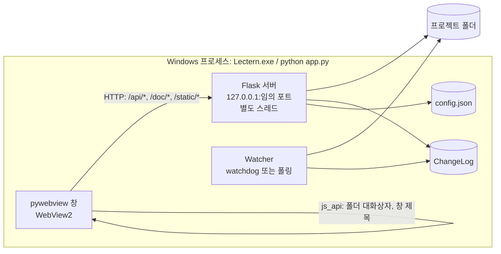
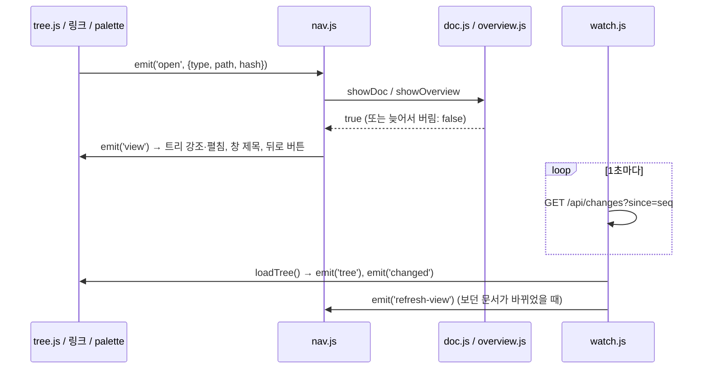

# 구조 설명

Lectern이 어떻게 돌아가는지 정리한 문서. 코드를 고치기 전에 해당 절을 읽는다.

## 1. 전체 그림



- 한 프로세스 안에 창(메인 스레드), HTTP 서버(데몬 스레드), 파일 감시(watchdog 스레드)가 함께 돈다.
- 창은 `http://127.0.0.1:<포트>/` 를 연다. 포트는 기본으로 OS가 고른다 (`--port` 로 고정 가능).
- 창에서만 가능한 기능(폴더 선택 대화상자, 창 제목)만 pywebview `js_api` 로 부르고, 나머지는 전부 HTTP API다. 그래서 `--browser` 모드에서 일반 브라우저로 같은 UI를 확인할 수 있다.

### 실행 모드

| 모드 | 명령 | 차이 |
|---|---|---|
| 창 (기본) | `python app.py [폴더]` | pywebview 창, `/api/*` 토큰 검사, 요청 로그 숨김. 프런트는 pywebview가 토큰을 넣고 `pywebviewready` 를 보낼 때까지 기다린다 (4초가 넘으면 '창과 연결하는 중' 안내) |
| 디버그 | `python app.py --debug [폴더]` | 창 + 개발자 도구. WebView2 기본 단축키·우클릭 메뉴도 켜짐 |
| 브라우저 | `python app.py --browser [폴더]` | 창 없이 서버만 (기본 포트 8765). 토큰 검사 없음. 폴더 선택은 경로 입력창 |

폴더 인자가 없으면 `config.json` 의 `last_folder` 를 연다. 그것도 없으면 시작 화면(폴더 열기 + 최근 폴더)이 나온다.

## 2. 백엔드 (lectern/)

### AppState (state.py)
열린 폴더(`root`, resolve된 절대경로), Watcher, ChangeLog, Config, 실행 모드, 토큰을 묶는다.
`open(folder)` 는 기존 감시를 멈추고 새 폴더 감시를 시작한 뒤 `ChangeLog` 에 구조 변경을 하나 넣고 최근 폴더를 기록한다.

### 스캔 (scanner.py)
- `scan(root, exclude, rel='', with_info=True, html_exclude=...)` → 트리 노드 목록. 폴더 먼저, 그다음 파일. 각각 자연 정렬(`2장 < 10장`).
  - 폴더 노드: `{type:'dir', name, path, children}`
  - 파일 노드: `{type:'file', name, path, kind, mtime, size, title}` (`path` 는 root 기준 `/` 구분 상대경로, `kind` 는 `DOC_TYPES` 의 `markdown`·`html`)
  - html 은 `html_exclude`(기본 `DEFAULT_HTML_EXCLUDE_DIRS` + 설정 `html_exclude_dirs`) 이름의 폴더 안에 있으면 뺀다 (앱 소스의 `index.html` 등, D27).
- 제외 규칙: 모듈 머리 주석 참고. 제외 폴더 기본값은 `DEFAULT_EXCLUDE_DIRS`, 설정 `exclude_dirs` 로 추가(대소문자 무시).
- `resolve_inside(root, rel)` → 실제 경로 또는 `None`. 먼저 글자만으로(`normpath`) root 안인지 보고 — `\\서버\공유`·드라이브 경로를 `resolve()` 하면 Windows 가 그 서버에 접속하므로 (D29) — 그다음 `resolve()` 로 `..`·링크를 푼 뒤 root 안인지, 경로 중 숨김 요소가 없는지 확인한다. **파일을 내주는 모든 경로는 이 함수를 거친다.**
  - 제외 폴더(`node_modules` 등)는 숨김이 아니므로 링크로는 열 수 있다. 트리에만 안 나온다.

### 제목·요약 (docinfo.py)
파일 앞 16KB(html 은 64KB)만 읽는다. (mtime_ns, size)가 같으면 캐시 사용.
- 제목: frontmatter `title`/`name` → 첫 H1 → 첫 제목
- 요약: frontmatter `description`/`summary` → 본문 첫 문단 (코드 블록·표·HTML·그림 줄 제외, 목록·인용 기호 제거, 160자). `작성: 2026-10-09` 같은 메타데이터 줄만 있는 문단은 다른 문단이 없을 때만 쓴다.
- html (`extract_html_info`, 표준 라이브러리 `html.parser`): 제목은 `<title>` → 첫 `<h1>` → 첫 제목, 요약은 `<meta name="description">` → 첫 `<p>`. 스크립트·스타일 안은 보지 않는다.

### 변경 감지 (changes.py)
- `Watcher` 는 watchdog `Observer` 로 root를 재귀 감시한다. watchdog가 없거나 시작에 실패하면 2초 간격 스캔 비교로 대신한다 (`backend` = `watchdog` | `polling`).
- 이벤트 필터: root 밖, 숨김(`.`), 제외 폴더 안, 문서(`doc_kind` — md·html)가 아닌 파일은 버린다. 폴더 생성·삭제·이동은 `structure=True`, 문서 생성·삭제·이동도 `structure=True`, 수정은 `structure=False`.
- Windows 숨김 속성은 감시 단계에서 보지 않는다 (트리 재스캔 때 걸러진다).
- `ChangeLog` 는 `(seq, path, structure)` 를 최대 5000개 보관한다. `since(seq)` 는 그 뒤의 경로 집합과 구조 변경 여부를 돌려준다. 오래된 기록이 밀려나 놓친 경우 `reset=True`.

### 링크 대상 열기 (osutil.py)
`open_path(path, line, editor)`:

| 대상 | 동작 | 반환 |
|---|---|---|
| 폴더 | 탐색기로 열기 | `folder` |
| `SAFE_DEFAULT_APP_EXT` (이미지·PDF·txt·csv·오피스·hwp 등) | `os.startfile` | `default` |
| 그 밖의 파일 (코드·스크립트·md 등) | 편집기 `<editor> -g 경로:줄` | `editor` |
| 편집기가 없거나 경로에 `&|<>^%!"` 포함 | 탐색기에서 파일 선택 (`explorer /select,`) | `reveal` |

편집기는 설정 `editor` (실행 파일의 절대경로) → PATH의 `code` 순으로 찾는다. VS Code·Cursor처럼 `-g file:line` 을 받는 편집기를 가정한다.
현재 폴더에서는 찾지 않는다: `shutil.which` 앞에 `NoDefaultCurrentDirectoryInExePath=1` 을 두고, 탐색기는 `%SystemRoot%\explorer.exe` 로 띄운다. `app.py` 도 폴더 인자를 푼 뒤 앱 폴더로 `chdir` 한다. `run.bat .`·탐색기 우클릭으로 띄우면 현재 폴더가 열린 프로젝트라, 그 안의 `code.cmd`·`explorer.exe` 가 링크 한 번에 실행될 수 있었다 (D29).

### 설정 (config.py)
`%APPDATA%\Lectern\config.json` (테스트에서는 `LECTERN_CONFIG_DIR` 로 바꿈). 원자적 저장(임시 파일 → `os.replace`).
값마다 형식을 본다(`value_ok` — `DEFAULTS` 와 같은 형식, `NULLABLE` 키는 `null` 도). 형식이 틀린 값은 기본값으로 돌고 나머지는 그대로 쓰며, `load_error` 에 키와 맞는 형식을 남긴다 (화면의 `POST /api/config` 값도 형식이 틀리면 버린다, D29).
파일이 있는데 읽지 못하면(JSON 오류, 맨 바깥이 객체가 아님) `load_error` 에 이유를 남기고 기본 설정으로 돌며, 파일이 고쳐질 때까지 저장하지 않는다. 이유는 `/api/state` 의 `config_error` 로 화면에 알린다 (D21). UTF-8 BOM은 허용한다.
읽거나 바꿀 때마다 파일의 (수정 시각, 크기)를 보고, 밖에서 바뀌었으면 다시 읽는다(`_refresh`). 그래서 설정 창의 '설정 파일 열기'로 고친 값은 앱을 다시 실행하지 않아도 반영되고, 앱이 들고 있던 옛 값으로 덮어쓰지 않는다. 설정을 바꾸는 코드는 `_update(change)` 를 거친다 (다시 읽기 → 바꾸기 → 저장).

| 키 | 기본값 | 프런트에서 변경 | 설명 |
|---|---|---|---|
| `version` | `1` | 불가 | 설정 파일 형식 버전 (형식이 바뀌면 올리고 변환 코드를 둔다) |
| `recent` | `[]` | 불가 | 최근 연 폴더 (최대 10). 폴더를 열 때 서버가 기록 |
| `last_folder` | `null` | 불가 | 인자 없이 실행할 때 열 폴더 |
| `theme` | `"auto"` | 가능 | `auto` 또는 스타일 id (`theme.js` 의 `THEMES`) |
| `theme_groups` | `"use"` | 가능 | 스타일 목록을 묶는 방식: `use`(용도별)·`mood`(분위기별)·`tone`(밝기별) (설정 창, D30) |
| `show_titles` | `true` | 가능 | 트리에 제목(끄면 파일명) |
| `sidebar_visible` / `toc_visible` | `true` | 가능 | 패널 표시 |
| `sidebar_width` | `null` | 가능 | 사이드바 폭(px, 200~480). 경계를 끌어 바꾸고 두 번 누르면 `null`(기본 288) |
| `math` | `true` | 가능 | `$` 수식 렌더링 (설정 창) |
| `external_images` | `true` | 가능 | 문서 속 `http(s)` 이미지 표시. 끄면 링크로만 (설정 창. 바꾸면 페이지를 다시 불러옴 — CSP) |
| `restore_last` | `true` | 가능 | 폴더를 열면 마지막에 보던 문서와 스크롤 위치로 (설정 창). 끄면 위치를 기록하지도 않는다 |
| `expand_first_level` | `true` | 가능 | 폴더를 열면 트리의 첫 단계 폴더를 펼쳐 둠 (설정 창) |
| `window` | `{width:1280,height:860}` | 불가 | 창 크기 (닫을 때 저장. 최소화·최대화한 채 닫으면 저장하지 않음. 형식이 틀리면 기본값, 720×480보다 작으면 그 크기로) |
| `exclude_dirs` | `[]` | 불가 | 추가 제외 폴더 이름 |
| `editor` | `null` | 불가 | 편집기 실행 파일 경로 |
| `html_exclude_dirs` | `[]` | 불가 | 이 이름의 폴더 안 html 은 문서로 보지 않음 (기본 목록 `src`·`public` 등에 더함, D27) |
| `projects` | `{}` | 불가 | 프로젝트(경로 소문자)별 `{doc, scroll:{문서: 위치}}`. 서버가 `POST /api/position` 으로 기록. 최근 20개 프로젝트, 프로젝트마다 100개 문서 |

'불가' 키는 `config.json` 을 직접 고쳐야 한다. 웹 페이지가 실행 파일 경로 같은 값을 바꾸지 못하게 하려는 제한이다 (`CLIENT_KEYS`).

## 3. HTTP API (server.py)

창 모드에서는 `/api/*` 요청에 `X-Token: <window.pywebview.token>` 헤더가 필요하다. 응답은 JSON, 오류는 `{error: "..."}`.
`/api/*`, `/doc/*`, `/` 응답에는 `Cache-Control: no-cache` 가 붙는다.
`/` 응답에는 이미지·연결·글꼴 출처를 제한하는 CSP와 `Referrer-Policy: no-referrer` 가 붙는다 (D20).
`.js`·`.mjs`·`.css`·`.svg`·`.woff2` 의 응답 형식은 서버가 정한다 (`FIXED_TYPES`). Windows의 `mimetypes` 는 레지스트리 값을 따르는데, `.js` 가 `text/plain` 으로 잡힌 PC에서는 브라우저가 모듈 스크립트를 거부해 화면이 비기 때문이다. `img-src` 는 설정 `external_images` 에 따라 바뀌므로, 설정을 바꾸면 페이지를 다시 불러와야 반영된다.

| 메서드·경로 | 요청 | 응답 / 설명 |
|---|---|---|
| `GET /` | | `index.html` (`{{MODE}}`, `{{VERSION}}` 치환) + CSP 헤더 |
| `GET /static/<경로>` | | `web/` 정적 파일 |
| `GET /api/state` | | `{root, name, seq, mode, sep, watch, version, config_error, position}`. `position` 은 이 폴더의 `{doc, scroll}` (마지막 위치 복원). `root` 가 `null` 이면 열린 폴더 없음. `watch` 는 `watchdog`·`polling`·`none`. `config_error` 는 설정 파일을 읽지 못한 이유 (없으면 `null`) |
| `POST /api/open` | `{path}` | 폴더 열기. 성공 시 `/api/state` 와 같은 형식, 폴더가 아니면 400 |
| `GET /api/tree?fresh=1` | | `{root, tree}` (스캔 결과, 파일 노드의 `kind` 는 `markdown`·`html`). 변경 기록(seq)이 그대로면 마지막 스캔을 다시 쓴다. `fresh=1`(F5)은 새로 훑는다. 폴더가 없으면 409 |
| `GET /api/overview?path=<폴더>` | | `{path, name, dirs:[{name,path,count,mtime}], files:[파일 노드+summary], recent:[파일 노드 최대 6], total}`. `path` 는 실제 경로로 맞춘 값 (`docs/../docs`·`DOCS` → `docs`) |
| `GET /api/search?q=<검색어>` | | 전체 본문 검색. `{query, results:[{path, title, mtime, named, hits:[{line, text}], more}], total, truncated}` (`named`: 제목·파일명에 검색어가 있음 — 먼저 나옴). 검색어가 200자를 넘으면 400 |
| `GET /api/changes?since=<seq>` | | `{seq, paths, structure, reset, root}` |
| `GET /api/config` | | 설정 전체 |
| `POST /api/position` | `{path, scroll}` | 지금 보는 문서와 스크롤 위치 기록 (`restore_last` 가 꺼져 있으면 무시). `{ok:true}`. 밖·숨김·없음 404, 폴더·잘못된 값 400 |
| `POST /api/open-config` | | 설정 파일을 편집기로 (없으면 탐색기에서 선택). 파일이 없으면 기본값으로 만든다. `{action, path}` |
| `POST /api/config` | 부분 객체 | `CLIENT_KEYS` 만 반영, 설정 전체 반환 |
| `POST /api/open-external` | `{path, line?}` | `{action}` — `folder`·`default`·`editor`·`reveal` |
| `POST /api/exists` | `{paths:[...], base}` | 경로 표기 중 프로젝트 안에 있는 파일. 프로젝트 기준, 없으면 `base`(문서 폴더) 기준. `{found:{입력: 프로젝트 기준 경로}}`. 숨김·밖·폴더는 없는 것. 500개까지 |
| `POST /api/reveal` | `{path}` | 탐색기에서 선택. `{action:'reveal'}` |
| `GET /doc/<경로>` | | md는 `text/markdown; charset=utf-8` 원문, html 은 `text/html; charset=utf-8` + 문서용 CSP(`html_doc_policy`: `sandbox allow-same-origin allow-modals`, 스크립트·연결·폼 금지, 그림은 `external_images`, D27), 그 밖은 파일 그대로 + `Content-Security-Policy: sandbox`. 모두 `X-Content-Type-Options: nosniff` (D20) 와 `Referrer-Policy: no-referrer` (html 문서 속 인터넷 그림이 앱 주소를 보내지 않게). 숨김·밖·없음·폴더는 404 |

상태 코드: 400 잘못된 요청(필수 값 없음, JSON 객체가 아님, 폴더가 아님) · 403 토큰 불일치 또는 허용되지 않은 Host · 404 없음·숨김·프로젝트 밖 · 405 잘못된 메서드 · 415 `/api/*` POST 의 본문이 JSON(`Content-Type: application/json`)이 아님 · 409 열린 폴더 없음(`/api/tree`, `/api/overview`, `/doc/*` 등) · 500 OS가 파일 열기에 실패. `/api/*` 의 오류는 모두 `{error}` JSON이다.

## 4. 프런트엔드 (web/)

빌드 단계 없이 `<script type="module">` 로 바로 실행한다. vendor 라이브러리는 `index.html` 에서 일반 스크립트로 먼저 불러온다(전역). Mermaid(약 5MB)만 다이어그램이 있는 문서를 처음 열 때 `mermaid.js` 가 불러온다. 불러오기 전에는 문서 속 id `mermaid` 요소가 `window.mermaid` 로 잡히므로, 전역이 있는지가 아니라 `run` 함수가 있는지로 확인한다.

### 상태와 이벤트
상태는 `store.js` 의 `S` 하나에 모은다. 모듈끼리는 직접 호출 대신 `emit`/`on` 이벤트로 이어서 순환 참조를 피한다. 이벤트 목록은 `store.js` 머리 주석에 있다.



### 화면 이동 (nav.js)
- `navigate(target)` 은 현재 스크롤 위치를 기억하고 새 화면을 그린 뒤 기록에 넣는다. 뒤로/앞으로는 기억한 스크롤로 돌아간다.
- `refreshView()` 는 같은 화면을 같은 스크롤 위치로 다시 그린다. 위치는 렌더러에 함수로 넘겨 바꿔 끼우기 직전에 읽는다 (그리는 동안 사용자가 스크롤하면 그 위치). 사용자의 이동이 진행 중이면 미뤘다가 이동이 끝나면 한 번 한다 (`pending`·`missedRefresh` — 그사이 바뀐 문서를 놓치지 않게).
- 뒤로/앞으로를 빠르게 여러 번 누르면 아직 그리는 중인 기록 위치(`wanted`)에서 이어 간다. 그리다 오류가 나면 알림(toast)을 띄우고 화면은 그대로 둔다.
- 렌더링 함수는 시작할 때 `++S.renderId` 를 받아 두고, await 뒤에 값이 바뀌었으면 결과를 버린다.

### 문서 렌더링 순서 (doc.js `showDoc`)
1. `GET /doc/<경로>` 로 원문을 받는다 (실패하면 '문서 없음' 화면).
2. `markdown.js`: frontmatter를 떼고 markdown-it으로 HTML을 만든다.
   - 블록마다 원문 줄 범위를 `data-lines="시작-끝"`(1부터, 끝 줄 포함, 떼어 낸 frontmatter 줄 수 보정)으로 단다 (`sourceLines`). 본문 우클릭 메뉴가 쓴다.
   - 플러그인: footnote, task-lists(비활성 체크박스), anchor(GitHub식 slug — 한글 유지)
   - 수식: `$…$`, `$$…$$`, `\(…\)`, `\[…\]` → KaTeX. `$` 는 pandoc 규칙(여는 `$` 뒤·닫는 `$` 앞 공백 불가, 닫는 `$` 뒤 숫자 불가, 첫 후보만 확인)이라 `$105에서 $110` 은 수식이 아니다.
   - ```` ```mermaid ```` 는 `<pre class="mermaid">` 로.
   - 코드 하이라이트는 highlight.js (언어가 지정된 블록만).
3. DOMPurify로 정화 (`SANITIZE_DOM:false`, `style`·`form` 태그 금지). 정화 훅이 `src` 를 `data-src` 로 옮겨 두고, 그림을 부르는 다른 길(`srcset`·`poster`·표의 `background`·SVG `image`·`feImage` 의 href·style 과 SVG 속성의 `url()`·`image-set()`)은 지운다. `document` 의 이름을 가리는 `img` 의 `name` 도 지우고 (D15), SVG 링크의 `xlink:href` 는 `href` 로 옮긴다. frontmatter는 직접 이스케이프한 표로 앞에 붙인다.
4. 화면 밖 무대(`.lec-stage`, 본문과 같은 폭)에 넣고 후처리:
   - 이미지: 상대경로 → `/doc/<경로>?v=<시각>` (다시 그릴 때 바뀐 그림 반영), 클릭하면 확대. 외부(`http(s)://`) 이미지는 설정 `external_images` 가 켜져 있으면 `referrerpolicy=no-referrer` 로 불러오고, 오류나 15초 안에 받지 못하면 '외부 이미지를 불러오지 못했습니다' 링크로 바꾼다. 꺼져 있으면 처음부터 링크로 둔다. 프로젝트 안을 가리키는 절대경로·`file:` 는 상대경로로 바꿔 보여 주고(`absoluteRef`, 아래), 그 밖의 스킴과 프로젝트 밖 경로는 표시하지 않는다.
   - 링크(`a[href]`, 이미지 맵의 `area[href]`, SVG 속 `<a>` 포함): `#앵커` → 문서 안 스크롤 / 다른 md, 트리에 있는 html → 뷰어 안에서 열기 / 폴더 → 폴더 개요 / 그 밖의 파일 → `/api/open-external` (`#L42` 는 줄 번호) / 외부 URL → 새 창(pywebview가 시스템 브라우저로 넘김) / 프로젝트 밖·막힌 스킴 → 취소선 + 안내.
   - `/` 로 시작하는 링크는 프로젝트 루트 기준으로 해석한다.
   - 절대경로(`C:\proj\a.md`, `C:/proj/a.md`, `\\server\share\a.md`, `file:///C:/proj/a.md`)는 열린 프로젝트 안이면 상대경로로 바꾸고(대소문자 무시) 밖이면 막는다 (`absoluteRef`). markdown-it 은 `file:` 링크를 기본으로 글자로 남기고 `\` 를 `%5C` 로 바꾸며, DOMPurify 는 기본 허용 URL 에 없는 `c:`·`file:` 를 지우므로 `validateLink` 와 `ALLOWED_URI_REGEXP` 를 넓혔다.
   - `> [!NOTE]` 등 → 콜아웃, 표 → 가로 스크롤 감싸기 + 숫자 열(70% 이상이 숫자) 오른쪽 정렬, 코드 블록 → 언어 표시 + 복사 버튼.
   - Mermaid 실행. 실패한 블록은 원문 + 안내로 바꾼다.
   - 본문 속 경로 표기(`src/app.py:42`, `../code/x.py`, `docs/a.md`)를 모아 `POST /api/exists` 로 한 번에 묻고, 있는 파일이면 `a.path-link` 로 감싼다 (`pathlink.js`). 코드 블록·링크·수식·다이어그램·메타데이터 안은 보지 않고, 문장 속 `코드` 는 내용 전체가 경로일 때만. 누르면 md·html 문서는 뷰어에서, 그 밖은 편집기의 그 줄로.
5. 무대의 내용을 `#lec-view` 로 옮기고, 이 문서에서 접어 두었던 절을 다시 접고(`setupFolds`), 목차를 만든 뒤 스크롤 위치를 정한다 (유지 / 앵커 / 맨 위).
6. `S.changed` 에서 이 문서를 지우고 상태줄을 갱신, `emit('rendered')` (찾기가 열려 있으면 다시 검색).

### html 문서 (htmldoc.js)
- `nav.js` 가 확장자로 렌더러를 고른다 (`.html`·`.htm` → `showHtml`). `HEAD /doc/<경로>` 로 있는지 보고, `<iframe sandbox="allow-same-origin allow-modals">` 에 문서를 띄운다 (D27. `allow-modals` 는 앱이 그 문서를 인쇄하려고 — 문서 스크립트는 돌지 않으니 문서가 쓸 수는 없다).
- 불러온 뒤: `css/frame.css`(찾기 표시·바뀐 곳·우클릭 테두리)를 넣고, 문서가 불러온 스타일이 없으면 `base.css`·지금 스타일 css 를 넣고 `body` 에 `md-body` 를 단다. 스타일이 있는데 쪽 바탕(html·body)을 칠하지 않으면, 바탕을 칠한 상자 밖의 글자 밝기를 글자 수로 따져 어두운/밝은 바탕과 색 모드를 문서 뿌리에 넣는다 (`backdropFor`·`paintBackdrop` — iframe 의 다크 선호는 Windows 설정을 따르고, 색 모드가 앱과 다르면 Chromium 이 흰 바탕을 칠하기 때문, D27). 스타일 없는 문서는 바탕·색 모드를 앱 스타일로. 목차용으로 id 없는 h1~h4 에 `lec-hN` 을 붙이고, 링크는 md 와 같은 `bindLink` 로 묶는다 (인터넷 링크는 앱이 `window.open` — sandbox 는 새 창을 못 연다).
- iframe 안의 이벤트는 앱 문서로 올라오지 않으므로 keydown(단축키)·mouseup(마우스 뒤로/앞으로)·mousedown(메뉴 닫기)을 앱으로 넘기고, contextmenu 는 `docmenu.frameContextMenu` 로 보낸다.
- 높이를 문서에 맞춘다 (ResizeObserver, `<details>` 의 toggle). `scrollHeight` 는 iframe 자신의 높이보다 작아지지 않아 줄어들 때를 놓치므로, html 상자의 높이와 body 자식들의 아래 끝을 잰다 (`contentHeight`). SVG 의 옛 링크(`xlink:href`)는 `href` 로 옮겨 `bindLink` 가 다룬다 — 아니면 누를 때 iframe 이 떠난다. 불러오다 실패하면(시간 초과, HEAD 뒤에 지워져 404) 안내 화면으로 바꾸고 앞 문서의 목차·원문·바뀐 곳을 지운다. 같은 문서를 다시 그리는지는 화면의 iframe 이 그 문서를 다 불러왔는지(`data-ready`)로 본다. 자동 새로고침 때는 새 iframe 을 옛 것 위에 보이지 않게 겹쳐 불러온 뒤 옛 것을 지운다 (iframe 은 DOM 에서 옮기면 다시 불러온다).
- 다른 모듈은 `util.docRoot()`(md: `#lec-view`, html: iframe body)와 `util.screenRect()`(iframe 위치를 더한 화면 좌표)로 두 형식을 같이 다룬다 — 찾기·목차·바뀐 부분 강조. 바뀐 부분 강조는 html 에서 최상위 자식 대신 `p, li, h1~h6, tr, pre, blockquote, figure, dt, dd, img` 를 비교한다.

### 전체 검색 (search.js, lectern/search.py)
- 사이드바 '검색' 탭(Ctrl+Shift+F). 입력을 250ms 기다렸다가 `GET /api/search?q=` 를 부르고, 늦게 온 결과는 버린다 (Enter 는 기다리지 않고 바로 — 기다리던 검색은 취소). 문서 목록이 바뀌면(자동 새로고침) 다시 찾고, 다른 프로젝트를 열면 옛 결과는 바로 지운다.
- 서버는 트리와 같은 `scan()` 결과의 문서만 읽는다 (숨김·제외는 찾지 않음). 대소문자 무시, 글자 그대로. 줄 번호는 markdown-it 과 같게 센다 (`\r\n`·`\r`·`\n` 만 줄바꿈). 제목·경로에 검색어가 든 문서를 먼저, 그다음 최근에 고친 순. 문서당 20줄, 모두 1000줄·200문서까지.
- 결과 줄을 누르면 문서를 열고, 그 줄이 든 가장 작은 `data-lines` 블록(표의 행까지)으로 가서 깜박이고, 문서 안 찾기(`findText`)로 검색어를 표시한다. 찾기 막대의 '지금 결과'도 그 블록 안의 것으로 둔다 (`pickMatchAt`).

### 바뀐 부분 강조 (diffmark.js)
- 같은 문서를 다시 그릴 때(자동 새로고침) 바꿔 끼우기 직전의 최상위 블록마다 서명(태그 + 공백을 줄인 글자 + 그림 주소, Mermaid는 원문)을 세어 두고, 새 화면에서 서명이 이전에 없던 블록에 `lec-changed`(약 4초 배경색·테두리)를 준다. 같은 서명이 여럿이면 개수로 맞춘다.
- 처음 열 때, '문서 없음' 화면에서 돌아올 때, 내용이 같은 다시 그리기(스타일 변경, F5)는 강조하지 않는다. 지워진 블록은 알리지 않는다.
- 불러오지 못한 인터넷 그림은 이번 실행 동안 기억해(`doc.js` 의 `failedImages`, F5 로 잊음) 다시 그릴 때 바로 링크로 둔다 — 아니면 매번 15초를 기다리고, 그 사이 `` 와 옛 링크가 달라 '바뀐 곳'으로 잡힌다.
- 많이 바뀌어도 멈추지 않게: 깜박임은 한꺼번에 시작하고(화면 배치 한 번), html 의 '바뀐 항목 안의 블록 빼기'는 조상을 따라 올라가며 본다.
- 바뀐 블록이 하나라도 화면 밖(접힌 절 안 포함)이면 상태줄에 '바뀐 곳 N곳 ↓' 버튼. 누를 때마다 다음 블록으로 가서(접힌 절은 `unfoldTo`) 다시 깜박인다. 다른 화면으로 가면 사라진다.

### 제목 접기 (fold.js)
- 문서의 최상위 제목(`#lec-view` 의 자식 h1~h6)을 누르면 그 절 — 다음 같은 수준 이상의 제목 전까지 — 을 접고, 다시 누르면 편다. 각주(`.footnotes-sep`, `.footnotes`)는 마지막 절에 속하지 않는다.
- DOM은 markdown-it 이 만든 평평한 구조 그대로 두고 클래스만 붙인다: 접을 수 있는 제목 `lec-fold`, 접힌 제목 `lec-folded`, 숨는 블록 `lec-fold-hidden`(`display:none`). 펴면 따로 접어 둔 하위 절은 접힌 채 남는다.
- 접지 않는 제목: 내용이 없는 제목, 문서에 H1이 하나뿐일 때의 H1(문서 제목 — 목차와 같은 규칙).
- 제목 속 링크를 누르거나 Shift+클릭 등으로 글자를 고르면 접지 않는다. 두 번 눌러 낱말을 고르면 첫 번째 누름의 접기를 되돌린다.
- 목차·앵커 링크·찾기(Ctrl+F)가 접힌 절 안으로 가면 `unfoldTo()` 로 감싼 절을 편다. 목차의 현재 위치 표시는 숨은 제목을 건너뛴다.
- 접은 상태는 문서 경로별로 이번 실행 동안만 메모리에 둔다 (자동 새로고침·뒤로 가기·다른 문서에 다녀와도 유지, 다른 폴더를 열면 잊음). 제목 id로 기억하므로 제목 글자가 바뀌면 그 절은 펴진다. 디스크에는 쓰지 않는다 (D23).

### 본문 우클릭 메뉴 (docmenu.js)
- 문서 화면에서 우클릭한 블록(제목·단락·목록 항목·표·그림·코드·다이어그램·수식·인용)에 `lec-picked` 테두리를 그리고 `ui.js` 의 `showMenu` 로 메뉴를 띄운다. 가장 안쪽 블록을 고르되, Mermaid 그림 속 글자와 메타데이터 표의 칸은 통째로 고른다. 메뉴 맨 위 머리말에 종류(예: '표 · 6행 5열')를 적는다.
- 항목: 텍스트 복사(그림·수식·다이어그램 제외), 원문 복사(`data-lines` 범위의 원문 줄), Claude용 위치 복사(`@docs/a.md 40~52행`), 제목은 절 원문 복사(다음 같은 수준 이상의 제목 앞까지, 문서 끝이면 맨 뒤의 각주 정의는 뺌)와 절 링크 복사(`docs/a.md#id`), 표 복사(탭으로 나눈 글 + 간단한 HTML 표), 그림 복사(같은 출처 그림을 캔버스로 PNG, SVG는 2배), 인터넷 그림은 주소 복사.
- 2차 항목(v0.3.0): 원문 줄이 있는 블록은 '편집기에서 이 줄 열기'(`/api/open-external` 의 `line`), 다이어그램은 그림 복사(SVG를 viewBox 크기 2배 PNG로, 화면 바탕색을 깔아서), 수식은 LaTeX 복사(`markdown.js` 가 단 `data-tex`), 링크는 주소 복사(`bindLink` 가 단 `data-lec-href` — 인터넷 주소 또는 프로젝트 기준 경로), 제목은 같은 수준 모두 접기·펴기, 메타데이터는 원문 복사.
- 문서 메뉴의 '인쇄 / PDF로 저장…'은 `window.print()` (html 문서는 iframe 의 `print()` — iframe sandbox 에 `allow-modals` 가 필요). 인쇄 모양은 `base.css` 의 `@media print`: 화면 UI 빼기, 스타일 색을 흰 바탕·검은 글자로 덮기(바탕색은 기본으로 인쇄되지 않음), 접은 절 펴기, 쪼개지 않기, 인터넷 링크 주소 붙이기.
- 블록 밖(여백, 문서 아래 빈 곳)은 문서 메뉴: 트리와 같은 경로 항목(`tree.js` 의 `pathMenuItems`) + 모두 접기·펴기.
- 글을 고른 채 우클릭하면 맨 위에 '선택한 글 복사'. 고른 곳 밖을 우클릭하면 브라우저가 선택을 푼다.
- 원문은 `doc.js` 가 그릴 때마다 `setDocSource(path, text)` 로 넘긴다. 클립보드는 `navigator.clipboard.write`(여러 형식)를 쓰고, 안 되면 글만 복사한다.

### 설정 창과 마지막 위치 (settings.js, position.js)
- 툴바 톱니 버튼·Ctrl+, 로 설정 창: 스타일 목록 묶기(라디오 — 용도별·분위기별·밝기별), 마지막 위치에서 시작, 첫 단계 폴더 펼치기, 수식 표시, 인터넷 그림 표시, '설정 파일 열기'(편집기 경로·제외 폴더 등).
- `position.js` 는 화면 이동과 스크롤이 멈추고 1.5초 뒤 `POST /api/position` 으로 지금 문서와 위치를 보낸다 (같은 값이면 보내지 않음). 폴더를 열 때 `main.js` 가 `/api/state` 의 `position` 으로 그 문서를 열고 위치를 복원한다. 문서가 없어졌으면 폴더 개요.

### 사이드바 (tree.js)
- 파일 탭: 루트 행(프로젝트 개요) + 트리. 폴더 이름을 누르면 개요 화면 + 펼침, 화살표는 펼치기/접기만. 처음 열 때 첫 단계 폴더는 펼쳐 둔다 (설정 `expand_first_level`, 기본 켜짐).
- 필터: 입력하면 트리 대신 일치하는 문서 목록(제목+경로, 공백으로 나눈 모든 단어 포함). Enter는 첫 결과 열기, Esc는 지우기.
- 최근 변경 탭: 수정 시각 순 40개.
- 호박색 점: 열어 보기 전에 바뀐 문서(`S.changed`). 접힌 폴더는 안쪽에 바뀐 문서가 있으면 점을 단다.
- 우클릭: `@경로` 복사(Claude Code 프롬프트용), 전체 경로 복사, 편집기로 열기, 탐색기에서 보기.
- 파일이 바뀌어 트리·최근 변경·검색 결과를 다시 그려도 키보드 초점은 같은 행에 남는다 (`util.keepFocus`).
- 폴더를 처음 훑는 데(문서 수천 개) 0.4초가 넘으면 본문에 '폴더를 읽고 있습니다…'를 보인다 (`main.js`).

### 단축키

| 키 | 동작 |
|---|---|
| Ctrl+P | 빠른 열기 (입력 전에는 최근 수정 순) |
| Ctrl+F | 문서 화면: 문서 안 찾기 / 개요 화면: 트리 필터로 이동 |
| Ctrl+Shift+F | 전체 검색 (사이드바 '검색' 탭) |
| Ctrl+, | 설정 창 |
| Ctrl+O | 폴더 열기 |
| Ctrl+B | 사이드바 보이기/숨기기 |
| Alt+← / Alt+→, 마우스 뒤로/앞으로 버튼 | 뒤로 / 앞으로 |
| F5 | 트리와 현재 화면 다시 불러오기 |
| Esc | 팝업·메뉴·확대·찾기 닫기 |
| Ctrl+휠 | 확대/축소 (pywebview `zoomable`) |

### 테마 (theme.js, themes/)
- 스타일 24종 (D26, D30): 밝은 16 — `default`(기본)·`report`(보고서)·`office`(사내 문서)·`consulting`(컨설팅)·`notion`(노션풍)·`contrast`(고대비)·`paper`(종이·세피아)·`book`(책)·`academic`(논문)·`newsprint`(신문)·`magazine`(잡지)·`manuscript`(원고·타자기)·`github`·`docsite`(문서 사이트)·`solarized-light`·`gruvbox-light`, 어두운 8 — `dark`·`github-dark`·`nord`·`solarized-dark`·`dracula`·`one-dark`·`night`(밤 종이)·`ink`(먹·완전 검정).
- `base.css` 가 본문 규칙을 CSS 변수로 정의하고, 스타일마다 `<id>.css` 가 변수 값과 몇몇 규칙(표 테두리, 제목 장식, 코드 색)을 바꾼다. `<link id="lec-theme-css">` 의 href를 바꿔 전환한다.
- 제목(`--md-heading`)은 본문(`--md-fg`)과 색을 조금 달리한다 (기본: 남색, 다크: 옅은 하늘색, 보고서: 남색). 표 머리행은 배경 `--md-th-bg`, 아래 2px 선 `--md-th-rule`, 글자는 제목 색(짙은 머리행 스타일은 `--md-th-fg` — 사내 문서·컨설팅의 흰 글자)으로 본문 행과 구분한다.
- `theme.js` 의 `THEMES` 가 스타일마다 이름, 밝음/어두움(앱 UI와 highlight.js github / github-dark), Mermaid 테마를 정한다. 선택 목록도 이 표로 만든다 — 밝은 스타일은 `use`(용도)·`mood`(분위기)·`tone`(밝기) 묶음을 갖고, 어두운 스타일은 늘 '어두운' 묶음이다. 설정 `theme_groups` 에 따라 `GROUPINGS` 의 묶음 순서로 `<optgroup>` 을 만든다 (`fillPicker`, 설정 창에서 바꾸면 다시 부른다). 목록 옆 ∧·∨ 버튼(`#lec-theme-prev`·`#lec-theme-next`)은 목록에서 바로 위·아래 항목으로 바꾸고('자동'이 맨 위), 맨 처음·맨 끝에서는 꺼진다. 고르면 화면에 바로 입히고 설정 저장은 뒤에서 한다 (빠르게 눌러도 따라오게). 코드 색을 바꾸는 스타일(Nord·Solarized·Gruvbox·Dracula·One Dark)은 자기 css 에서 `.md-body .hljs-*` 를 덮는다. Mermaid는 모든 스타일이 `base` 테마에 스타일 색(themeVariables — 바탕, 상자 채움·테두리·글자, 보조 상자, 선, 글자)을 준다 (`mermaidColors`). 전환하면 Mermaid 때문에 현재 문서를 다시 그린다.
- 글꼴은 PC에 있는 것만 쓴다. 영문 글꼴 → 한글 글꼴(KoPub·나눔·Noto 등, 있으면) → Windows 기본(맑은 고딕·바탕) 순이다. Georgia 를 쓰는 스타일은 숫자 높낮이가 다른 글꼴이라 표만 Cambria 로 바꾼다.
- 고른 스타일은 설정 `theme` 에 저장되어 다음 실행에도 쓰인다.
- `auto` 는 `prefers-color-scheme` (WebView2는 Windows 앱 모드 설정을 따름)으로 기본/다크를 고른다.
- 앱 UI 색(`app.css` 의 `--ui-*`)은 지금 스타일의 `--md-*` 에서 `color-mix()` 로 만든다 (D28). `data-ui="dark"` 는 어두운 스타일의 몇 값(사이드바를 조금 어둡게, 찾기 색)과 `color-scheme: dark`.
- 새 스타일 추가: `themes/<id>.css` 작성 → `theme.js` 의 `THEMES` 에 한 줄. `ui_smoke.py` 가 스타일 수(지금 24)와 묶음, 대비·구분을 확인하므로 수를 함께 고친다.

## 5. 보안 모델

로컬 단일 사용자 도구라는 전제에서 다음을 막는다.

| 위험 | 대책 |
|---|---|
| 문서가 `\\서버\공유` 주소로 Windows 로그인 정보(NTLM)를 빼냄 | `resolve_inside` 가 `resolve()` 전에 글자로 root 밖을 거름 (`/doc/%5C%5C서버…` 도 404, D29) |
| 내려받은 프로젝트에 넣어 둔 `code.cmd`·`explorer.exe` 가 링크 클릭으로 실행됨 | 프로그램을 현재 폴더에서 찾지 않음 (`osutil`, `app.py` 의 `chdir`, D29) |
| 다른 로컬 웹페이지가 API를 호출 | 서버는 127.0.0.1만 바인딩. 창 모드에서 `/api/*` 는 세션 토큰 필요. CORS 헤더를 주지 않으므로 다른 출처는 응답을 읽지 못함. `/api/*` POST 는 `Content-Type: application/json` 만 받으므로(아니면 415, `check_request`) 사전 요청(preflight) 없이 보낼 수 있는 폼·단순 요청은 토큰이 없는 브라우저 모드에서도 아무것도 하지 못함 |
| DNS 리바인딩 (외부 도메인을 127.0.0.1로 돌려 같은 출처처럼 읽기) | `Host` 헤더가 `127.0.0.1`·`localhost` 가 아니면 403 |
| 경로 조작으로 프로젝트 밖 파일 읽기 | `resolve_inside()` (resolve 후 포함 관계 검사, 숨김 요소 검사, NUL 거부) |
| 문서 속 스크립트 | md: DOMPurify, `style`·`form` 금지, `javascript:` 등 위험한 스킴 차단 (`file:`·드라이브 경로는 `absoluteRef` 가 프로젝트 안만 상대경로로 열고 밖은 막음). html: `allow-scripts` 없는 iframe sandbox + 문서용 CSP (D27) |
| 링크 클릭으로 코드 실행 | `osutil.open_path` 의 확장자 화이트리스트, 편집기 인자 문자 검사 |
| 웹 페이지가 실행 경로 설정을 바꿈 | `editor`·`exclude_dirs` 등은 API로 못 바꿈 (`CLIENT_KEYS`) |
| 외부로 정보 유출 | 앱은 외부 리소스를 불러오지 않음. 문서 속 외부 이미지만 예외(설정 `external_images`, 기본 켜짐): referrer를 보내지 않으므로 이미지 서버가 아는 것은 '이 PC가 그 그림을 요청했다'는 사실뿐. `` 가 아닌 길(`srcset`·`poster`·표 `background`·SVG `image`·CSS `url()`·`image-set()`)은 정화 훅이 지우고, `/` 의 CSP(`img-src`·`connect-src` 등)가 한 번 더 막음 (D20) |

`/doc/*` 는 `` 태그가 헤더를 보낼 수 없어 토큰 없이 열려 있다. 127.0.0.1의 임의 포트이고 숨김·밖 경로는 막히므로 감수한다.

## 6. 배포 구조

`build.bat` = pytest → `pyinstaller lectern.spec` (onedir) → Inno Setup(`installer\lectern.iss`)이 있으면 설치 파일.

```
dist\Lectern\
  Lectern.exe
  _internal\            Python 런타임, 라이브러리
    web\                index.html, js, css, themes, vendor
```

`paths.resource_dir()` 가 `sys._MEIPASS`(= `_internal`)를 보고 `web/` 을 찾는다. 설정은 exe 옆이 아니라 `%APPDATA%\Lectern\` 에 저장된다.
WebView2 런타임은 Windows 11과 대부분의 Windows 10에 있다.

- `lectern.spec`: 아이콘 `assets\lectern.ico`, 버전 정보(제품 이름·설명·버전 — `lectern/__init__.py` 의 `__version__` 을 읽음).
- 설치 파일(`dist\Lectern-버전-setup.exe`, D25): 현재 사용자 설치(`%LOCALAPPDATA%\Programs\Lectern`, 관리자 권한 불필요). 시작 메뉴 바로가기, 선택: 바탕화면 바로가기·탐색기 우클릭 메뉴(`HKCU\Software\Classes\Directory\shell\Lectern` 등, `tools/context_menu.py` 와 같은 키). 덮어 설치할 때 `_internal` 을 비우고 새로 넣는다. WebView2가 없으면 알린다. 제거해도 `%APPDATA%\Lectern` 은 남긴다.
