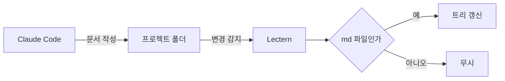
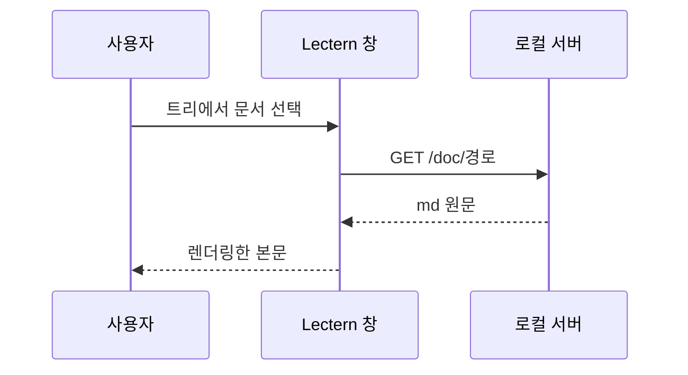

# 다이어그램

언어를 `mermaid` 로 적은 코드 블록은 그림으로 바뀝니다. 그림을 누르면 크게 봅니다.

## Mermaid

다이어그램이 있는 문서를 처음 열 때 Mermaid 라이브러리(약 5MB)를 불러옵니다. 이 절 제목의 앵커 id는 `mermaid` 라서 라이브러리 이름과 겹칩니다. 그래도 아래 그림이 그려져야 합니다.

## 흐름도



## 순서도



## 문법 오류

잘못된 코드는 그림 대신 원문과 안내를 보여 줍니다.

```mermaid
flowchart LR
    A[닫히지 않은 괄호 --> B
```
