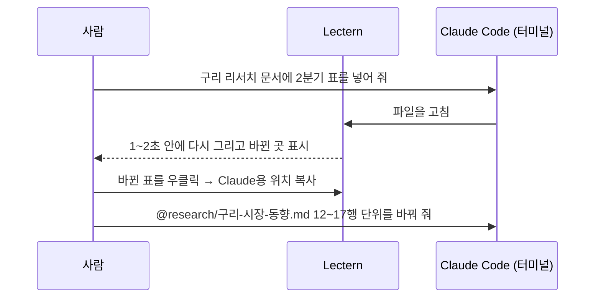

# Claude Code 와 함께

Lectern 은 Claude Code 와 나란히 쓰도록 만들어졌다. Claude Code 가 문서·코드를 만들고 고치면, 사람은 Lectern 에서 바로 읽고 확인하고 다음 일을 맡긴다.

## 터미널

탭 막대 오른쪽 끝의 **터미널**(또는 **Ctrl+`**)을 누르면 그 프로젝트 폴더에서 PowerShell 이 열린다. 여기서 `claude` 를 실행하면 된다.

> [!IMPORTANT]
> 이 예제는 Lectern 프로그램 폴더 안에 있어 **보기만** 한다 — 이 탭에서는 터미널·편집 모드·새 문서·이름 바꾸기가 없다 (프로그램 파일 옆에서 명령이 돌거나 파일이 바뀌지 않게). 아래의 '해 보세요' 가운데 고치는 것은 내 프로젝트나, 이 폴더를 다른 곳(문서 폴더 등)에 복사해 연 복사본에서 한다.

- 프로젝트 탭마다 셸이 하나씩 있다. 닫아도(Ctrl+`) 셸은 계속 돌고, 다시 열면 그대로다.
- 머리줄의 버튼으로 터미널을 오른쪽 ↔ 문서 아래로 옮긴다. 창이 세로로 길면 자동으로 아래에 둔다.
- 툴바의 **터미널 모음**(Ctrl+Shift+`)은 열린 모든 프로젝트의 터미널을 한 화면에 격자로 보여 준다 — 여러 Claude Code 를 동시에 돌릴 때.

## 문서의 위치를 Claude Code 에

본문의 표·단락·제목을 우클릭하면 **Claude용 위치 복사**가 있다. `@research/구리-시장-동향.md 12~17행` 처럼 파일과 원문 줄 범위를 복사한다. 옆의 터미널 버튼을 누르면 터미널에 바로 붙는다 (Enter 는 누르지 않으므로 이어서 할 말을 적는다).

같은 메뉴의 **원문 복사**는 그 블록의 Markdown 원문을, 제목의 **이 절 원문 복사**는 절 전체를 복사한다.

> [!TIP]
> 해 보세요: 이 단락을 우클릭해 'Claude용 위치 복사'를 누르고, 메모장에 붙여 본다.

## 바뀐 곳 보기

Claude Code 가 파일을 고치면 Lectern 이 1~2초 안에 다시 그린다. 스크롤 위치는 그대로이고, **바뀐 블록만** 잠깐 색으로 표시된다. 바뀐 곳이 화면 밖이면 상태줄에 **바뀐 곳 N곳** 버튼이 나오고, 누르면 차례로 찾아간다.

- 열어 보지 않은 문서가 바뀌면 트리에 점이 붙고, 다른 탭의 프로젝트가 바뀌면 탭에 점이 붙는다.
- 사이드바 **최근 변경**에서 무엇이 언제 바뀌었는지 본다.

## 코드 읽기

사이드바 **코드** 묶음의 파일을 한 번 누르면 줄 번호·언어 색으로 읽는다. 오른쪽 목차에 클래스·함수와 `# ---- 계산 ----` 같은 구분 주석이 나온다. 문서 속 `src/report.py:14` 같은 경로를 누르면 그 줄로 간다. 코드는 실행하지 않는다.

## 편집 모드

간단한 고침은 Lectern 에서 바로 한다. 탭 막대의 **편집**(또는 Ctrl+E, 상태줄 '편집', 우클릭 '여기를 편집')을 누르면 보던 자리의 원문이 열린다.

- 줄 번호·언어 색, Ctrl+F 찾기·Ctrl+H 바꾸기·Alt+G 줄로 가기
- **Ctrl+S** 저장 — 원래 줄바꿈(CRLF/LF)·BOM 은 그대로
- 편집하는 동안 오른쪽 목차는 커서가 있는 절을 따라오고, 목차를 누르면 편집기가 그 줄로 간다
- 그사이 Claude Code 가 같은 파일을 고쳤으면 저장할 때 덮어쓸지 묻는다
- Esc 로 닫으면 문서 화면이 편집하던 곳에 있다

> [!NOTE]
> 해 보세요 (예제의 복사본에서): [후속 과제](../plans/10-후속-과제.md)를 열고 Ctrl+E → 맨 끝에 할 일 한 줄 → Ctrl+S → Esc.

## 담기 — 조각을 모아 다른 문서로

여러 문서의 절·표·그림·차트를 모아 보고서 하나로 엮을 때 쓴다.

- 제목을 우클릭하면 **이 절 담기**, 표·그림·차트를 우클릭하면 **담기** — 캡션과 '자료:' 줄도 함께
- 사이드바 **담기** 탭에서 순서를 고르고 **문서로 보내기…** → **새 문서…** 또는 문서 탭에 열어 둔 문서와 자리(맨 끝·절 끝)
- 그 문서가 편집 모드로 열린다 — 그림·차트 데이터의 경로와 각주는 맞춰져 있고, 확인한 뒤 **Ctrl+S**
- 빈 새 문서는 **Ctrl+N** 이나 폴더 우클릭 **이 폴더에 새 문서…** — 경로를 정하면 바로 만들어진다
- 조각마다 보이지 않는 `<!-- 담은 곳: … -->` 주석이 남아 Claude Code 가 출처를 안다
- **Claude 에 맡기기**는 담은 것들의 위치로 Claude Code 에 새 문서를 부탁하는 요청 글이다

> [!NOTE]
> 해 보세요 (예제의 복사본에서): [구리 시장 동향](../research/구리-시장-동향.md)의 '요약' 제목과 차트를 우클릭해 담고, 담기 탭의 **문서로 보내기…** → **새 문서…** → `reports/모음.md` → Enter → Ctrl+S.

## Claude Code 에 Lectern 알려 주기

Claude Code 가 Lectern 에서 잘 보이는 문서를 쓰게 하려면, 설정(Ctrl+,)의 **Claude Code 에 Lectern 알려 주기** → **Claude Code용 요청 복사**를 Claude Code 에 붙인다. Claude Code 가 Lectern 의 작성 안내를 읽고 그 프로젝트의 `CLAUDE.md` 에 규칙을 정리한다. 이 예제의 [CLAUDE.md](../CLAUDE.md) 가 그 결과의 본보기다.

다음: [문서 쓰는 법](04-문서-쓰는-법.md)
