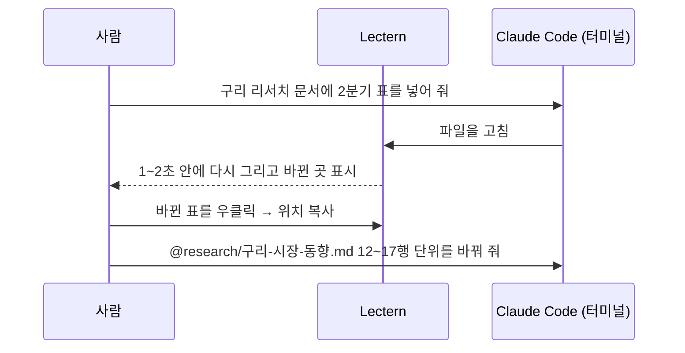

# Claude Code 와 함께

Lectern 은 Claude Code 와 나란히 쓰도록 만들어졌다. Claude Code 가 문서·코드를 만들고 고치면, 사람은 Lectern 에서 바로 읽고 확인하고 다음 일을 맡긴다.

## 터미널

탭 막대 오른쪽 끝의 **터미널**(또는 **Ctrl+\`** — \` 는 숫자 1 왼쪽 키)을 누르면 그 프로젝트 폴더에서 PowerShell 이 열린다. 여기서 `claude` 를 실행하면 된다.

> [!IMPORTANT]
> 이 예제는 Lectern 프로그램 폴더 안에 있어 **보기만** 한다 — 이 탭에서는 터미널·편집 모드·새 문서·이름 바꾸기가 없다 (프로그램 파일 옆에서 명령이 돌거나 파일이 바뀌지 않게). 아래의 '해 보세요' 가운데 고치는 것은 내 프로젝트나, 이 폴더를 다른 곳(문서 폴더 등)에 복사해 연 복사본에서 한다.

- 프로젝트 탭마다 셸이 하나씩 있다. 닫아도(Ctrl+\`) 셸은 계속 돌고, 다시 열면 그대로다.
- 머리줄의 **+** 로 터미널을 더 연다 (5개까지 — 1번은 Claude Code, 2번은 서버나 두 번째 Claude 처럼). 오른쪽에 두면 위아래로 쌓여 모두 보인다 — 1번이 맨 아래이고, 칸 사이 경계를 끌어 높이를 바꾼다. 문서 아래에 두면 탭이다.
- 머리줄의 버튼으로 터미널을 오른쪽 ↔ 문서 아래로 옮긴다. 창이 세로로 길면 자동으로 아래에 둔다.
- 툴바의 **터미널 모음**(Ctrl+Shift+\`)은 열린 모든 프로젝트의 터미널을 한 화면에 격자로 보여 준다 — 여러 Claude Code 를 동시에 돌릴 때.

## 문서의 위치를 Claude Code 에

본문의 표·단락·제목을 우클릭하면 **위치 복사**가 있다. `@research/구리-시장-동향.md 12~17행` 처럼 파일과 원문 줄 범위를 복사한다. 옆의 터미널 버튼을 누르면 터미널에 바로 붙는다 (Enter 는 누르지 않으므로 이어서 할 말을 적는다).

키보드로는 **Shift+→** 가 현재 줄의 위치를 맨 앞(1번) 터미널에 넣는다. 터미널이 여럿이면 **Shift+숫자**(Shift+2 면 2번)로 그 터미널에 넣고, 메뉴에서는 **숫자 키를 누른 채** 터미널 버튼을 누른다. Ctrl 을 함께 누르면 초점이 문서에 남아 여러 곳을 이어서 넣는다.

같은 메뉴의 **원문 복사**는 그 블록의 Markdown 원문을, 제목의 **이 절 원문 복사**는 절 전체를 복사한다.

> [!TIP]
> 해 보세요: 이 단락을 우클릭해 '위치 복사'를 누르고, 메모장에 붙여 본다.

## 바뀐 곳 보기

Claude Code 가 파일을 고치면 Lectern 이 1~2초 안에 다시 그린다. 스크롤 위치는 그대로이고, **바뀐 블록만** 잠깐 색으로 표시된다. 바뀐 곳이 화면 밖이면 상태줄에 **바뀐 곳 N곳** 버튼이 나오고, 누르면 차례로 찾아간다.

- 열어 보지 않은 문서가 바뀌면 트리에 점이 붙고, 다른 탭의 프로젝트가 바뀌면 탭에 점이 붙는다.
- 사이드바 **최근 변경**에서 무엇이 언제 바뀌었는지 본다.

## 코드 읽기

사이드바 **코드** 묶음의 파일을 한 번 누르면 줄 번호·언어 색으로 읽는다. 오른쪽 목차에 클래스·함수와 `# ---- 계산 ----` 같은 구분 주석이 나온다. 문서 속 `src/report.py:14` 같은 경로를 누르면 그 줄로 간다. 코드는 실행하지 않는다.

## 고치기

간단한 고침은 그 자리에서 줄을 열어 한다 — **F2** 나 두 번 누르기로 열고 Enter 로 저장한다 ([한 줄 편집](08-한-줄-편집.md)). 줄 옮기기·지우기, 표·강조글·그림 넣기도 그 자리에서 하고, 누르는 순간 저장된다.

여러 곳을 한꺼번에 손볼 때는 **편집 모드**를 연다. 탭 막대의 **편집**(또는 Ctrl+E, 상태줄 '편집', 우클릭 '이 문서 편집')을 누르면 보던 자리의 원문이 열린다.

- 줄 번호·언어 색, Ctrl+F 찾기·Ctrl+H 바꾸기·Ctrl+G 줄로 가기
- **Ctrl+S** 저장 — 원래 줄바꿈(CRLF/LF)·BOM 은 그대로
- 편집하는 동안 오른쪽 목차는 커서가 있는 절을 따라오고, 목차를 누르면 편집기가 그 줄로 간다
- 그사이 Claude Code 가 같은 파일을 고쳤으면 저장할 때 덮어쓸지 묻는다
- Esc 로 닫으면 문서 화면이 편집하던 곳에 있다

> [!NOTE]
> 해 보세요 (예제의 복사본에서): [후속 과제](../plans/10-후속-과제.md)를 열고 마지막 할 일에서 **Ctrl+Enter** → 할 일 한 줄 → Enter. 편집 모드로는 Ctrl+E → 맨 끝에 한 줄 → Ctrl+S → Esc.

## 담기 — 조각을 모아 다른 문서로

여러 문서의 절·표·그림·차트를 모아 보고서 하나로 엮을 때 쓴다.

- 제목을 우클릭하면 **이 절 담기**, 표·그림·차트를 우클릭하면 **담기** — 캡션과 '자료:' 줄도 함께
- 사이드바 **담기** 탭에서 순서를 고르고 **문서로 보내기…** → **새 문서…** 또는 문서 탭에 열어 둔 문서와 자리(맨 끝·절 끝)
- 그 문서에 바로 들어가 저장된다 — 그림·차트 데이터의 경로와 각주는 맞춰져 있고, Ctrl+Z 로 되돌린다
- 빈 새 문서는 **Ctrl+N** 이나 트리 우클릭 **새 문서 만들기…** — 제목과 위치를 정하면 바로 만들어진다
- 조각마다 보이지 않는 `<!-- 담은 곳: … -->` 주석이 남아 Claude Code 가 출처를 안다
- **Claude 에 맡기기**는 담은 것들의 위치로 Claude Code 에 새 문서를 부탁하는 요청 글이다

> [!NOTE]
> 해 보세요 (예제의 복사본에서): [구리 시장 동향](../research/구리-시장-동향.md)의 '요약' 제목과 차트를 우클릭해 담고, 담기 탭의 **문서로 보내기…** → **새 문서…** → `reports/모음.md` → Enter. 따로 저장하지 않아도 된다.

## Claude Code 에 Lectern 알려 주기

Claude Code 가 Lectern 에서 잘 보이는 문서를 쓰게 하려면, 설정(Ctrl+,)의 **Claude Code 에 Lectern 알려 주기** → **Claude Code용 요청 복사**를 Claude Code 에 붙인다. Claude Code 가 Lectern 의 작성 안내를 읽고 그 프로젝트의 `CLAUDE.md` 에 규칙을 정리한다. 이 예제의 [CLAUDE.md](../CLAUDE.md) 가 그 결과의 본보기다.

## Codex·Antigravity·OpenCode 를 쓸 때

터미널은 어떤 프로그램이든 돌리므로 `claude` 대신 `codex`(OpenAI Codex CLI), `agy`(Google Antigravity CLI), `opencode`(OpenCode)를 띄워도 된다. 이 안내에서 'Claude Code' 라고 적은 것은 네 도구 모두에 해당한다.

- 설정(Ctrl+,)의 **쓰는 AI 도구**에서 고르면 화면의 이름('Codex로 보내기')과 요청 글이 그 도구를 따른다.
- 세 도구는 프로젝트의 규칙을 `CLAUDE.md` 가 아니라 `AGENTS.md` 에서 읽는다. 이 예제의 [AGENTS.md](../AGENTS.md) 는 CLAUDE.md 를 읽으라고 가리키기만 한다.
- 터미널을 여럿 열어 1번은 Claude Code, 2번은 Codex 처럼 두고 **Shift+숫자**로 골라 보낼 수 있다. 여러 줄을 붙여 넣어도 네 도구 모두 보내지 않고 입력 칸에 둔다 — Enter 는 직접 누른다.

다음: [문서 쓰는 법](04-문서-쓰는-법.md)
