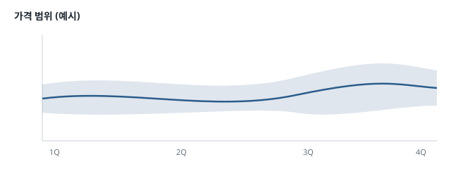

# 문서 쓰는 법

Lectern 에서 잘 보이는 Markdown 이다. 기능마다 **원문**(회색 상자)과 그 **결과**를 차례로 둔다. 사람은 결과를 보고, AI 는 원문을 보고 같은 문법을 쓰면 된다. 블록을 우클릭 → '원문 복사'로 원문만 가져갈 수도 있다.

## 제목과 목차

`#` 은 문서 제목(하나만), `##`·`###` 은 절이다. 오른쪽 목차·절 접기·장 하이라이트가 이 단계로 나뉜다. 단계를 건너뛰지 않는다(`##` 아래에 바로 `####` 를 두지 않는다).

~~~md
# 문서 제목
## 큰 절
### 작은 절
~~~

## 표

숫자만 있는 열은 저절로 오른쪽 정렬된다. 단위는 머리행에 적고, 칸에는 숫자만 둔다. 긴 표는 스크롤해도 머리행이 위에 붙어 있다. 표 바로 위에 `표 1. 제목` 한 줄을 두면 그것이 캡션이 되어 목차·모아 보기에서 표의 이름으로 보인다 (그림은 바로 아래에 `그림 1. 제목`). 첫 열(구분·항목)은 짧게 쓴다 — 다른 열보다 여러 줄로 감기면 Lectern 이 첫 열을 넓혀 맞추지만, 짧은 이름표가 가장 읽기 좋다.

~~~md
표 1. 분기별 금속 가격

| 품목 | 1분기 (USD/t) | 2분기 (USD/t) | 변화 |
|---|---|---|---|
| 구리 | 10,593 | 11,007 | +3.9% |
| 알루미늄 | 2,310 | 2,265 | -1.9% |
~~~

표 1. 분기별 금속 가격

| 품목 | 1분기 (USD/t) | 2분기 (USD/t) | 변화 |
|---|---|---|---|
| 구리 | 10,593 | 11,007 | +3.9% |
| 알루미늄 | 2,310 | 2,265 | -1.9% |

## 박스글

인용(`>`) 첫 줄에 종류를 적으면 색이 있는 박스글이 된다. 다섯 가지가 있다.

~~~md
> [!NOTE]
> 참고할 내용.

> [!WARNING]
> 조심할 내용.
~~~

> [!NOTE]
> 참고할 내용. 읽는 사람이 알아 두면 좋은 것.

> [!TIP]
> 더 잘하는 방법.

> [!IMPORTANT]
> 꼭 알아야 하는 것.

> [!WARNING]
> 조심할 것. 잘못하면 문제가 생긴다.

> [!CAUTION]
> 하면 안 되는 것.

`[!` 없이 쓴 `>` 는 보통 인용이다.

> 보통 인용은 이렇게 보인다.

## 목록과 체크리스트

~~~md
1. 자료 모으기
2. 요약 쓰기
   - 표는 숫자만
   - 단위는 머리행에

- [x] 끝낸 일
- [ ] 남은 일
~~~

1. 자료 모으기
2. 요약 쓰기
   - 표는 숫자만
   - 단위는 머리행에

- [x] 끝낸 일
- [ ] 남은 일

## 각주

~~~md
가격은 세 달 평균이다[^1].

[^1]: 분기마다 월평균 세 개의 단순 평균.
~~~

가격은 세 달 평균이다[^1].

[^1]: 분기마다 월평균 세 개의 단순 평균. 각주는 문서 맨 아래에 모이고, 번호를 누르면 오간다.

## 코드 블록

언어를 적으면 색이 입혀지고, 오른쪽 위에 '복사' 버튼이 생긴다.

~~~~md
```python
def change(prices, months=3):
    ...
```
~~~~

```python
def change(prices, months=3):
    recent = mean(p.usd_per_t for p in prices[-months:])
    before = mean(p.usd_per_t for p in prices[-2 * months:-months])
    return (recent - before) / before * 100
```

## 코드 위치

본문에 `경로:줄` 을 적으면 링크가 된다 (그 파일이 프로젝트에 있을 때만). 누르면 코드 읽기 화면의 그 줄로 간다.

~~~md
계산은 `src/report.py:14` 의 `change()` 다.
~~~

계산은 `src/report.py:14` 의 `change()` 다. 요약 문장은 `src/report.py:29` 에서 만든다.

## 링크

| 원문 | 열리는 곳 |
|---|---|
| `[계획](../plans/구현-계획.md)` | 다른 문서 — Lectern 안에서 |
| `[전망](../research/구리-시장-동향.md#전망)` | 다른 문서의 절 |
| `[표 절](#표)` | 이 문서의 절 |
| `[저장소](https://github.com/samiblog/lectern)` | 기본 브라우저 |
| `[자료](../data/월별-가격.csv)` | 자료 파일 — 기본 앱 (실행 파일은 탐색기에서 선택만) |

예: [계획](../plans/구현-계획.md), [전망](../research/구리-시장-동향.md#전망), [표 절](#표).

절 링크의 `#` 뒤는 제목에서 만든다 — 소문자로, 빈칸은 `-`, 기호는 뺀다 (`## 가격 범위` → `#가격-범위`).

## 그림

프로젝트 안의 그림은 문서 기준 상대경로로 넣는다. 누르면 크게 본다.

~~~md

~~~


인터넷 주소의 그림(`https://…`)은 설정 '인터넷 그림 표시'가 켜져 있을 때만 불러온다.

## 접는 내용

긴 부연은 HTML 의 `<details>` 로 접어 둘 수 있다.

~~~md
<details>
<summary>계산 방법 자세히</summary>

세 달 평균끼리 비교한다.

</details>
~~~

<details>
<summary>계산 방법 자세히</summary>

최근 세 달의 월평균을 더해 3으로 나누고, 그 앞 세 달도 같게 구해 비교한다.

</details>

## 문서 정보 (frontmatter)

맨 위 `---` 사이에 적은 값은 문서 위의 '메타데이터' 상자로 보인다. `description` 은 폴더 개요의 요약으로 쓰인다. [구현 계획](../plans/구현-계획.md)이 그 예다.

~~~md
---
title: 리서치 자동화 구현 계획
description: 세 단계로 나눈 계획
status: 진행 중
---
~~~

## 파일 이름

- 첫 줄의 `# 제목` 이 문서의 이름이다 — 트리에 마우스를 올리면, 또는 '제목' 버튼을 켜면 보인다.
- 순서가 있는 문서는 `01-`, `02-` 처럼 번호로 시작한다. `2-` 는 `10-` 보다 앞에 온다.
- `.` 으로 시작하거나 `node_modules`·`dist`·`build` 안의 문서는 보이지 않는다.

## 그 밖에

수식은 [수식](05-수식.md), 흐름도·시퀀스·간트는 [다이어그램](06-다이어그램.md), 데이터 차트는 [차트](07-차트.md)에 있다. 발표 자료(슬라이드)는 [발표](08-발표.md) — 맨 앞 설정에 `marp: true` 를 적은 문서다.
