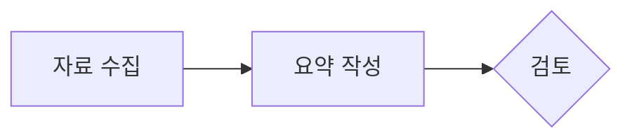
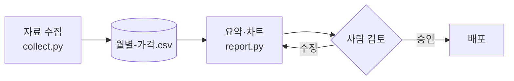
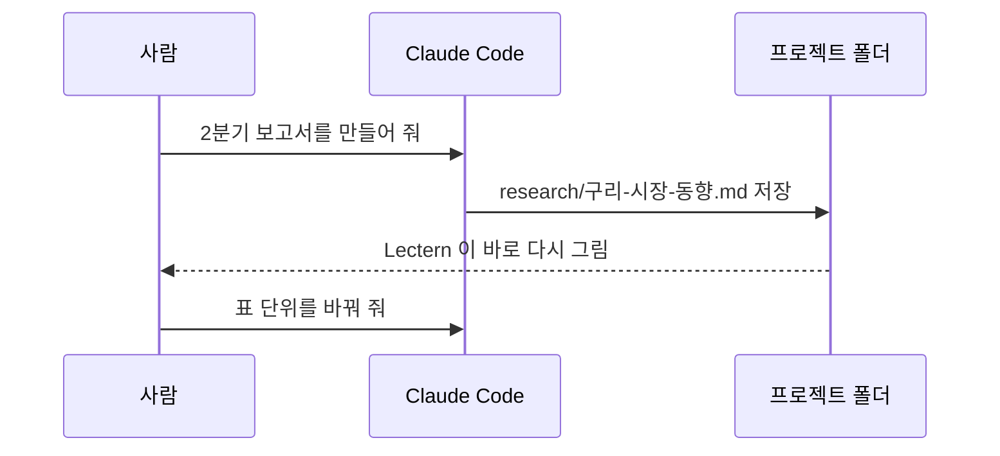
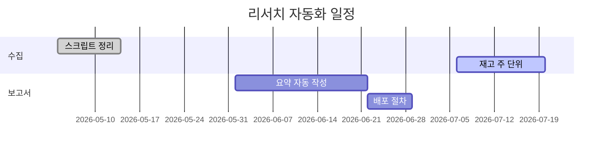
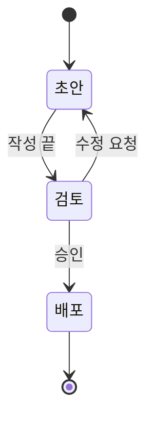
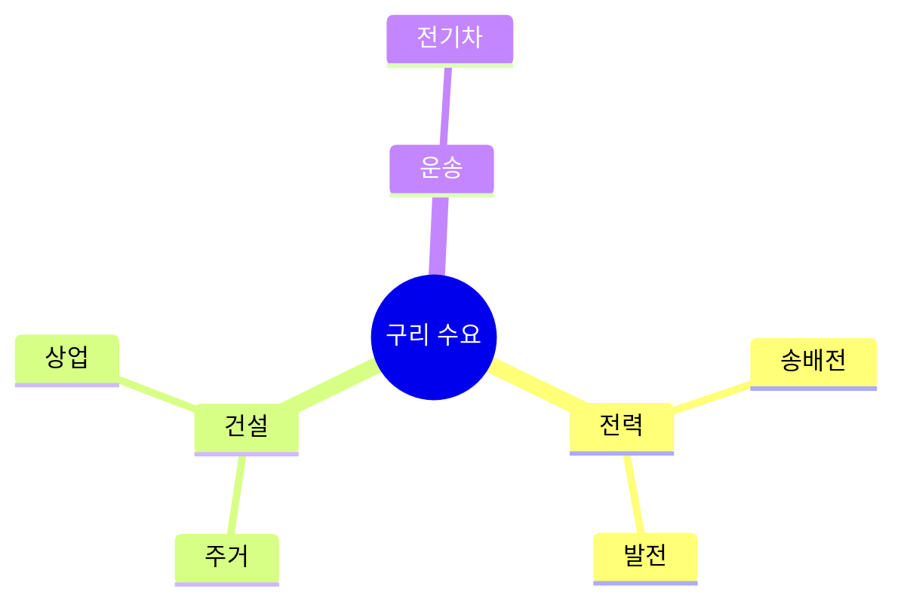
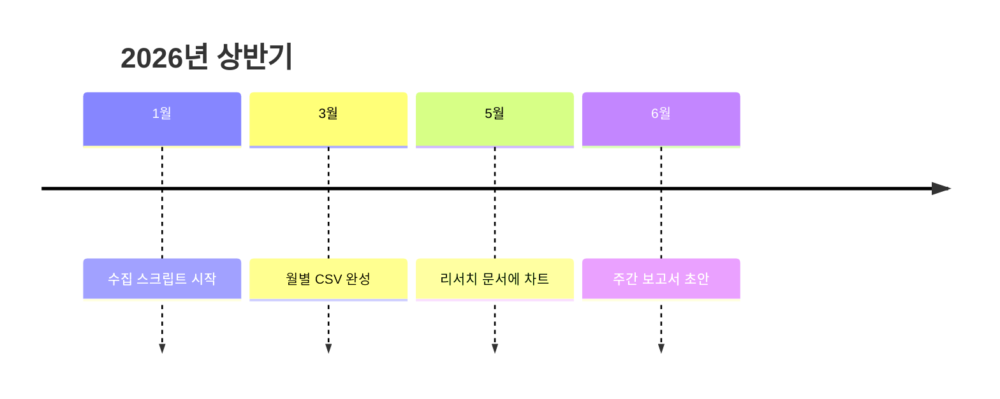
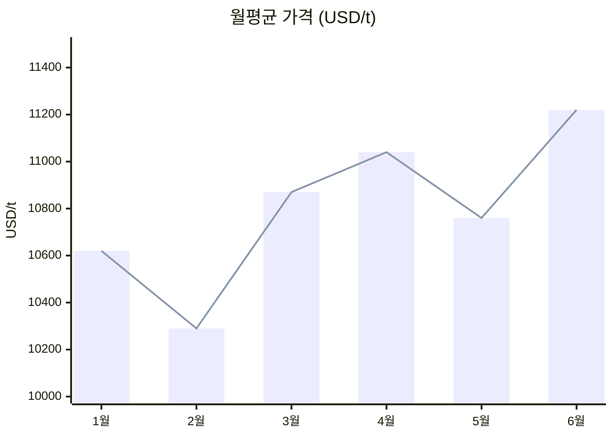
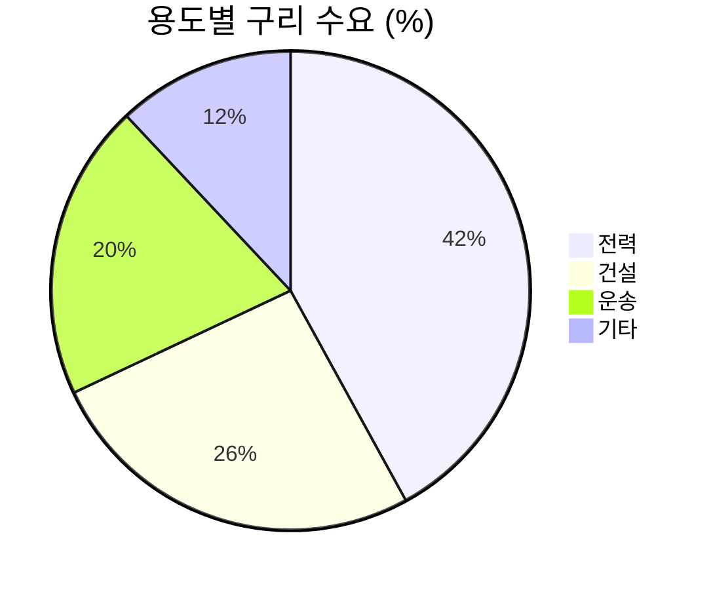

# 다이어그램

코드 블록의 언어를 `mermaid` 로 적으면 그림으로 바뀐다 (Mermaid). 색은 문서 스타일을 따르고, 누르면 크게 보며, 우클릭 '그림 복사'로 PNG 를 워드·PPT 에 붙인다. 목차와 모아 보기에는 '다이어그램'으로 나온다.

~~~~md

~~~~

## 흐름도

## 시퀀스

## 일정 (간트)

## 상태

## 마인드맵

## 타임라인

## Mermaid 의 차트

간단한 막대·꺾은선(`xychart-beta`), 원형(`pie`), 흐름량(`sankey-beta`)도 Mermaid 로 된다. 한글 축 이름은 따옴표로 감싼다. 데이터가 많거나 모양을 자세히 정하려면 [차트](07-차트.md)의 Vega-Lite·ECharts·Plotly 를 쓴다.

다음: [차트](07-차트.md)
