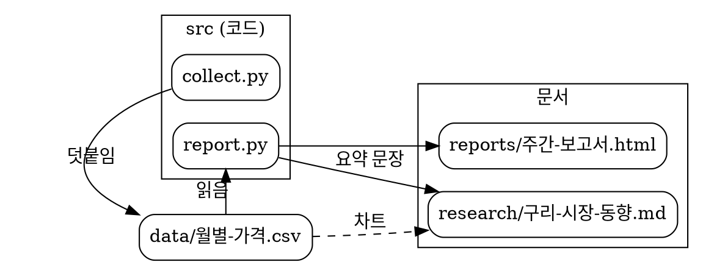
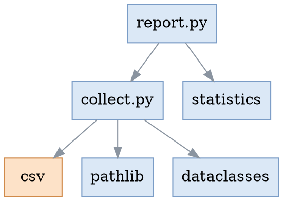

# 차트

언어를 아래처럼 적은 코드 블록은 [다이어그램](06-다이어그램.md)처럼 그림으로 바뀝니다. 그림을 누르면 크게 보고, 우클릭 '그림 복사'로 PNG 를 워드·PPT 에 붙이며, '원문 복사'로 그 설정을 가져갑니다. 목차와 모아 보기에는 '다이어그램'으로 나옵니다.

| 코드 블록 언어 | 라이브러리 | 잘하는 것 |
|---|---|---|
| `vega-lite` (또는 `vega`) | Vega-Lite | 데이터 차트 — 막대·선·면적·산점도·히트맵, 겹친 차트. 프로젝트 안의 CSV·JSON 파일도 읽음 |
| `echarts` | Apache ECharts | 종류가 많은 차트 — 도넛·캔들·게이지·레이더 등 |
| `plotly` | Plotly | 분석용 차트 — 상자 그림·히스토그램·선버스트·폭포 등. Python 의 `fig.to_json()` 결과를 그대로 붙여도 됨 |
| `dot` (또는 `graphviz`) | Graphviz | 노드가 많은 구성도·의존 관계의 자동 배치 |

- 색과 글꼴은 고른 문서 스타일을 따릅니다. 스타일을 바꾸면 다시 그립니다.
- 모두 움직이지 않는 그림입니다. 마우스를 올려 값 보기나 확대는 없습니다.
- 설정에 함수는 쓸 수 없습니다. 문서가 스크립트를 돌리지 않는 것과 같은 까닭입니다.
- 인터넷에서 데이터를 받지 않습니다. 데이터는 문서 안에 적거나 프로젝트 안의 파일을 가리킵니다.

## Vega-Lite

### 막대와 선을 겹쳐서

`"width": "container"` 는 문서 폭에 맞춥니다. 두 값의 단위가 달라서 세로축을 따로 둡니다.

```vega-lite
{
  "$schema": "https://vega.github.io/schema/vega-lite/v6.json",
  "title": "분기별 구리 가격과 거래소 재고",
  "width": "container",
  "height": 240,
  "data": {
    "values": [
      { "분기": "2025 1Q", "가격": 8950, "재고": 21.4 },
      { "분기": "2025 2Q", "가격": 9420, "재고": 18.9 },
      { "분기": "2025 3Q", "가격": 9100, "재고": 19.6 },
      { "분기": "2025 4Q", "가격": 9630, "재고": 16.2 },
      { "분기": "2026 1Q", "가격": 10260, "재고": 14.8 },
      { "분기": "2026 2Q", "가격": 10870, "재고": 13.1 }
    ]
  },
  "encoding": { "x": { "field": "분기", "type": "ordinal", "axis": { "labelAngle": 0 }, "title": null } },
  "layer": [
    {
      "mark": { "type": "bar", "opacity": 0.85 },
      "encoding": { "y": { "field": "가격", "type": "quantitative", "title": "가격 (USD/t)" } }
    },
    {
      "mark": { "type": "line", "point": true, "color": "#e45756" },
      "encoding": { "y": { "field": "재고", "type": "quantitative", "title": "재고 (만 t)" } }
    }
  ],
  "resolve": { "scale": { "y": "independent" } }
}
```

### 산점도

```vega-lite
{
  "title": "광산별 생산량과 원가",
  "width": "container",
  "height": 260,
  "data": {
    "values": [
      { "광산": "에스콘디다", "지역": "남미", "생산": 1050, "원가": 1.45 },
      { "광산": "그라스베르크", "지역": "아시아", "생산": 760, "원가": 0.95 },
      { "광산": "코야와시", "지역": "남미", "생산": 590, "원가": 1.30 },
      { "광산": "모렌시", "지역": "북미", "생산": 410, "원가": 2.10 },
      { "광산": "카모아", "지역": "아프리카", "생산": 390, "원가": 1.20 },
      { "광산": "엘테니엔테", "지역": "남미", "생산": 360, "원가": 2.30 },
      { "광산": "올림픽댐", "지역": "오세아니아", "생산": 210, "원가": 2.45 }
    ]
  },
  "mark": { "type": "point", "filled": true, "size": 110 },
  "encoding": {
    "x": { "field": "생산", "type": "quantitative", "title": "생산량 (천 t)" },
    "y": { "field": "원가", "type": "quantitative", "title": "원가 (USD/lb)" },
    "color": { "field": "지역", "type": "nominal", "title": "지역" }
  }
}
```

### 프로젝트 안의 CSV 파일

`data.url` 에 이 문서 기준 상대경로를 적으면 그 파일을 읽습니다 (`data/월별-가격.csv` — 이 문서에서는 `../data/월별-가격.csv`). 프로젝트 밖이나 인터넷 주소는 읽지 않습니다. 파일을 고치면 문서를 다시 열거나 F5 를 누를 때 반영됩니다.

```vega-lite
{
  "title": "CSV 파일에서 읽은 월별 가격",
  "width": "container",
  "height": 220,
  "data": { "url": "../data/월별-가격.csv" },
  "mark": { "type": "area", "line": true, "opacity": 0.25 },
  "encoding": {
    "x": { "field": "월", "type": "temporal", "title": null, "axis": { "format": "%y.%m" } },
    "y": { "field": "가격", "type": "quantitative", "title": "USD/t", "scale": { "zero": false } }
  }
}
```

## ECharts

폭은 문서 폭에 맞추고, 높이는 `"height"` 로 정합니다 (없으면 360). ECharts 에는 없는 키라 여기서만 씁니다.

### 묶은 막대

```echarts
{
  "title": { "text": "지역별 수요 (만 t)" },
  "legend": { "top": 4, "right": 0 },
  "grid": { "top": 48, "left": 48, "right": 16, "bottom": 28 },
  "height": 300,
  "xAxis": { "type": "category", "data": ["중국", "유럽", "미국", "일본", "인도"] },
  "yAxis": { "type": "value" },
  "series": [
    { "name": "2025", "type": "bar", "data": [1520, 320, 180, 95, 140] },
    { "name": "2026", "type": "bar", "data": [1580, 315, 190, 93, 162] }
  ]
}
```

### 도넛 — 예제처럼 적어도 됩니다

ECharts 예제의 `option = { … }` 처럼 따옴표 없는 키, 작은따옴표, 주석, 끝 쉼표를 그대로 써도 읽습니다.

```echarts
// 용도별 소비 비중
option = {
  title: { text: '용도별 소비 비중', left: 'center' },
  legend: { bottom: 0 },
  height: 320,
  series: [{
    type: 'pie',
    radius: ['40%', '64%'],
    center: ['50%', '56%'],
    label: { formatter: '{b}\n{d}%' },
    data: [
      { name: '전력·전선', value: 42 },
      { name: '건설', value: 26 },
      { name: '운송', value: 13 },
      { name: '기계', value: 11 },
      { name: '기타', value: 8 },
    ],
  }],
};
```

### 캔들

값은 [시가, 종가, 저가, 고가] 입니다. 오르면 빨강, 내리면 초록입니다.

```echarts
{
  "title": { "text": "주간 가격 (USD/t)" },
  "grid": { "top": 40, "left": 56, "right": 16, "bottom": 28 },
  "height": 280,
  "xAxis": { "type": "category", "data": ["9/1", "9/8", "9/15", "9/22", "9/29", "10/6"] },
  "yAxis": { "type": "value", "scale": true },
  "series": [{
    "type": "candlestick",
    "data": [
      [9420, 9510, 9380, 9560], [9510, 9470, 9400, 9590], [9470, 9620, 9450, 9680],
      [9620, 9580, 9510, 9700], [9580, 9760, 9550, 9810], [9760, 9890, 9720, 9950]
    ]
  }]
}
```

## Plotly

설정은 `{"data": [그래프…], "layout": {…}}` 입니다 (Python 의 `fig.to_json()` 과 같은 모양). 폭은 문서 폭, 높이는 `layout.height`(없으면 400)입니다. 지도 차트는 인터넷의 지도 자료가 있어야 해서 그리지 않습니다.

### 선과 막대, 오른쪽 축

```plotly
{
  "data": [
    { "type": "bar", "name": "생산 (천 t)", "x": ["1월", "2월", "3월", "4월", "5월", "6월"], "y": [410, 395, 430, 452, 440, 468] },
    { "type": "scatter", "mode": "lines+markers", "name": "가동률 (%)", "yaxis": "y2",
      "x": ["1월", "2월", "3월", "4월", "5월", "6월"], "y": [86, 83, 89, 92, 90, 94] }
  ],
  "layout": {
    "title": { "text": "월별 생산과 가동률" },
    "height": 340,
    "yaxis": { "title": { "text": "천 t" } },
    "yaxis2": { "title": { "text": "%" }, "overlaying": "y", "side": "right", "range": [70, 100], "showgrid": false },
    "legend": { "orientation": "h", "y": -0.18 }
  }
}
```

### 상자 그림

```plotly
{
  "data": [
    { "type": "box", "name": "남미", "y": [1.45, 1.30, 2.30, 1.85, 1.62, 1.95, 2.10] },
    { "type": "box", "name": "아시아", "y": [0.95, 1.40, 1.20, 1.75, 1.10] },
    { "type": "box", "name": "아프리카", "y": [1.20, 1.55, 1.35, 1.90, 1.48, 1.66] }
  ],
  "layout": { "title": { "text": "지역별 원가 분포 (USD/lb)" }, "height": 320, "showlegend": false }
}
```

### 선버스트

```plotly
{
  "data": [{
    "type": "sunburst",
    "labels": ["구리 수요", "전력", "건설", "운송", "송배전", "발전", "주거", "상업", "전기차", "기타 운송"],
    "parents": ["", "구리 수요", "구리 수요", "구리 수요", "전력", "전력", "건설", "건설", "운송", "운송"],
    "values": [100, 42, 26, 32, 28, 14, 16, 10, 20, 12],
    "branchvalues": "total"
  }],
  "layout": { "title": { "text": "용도별 구리 수요 (%)" }, "height": 380, "margin": { "t": 50, "l": 10, "r": 10, "b": 10 } }
}
```

## Graphviz

DOT 언어로 노드와 선만 적으면 자리를 알아서 잡습니다. 배치 방식은 `layout=neato` 처럼 바꿀 수 있습니다.

### 구성도



### 의존 관계 (색 채우기)

채운 상자의 글자는 어두운 스타일에서도 읽히게 상자 색에 맞춥니다.



## Mermaid 로도 되는 차트

간단한 막대·꺾은선·원형은 Mermaid 로도 됩니다 — [다이어그램](06-다이어그램.md)의 'Mermaid 의 차트'.

## 그리지 못할 때

설정에 함수가 있거나 형식이 틀리면 그림 대신 원문과 까닭을 보입니다.

```echarts
{
  "series": [{ "type": "bar", "data": [3, 5, 2] }],
  "tooltip": { "formatter": function (p) { return p.name; } }
}
```

다음: [처음으로](../README.md)
