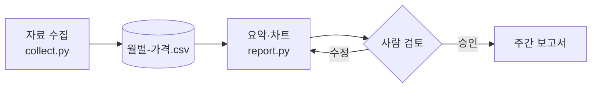

<!-- _class: lead -->
<!-- _paginate: false -->
<!-- _footer: "" -->

# 구리 시장 2분기 리뷰

리서치 자동화 프로젝트 · 2026-07-03

<!--
맨 앞 설정의 marp: true 가 있으면 Lectern 이 이 문서를 슬라이드로 보인다.
상태줄의 '발표'(Shift+F5)를 누르면 창 전체에 한 장씩, N 을 누르면 이 노트가 보인다.
-->

---

## 이번 분기 요약

| 지표 | 1분기 | 2분기 | 변화 |
|---|---|---|---|
| 거래소 평균 가격 (USD/t) | 10,593 | 11,007 | +3.9% |
| 거래소 재고 (천 t) | 268 | 241 | -10.1% |
| 중국 수입 (만 t) | 141 | 149 | +5.7% |

- 6월 가격 **$11,220** — 자료를 모은 뒤 가장 높다
- 3분기에는 공급 차질이 풀리며 오름폭이 줄 것으로 본다

<!-- 숫자는 research/구리-시장-동향.md 의 요약 표와 같다. 예제용으로 만든 값이다. -->

---

## 자료가 흐르는 길



---

## 월별 가격

```vega-lite
{
  "width": "container",
  "height": 230,
  "data": { "url": "../data/월별-가격.csv" },
  "mark": { "type": "area", "line": true, "opacity": 0.25 },
  "encoding": {
    "x": { "field": "월", "type": "temporal", "title": null, "axis": { "format": "%y.%m" } },
    "y": { "field": "가격", "type": "quantitative", "title": "USD/t", "scale": { "zero": false } }
  }
}
```

---


## 가격 밴드

- 분기 평균에서 위아래로 한 표준편차
- 2분기는 밴드의 위쪽에서 움직였다
- 그림은 `` 로 오른쪽에 깔았다

---

## 변화율 계산

분기 평균 가격의 변화는

$$
\Delta = \frac{\bar{p}_{Q2} - \bar{p}_{Q1}}{\bar{p}_{Q1}} = \frac{11{,}007 - 10{,}593}{10{,}593} \approx 3.9\%
$$

계산 코드는 `src/report.py` 에 있다.

```python
change = (q2_mean - q1_mean) / q1_mean
```

---

<!-- _class: invert lead -->

## 다음 단계

1. 3분기 자료 수집을 매주 자동으로
2. 재고·수입 지표도 CSV 로 모으기
3. 이 발표를 주간 보고서와 함께 배포

---

## 이 발표 문서를 쓰는 법

| 쓰는 것 | 하는 일 |
|---|---|
| 맨 앞 설정 `marp: true` | 슬라이드로 보인다 (없으면 보통 문서) |
| `---` (줄) | 다음 슬라이드 |
| `paginate`·`footer`·`header` | 쪽 번호·아래·위 글 (`_` 를 붙이면 그 장만) |
| `<!-- _class: lead -->` | 가운데 정렬한 장 (`invert` 는 어두운 장) |
| `` | 배경 그림 (`left`·`contain` 등) |
| 지시어가 아닌 `<!-- … -->` | 발표자 노트 (발표 중 N) |
| `style: \|` | 이 문서의 슬라이드에만 입히는 CSS |

Mermaid·차트·수식·코드는 보통 문서와 같이 쓴다.
