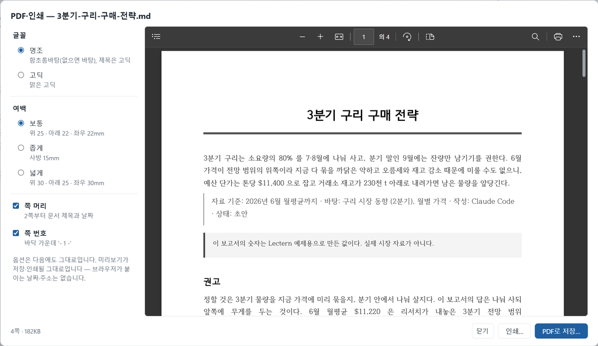

# 보고서 쓰고 PDF 로 보내기

Claude Code 에게 사람이 읽을 보고서를 맡기고, Lectern 에서 읽고 고친 뒤, 보고서 양식의 PDF 로 보내는 흐름이다. 앞쪽은 **글쓰기 스타일**(Claude 를 리서치 동료·편집자로 바꾸는 출력 스타일)로 글의 질을 올리는 법, 뒤쪽은 **PDF로 저장**이 종이에 어떻게 싣는지와 그에 맞춰 쓰는 법이다. 예는 모두 실제로 시켜 보고 PDF 로 뽑아 본 것이다.

[목차]

## 1. 한눈에


그림 1. 보고서 하나가 PDF 가 되기까지

| 단계 | 누가 | 어디서 |
|---|---|---|
| 글쓰기 스타일 설치 | Claude (사람이 허락) | 설정 창 **글쓰기 스타일** → 요청 글을 터미널에 |
| 스타일 고르기 | 사람 | 보고서 폴더의 Claude Code 에서 `/output-style 리서치 글쓰기` |
| 쓰기·퇴고 | Claude | 오른쪽 터미널 (**Ctrl+\`**) |
| 읽고 고치기 | 사람 | Lectern — 한 줄 편집, 편집 모드 (**Ctrl+E**) |
| PDF | 사람 | 탭 막대의 **인쇄** 버튼, 또는 문서 여백 우클릭 → **PDF로 저장…** |

표 1. 단계마다 하는 곳

## 2. 글쓰기 스타일 — 한 번만 설치

Claude Code 의 기본 역할은 개발자다. 그래서 보고서를 맡겨도 '~함·~임' 개조식과 표로 흐르기 쉽다. 글쓰기 스타일은 그 역할을 바꾼다. 쓰기 전에 읽는 사람과 판단할 것을 정하고, 폴더 밖 자료와 웹으로 근거를 넓히고, 문단으로 쓰고, 다 쓴 뒤 읽는 사람이 되어 다시 읽는다.

1. 설정 창(**Ctrl+,**)의 **글쓰기 스타일**에서 터미널 버튼을 누른다. 요청 글이 터미널에 들어간다 (Enter 는 누르지 않는다).
2. Enter 를 누르면 Claude 가 스타일 파일을 읽고 무엇이 바뀌는지 알린 뒤 **설치할지 묻는다**. 그렇다고 답하면 `~/.claude/output-styles/research-writing.md` 로 복사한다. 스스로 설치하지는 않는다.
3. Claude Code 를 끝내고(`/exit`) 다시 띄운다 — 스타일 파일은 시작할 때 읽는다.
4. **보고서를 쓰는 폴더에서만** `/output-style 리서치 글쓰기` 를 친다. 그 폴더의 `.claude/settings.local.json` 에 남아 다음에도 그 폴더에서는 이 스타일로 시작한다. 지금 스타일은 `/output-style` 로 보고, 되돌릴 때는 `/output-style default`.

### 이전 판과 견주면

같은 과제 셋(임원 브리핑 한 쪽, 계획서 검토 의견, 신입 사원용 해설)을 스타일 없이(0.73.1)와 이 스타일로 시키고, 어느 쪽인지 가린 채 다른 Claude 에게 편집장 기준(독자·결론·근거·흐름·정직·분량, 30점)으로 매기게 했다.

| 과제 | 스타일 없이 | 이 스타일 |
|---|---:|---:|
| 임원 브리핑 | 25.0 | 27.3 |
| 계획서 검토 의견 | 24.5 | 28.0 |
| 신입 사원용 해설 | 25.5 | 27.8 |

표 2. 과제마다 평가 평균 (30점 — 순서를 바꿔 매긴 것, 스타일을 다듬은 뒤 다시 매긴 것을 모두 평균)

가장 크게 달라진 것은 **흐름**(글머리표 나열 대신 이어지는 문단 — 글머리표 비율 40~80% → 0~20%)과 **정직**(자료와 자기 추정을 나눠 적음)이었고, 권고의 까닭을 더 잘 세웠다. 숫자 잘못은 양쪽 모두 없었다. 평가자도 Claude 이고 과제가 셋뿐이라 정밀한 측정은 아니지만, 여러 번 매겨도 방향은 같았다.

> [!WARNING]
> 코드를 쓰는 폴더에서는 고르지 않는다. 이 스타일은 Claude Code 의 개발 지침(범위 지키기, 고친 뒤 확인하기 등)을 뺀다.

> [!TIP]
> Claude 앱이 내 글을 잘 아는 까닭의 일부는 메모리다. Claude 앱 설정의 메모리를 복사해 Claude Code 에게 "이걸 정리해서 `~/.claude/CLAUDE.md` 에 넣어 줘" 라고 하면 모든 폴더의 Claude Code 가 나에 대해 몇 줄을 알고 시작한다 — 하는 일, 자주 쓰는 글과 읽는 사람, 좋아하는 문체.

## 3. 요청 — 이렇게 시킨다

스타일이 있어도 요청에 **읽는 사람·목적·분량**이 있으면 글이 달라진다. 아래는 실제로 시켜 본 요청과 Claude 가 한 일이다.

### 짧은 보고서를 바로

```text
research 폴더와 data 의 자료로, 구매팀장이 읽을 '3분기 구리 구매 전략' 보고서를
reports/3분기-구리-구매-전략.md 에 써 줘. A4 두세 쪽 분량. 개요 확인 없이 바로 써.
```

결과가 이 예제의 [3분기 구리 구매 전략](../reports/3분기-구리-구매-전략.md) 이다 (받은 그대로). 결론이 첫 문단에 있고, 숫자마다 '무엇에 비해 얼마, 그래서 무엇'이 붙어 있다. 판단과 추정은 판단·추정이라고 밝혔고, 끝의 '아직 모르는 것' 절에 빈칸(재고 자료, 회사 소요량)을 적었다. 표 캡션·각주·상대경로 링크 같은 Lectern 형식은 폴더의 CLAUDE.md 대로였다. 같은 요청을 기본 스타일로 시키면 '~함·~임' 개조식과 글머리표가 대부분이었다.

### 긴 보고서는 개요부터

```text
구리 시장 2분기 리뷰를 바탕으로 임원 보고용 하반기 구리 시장 전망 보고서를 다섯 쪽 분량으로 써 줘.
```

Claude 는 바로 쓰지 않았다. 핵심 주장 넷과 근거, 쪽 배분 표를 개요로 보이고, 정할 것 둘(기준 시점, 구매 권고를 얼마나 구체적으로)을 추천과 함께 물은 뒤 멈췄다. "추천대로" 나 고칠 점을 답하면 그 개요로 쓴다. 바로 쓰게 하려면 요청에 "개요 확인 없이 바로" 를 붙인다.

### 이미 쓴 글을 퇴고

```text
@의견서/철재-검토-의견.md 의 두 번째 문항 답을 퇴고해 줘.
주장과 인용한 기관 수치는 그대로 두고, 기계적으로 읽히는 곳(나열, 되풀이되는 어미)만 고쳐서 파일에 바로 반영해.
```

규칙이 엄한 폴더(기관에 보내는 검토 의견서 — 존댓말, 인용 수치는 원문 그대로, 표 금지, 보내는 파일은 hwpx 로 따로)에서 시켜 본 것이다. 두 번째 문항만 바뀌었고 그 절의 숫자는 하나도 빠지거나 늘지 않았다. '첫째~넷째' 나열이 문단의 흐름으로 바뀌었고 '판단됩니다'는 두 번에서 한 번으로 줄었다. 존댓말과 `\~` 표기는 그대로였고, 폴더 규칙대로 "hwpx 도 같게 고쳐야 한다" 고 알렸다.

### 그 밖에 쓸 만한 말

| 하고 싶은 것 | 요청 |
|---|---|
| 읽는 사람으로 다시 읽기 | "임원 입장에서 처음부터 읽고, 결론이 늦게 나오거나 나열만 있는 곳을 고쳐 줘" |
| 근거 넓히기 | "웹에서 최근 동향과 반대 근거를 찾아 출처를 각주로 달아 줘" |
| 지난 자료와 잇기 | "..\지난자료 의 작년 보고서를 읽고, 달라진 점이 드러나게 써 줘" |
| 분량 맞추기 | "본문을 한 쪽으로 줄여 줘 — 확인한 것·남은 것은 본문 밖에" |
| 한 곳만 | 본문을 우클릭해 **Claude용 위치 복사** 로 `@문서.md 40~52행` 을 붙이고 "이 문단을 결론 먼저로" |

표 3. 자주 쓰는 요청

> [!TIP]
> 폴더의 CLAUDE.md 맨 앞에 그 폴더의 **읽는 사람·목적·말투**를 몇 줄 적어 두면 요청마다 말하지 않아도 된다. 이 예제의 [CLAUDE.md](../CLAUDE.md) 맨 앞 '글' 절이 그 본보기다. 설정 창의 **Claude Code 에 Lectern 알려 주기** 요청 글도 이것을 먼저 묻게 되어 있다.

## 4. PDF 에 잘 나오게 쓰기

'PDF로 저장…'과 '인쇄…'는 화면 스타일과 상관없이 늘 같은 **보고서 양식**이다. A4 에 여백 위 25·아래 22·좌우 22mm, 본문 10.5pt 명조(설정 창 **인쇄·PDF 글꼴**에서 고딕으로)다. 문서를 이렇게 쓰면 그 양식이 제 몫을 한다.

| 쓰는 것 | 종이에서 |
|---|---|
| 첫 줄 `# 제목` | 첫 쪽 가운데 큰 제목과 두 줄 선. 2쪽부터 머리 왼쪽에 (60자가 넘으면 줄여서) |
| 제목 바로 아래 한 줄 인용 `> 작성: … · 2026-07-04` | 제목 아래 가운데 부제처럼 |
| 맨 앞 설정의 `date:` | 2쪽부터 머리 오른쪽의 날짜 (없으면 저장한 날). 맨 앞 설정 표는 싣지 않는다 |
| `표 1. 제목` (표 위) | 표와 같은 쪽에 붙는다. 12행이 넘는 표는 쪽을 나눠 싣고 머리행을 쪽마다 되풀이한다 |
| `그림 1. 제목` (그림·차트 아래) | 그림과 같은 쪽에. 쪽보다 큰 그림은 한 쪽 높이로 줄인다 |
| 열이 많은 표 | 9열부터 글자를 줄이고, 낱말·숫자는 칸 안에서 쪼개지 않는다 |
| 링크 | 검은 글자. 주소는 **'출처'·'참고문헌'·'자료' 절의 목록**에만 붙고, PDF 에서 누르면 열린다 |
| 각주 `[^1]` | 끝에 짧은 줄 아래 작은 글자 |
| `[목차]` 한 줄 | 그 자리에 목차. PDF 에서 누르면 그 절로 간다 |
| 쪽 나눔 줄 (넣기 창의 **쪽 나눔**) | 거기서 쪽이 바뀐다 |
| 강조글·박스글 | 색 없이 회색 막대·검은 테두리 |
| 긴 코드 | 긴 줄은 접고, 30줄이 넘으면 쪽을 나눠 싣는다 |

표 4. 쓰는 것과 종이

> [!NOTE]
> 출처를 본문 링크로만 달면 종이에는 주소가 남지 않는다. 받는 사람이 출처를 찾아야 하는 보고서라면 끝에 `## 출처` 절을 두고 목록으로 적는다.

## 5. PDF로 저장

1. 탭 막대 오른쪽 끝의 **인쇄** 버튼을 누르거나, 문서 여백(글이 없는 곳)을 우클릭해 **PDF로 저장…** 을 고른다. **PDF·인쇄** 창이 뜨고 오른쪽에 실제 PDF 의 미리보기가 나온다.
2. 왼쪽에서 글꼴(명조·고딕), 여백(보통·좁게·넓게), 쪽 머리, 쪽 번호를 고른다. 고를 때마다 미리보기가 그대로 다시 만들어진다 — 문서 하나에 1초가 안 걸린다. 고른 것은 다음에도 그대로다.
3. **PDF로 저장…** 을 누르면 저장 대화상자가 문서 옆에 '문서 이름.pdf' 로 열린다. 미리 본 그대로 저장된다. 같은 이름이 있으면 Windows 가 덮어쓸지 묻는다.
4. 오른쪽 아래에 'PDF 로 저장했습니다' 가 뜬다. 프로젝트 안에 저장했으면 사이드바 **자료** 목록에 바로 나온다.

종이로 낼 때는 같은 창에서 **인쇄…** 를 누른다. 미리 본 PDF 가 인쇄 창으로 가서 프린터·매수·쪽을 고르고 인쇄한다. 어느 쪽이든 브라우저가 붙이는 날짜·주소 머리글이 없고, PDF 는 제목들이 책갈피가 된다.



그림 2. PDF·인쇄 창 — 왼쪽은 옵션, 오른쪽은 저장·인쇄될 그대로의 미리보기

- **화면 설정은 종이에 들어가지 않는다.** 글자 크기, 문서 폭, 줄 번호, 찾기 표시, 장 하이라이트, 고른 스타일(어두운 것·내 스타일)과 상관없이 같은 PDF 가 나온다. 차트만은 화면에 그린 폭을 쪽 폭에 맞춰 줄이므로 문서 폭을 바꾸면 차트 글자 크기가 조금 달라진다.
- **편집 중이면** 먼저 저장(**Ctrl+S**)하고 편집을 닫는다(**Esc**). 편집기 안의 우클릭에는 PDF 가 없고, PDF 는 저장한 내용으로 만든다.
- **모두 펼치기**에서는 우클릭한 칸의 문서가 PDF 가 된다.
- **Lectern 슬라이드**는 슬라이드 창에서 'PDF로 저장…' 하면 슬라이드 크기의 쪽에 한 장씩, 화면 색 그대로 나온다.
- **인쇄…** 는 미리 본 PDF 를 인쇄 창으로 보낸다. PDF 를 인쇄하는 것이라 날짜·주소 머리글이 붙지 않는다.
- **html 문서**는 그 문서 자체의 스타일로 인쇄 창 하나만 있다 ('Microsoft Print to PDF').

## 6. 이 예제로 해 보기

1. [3분기 구리 구매 전략](../reports/3분기-구리-구매-전략.md) 을 연다 (Claude 가 글쓰기 스타일로 쓴 그대로다).
2. 여백을 우클릭해 **PDF로 저장…** — PDF·인쇄 창에서 미리 보고 **PDF로 저장…**. 예제 폴더는 보기만 하는 곳이라 저장 대화상자가 내 문서 폴더에서 열린다.
3. 저장한 PDF 를 열어 본다: 첫 쪽 가운데 제목, 2쪽부터 머리의 제목과 날짜(맨 앞 설정의 2026-07-04), 표 1·표 2 와 캡션, 그림 1 차트, 끝의 각주. 네 쪽이다.
4. PDF·인쇄 창에서 글꼴을 고딕으로, 여백을 좁게, 쪽 머리를 끄며 미리보기가 어떻게 바뀌는지 본다.
5. 툴바의 글자 크기를 키우고 문서 폭을 '가득'으로 한 뒤 저장해도 같은 PDF 가 나오는지 본다.

## 7. 잘 안 될 때

| 보이는 것 | 까닭과 할 일 |
|---|---|
| 우클릭에 'PDF로 저장…' 이 없고 '인쇄 / PDF로 저장…' 만 | html 문서이거나 브라우저 개발 모드다. md 문서에서, Lectern 창에서 한다 |
| 우클릭 메뉴에 PDF 가 없다 | 글 위를 눌렀다 — 여백(글이 없는 왼쪽·오른쪽)을 누른다. 편집 중이면 편집을 닫는다 |
| '닫고 다시 저장하세요' | PDF 보기 프로그램(Acrobat 등)이 그 파일을 열고 있다. 닫고 다시 저장한다. 옛 파일은 그대로다 |
| 'Lectern 프로그램 폴더 안에는 저장하지 않습니다' | 설치된 예제 폴더 안을 골랐다. 다른 폴더를 고른다 |
| 종이 인쇄에 날짜·주소가 붙는다 | PDF·인쇄 창의 **인쇄…** 로 인쇄한다 (미리 본 PDF 를 인쇄 — 머리글이 없다) |
| PDF·인쇄 창에서 Esc 가 안 듣는다 | 미리보기 안을 누르면 키가 미리보기로 간다. 마우스를 미리보기 밖으로 옮기거나 **닫기** 를 누른다 |
| 명조가 바탕체로 나온다 | 함초롬바탕이 없는 PC 다 (한컴오피스와 함께 깔린다). 그대로 써도 되고 고딕으로 바꿔도 된다 |
| 출처 주소가 종이에 없다 | 본문 링크에는 주소를 붙이지 않는다. `## 출처` 절의 목록으로 옮긴다 |
| Claude 가 쓰기 전에 묻기만 한다 | 긴 글이라 개요부터 맞추는 것이다. "추천대로" 라고 하거나, 다음부터 "개요 확인 없이 바로" 를 붙인다 |
| 글이 여전히 개조식이다 | 그 폴더에서 `/output-style` 로 '리서치 글쓰기' 가 골라져 있는지 본다. 폴더의 CLAUDE.md 가 개조식을 정했으면 그것을 따른다 |

표 5. 잘 안 될 때
