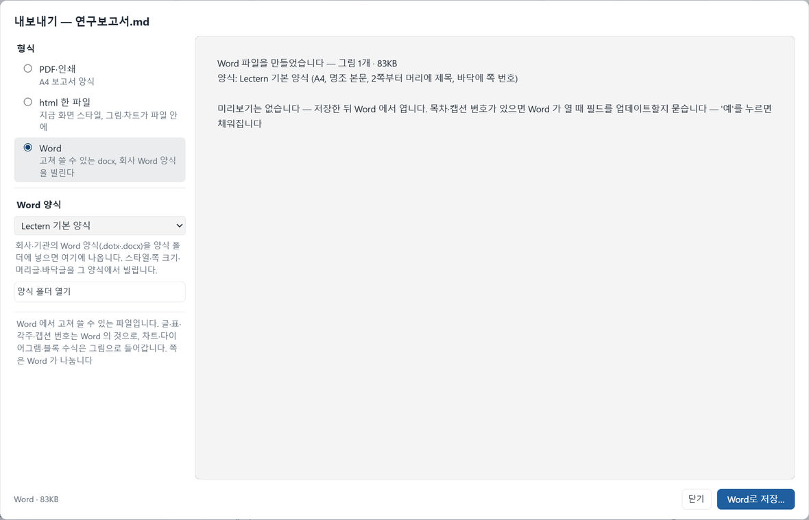

# 내보내기 — html·지면 틀·Word

문서 하나를 받는 사람에 맞춰 PDF, html 한 파일, Word 로 내보낸다. 원본은 늘 md 문서 하나이고, 내보낸 파일은 그때그때 새로 만든다. 이 가이드는 처음 해 보는 순서부터 지면 틀 18가지, 회사 Word 양식 쓰기, 잘 안 될 때까지를 다룬다. 바로 해 볼 수 있는 예제 문서 세 개가 [내보내기-예제](내보내기-예제/연구보고서.md) 폴더에 있다.

[목차]

## 1. 3분 만에 해 보기

1. 왼쪽 트리에서 [내보내기-예제/연구보고서](내보내기-예제/연구보고서.md) 를 연다.
2. 글이 없는 여백(본문 왼쪽·오른쪽)을 우클릭해 **PDF로 저장…** 을 고른다. **내보내기** 창이 뜬다.
3. 창 왼쪽의 **틀**에 '연구보고서' 가 이미 골라져 있다 — 문서 맨 앞 설정의 `layout: 연구보고서` 때문이다. 오른쪽 미리보기에 표지·요약·차례·본문이 쪽마다 보인다.
4. **PDF로 저장…** 을 누르면 저장 대화상자가 뜬다. 예제 폴더는 보기만 하는 곳이라 대화상자가 내 문서 폴더에서 열린다.
5. 같은 창의 **형식**을 **Word** 로 바꾼다. 몇 초 뒤 '그림 1개' 라고 알리면 **Word로 저장…** 을 누른다.
6. 저장한 docx 를 Word 로 연다. 필드를 업데이트할지 물으면 **예** — 목차와 쪽 번호가 채워진다.

> [!TIP]
> 창은 탭 막대 오른쪽 끝의 **인쇄** 버튼으로도 연다. 우클릭 메뉴의 **html로 저장…**·**Word로 저장…** 은 같은 창을 그 형식으로 연다.

## 2. 어떤 형식을 고를까

| 형식 | 받는 사람이 | 모양 | 이럴 때 |
|---|---|---|---|
| PDF | 읽고 인쇄한다 (고치지 않는다) | 쪽이 정해져 어디서 열어도 같다 | 결재·제출·배포, 인쇄 |
| html 한 파일 | 브라우저로 읽는다 | 화면 스타일 그대로 한 쪽에 길게, 틀을 고르면 그 양식 | 메일로 빨리 보내기, 긴 글을 화면으로 읽게 할 때 |
| Word | 고쳐 쓴다 | Word 가 쪽을 나눈다, 회사 Word 양식을 빌릴 수 있다 | 받는 사람이 손봐야 할 때, 회사 양식으로 내야 할 때 |

세 형식 모두 원본 md 는 그대로다. 문서를 고친 뒤 다시 내보내면 된다.

## 3. 내보내기 창



그림 1. 내보내기 창 — 왼쪽은 형식과 옵션, 오른쪽은 미리보기(Word 는 만든 결과)

| 자리 | 하는 일 |
|---|---|
| 형식 | PDF·인쇄, html 한 파일, Word |
| 틀 | PDF·html 의 출력 양식 — 맨 위 '보고서 (기본 양식)' 과 18가지 틀, 맨 아래 '내 틀' |
| 글꼴·여백·쪽 머리·쪽 번호 | 기본 양식의 PDF 에만 — 다음에도 그대로 |
| Word 양식 | Word 에만 — 'Lectern 기본 양식' 과 양식 폴더의 회사 양식 |
| 오른쪽 | PDF·html 은 저장될 그대로의 미리보기, Word 는 만든 결과(그림 수·크기·알릴 것) |
| 아래 단추 | 형식에 맞는 저장 단추. PDF 는 **인쇄…** 도 |

- 형식이나 틀을 바꾸면 미리보기를 다시 만든다. 만드는 동안에는 저장 단추가 꺼져 있다.
- 창을 연 채 Claude 가 문서를 고치면 미리보기도 다시 만든다 — 옛 내용을 저장하지 않는다.
- Esc 나 **닫기**로 닫는다.

## 4. html 한 파일

메일에 붙여 보내기 좋은 형식이다. 그림·차트·다이어그램·수식이 파일 안에 들어가 그 파일 하나만 보내면 된다. 스크립트가 없어 받는 사람의 브라우저에서 안전하게 열린다.

- 틀을 고르지 않으면 지금 화면 스타일 그대로 한 쪽에 길게 담는다. 받는 사람이 인쇄하면 PDF 와 같은 보고서 양식이다.
- 틀을 고르면 그 틀의 모양(표지·머리·글꼴·색)으로 담는다. PDF 와 같은 꼴이다.
- 접어 둔 절·박스글도 펴서 담고, 복사 단추·줄 번호 같은 앱 표시는 뺀다. 목차·각주·상호 참조 링크는 그대로 된다. 다른 문서로 가는 링크는 글로 남는다.

## 5. 지면 틀 — 같은 글을 다른 양식으로

틀은 글을 바꾸지 않는다. 표지·머리·쪽 크기·글꼴·색만 바꾼다. 같은 보고서를 정부 보고서로도, 증권사 리포트로도, 잡지 기사로도 뽑을 수 있다.

### 18가지 틀

표 1. 지면 틀 18가지 — 모든 틀이 제목(`title` 또는 맨 앞 `# 제목`)과 날짜를 쓴다

| 묶음 | 틀 | 틀 id | 맨 앞 설정 (예) | 박스글 자리 |
|---|---|---|---|---|
| 업무·공공 | 정부 보고서 | `gov-report` | 부서, 작성자 | 요약 |
| | 한 장 보고서 | `one-page` | 부서, 작성자, 결재 | 결론 |
| | 공문 (기안문) | `official-letter` | 기관, 수신, 발신, 기안자, 결재권자 | |
| | 보도자료 | `press-release` | 기관, 보도일시, 담당자, 연락처 | 부제 |
| | 회의록 | `minutes` | 시간, 장소, 참석자, 작성자 | |
| 연구 | 연구보고서 | `research-report` | 기관, 보고서번호, 부제, 연구진 | 요약 |
| | 이슈 브리프 | `issue-brief` | 기관, 시리즈, 호수 | 핵심 |
| | 학술 논문 (2단) | `paper-2col` | 소속, 주제어 | 초록 |
| | 투고 원고 | `manuscript` | 소속, 짧은제목 | 초록 |
| | 백서 | `white-paper` | 기관, 부제 | 요약 |
| 금융·컨설팅 | 증권사 리포트 | `equity-research` | 회사, 종목코드, 투자의견, 목표가, 현재가 | 핵심 수치, 면책 |
| | 컨설팅 보고서 | `consulting` | 기관, 고객, 부제 | 요약 |
| | 제안서 | `proposal` | 기관, 고객, 부제 | 요약 |
| 매체·출판 | 잡지 | `magazine` | 꼬리표, 부제 | |
| | 뉴스레터 | `newsletter` | 시리즈, 호수, 기관 | |
| | 책 | `book` | 책, 장, 부제 | |
| | 웹 장문 | `longform` | 꼬리표, 부제 (쪽 없이 길게) | |
| 안내 | 매뉴얼·가이드 | `manual` | 판, 기관 | |

### 맨 앞 설정 — 틀이 표지와 머리에 쓰는 값

문서 맨 앞의 `---` 사이에 적는다. 키는 영어로도 한국어로도 된다.

~~~yaml
---
title: 구리 공급망 점검
부제: 비축을 늘리고 분기 구매를 나누어 가격 충격을 줄인다
기관: 예제자원연구원
연구진: [김연구, 이분석]
보고서번호: 연구보고서 2026-14
날짜: 2026-11-15
layout: 연구보고서
---
~~~

표 2. 맨 앞 설정의 한국어 키

| 한국어 키 | 영어 키 |
|---|---|
| 제목 | `title` |
| 부제·부제목 | `subtitle` |
| 작성자·저자·지은이·연구진 | `author` |
| 날짜·일자 | `date` |
| 기관·기관명 | `org` |
| 부서·담당부서 | `dept` |
| 번호·보고서번호·호수 | `number` |
| 고객·발주처 | `client` |
| 소속 | `affiliation` |
| 주제어·키워드 | `keywords` |

- `layout:` 에는 틀 id(`research-report`)나 이름(`연구보고서`)을 적는다. 적어 두면 창을 열 때 그 틀이 골라져 있다.
- 여러 사람은 `[김연구, 이분석]` 처럼 대괄호로 적는다. 결재란(`결재: [담당, 팀장, 본부장]`)도 같다.
- 틀을 고르면 창이 그 틀이 쓰는데 문서에 비어 있는 키를 알린다. **맨 앞 설정 견본 복사**를 누르면 그 키들이 복사된다 — 문서 맨 앞 `---` 사이에 붙이고 값을 채운다.

### 이름 있는 박스글 — 요약·결론·초록을 제자리에

요약·결론·초록처럼 본문과 따로 놓일 글은 박스글에 이름을 붙여 쓴다.

~~~md
<!-- box: 요약 -->
- 비축 목표를 90일분으로 늘린다.
- 분기 구매를 4:4:2 로 나눈다.
<!-- /box -->
~~~

- 틀에 그 이름의 자리가 있으면 그리로 간다 — 연구보고서는 요약 쪽, 정부 보고서는 제목 아래 요약 상자, 학술 논문은 초록 자리.
- 틀에 그 자리가 없으면 본문의 보통 박스글로 남는다. 글이 사라지지 않는다.
- Word 로 내보내면 박스의 이름이 제목 띠가 된다.
- 다른 Markdown 뷰어에서는 주석이 보이지 않아 보통 글이다.

### 내 틀 만들기

회사·기관만의 양식이 있으면 틀을 하나 만든다. 설정(Ctrl+,)의 **지면 틀**에서 **Claude Code용 요청 복사**를 눌러 Claude Code 에 붙이고, 원하는 양식을 이어서 적는다.

```text
(요청 글을 붙인 뒤 이어서) 우리 기관 주간 동향 보고 양식으로 만들어 줘. 첫 쪽 위에 기관 이름 띠와 호수, 제목 아래 요약 상자, 본문은 □ ○ - 기호 문단.
```

Claude 가 작성 안내를 읽고 틀 폴더에 html 하나를 만든다. 창을 다시 열면 목록 맨 아래 **내 틀**에 나온다. 앱은 틀을 읽기만 하고, 틀 안의 스크립트와 인터넷 주소는 지운다.

## 6. Word — 받는 사람이 고쳐 쓸 파일

### Word 로 옮기는 것

표 3. Word 로 옮기는 것

| Lectern | Word |
|---|---|
| 맨 앞 `# 제목` 하나 | 제목 스타일 — 그 아래 `##` 가 제목 1, `###` 가 제목 2 |
| 맨 앞 설정의 부제·작성자·날짜 | 제목 바로 아래 줄 |
| 굵게·기울임·취소선·형광펜·글자색 | Word 의 글자 서식 (형광펜은 같은 색의 음영) |
| 표 | Word 표 — 머리행은 쪽마다, 행은 쪽에서 나누지 않음, 숫자 열은 오른쪽 |
| `표 1.`·`그림 1.` 캡션 | 캡션 스타일 + 번호 필드 — Word 에서 표를 더해도 번호가 맞는다 |
| `[표 1](#표-1)`·`[2절](#2-제목)` | 그 캡션·절로 가는 링크 (Ctrl+누르기) |
| 각주 `[^1]` | Word 각주 — 같은 각주를 두 번 불러도 번호가 맞는다 |
| 강조글·박스글 | 테두리 상자 (한 칸 표) |
| 목록·번호 목록·할 일 | Word 목록 — 번호 목록마다 1부터, 할 일은 ☐·☑ |
| 차트·다이어그램·블록 수식 | 그림 |
| 문장 속 수식 `$x^2$` | 글 — 그리스 문자·기호·위첨자·아래첨자 |
| `[목차]`·`[표 목차]`·`[그림 목차]` | Word 목차 필드 |
| 쪽 나눔 줄 | 쪽 나누기 |

- 미리보기는 없다. 쪽은 Word 가 나누고, 창에는 만든 결과(그림 수·크기)와 알릴 것이 보인다 — 그리지 못한 차트, 넣지 않은 인터넷 그림 같은 것.
- 차트는 Windows 의 Edge 로 앱 안의 라이브러리를 돌려 그린다. 인터넷에 나가지 않는다. 차트가 많으면 몇 초 더 걸린다.

### 회사 Word 양식 쓰기

회사·기관이 쓰는 Word 양식(.dotx, 또는 양식으로 쓰는 .docx)이 있으면 그 스타일·쪽 크기·여백·머리글·바닥글을 빌려 본문만 새로 쓴다.

1. 내보내기 창에서 형식을 **Word** 로 고르고 **양식 폴더 열기**를 누른다. 탐색기에 Word 양식 폴더가 열린다.
2. 회사 양식 파일을 그 폴더에 복사한다.
3. 창을 닫았다 다시 연다. **Word 양식** 목록에 양식 이름(파일 이름)이 나온다. 고르면 그 양식으로 다시 만든다.
4. 늘 그 양식으로 내려면 문서 맨 앞 설정에 `docxStyle: 양식 이름` 을 적는다. 창을 열 때 그 양식이 골라져 있다.

양식의 스타일은 **이름**으로 찾는다. Word 의 기본 스타일('제목 1'·'캡션'·'표준')은 한국어 Word 든 영어 Word 든 파일 안에서 같은 이름이라 그대로 쓴다. 회사 양식이 자기 이름의 스타일('1.제목'·'본문2' 같은)을 쓰면, 양식 옆에 `양식이름.styles.json` 을 하나 둔다.

~~~json
{"heading 1": "1.제목", "heading 2": "1.1소제목", "Normal": "본문2", "caption": "표제목"}
~~~

표 4. styles.json 에서 바꿀 수 있는 이름 (자주 쓰는 것)

| 왼쪽에 쓰는 이름 | 쓰이는 곳 |
|---|---|
| `Title`·`Subtitle` | 문서 제목과 그 아래 줄 |
| `heading 1` ~ `heading 6` | `##` 부터의 제목 |
| `Normal` | 본문 |
| `caption` | 표·그림 캡션 |
| `Quote` | 인용 |
| `List Paragraph` | 목록 |

> [!TIP]
> 지면 틀과 Word 양식을 같은 이름으로 두면 맨 앞 설정 한 줄로 셋이 짝을 이룬다. 예: 내 틀 `우리-주간보고` 와 Word 양식 `우리-주간보고.dotx` — `layout: 우리-주간보고` 만 적으면 PDF·html 은 그 틀, Word 는 그 양식이 골라진다 (`docxStyle` 을 따로 적으면 그것이 먼저다).

### Word 에서 처음 열 때

- 목차·캡션 번호가 있으면 Word 가 열 때 문서의 필드를 업데이트할지 묻는다. **예**를 누르면 목차와 쪽 번호가 채워진다. **아니요**를 눌렀다면 목차를 우클릭 → **필드 업데이트**.
- 받는 사람에게 보내기 전에 한 번 열어 목차를 채워 저장해 두면 받는 사람은 묻는 창을 보지 않는다.

## 7. Claude Code 에게 시키기

앱의 **Word로 저장…** 은 스킬을 설치하지 않아도 된다. 여러 문서를 한꺼번에 바꾸거나, 회사 양식 파일을 바로 주며 시키려면 Word 스킬(`lectern-to-docx`)을 설치해 Claude Code 에게 말로 시킨다. 설치는 설정의 **PowerPoint·Word 스킬** → **Claude Code용 요청 복사**를 Claude Code 에 붙이면 Claude 가 먼저 묻는다.

```text
@reports/3분기-구리-구매-전략.md 를 Word 로 만들어 줘. 같은 폴더에 같은 이름으로.
```

```text
@보고서.md 를 우리 회사 양식 D:\양식\주간보고.dotx 로 Word 를 만들어 줘. 양식의 제목 스타일 이름이 '1.제목' 이면 styles.json 도 만들어 줘.
```

```text
reports 폴더의 md 문서를 모두 Word 로 만들어서 reports/word 폴더에 둬. 그리지 못한 차트가 있으면 알려 줘.
```

지면 틀을 고르는 일은 사람이 창에서 한다. Claude 에게는 맨 앞 설정을 채워 달라고 하면 된다.

```text
@보고서.md 의 맨 앞 설정을 연구보고서 틀에 맞게 채워 줘. 기관은 예제자원연구원, 연구진은 김연구·이분석. 요약은 이름 있는 박스글로.
```

## 8. 이 예제로 해 보기

1. [연구보고서](내보내기-예제/연구보고서.md) — 1절의 순서대로 PDF 와 Word 를 만든다. 틀을 '증권사 리포트'·'잡지'·'정부 보고서'로 바꿔 가며 미리보기를 본다. 같은 글이 양식만 바뀐다.
2. [한 장 보고서](내보내기-예제/한-장-보고서.md) — PDF 가 정확히 한 쪽인지, 위에 결재란 세 칸(담당·팀장·본부장)과 결론 상자가 있는지 본다.
3. [학술 논문](내보내기-예제/학술-논문.md) — 2단 PDF 에서 초록이 두 단 위에 걸치고, 표는 두 단을 가로지르는지 본다. Word 로 바꾸면 블록 수식은 그림, 문장 속 수식은 글이다.
4. 형식을 html 로 바꿔 **html로 저장…** 한 파일을 브라우저로 연다. 메일에 그 파일 하나만 붙여 보내면 된다.
5. 예제 폴더는 보기만 하는 곳이라 맨 앞 설정을 고칠 수 없다. 키를 바꿔 보려면 예제 폴더를 다른 곳에 복사해 그 폴더를 연다.

## 9. 잘 안 될 때

표 5. 잘 안 될 때

| 보이는 것 | 까닭과 할 일 |
|---|---|
| 우클릭 메뉴에 **Word로 저장…** 이 없다 | Lectern 슬라이드이거나(→ 상태줄의 'pptx 로 전환') 글 위를 눌렀다. 여백을 누른다. html 문서는 내보내지 않는다 |
| 틀이 골라져 있지 않다 | 맨 앞 설정의 `layout:` 값이 틀 id·이름과 다르다. 표 1 의 id 나 이름을 그대로 적는다 |
| 표지에 기관·작성자가 비어 있다 | 그 틀이 쓰는 키가 문서에 없다. 창의 알림을 보고 **맨 앞 설정 견본 복사**로 채운다 |
| 요약이 요약 자리로 가지 않는다 | 박스글 이름이 틀의 자리 이름과 다르다 (창이 '박스글 자리'를 알린다). `<!-- box: 요약 -->` 처럼 맞춘다 |
| Word 양식 목록에 회사 양식이 없다 | 양식 폴더에 넣은 뒤 창을 다시 연다. `.dotx`·`.docx` 만 나온다 |
| Word 에서 제목 모양이 양식과 다르다 | 양식의 스타일 이름이 Word 기본 이름이 아니다. `양식이름.styles.json` 을 둔다 |
| Word 의 차트 자리에 설정 글이 들어갔다 | 차트를 그리지 못했다 (창의 알림에 까닭). 설정에 함수가 있거나 Edge 가 없는 PC 다 |
| Word 의 목차가 '필드 업데이트…' 글로 남는다 | 열 때 물은 것에 아니요를 눌렀다. 목차를 우클릭 → **필드 업데이트** |
| '…을 쓰지 못했습니다 — 다른 프로그램이 그 파일을 열고 있으면 닫고 다시 저장하세요' | 같은 이름의 파일을 Word 가 열고 있다. Word 에서 닫고 다시 저장한다. 옛 파일은 그대로다 |
| html·PDF 미리보기가 다시 만들어지지 않는다 | 편집 중이다 — 저장하고 편집을 닫는다. 미리보기는 저장한 내용으로 만든다 |

다음: [예제의 첫 문서](../README.md) — 사용법 전체 차례.
