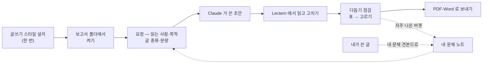

# 보고서 글쓰기 — 글쓰기 스타일·다듬기 점검·내 문체

Claude Code 가 쓰는 보고서에서 개발자 글버릇을 빼고, 내가 쓴 글은 틀린 말과 읽기 어려운 곳만 골라 고치고, 내 문체에서 지킬 것과 버릴 버릇을 노트로 남기는 법이다. 예와 숫자는 모두 이 예제 폴더로 실제로 시켜 본 것이다.

[목차]

## 1. 한눈에

Claude Code 의 기본 역할은 개발자다. 보고서를 맡겨도 개발 문서의 버릇이 섞이고, 내 글을 다듬어 달라고 하면 묻지 않고 내용까지 고쳐 쓰기 쉽다. Lectern 은 세 가지로 돕는다.

표 1. Lectern 이 돕는 세 가지

| 무엇 | 하는 일 | 어디서 |
|---|---|---|
| 글쓰기 스타일 | Claude 가 보고서를 쓰는 실무자처럼 쓴다 — 글 종류에 맞게, 개발자 글버릇 없이 | 설정 창(**Ctrl+,**) **글쓰기 스타일** — 한 번 설치 |
| 다듬기 점검 | 내가 쓴 글의 틀린 말·읽기 어려운 곳을 표로 먼저 보이고, 고른 것만 고친다 | 문서 여백 우클릭 **다듬기 점검 요청** |
| 내 문체 | 내가 쓴 글에서 지킬 것·즐겨 쓰는 방식·따라 하지 않을 버릇을 노트로 남긴다 | 문서 여백 우클릭 **내 문체 견본으로 보내기**, 설정 창 **내 문체** |



그림 1. 보고서 하나가 나가기까지와 내 문체 노트

셋 모두 Lectern 은 요청 글을 터미널에 넣기만 한다 (Enter 는 누르지 않는다). 파일을 고치거나 설치하는 것은 Claude 가 먼저 보이고 물은 뒤, 사람이 그렇다고 할 때다.

## 2. 왜 필요한가 — 개발자 글버릇

같은 자료로 구매팀장에게 올릴 '3분기 구리 구매 시점 검토'를 개조식으로 시켜 보면, 이전 스타일(Lectern 0.83)에서는 이런 줄이 나왔다.

```text
> 보고: 구매팀장 · 자료 기준: 2026년 6월 월평균까지 · 작성: Claude Code

- **1차 (7월 첫 주) 40%** — 재고 감소로 값이 범위 상단($11,400)까지 오를 때에 대비한 몫
- 하락 쪽: 광산 가동률이 88.2% → 91.4% 로 올라 공급 차질이 풀리는 중
```

틀린 말은 없지만 보고서보다 개발 문서에 가깝다. 사람이 쓴 보고서에는 잘 나오지 않는 것들이다.

표 2. 개발자 글버릇과 보고서의 쓰는 법

| 개발자 글버릇 | 보고서에서는 |
|---|---|
| 머리에 '작성: Claude Code', '자료 기준', '상태: 초안' | 날짜와 작성 부서처럼 보고서에 원래 있는 것만 |
| '**굵은 이름** — 설명' 꼴의 나열 | 결론 문장 아래에 근거 항목 |
| 화살표(88.2% → 91.4%), 빗금(-2.9%/+1.6%) | '1분기 88.2%에서 2분기 91.4%로' |
| 본문의 파일 경로·코드 글꼴 (`data/월별-가격.csv`) | 끝의 출처 절에 문서 이름 |
| '다음과 같습니다:', '확인한 결과', '1단계·2단계' | 바로 그 내용 |
| 한두 문단마다 소제목, 아무 데나 표 | 내용이 바뀔 때 소제목, 견줄 것이 있을 때 표 |

글쓰기 스타일 2판으로 같은 요청을 시키면 굵은 이름 나열·화살표·줄표가 하나도 나오지 않았다 (이전 판은 굵은 이름 나열 4줄, 화살표 5곳, 줄표 7곳). 결과는 [개조식 견본](글쓰기-예제/개조식-견본.md) 이다.

## 3. 글쓰기 스타일 — 설치하고 켜기

스타일 파일은 개인 폴더(`~/.claude/output-styles/`)에 하나만 두고, 켜는 곳을 고른다.

1. 보고서를 쓰는 폴더를 연 채로 설정 창(**Ctrl+,**)의 **글쓰기 스타일**에서 **이 폴더에서 켜기**(기본)를 고른다. 아래 **바뀌는 파일**에 스타일 파일과 그 폴더의 `.claude/settings.local.json` 이 전체 경로로 보이고, 지금 그 폴더에서 듣는 스타일도 보인다.
2. 터미널 버튼을 누르고 Enter. Claude 가 스타일 파일을 읽고 무엇이 바뀌는지와 지금 상태를 알린 뒤 **설치하고 켤지 묻는다**. 그렇다고 하면 스타일 파일을 복사하고(없거나 다를 때만), 그 폴더의 설정 파일에 `"outputStyle": "리서치 글쓰기"` 한 값만 적는다.
3. 스타일 파일을 새로 설치했으면 Claude Code 를 끝내고(`/exit`) 다시 띄운다. 스타일 파일은 시작할 때 읽는다.
4. 다른 보고서 폴더에서는 그 폴더를 열고 1~2 를 한 번 더 한다 — 이번에는 스타일 파일이 '그대로'라 켜는 값만 적는다. Claude Code 안에서 `/output-style 리서치 글쓰기` 를 쳐도 같다.

> [!WARNING]
> 코드를 쓰는 폴더에서는 켜지 않는다. 이 스타일은 Claude Code 의 개발 지침(범위 지키기, 고친 뒤 확인하기)을 뺀다. **모든 폴더에서 켜기**도 고를 수 있지만 그러면 코드 폴더마다 **이 폴더에서 끄기**(또는 `/output-style default`)를 해 두어야 하고, 빠뜨리면 그 폴더의 코드 작업에서 개발 지침이 조용히 빠진다. 보고서 폴더에서 켜기를 빠뜨리면 글이 딱딱해져 바로 보인다.

> [!TIP]
> Lectern 을 새 판으로 바꾼 뒤 바뀌는 파일에 '바꿈 — Lectern 의 것과 다름'이 보이면 같은 요청 글로 다시 설치한다. 예전 판처럼 스타일 파일 끝에 내 문체 노트가 있으면 Claude 가 개인 규칙 파일로 옮길지 묻는다.

Codex·Antigravity·OpenCode 에는 출력 스타일이 없다. 같은 버튼이 고른 곳(개인 지시 파일, 또는 그 프로젝트의 `AGENTS.md`)에 '글쓰기' 절로 넣을지 묻는 요청 글을 넣는다.

## 4. 글 종류에 맞게 시키기

글쓰기 스타일은 개조식을 나쁜 글로 보지 않는다. 글 종류마다 잘 쓴 글의 기준이 다르다.

표 3. 글 종류마다의 기준

| 종류 | 잘 쓴 글 |
|---|---|
| 서술식 보고서 | 문단으로. 문단의 첫 문장이 주장, 뒤 문장이 근거. 문단은 서너 문장 |
| 개조식 보고서 | 묶음의 맨 위 항목이 결론 한 문장, 그 아래 항목이 근거와 뜻. 한 항목에 한 내용, 두 줄 안. 끝맺음(~함·~임)은 한결같이 |
| 검토 의견서 | 문항마다 의견 → 근거 → 고칠 것이나 제안 |
| 메모·브리핑 | 첫 문단에 결론과 읽는 사람이 내릴 결정 |

어느 종류든 결론을 앞에 두고, **소제목은 그 절의 주장으로** 단다. 소제목만 훑어도 흐름이 잡힌다.

표 4. 소제목

| 이름만 단 소제목 | 주장을 단 소제목 (실제 견본에서) |
|---|---|
| 판단 근거 | 6월 값은 전망 범위의 위쪽에 있다 |
| 구매 방식과 실행 조건 | 재고가 23만 톤을 밑돌면 더 기다리지 않는다 |
| 비교 | 나눠 사면 잃을 돈은 작고 아낄 돈은 크다 |

### 요청은 이렇게

요청에 **읽는 사람·목적·글 종류·분량**이 있으면 글이 가장 많이 달라진다.

```text
research 폴더와 data 의 자료로, 구매팀장에게 올릴 '3분기 구리 구매 시점 검토' 보고서를
개조식으로 써서 reports/구매-시점-검토.md 에 저장해 줘. A4 한 쪽 분량. 개요 확인 없이 바로 써.
```

'개조식으로'를 '서술식으로'로 바꾸면 [서술식 견본](글쓰기-예제/서술식-견본.md) 처럼 쓴다. 두 견본은 받은 그대로다. 긴 글은 "개요 확인 없이 바로"를 빼고 시키면 Claude 가 핵심 주장과 쪽 배분을 먼저 보이고 멈춘다.

### 분량

Lectern 의 PDF 양식(A4, 10.5pt)에서 한 쪽에 드는 양은 대략 이렇다 (공백 빼고, 제목과 출처까지).

표 5. 한 쪽에 드는 글자 수

| 글 | 한 쪽 |
|---|---:|
| 서술식 | 1,000자 |
| 서술식에 표 하나 | 850자 |
| 개조식 | 800자 |
| 개조식에 표 하나 | 700자 |

스타일이 이 기준을 알고 있지만 Claude 가 글자를 세지 못하는 환경이면 조금 넘치기도 한다 (시험에서 한두 줄). 정확히 맞춰야 하면 "공백 빼고 850자 안으로"처럼 숫자로 말하거나, 'PDF로 저장…' 의 미리보기로 쪽 수를 보고 "한 쪽에 맞게 줄여 줘"라고 시킨다.

### 자료의 어색한 표현

리서치 문서의 '재고가 230천 t 아래로'처럼 표의 단위를 그대로 문장에 쓴 표현은 옮겨 쓰지 않고 '23만 t' 로 고쳐 쓴다. 따옴표로 인용할 때만 원문 그대로 둔다.

## 5. 다듬기 점검 — 내가 쓴 글을 고르게 고치기

그냥 "다듬어 줘"라고 시키면 Claude 는 잘 고치지만 너무 많이 고친다. 이전 스타일로 시켜 보니 묻지 않고 파일을 바로 고쳤고, 자료에서 숫자와 링크를 더하고, 내용이 없다며 문장 하나를 지웠다. 868자이던 글이 1,141자가 되었다. 다듬기 점검 요청은 고치기 전에 표를 먼저 보이게 한다.

### 해 보기

1. [연습 보고서](글쓰기-예제/연습-구매-계획-검토.md) 를 연다. 틀린 말·겹말·번역투·읽기 어려운 문장·섞인 표기를 일부러 심고, 고치면 안 되는 인용과 맞게 쓴 말도 넣은 보고서다.
2. 예제 폴더는 보기만 하는 곳이라 터미널이 열리지 않고 파일도 고칠 수 없다. 이 파일을 내 폴더로 복사해 그 폴더를 Lectern 으로 연다 (사이드바에서 우클릭해 **탐색기에서 보기**로 파일을 찾는다).
3. 여백을 우클릭해 **다듬기 점검 요청**을 고른다. 몇 줄만이면 그 줄을 고르거나(Shift+↓) 장을 하이라이트한 뒤 우클릭해 **이 범위 다듬기 점검 요청**.
4. 터미널에서 Enter. Claude 가 파일을 고치기 전에 표를 보인다.
5. 고를 것을 말한다: "틀림과 읽기 어려움은 고친 안대로 반영해 줘", "1·3·7번만", "취향 빼고 모두".

### Claude 가 보이는 표 (실제로 받은 것 가운데 몇 줄)

표 6. 다듬기 점검 표의 예

| 번호 | 등급 | 어디 | 원문 | 고친 안 | 까닭 |
|---|---|---|---|---|---|
| 1 | 틀림 | 머리말 | 이 보고서의 건의는 … 나눠 산다. | 이 보고서의 건의는 … 나눠 사는 것이다. | 주어 '건의는'과 서술어 '산다'가 맞지 않음 |
| 5 | 틀림 | 3절 | 분기 말 일괄 구매를 지향하고 분할 구매를 지양해야 | 분기 말 일괄 구매를 지양하고 분할 구매를 지향해야 | 이 절은 분할 구매를 권하는데 말이 반대로 쓰였음 (뜻 확인) |
| 9 | 읽기 어려움 | 1절 | 재고 감소로 인하여 가격 상승이 야기되었다 | 재고가 줄어 가격이 올랐다 | 이중 피동과 번역투 |
| 11 | 읽기 어려움 | 2절 | 재고가 23만 t 아래로 … 바람직하다. | …넘을 수 있다. 다만 … 보인다. 따라서 … 바람직하다. | 조건 셋과 결론이 한 문장에 얽혀 세 문장으로 나눔 |
| 13 | 읽기 어려움 | 3절 | 서로 상의한, 남은 잔량, 새로 신설해 | 상의한, 잔량, 신설해 | 같은 뜻을 두 번 쓴 겹말 |
| 19 | 확인 필요 | 3절 | 2분기 상승률 4.9% | — | 1절과 리서치 문서 표에는 3.9% |

표 아래에는 '그대로 둔 것'(인용 속 '230천 t', 규정 인용 속 '~에 있어서는', 맞게 쓴 '일절'·'대금 결제')과 '자주 나온 것'("번역투와 피동이 네 번, 겹말이 세 번 — 다음에 이 두 가지만 훑어보면 된다")이 붙는다.

### 등급

표 7. 다듬기 점검의 등급

| 등급 | 무엇 | 고르면 |
|---|---|---|
| 틀림 | 고친 안이 하나뿐인 것 — 맞춤법, 잘못 쓴 낱말, 주어와 서술어 | 고치기를 권한다. 뜻이 뒤집히는 것은 '뜻 확인'이 붙는다 |
| 읽기 어려움 | 틀리지 않았지만 막히는 곳 — 겹말, 번역투, 긴 문장, 모호한 '그것', 풀지 않은 약어, 섞인 표기 | 고친 안을 보고 고른다. 짐작한 뜻으로 고친 것은 그렇다고 적는다 |
| 취향 | 둘 다 맞는 것 — '구매할 만한'과 '구매할만한' | 원할 때만 |
| 확인 필요 | 표현이 아니라 내용 — 맞지 않는 숫자, 근거 없는 주장 | 고치지 않는다. 값이나 내용을 정해 주면 그때 고친다 |

인용(따옴표·인용 상자 안, 규정에서 옮긴 문장), 숫자 값, 기관·법령 이름, 맞게 쓴 말, 읽기에 문제없는 내 문체는 건드리지 않는다. 문장을 더하거나 지우지도 않는다.

### 그냥 '다듬어 줘'와 견주면

표 8. 같은 연습 보고서로 두 번씩 시킨 결과

| | 그냥 "다듬어서 바로 반영해 줘" (이전 스타일) | 다듬기 점검 요청 (2판) |
|---|---|---|
| 고치기 전에 보여 줌 | 아니오 — 고친 뒤 설명 | 예 — 표 20곳 남짓, 고를 수 있음 |
| 심은 고칠 곳 21곳 | 21곳 | 18~19곳 (빠진 것은 붙여 써도 맞는 '구매할만한' 같은 취향, 내용 문제로 보고 '확인 필요'로 돌린 곳) |
| 인용·규정 이름 | 그대로 | 그대로 |
| 맞게 쓴 말 (결제·일절·며칠) | 두 곳을 문장째 바꿈 | 그대로, 맞는 말이라고 알림 |
| 맞지 않는 숫자 4.9% | 3.9% 로 바꾼 뒤 알림 | 값은 두고 '확인 필요' |
| 글자 수 (원문 868자) | 1,141·1,240자 | 853~868자 |
| 내용 | 숫자·링크·문장을 더하고 한 문장을 지움 | 손대지 않고 따로 알림 |

> [!NOTE]
> 고친 곳은 Lectern 에 바로 보이고, 트리에 호박색 점이 붙는다. 마음에 들지 않으면 "3번은 되돌려 줘"라고 하거나, git 을 쓰는 폴더면 되돌린다.

## 6. 내 문체 — 지킬 것과 버릴 버릇

내 문체 노트는 흉내를 위한 것이 아니다. 읽는 사람이 기대하는 내 규칙(말투, 용어, 숫자 쓰는 법)은 지키고, 읽기 어렵게 하는 내 버릇은 따라 하지 않게 하는 것이다. 글쓰기 스타일의 기본보다 앞서지 않는다.

### 만들기

1. 내가 직접 쓴 글을 연다 (AI 와 함께 쓴 글은 빼고). Word·PDF 로 쓴 예전 보고서도 된다.
2. 여백을 우클릭해 **내 문체 견본으로 보내기**를 고른다. 여러 편을 한 번에 보내려면 설정 창 **내 문체**의 요청 글 끝에 `@경로` 를 이어 붙인다 (트리나 문서 여백을 우클릭한 **@경로 복사**).
3. Enter. Claude 가 세 칸으로 정리한 노트 초안을 보인다. 아직 저장하지 않는다.
4. "이건 내 방식이니 따라 해", "이건 빼"처럼 칸을 고친 뒤 좋다고 하면 저장한다. Claude Code 는 개인 규칙 파일 `~/.claude/rules/내-문체.md` 하나에 넣는다. 그 파일은 `.claude` 폴더 안이라 Claude Code 가 고쳐도 되는지 한 번 더 묻는다 — 허락한다.
5. Claude Code 를 다시 시작한다. 어느 폴더에서나, 어느 글쓰기 스타일을 켜든 같은 노트가 쓰인다.

표 9. 내 문체 노트의 세 칸

| 칸 | 무엇 | 글을 쓸 때 |
|---|---|---|
| 지킬 것 | 읽는 사람이 기대하는 규칙 — 말투, 용어, 숫자·단위·날짜 쓰는 법, 출처 쓰는 법 | 따른다 |
| 참고할 것 | 즐겨 쓰는 방식 — 문장 길이, 결론을 두는 자리, 문단 구성 | 글 종류와 읽는 사람이 맞을 때만 |
| 따라 하지 않을 것 | 읽기 어렵게 하는 버릇 — 겹말, 번역투, 아주 긴 문장 | 따라 하지 않고, 다듬기 점검 때 먼저 살핀다 |

- 두 편 넘게 나온 것만 적는다. 한 편에서만 본 것은 '(한 편에서만 봄)'이 붙는다.
- 글 종류마다 따로 적는다. 항목마다 '메모:', '서술식 보고서:', '공통:'처럼 어느 종류에서 본 것인지 붙어서, 메모의 합니다체가 보고서로, 개조식의 '~함'이 서술식으로 번지지 않는다. 노트에 없는 종류의 글이면 '공통:' 항목(용어, 숫자·날짜 표기, 출처 쓰는 법)만 쓴다.
- 예문은 견본을 옮기지 않고 새로 지어 쓴다. 기밀 보고서가 견본이어도 숫자·이름이 노트로 새지 않는다.
- 폴더마다 다른 규칙(기관 양식, 존댓말)은 노트가 아니라 그 폴더의 `CLAUDE.md` 에 둔다.

### 실제로 해 본 것

[가상 필자의 견본](글쓰기-예제/가상-필자-견본/알루미늄-구매-검토.md) 세 편은 문체가 뚜렷한 가상의 구매2팀 메모다 — 합니다체, '당 팀은', 날짜를 '26.4월 처럼 쓰고, 끝에 '※ 참고:'. 일부러 나쁜 버릇도 심었다: 세 편 모두 '~의 결정에 있어서', '미리 사전에', 합니다체 글 속 '~할 필요성이 있음', 조건을 쉼표로 줄줄이 이은 긴 문장. 이 세 편을 견본으로 보내자 Claude 가 이렇게 나눴다.

- **지킬 것**: 메모는 합니다체, 글쓴이 쪽은 '당 팀은'. 날짜는 '27.3월 꼴. 비율끼리의 차이는 %p. 비교 기준은 '전 분기보다', '전년 같은 때보다'. 출처는 끝에 '※ 참고:' 한 줄.
- **참고할 것**: 첫 문장에 권고, 둘째 문장에 까닭 하나. 소제목 없이 세 문단. '당 팀은 ~ 안을 건의합니다'로 건의를 연다.
- **따라 하지 않을 것**: '~의 ~에 있어서' — '~을 정할 때'가 더 잘 읽힌다. '미리 사전에' — '미리' 하나면 된다. 합니다체 글의 '~할 필요성이 있음' — '~해 두어야 합니다'로. 백 자 넘게 이은 긴 문장 — 두세 문장으로 나눈다.

심은 나쁜 버릇 넷을 모두 '따라 하지 않을 것'에 넣었고, 저장하기 전에 "회사 규칙인지 취향인지 모르겠는 항목"을 물었다.

이 노트를 넣고 같은 자료로 다시 시켰다. **메모**를 쓰게 하자 노트대로 합니다체에 '당 팀은 ~ 안을 건의합니다', 제목 아래 날짜 줄('26.7월), 끝의 '※ 참고:'로 썼고, 심은 나쁜 버릇 넷은 하나도 따라 하지 않았다. 노트 없이 같은 메모를 시키면 한다체에 소제목과 표가 있는 평소의 Claude 글이었다.

**보고서**를 쓰게 하자 메모의 말투는 가져오지 않았다. 한다체에 주장형 소제목으로 쓰고, 종류를 가리지 않는 날짜 표기와 '※ 참고:'만 따랐다. 노트의 항목마다 '메모:', '공통:'처럼 어느 종류에서 본 것인지 붙어 있어서다. 처음에는 이 표시가 없어 보고서에도 합니다체를 썼고, 그래서 규칙을 고쳤다 — 내 문체가 글 종류를 넘어 번지지 않게.

> [!CAUTION]
> 가상 필자의 견본으로 해 볼 때는 세 편을 내 폴더로 복사해서 하고, 요청 끝에 "저장하지 말고 노트 초안만 보여 줘"라고 덧붙인다. 그대로 저장하면 내 노트가 가상 필자의 문체가 된다.

## 7. Codex·Antigravity 에서

설정 창의 **쓰는 AI 도구**에서 고르면 메뉴와 요청 글이 그 도구로 바뀐다. 다듬기 점검과 내 문체의 요청 글은 안내 파일의 경로와 문서 위치만 담고 있어 도구를 가리지 않는다. 다른 것은 글쓰기 규칙과 노트가 들어가는 자리다.

표 10. 도구마다 다른 자리

| | Claude Code | Codex·Antigravity·OpenCode |
|---|---|---|
| 글쓰기 규칙 | 개인 출력 스타일 하나, 켜는 곳을 고름 (보고서 폴더) | 개인 지시 파일이나 그 프로젝트의 `AGENTS.md` 의 '글쓰기' 절 |
| 내 문체 노트 | 개인 규칙 파일 `~/.claude/rules/내-문체.md` | 개인 지시 파일의 '내 문체' 절 |

`AGENTS.md` 의 규칙은 그 프로젝트의 지시일 뿐이라, 세션 전체의 역할을 바꾸는 Claude Code 출력 스타일보다 약할 수 있다. Codex(codex-cli 0.169)로 같은 시험을 해 보니 이랬다.

- **설치 요청**: 무엇이 바뀌는지 알리고 넣을지 물은 뒤, 그렇다고 하자 '글쓰기' 절을 넣었다.
- **개조식 보고서**: 한 쪽(813자)에 들었고 출처는 문서 이름으로 달았다. 다만 항목마다 서너 문장이라 개조식다운 짧은 항목이 아니었고, '$10,593/t' 같은 표기와 자료의 '230천 t'를 그대로 옮겼다. 웹에서 실제 3분기 값을 찾아 예제 값과 다르다고 밝혔다.
- **다듬기 점검**: 표를 먼저 보이고 파일은 고치지 않았다가, 고른 것만 반영했다(868 → 838자). 인용·숫자·맞게 쓴 말은 그대로였고 4.9% 는 '확인 필요'로 두었다. 다만 심은 21곳 가운데 13곳을 고쳤다 — 지향·지양이 뒤바뀐 것, '건의는 ~ 산다'의 호응, '1.49백만 t', '남은 잔량'을 표에 넣지 않았고 '띄고'를 취향으로 봤다 (Claude Code 는 18~19곳).
- **내 문체**: 네 버릇을 모두 '따라 하지 않을 것'에 넣고 '공통:'·'메모:'를 붙였으며 저장 전에 물었다. 날짜 표기·'당 팀은'·'※ 참고:' 같은 지킬 것은 Claude Code 보다 덜 잡았다.

Antigravity 는 설치 요청에서 무엇이 바뀌는지 알리고 넣을지 묻는 데까지 확인했다. 파일을 고칠 때 셸 명령 권한을 물으면 허락한다.

Codex 는 파일 맨 앞에 BOM 을 붙여 쓰기도 한다. Lectern 은 그대로 읽고, 고칠 때도 그대로 둔다.

## 8. 잘 안 될 때

표 11. 잘 안 될 때

| 이런 때 | 이렇게 |
|---|---|
| 스타일이 먹지 않는 것 같다 | 설치 뒤 Claude Code 를 다시 시작했는지 본다. 설정 창 **글쓰기 스타일**의 '지금 … 폴더에서 듣는 스타일'이 '리서치 글쓰기'인지 본다 — 아니면 그 폴더에서 **이 폴더에서 켜기**로 다시 요청한다 |
| 여전히 길다 | 요청에 "공백 빼고 850자 안으로"처럼 숫자를 준다. 'PDF로 저장…' 미리보기로 쪽 수를 본다 |
| 개조식에 □·○ 기호를 쓰고 싶다 | 폴더 `CLAUDE.md` 나 내 문체의 '지킬 것'에 적는다. 머리글 번호는 md 문서 스타일 '개조식 · 기호형'으로 |
| 다듬기가 너무 많이 고친다 | 그냥 "다듬어 줘" 대신 **다듬기 점검 요청**으로 표를 먼저 받고 번호로 고른다 |
| 숫자를 바꿔 버렸다 | 다듬기 점검의 '확인 필요'는 고치지 않는 것이 규칙이다. "그 숫자는 원래대로 되돌려 줘"라고 한다 |
| 내 문체 노트가 쓰이지 않는다 | 저장 뒤 다시 시작했는지 본다. 설정 창 **내 문체**의 바뀌는 파일에 노트 파일이 '바꿈'(있음)으로 보이는지 본다. Codex 등은 개인 지시 파일의 '내 문체' 절을 본다 |
| 노트가 나를 너무 흉내 낸다 | "이건 참고할 것으로 옮겨", "이건 빼"라고 고친다. 내 버릇이 반복되면 다듬기 점검의 '자주 나온 것'을 노트에 보태 달라고 한다 |

## 9. 이 예제로 해 보기

1. [개조식 견본](글쓰기-예제/개조식-견본.md) 과 [서술식 견본](글쓰기-예제/서술식-견본.md) 을 함께 열고 문서 탭 줄의 **모두 펼치기**로 나란히 본다. 같은 자료, 같은 요청에서 글 종류만 다르다.
2. 하나를 'PDF로 저장…' 해 본다 — 미리보기에서 한 쪽에 얼마나 드는지 본다.
3. [연습 보고서](글쓰기-예제/연습-구매-계획-검토.md) 를 내 폴더로 복사해 다듬기 점검을 해 본다. 5절의 표와 견준다.
4. 내가 쓴 보고서 두세 편으로 내 문체 노트를 만든다.

<!-- 이 가이드의 예와 숫자는 2026-11-16 실제 시험(Claude Code 2.1.325, Opus 5.5, 웹 검색 끔)에서 나왔다. 결정 기록은 docs/DECISIONS.md 의 D148. -->
