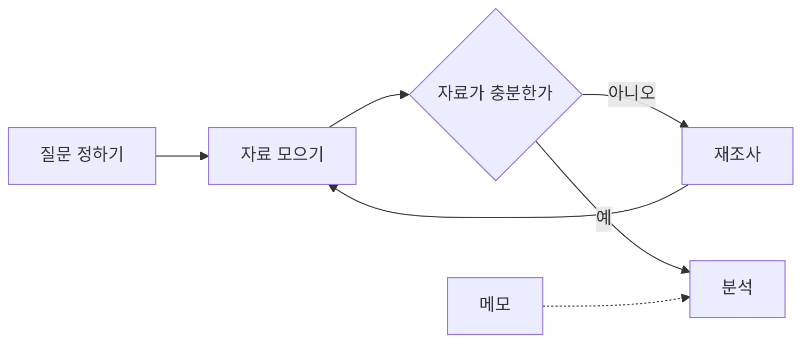
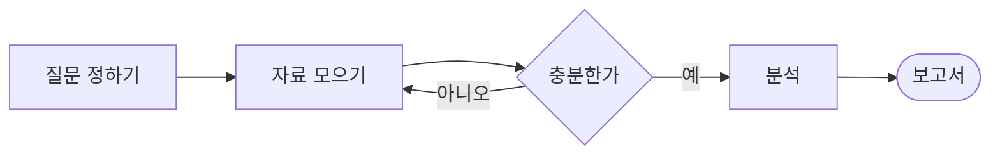
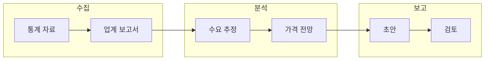
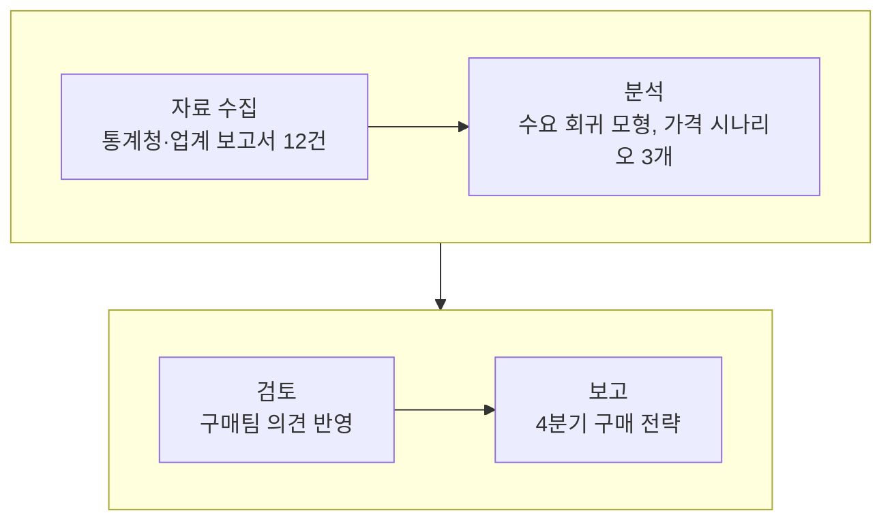
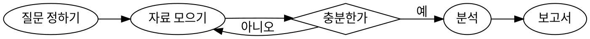
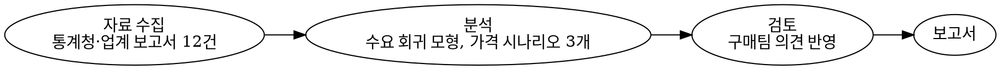
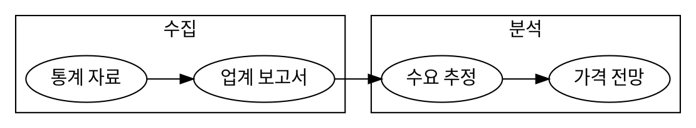

# 도해 스타일 견본

같은 흐름도를 도해 스타일 1~10 으로 그린 견본이다. 그림 블록 안에 `%% 스타일: 3 카드` 한 줄을 적으면 그 번호로 그린다 (Graphviz 는 `// 스타일: 3 카드`). Lectern 은 앞의 번호만 읽는다 — 이름은 원문만 보고도 무엇인지 알게 붙인다. 색은 지금 문서 스타일을 따르므로, 툴바에서 스타일을 바꾸면 견본도 그 색으로 바뀐다.

Claude 에게는 "Mermaid 3번 스타일로 그려 줘"처럼 말하면 된다. 그림을 우클릭해 '도해 스타일…'을 고르면 그 그림을 열 가지로 그린 창이 뜨고, 거기서 골라도 그 줄이 들어간다.

## 강조 표시

상자에 `:::key`(핵심)·`:::warn`(주의)·`:::muted`(보조)를 붙이면 번호가 정한 색으로 칠한다. Graphviz 는 `[class="key"]`.

## 1. 기본

0.111 까지와 같은 모양이다. 설정을 바꾸지 않았다면 줄을 적지 않은 그림은 모두 이 모양이다.

## 2. 보고서 선

흰 상자, 진한 테두리, 직각으로 꺾는 선. 흑백 인쇄에 강하다.

## 3. 카드

둥근 모서리, 옅은 그림자, 넉넉한 여백. 화면과 발표용.

## 4. 진한 채움

상자를 진하게 채우고 밝은 글자. 단계가 적은 큰 그림에.

## 5. 선만

채움 없이 가는 선. 논문·책처럼 글자가 또렷해야 할 때.

## 6. 손그림

손으로 그린 듯한 선. 초안·구상 단계임을 드러낼 때. Graphviz 에서는 기본 모양으로 그린다.

## 7. 단계 색

묶음(subgraph)마다 옅은 색을 돌려 쓴다. 영역이 여럿인 구성도에.

## 8. 제목 띠

줄을 바꾼 상자는 첫 줄이 제목, 나머지가 내용이다. Mermaid 는 ` `, Graphviz 는 `\n` 으로 줄을 바꾼다. 한 줄짜리 상자는 제목만 있는 상자가 된다.

## 9. 옅은 제목 띠

옅은 띠에 진한 제목 글자. 상자가 많아도 무겁지 않다.

## 10. 제목 줄

굵은 제목 아래에 가는 줄, 그 아래 흐린 내용. 칸을 나눈 표처럼 읽힌다.

## 가로와 세로

방향은 번호가 아니라 그림의 첫 줄이 정한다 — `flowchart LR`(가로)·`flowchart TD`(세로). 문서 폭에 상자 넷이 넘으면 가로 그림은 줄어 글자가 작아진다. 그림을 우클릭해 '세로로 바꾸기'를 고르거나, 아래처럼 세로 안에 가로 줄로 나눈다.

## Graphviz

Graphviz 도 같은 번호를 쓴다. 줄은 `// 스타일: 3` 이다.

다음: [색 조합 견본](색-조합-견본.md) · [다이어그램](../06-다이어그램.md)
