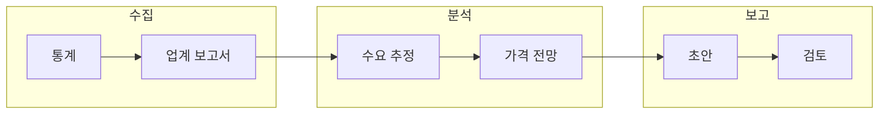

# 색 조합 견본

차트와 도해의 색을 번호 1~8 로 고른다. 모양(도해 스타일)과 따로 고르고, 글자·바탕·선은 문서 스타일을 따른다. 차트는 블록 맨 앞에 `// 색: 2 보고서 남색`, Mermaid 는 `%% 색: 2 보고서 남색`(모양과 한 줄에 `%% 스타일: 7 단계 색 · 색: 2 보고서 남색` 도), Graphviz 는 `// 색: 2 보고서 남색` 을 적는다 — 번호 뒤의 이름은 사람이 읽으라고 붙이고, Lectern 은 번호만 읽는다. 그림이나 차트를 우클릭해 '색 조합…'을 고르면 그 그림을 여덟 가지 색으로 그린 창에서 고를 수 있다.

문서 하나의 그림을 모두 같은 색으로 하려면 문서 위쪽에 `<!-- 도해: 색 2 -->` 한 줄을 둔다 (모양도 함께 `<!-- 도해: 스타일 8 · 색 2 -->`). 블록의 줄이 문서의 줄보다, 문서의 줄이 설정보다 먼저다.

## 1. 문서 스타일

지금 그대로다. 차트는 라이브러리의 기본색, 도해는 문서 스타일의 색이다. 설정을 바꾸지 않았다면 색 줄이 없는 그림은 모두 이 색이다.

```vega-lite
// 색: 1 문서 스타일
{
  "width": "container", "height": 180,
  "data": {"values": [
    {"분기": "1분기", "용도": "전력", "수요": 42}, {"분기": "1분기", "용도": "건설", "수요": 30}, {"분기": "1분기", "용도": "운송", "수요": 18}, {"분기": "1분기", "용도": "기계", "수요": 12},
    {"분기": "2분기", "용도": "전력", "수요": 45}, {"분기": "2분기", "용도": "건설", "수요": 28}, {"분기": "2분기", "용도": "운송", "수요": 20}, {"분기": "2분기", "용도": "기계", "수요": 14},
    {"분기": "3분기", "용도": "전력", "수요": 48}, {"분기": "3분기", "용도": "건설", "수요": 27}, {"분기": "3분기", "용도": "운송", "수요": 22}, {"분기": "3분기", "용도": "기계", "수요": 13}
  ]},
  "mark": "bar",
  "encoding": {
    "x": {"field": "분기", "type": "nominal", "title": null, "axis": {"labelAngle": 0}},
    "xOffset": {"field": "용도", "sort": ["전력", "건설", "운송", "기계"]},
    "y": {"field": "수요", "type": "quantitative", "title": "수요 (만 t)"},
    "color": {"field": "용도", "type": "nominal", "title": null, "sort": ["전력", "건설", "운송", "기계"]}
  }
}
```



## 2. 보고서 남색

남색 농담에 주황 강조 하나. 보고서와 흑백 인쇄에 무난하다.

```vega-lite
// 색: 2 보고서 남색
{
  "width": "container", "height": 180,
  "data": {"values": [
    {"분기": "1분기", "용도": "전력", "수요": 42}, {"분기": "1분기", "용도": "건설", "수요": 30}, {"분기": "1분기", "용도": "운송", "수요": 18}, {"분기": "1분기", "용도": "기계", "수요": 12},
    {"분기": "2분기", "용도": "전력", "수요": 45}, {"분기": "2분기", "용도": "건설", "수요": 28}, {"분기": "2분기", "용도": "운송", "수요": 20}, {"분기": "2분기", "용도": "기계", "수요": 14},
    {"분기": "3분기", "용도": "전력", "수요": 48}, {"분기": "3분기", "용도": "건설", "수요": 27}, {"분기": "3분기", "용도": "운송", "수요": 22}, {"분기": "3분기", "용도": "기계", "수요": 13}
  ]},
  "mark": "bar",
  "encoding": {
    "x": {"field": "분기", "type": "nominal", "title": null, "axis": {"labelAngle": 0}},
    "xOffset": {"field": "용도", "sort": ["전력", "건설", "운송", "기계"]},
    "y": {"field": "수요", "type": "quantitative", "title": "수요 (만 t)"},
    "color": {"field": "용도", "type": "nominal", "title": null, "sort": ["전력", "건설", "운송", "기계"]}
  }
}
```


## 3. 회색 + 강조

첫 계열만 색이고 나머지는 회색이다. 보여 주고 싶은 계열을 데이터의 맨 앞에 둔다.

```vega-lite
// 색: 3 회색 + 강조
{
  "width": "container", "height": 180,
  "data": {"values": [
    {"분기": "1분기", "용도": "전력", "수요": 42}, {"분기": "1분기", "용도": "건설", "수요": 30}, {"분기": "1분기", "용도": "운송", "수요": 18}, {"분기": "1분기", "용도": "기계", "수요": 12},
    {"분기": "2분기", "용도": "전력", "수요": 45}, {"분기": "2분기", "용도": "건설", "수요": 28}, {"분기": "2분기", "용도": "운송", "수요": 20}, {"분기": "2분기", "용도": "기계", "수요": 14},
    {"분기": "3분기", "용도": "전력", "수요": 48}, {"분기": "3분기", "용도": "건설", "수요": 27}, {"분기": "3분기", "용도": "운송", "수요": 22}, {"분기": "3분기", "용도": "기계", "수요": 13}
  ]},
  "mark": "bar",
  "encoding": {
    "x": {"field": "분기", "type": "nominal", "title": null, "axis": {"labelAngle": 0}},
    "xOffset": {"field": "용도", "sort": ["전력", "건설", "운송", "기계"]},
    "y": {"field": "수요", "type": "quantitative", "title": "수요 (만 t)"},
    "color": {"field": "용도", "type": "nominal", "title": null, "sort": ["전력", "건설", "운송", "기계"]}
  }
}
```


## 4. 선명한 구분

서로 잘 갈리는 열 가지 색. 계열이 많은 차트에.

```vega-lite
// 색: 4 선명한 구분
{
  "width": "container", "height": 180,
  "data": {"values": [
    {"분기": "1분기", "용도": "전력", "수요": 42}, {"분기": "1분기", "용도": "건설", "수요": 30}, {"분기": "1분기", "용도": "운송", "수요": 18}, {"분기": "1분기", "용도": "기계", "수요": 12},
    {"분기": "2분기", "용도": "전력", "수요": 45}, {"분기": "2분기", "용도": "건설", "수요": 28}, {"분기": "2분기", "용도": "운송", "수요": 20}, {"분기": "2분기", "용도": "기계", "수요": 14},
    {"분기": "3분기", "용도": "전력", "수요": 48}, {"분기": "3분기", "용도": "건설", "수요": 27}, {"분기": "3분기", "용도": "운송", "수요": 22}, {"분기": "3분기", "용도": "기계", "수요": 13}
  ]},
  "mark": "bar",
  "encoding": {
    "x": {"field": "분기", "type": "nominal", "title": null, "axis": {"labelAngle": 0}},
    "xOffset": {"field": "용도", "sort": ["전력", "건설", "운송", "기계"]},
    "y": {"field": "수요", "type": "quantitative", "title": "수요 (만 t)"},
    "color": {"field": "용도", "type": "nominal", "title": null, "sort": ["전력", "건설", "운송", "기계"]}
  }
}
```


## 5. 색약 친화

Okabe-Ito 색표. 색각 이상이 있어도 구분된다.

```vega-lite
// 색: 5 색약 친화
{
  "width": "container", "height": 180,
  "data": {"values": [
    {"분기": "1분기", "용도": "전력", "수요": 42}, {"분기": "1분기", "용도": "건설", "수요": 30}, {"분기": "1분기", "용도": "운송", "수요": 18}, {"분기": "1분기", "용도": "기계", "수요": 12},
    {"분기": "2분기", "용도": "전력", "수요": 45}, {"분기": "2분기", "용도": "건설", "수요": 28}, {"분기": "2분기", "용도": "운송", "수요": 20}, {"분기": "2분기", "용도": "기계", "수요": 14},
    {"분기": "3분기", "용도": "전력", "수요": 48}, {"분기": "3분기", "용도": "건설", "수요": 27}, {"분기": "3분기", "용도": "운송", "수요": 22}, {"분기": "3분기", "용도": "기계", "수요": 13}
  ]},
  "mark": "bar",
  "encoding": {
    "x": {"field": "분기", "type": "nominal", "title": null, "axis": {"labelAngle": 0}},
    "xOffset": {"field": "용도", "sort": ["전력", "건설", "운송", "기계"]},
    "y": {"field": "수요", "type": "quantitative", "title": "수요 (만 t)"},
    "color": {"field": "용도", "type": "nominal", "title": null, "sort": ["전력", "건설", "운송", "기계"]}
  }
}
```


## 6. 따뜻한

주황·적갈 계열. 비용·위험·수요처럼 따뜻한 주제에.

```vega-lite
// 색: 6 따뜻한
{
  "width": "container", "height": 180,
  "data": {"values": [
    {"분기": "1분기", "용도": "전력", "수요": 42}, {"분기": "1분기", "용도": "건설", "수요": 30}, {"분기": "1분기", "용도": "운송", "수요": 18}, {"분기": "1분기", "용도": "기계", "수요": 12},
    {"분기": "2분기", "용도": "전력", "수요": 45}, {"분기": "2분기", "용도": "건설", "수요": 28}, {"분기": "2분기", "용도": "운송", "수요": 20}, {"분기": "2분기", "용도": "기계", "수요": 14},
    {"분기": "3분기", "용도": "전력", "수요": 48}, {"분기": "3분기", "용도": "건설", "수요": 27}, {"분기": "3분기", "용도": "운송", "수요": 22}, {"분기": "3분기", "용도": "기계", "수요": 13}
  ]},
  "mark": "bar",
  "encoding": {
    "x": {"field": "분기", "type": "nominal", "title": null, "axis": {"labelAngle": 0}},
    "xOffset": {"field": "용도", "sort": ["전력", "건설", "운송", "기계"]},
    "y": {"field": "수요", "type": "quantitative", "title": "수요 (만 t)"},
    "color": {"field": "용도", "type": "nominal", "title": null, "sort": ["전력", "건설", "운송", "기계"]}
  }
}
```


## 7. 차가운

남·청록·보라 계열. 기술·공급·인프라처럼 차가운 주제에.

```vega-lite
// 색: 7 차가운
{
  "width": "container", "height": 180,
  "data": {"values": [
    {"분기": "1분기", "용도": "전력", "수요": 42}, {"분기": "1분기", "용도": "건설", "수요": 30}, {"분기": "1분기", "용도": "운송", "수요": 18}, {"분기": "1분기", "용도": "기계", "수요": 12},
    {"분기": "2분기", "용도": "전력", "수요": 45}, {"분기": "2분기", "용도": "건설", "수요": 28}, {"분기": "2분기", "용도": "운송", "수요": 20}, {"분기": "2분기", "용도": "기계", "수요": 14},
    {"분기": "3분기", "용도": "전력", "수요": 48}, {"분기": "3분기", "용도": "건설", "수요": 27}, {"분기": "3분기", "용도": "운송", "수요": 22}, {"분기": "3분기", "용도": "기계", "수요": 13}
  ]},
  "mark": "bar",
  "encoding": {
    "x": {"field": "분기", "type": "nominal", "title": null, "axis": {"labelAngle": 0}},
    "xOffset": {"field": "용도", "sort": ["전력", "건설", "운송", "기계"]},
    "y": {"field": "수요", "type": "quantitative", "title": "수요 (만 t)"},
    "color": {"field": "용도", "type": "nominal", "title": null, "sort": ["전력", "건설", "운송", "기계"]}
  }
}
```


## 8. 파스텔

옅은 색. 발표 화면이나 상자가 큰 그림에.

```vega-lite
// 색: 8 파스텔
{
  "width": "container", "height": 180,
  "data": {"values": [
    {"분기": "1분기", "용도": "전력", "수요": 42}, {"분기": "1분기", "용도": "건설", "수요": 30}, {"분기": "1분기", "용도": "운송", "수요": 18}, {"분기": "1분기", "용도": "기계", "수요": 12},
    {"분기": "2분기", "용도": "전력", "수요": 45}, {"분기": "2분기", "용도": "건설", "수요": 28}, {"분기": "2분기", "용도": "운송", "수요": 20}, {"분기": "2분기", "용도": "기계", "수요": 14},
    {"분기": "3분기", "용도": "전력", "수요": 48}, {"분기": "3분기", "용도": "건설", "수요": 27}, {"분기": "3분기", "용도": "운송", "수요": 22}, {"분기": "3분기", "용도": "기계", "수요": 13}
  ]},
  "mark": "bar",
  "encoding": {
    "x": {"field": "분기", "type": "nominal", "title": null, "axis": {"labelAngle": 0}},
    "xOffset": {"field": "용도", "sort": ["전력", "건설", "운송", "기계"]},
    "y": {"field": "수요", "type": "quantitative", "title": "수요 (만 t)"},
    "color": {"field": "용도", "type": "nominal", "title": null, "sort": ["전력", "건설", "운송", "기계"]}
  }
}
```


다음: [도해 스타일 견본](도해-스타일-견본.md)
