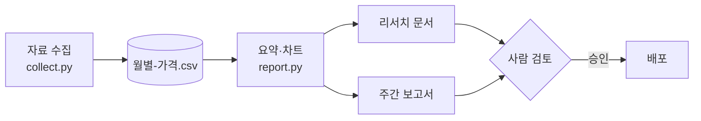

# 리서치 자동화 구현 계획

맨 위의 `---` 사이(frontmatter)는 문서 위에 '메타데이터' 상자로 보이고, `description` 은 폴더 개요의 요약으로 쓰인다. 트리에서 `plans` 폴더 이름을 눌러 확인해 보자.

## 목표

매주 월요일 아침, 지난주 가격·재고 자료로 만든 보고서를 사람이 검토만 하고 내보낸다.

## 단계

| 단계 | 할 일 | 산출물 | 상태 |
|---|---|---|---|
| 1 | 자료 수집 스크립트 정리 | `src/collect.py`, `data/월별-가격.csv` | 완료 |
| 2 | 요약 문장·차트 자동 작성 | `src/report.py`, `research/구리-시장-동향.md` | 진행 중 |
| 3 | 검토 후 배포 | `reports/주간-보고서.html` | 예정 |

## 결정한 것

- 자료는 CSV 하나로 모은다 — 사람이 엑셀로도 열 수 있고, 문서의 차트가 그대로 읽는다.
- 보고서의 차트는 Markdown 의 차트 코드 블록으로 만든다. HTML 의 스크립트 차트는 Lectern 에서 보이지 않는다.

## 참고

- [우선순위](2-우선순위.md)
- [후속 과제](10-후속-과제.md)
