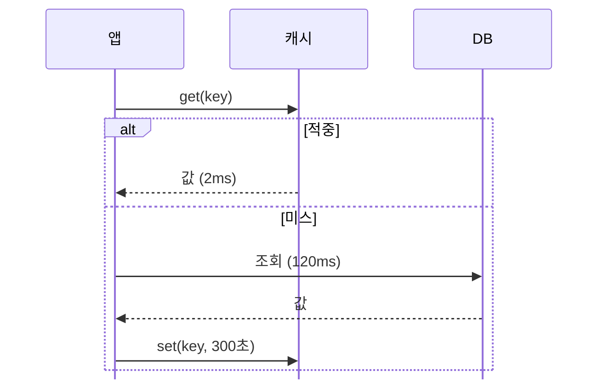

<!-- _class: lead -->
<!-- _paginate: false -->

# 캐시 한 겹으로 응답을 14ms까지 줄였다

가상 서비스 '서고'의 상세 조회 · 기술 세미나

<!-- 왜 캐시를 넣었고, 얼마나 줄었고, 무엇이 남았는지를 차례로 말한다. -->

---

<!-- layout: kpi-two -->
<!-- eyebrow: 문제 -->

## 같은 책을 읽는 조회가 DB를 채운다

::: a kpi
**2,000**
상세 조회 (회/초)
:::

::: b kpi
**120 ms**
평균 응답
:::

::: c kpi
**78%**
DB CPU
:::

::: d
### 책 구간별 조회 몫 (%)

```vega-lite
{
  "width": "container",
  "data": {"url": "data/07-조회-몫.csv"},
  "encoding": {
    "y": {"field": "구간", "type": "nominal", "sort": null, "title": null},
    "x": {"field": "몫", "type": "quantitative", "axis": null, "scale": {"domain": [0, 100]}}
  },
  "layer": [
    {"mark": {"type": "bar", "color": "#2f6f8f"}},
    {"mark": {"type": "text", "align": "left", "dx": 6, "fontSize": 16}, "encoding": {"text": {"field": "몫", "type": "quantitative"}}}
  ],
  "config": {"axis": {"labelFontSize": 15}, "view": {"stroke": null}}
}
```
:::

::: e card center 20
### 캐시가 맞는 자리

- 읽기가 쓰기의 50배다
- 책 1,000권에 조회가 90% 몰린다
- 책 정보는 자주 바뀌지 않는다
:::

<!-- 전체 100만 권 가운데 0.1%가 조회의 90%를 차지한다. 캐시가 잘 듣는 모양이다. -->

---

<!-- layout: left-stack -->
<!-- eyebrow: 설계 -->

## 앱이 캐시를 먼저 보고 없을 때만 DB로 간다

::: a center

:::

::: b kpi center 28
**2 ms**
적중 90%
:::

::: c kpi center 28
**122 ms**
미스 10%
:::

<!-- 미스는 캐시를 한 번 본 뒤 DB로 가니 2ms 와 120ms 를 더해 122ms 다. -->

---

<!-- layout: two-left -->
<!-- text: 코드 24 -->
<!-- eyebrow: 구현 -->

## 읽기 함수에 다섯 줄을 더했다

::: a center
```python
def get_book(book_id):
    key = f"book:{book_id}"
    book = cache.get(key)
    if book is not None:
        return book
    book = db.find_book(book_id)
    cache.set(key, book, ttl=300)
    return book
```
:::

::: b center 20
### 더한 것

- 책 번호로 키를 만든다
- 캐시를 먼저 본다
- 읽은 값을 300초 둔다

### 그대로인 것

- DB 조회 함수
- 쓰기 경로
:::

<!-- 본래 함수는 세 줄이었다. 키, 조회, 분기, 돌려주기, 저장의 다섯 줄이 늘었다. -->

---

<!-- grid: t t t t / a a a a / b c d e -->
<!-- rows: auto 1.3fr 1fr -->
<!-- eyebrow: 계산 -->

## 적중률 90%면 평균 응답은 14ms다

::: a card center text-center 56
$$T = T_c + (1 - h)\,T_d$$
:::

::: b kpi
**2 ms**
$T_c$ 캐시 응답
:::

::: c kpi
**120 ms**
$T_d$ DB 응답
:::

::: d kpi
**0.9**
$h$ 적중률
:::

::: e kpi accent
**14 ms**
2 + 0.1 × 120
:::

<!-- 캐시는 늘 한 번 보고, 미스일 때만 DB 값을 더 낸다. 적중률이 1%p 떨어지면 평균이 1.2ms 늘어난다. -->

---

<!-- layout: left-stack -->
<!-- text: 표 22 -->
<!-- eyebrow: 결과 -->

## DB 조회는 10분의 1, 응답은 8.6배 빨라졌다

::: a center
| 지표 | 전 | 후 |
|---|---:|---:|
| 평균 응답 (ms) | 120 | 14 |
| p99 응답 (ms) | 340 | 135 |
| DB 조회 (회/초) | 2,000 | 200 |
| DB CPU (%) | 78 | 15 |
| 캐시 적중률 (%) | — | 90 |
:::

::: b kpi accent center 28
**8.6배**
평균 응답이 빨라졌다
:::

::: c kpi center 28
**-90%**
DB 조회
:::

<!-- 계산한 14ms 와 잰 값이 같다. p99 는 미스가 남아서 평균만큼 줄지 않았다. -->

---

<!-- layout: two -->
<!-- eyebrow: 위험 -->

## 캐시는 새로운 실패 두 가지를 들여왔다

::: a center 24
### 부하

> [!WARNING]
> 캐시가 통째로 비면 **2,000회/초**가 한꺼번에 DB로 간다.

- 수명을 ±10% 흩뜨린다
- 같은 키 조회를 하나로 묶는다
:::

::: b center 24
### 정확성

> [!NOTE]
> 고친 책이 **최대 300초** 옛 값으로 보인다.

- 가격·재고는 캐시에서 뺐다
- 책을 고칠 때 키를 지운다
:::

<!-- 왼쪽은 부하의 위험이고 오른쪽은 정확성의 위험이다. 둘 다 아직 막지 못한 부분이 있다. -->

---

<!-- layout: right-stack -->
<!-- eyebrow: 다음 -->

## 남은 일은 셋이고, DB 보호가 먼저다

::: a kpi accent center 28
**3 / 6**
끝낸 일
:::

::: b center 26
- [x] 상세 조회에 캐시를 더했다
- [x] 가격·재고를 캐시에서 뺐다
- [x] 적중률을 대시보드에 올렸다
- [ ] 같은 키 조회를 하나로 묶는다
- [ ] 수명을 ±10% 흩뜨린다
- [ ] 책을 고칠 때 키를 지운다
:::

::: c center 22
> [!IMPORTANT]
> DB 보호 두 건은 장애 훈련 전에 끝낸다.
:::

<!-- 끝낸 일 셋, 남은 일 셋이다. 훈련 날짜는 다음 주에 정한다. -->
