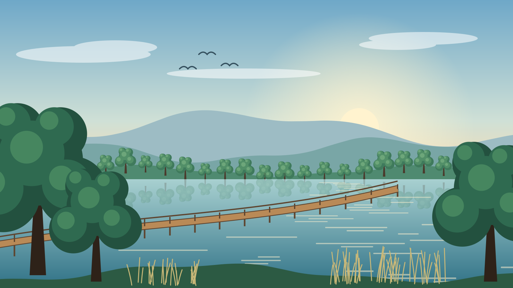
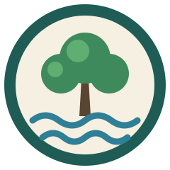
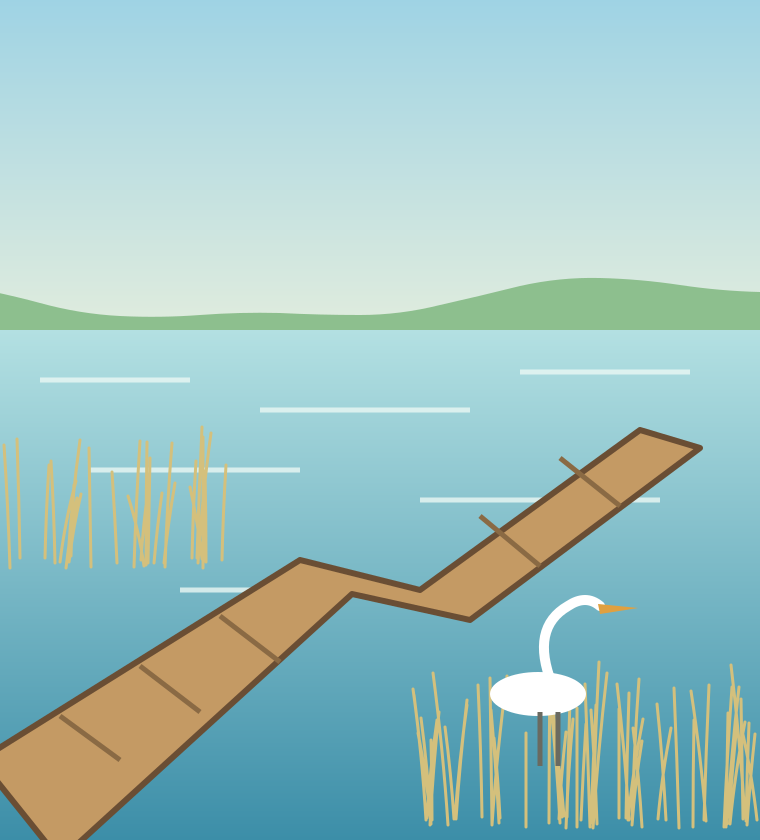
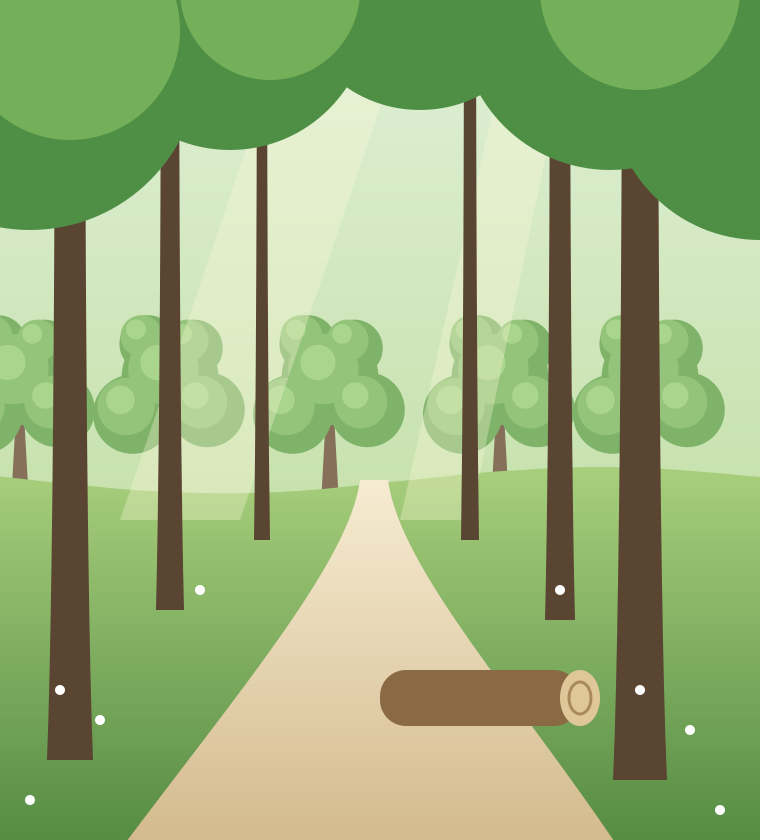
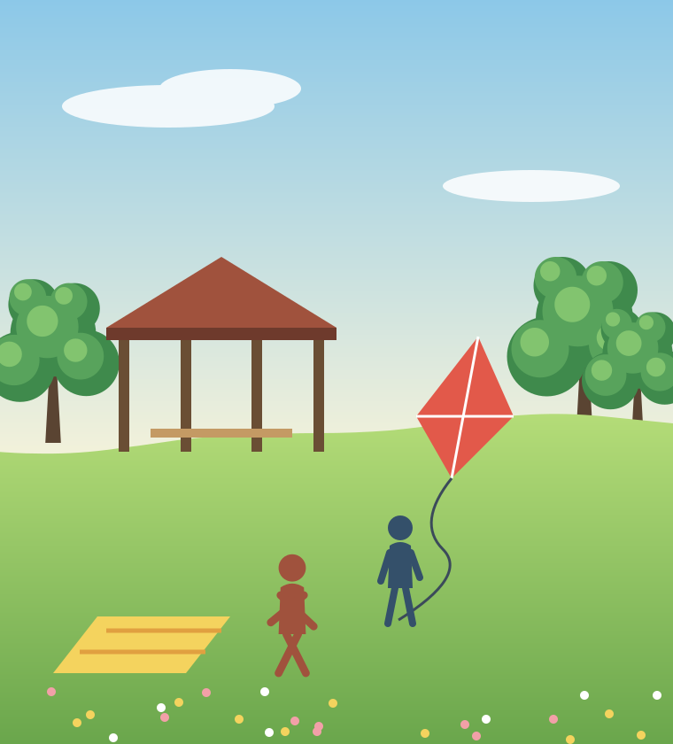
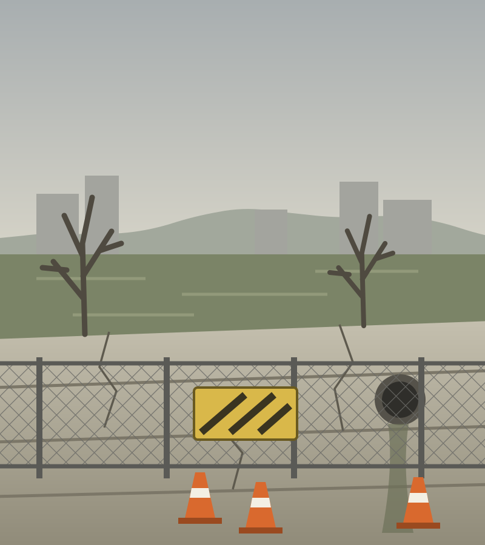
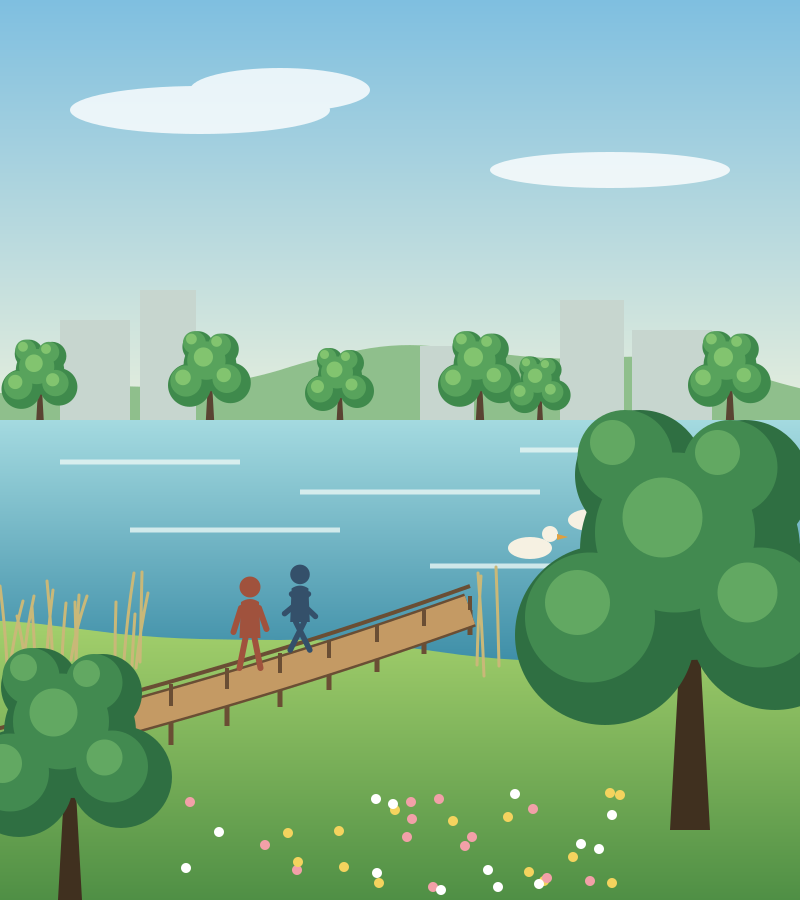
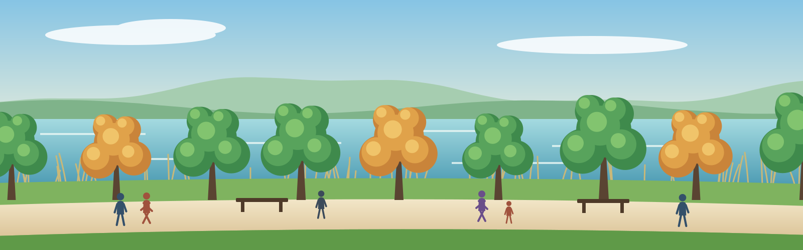

<!-- _class: lead invert -->
<!-- _paginate: false -->

# 느티나루 공원이 호수를 되찾았다

재정비 사진 기록 · 2024–2026

<!-- 가상의 공원이다. 공사 전부터 다 고친 뒤까지를 그림으로 따라간다. -->

---

<!-- _paginate: false -->
<!-- layout: stack -->
<!-- eyebrow: 원칙 -->

.svg>)

## 오래된 나무부터 지키기로 했다

::: a kpi accent center 28
**120그루**
그대로 둔 느티나무
:::

::: b center 20
- 나무를 피해 길을 다시 그렸다
- 뿌리 위에는 콘크리트를 쓰지 않았다
- 공사 차량은 숲길에 들이지 않았다
:::

<!-- 설계보다 먼저 정한 원칙이다. 그림의 길이 이번에 그대로 살린 느티나무 길이다. -->

---

<!-- eyebrow: 계획 -->

## 공원을 세 구역으로 나눠 차례로 고쳤다

::: map center at 56 116 724 540
.svg>)
:::

::: sum center at 800 116 300 100
### 96억 원 · 30개월
:::

::: logo center at 1124 116 100 100

:::

::: a card center at 800 230 424 130
### 1 호수 구역

44억 원 · 14개월
:::

::: b card center at 800 374 424 130
### 2 숲 구역

32억 원 · 10개월
:::

::: c card center at 800 518 424 130
### 3 마당 구역

20억 원 · 6개월
:::

<!-- 물길을 먼저 잡아야 숲과 마당의 높이가 정해져서 호수부터 시작했다. -->

---

<!-- layout: three -->
<!-- eyebrow: 구역별 -->

## 구역마다 한 가지만 크게 바꿨다

::: a

**호수** 둑을 걷고 갈대밭과 데크를 놓았다.
:::

::: b

**숲** 포장을 걷고 흙길로 되돌렸다.
:::

::: c

**마당** 주차장 자리를 잔디밭으로 바꿨다.
:::

<!-- 구역마다 한 문장으로 말할 수 있게 공사를 묶었다. -->

---

<!-- _class: invert -->
<!-- eyebrow: 전후 -->

## 같은 자리의 둑이 물가로 돌아왔다

::: a at 56 116 560 110
### 2024년 3월

콘크리트 둑에 철망을 둘렀다.
:::

::: b at 664 116 560 110
### 2026년 9월

걸어서 물가까지 내려간다.
:::

<!-- 왼쪽은 흑백으로 바꿔 지난 일임을 보인다. 둘은 같은 자리에서 본 모습이다. -->

---

<!-- layout: kpi -->
<!-- eyebrow: 결과 -->

## 걷는 길은 62%, 방문객은 75% 늘었다

::: a kpi
**6.8 km**
산책로 (전 4.2)
:::

::: b kpi
**5.6만**
월 방문객 (전 3.2만)
:::

::: c kpi
**1,240**
새로 심은 나무
:::

::: d kpi
**1.4 km**
걷어 낸 둑
:::

::: e center

:::

<!-- 산책로는 2.6km 늘어 62%, 방문객은 월 2.4만 명 늘어 75% 다. 그림은 호수 남쪽 산책로의 가을이다. -->

---

<!-- _class: invert -->
<!-- layout: three -->
<!-- eyebrow: 다음 -->

## 내년 봄에는 북쪽 습지를 연다

::: a 22
### 3월

북쪽 습지 산책로를 연다.
:::

::: b 22
### 5월

갈대밭 생태를 조사한다.
:::

::: c 22
### 9월

방문객 만족도를 다시 잰다.
:::

<!-- 공사는 끝났고 돌보는 일이 남았다. 다음 기록은 내년 가을에 낸다. -->
