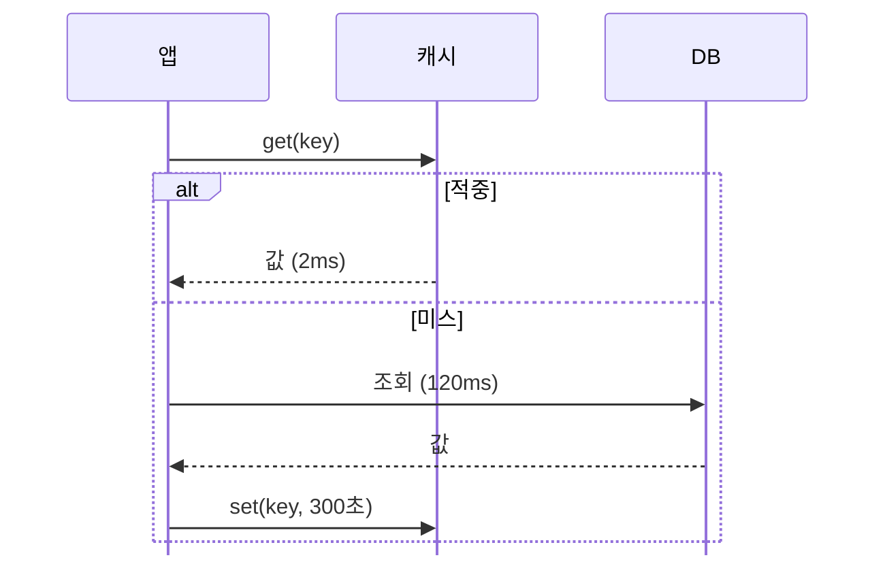

# 07 기술 세미나 — 처음부터 만들기

> 완성본: [기술 세미나](../07-기술-세미나.md)

**언제 쓰나** 개발자 앞에서 코드와 수식으로 설계 판단을 설명할 때 쓴다.

**이 예제에서 배우는 것**

- 코드 블록이 잘리지 않게 줄 길이를 맞추는 법
- 수식을 크게 보이고 다이어그램을 칸에 넣는 법
- 박스글과 체크 목록으로 위험과 남은 일을 정리하는 법

## 1. 먼저 정한다

- **듣는 사람**: 같은 회사의 개발자. 코드를 읽을 줄 안다. 뒷자리에서도 코드가 보여야 한다.
- **그들이 결정할 것**: 이 캐시를 다른 조회에도 쓸지, 남은 일에 시간을 낼지.
- **장 수**: 이야기 순서대로 센다. 문제, 설계, 코드, 계산, 결과, 위험, 남은 일. 일곱 개에 표지를 더해 8장이다.

## 2. Claude 에게 요청한다

터미널에 그대로 붙여 넣는다.

```text
web/help/slides.md 안내대로 Lectern 슬라이드를 써 줘.

파일: slides/07-기술-세미나.md, 8장. 자료는 slides/data/ 에 둔다.
주제: 가상 서비스 '서고'의 상세 조회에 캐시를 더한 일.
듣는 사람: 개발자. 코드를 읽을 줄 안다.

들어갈 것:
- 짧은 코드 블록 하나. 잘리는 줄이 없게 하고 글자를 크게.
- 크게 보이는 수식 하나: 평균 응답 = 캐시 응답 + (1 - 적중률) x DB 응답.
- mermaid 시퀀스 다이어그램 하나. 적중과 미스를 나눠서.
- 전후 비교 표 하나.
- [!WARNING] 와 [!NOTE] 박스글.
- 남은 일의 체크 목록.

숫자: 조회 2,000회/초, 캐시 2ms, DB 120ms, 적중률 90%.
제목은 결론으로 쓰고 숫자는 앞뒤가 맞게 계산해 줘.
```

## 3. 제목만 먼저 세운다

| 장 | 결론 제목 | 배치 |
|---:|---|---|
| 1 | 캐시 한 겹으로 응답을 14ms까지 줄였다 | `lead` |
| 2 | 같은 책을 읽는 조회가 DB를 채운다 | `kpi-two` |
| 3 | 앱이 캐시를 먼저 보고 없을 때만 DB로 간다 | `left-stack` |
| 4 | 읽기 함수에 다섯 줄을 더했다 | `two-left` |
| 5 | 적중률 90%면 평균 응답은 14ms다 | 격자 |
| 6 | DB 조회는 10분의 1, 응답은 8.6배 빨라졌다 | `left-stack` |
| 7 | 캐시는 새로운 실패 두 가지를 들여왔다 | `two` |
| 8 | 남은 일은 셋이고, DB 보호가 먼저다 | `right-stack` |

숫자는 여기서 맞춘다. 평균은 2 + 0.1 × 120 = 14ms 다. 120 ÷ 14 는 8.6배이고, 미스 10% 만 DB로 가니 조회는 2,000에서 200이 된다.

## 4. 칸을 채운다

**4장 코드.** 코드는 줄이 바뀌지 않고 잘린다. 14pt 한 줄은 칸 폭 ÷ 11 글자다. 24pt 면 한 글자가 약 19px 이니 767px 칸에 약 40글자가 들어간다. 제일 긴 줄이 33글자여서 `two-left` 에 `코드 24` 를 쓸 수 있다. 세미나는 뒷자리까지 읽혀야 하니 칸 안에서 가장 크게 썼다.

````markdown
<!-- layout: two-left -->
<!-- text: 코드 24 -->
<!-- eyebrow: 구현 -->

## 읽기 함수에 다섯 줄을 더했다

::: a center
```python
def get_book(book_id):
    key = f"book:{book_id}"
    book = cache.get(key)
    if book is not None:
        return book
    book = db.find_book(book_id)
    cache.set(key, book, ttl=300)
    return book
```
:::
````

**5장 수식.** 수식은 칸 크기를 따른다. 칸 머리 줄의 `56` 이 수식을 키운다. 윗줄은 수식 하나만 두고, 아랫줄 KPI 네 칸이 기호의 뜻과 값을 맡는다. 마지막 칸만 `accent` 로 칠해 답을 보인다. 틀에 없는 모양이어서 격자로 썼다.

```markdown
<!-- grid: t t t t / a a a a / b c d e -->
<!-- rows: auto 1.3fr 1fr -->
<!-- eyebrow: 계산 -->

## 적중률 90%면 평균 응답은 14ms다

::: a card center text-center 56
$$T = T_c + (1 - h)\,T_d$$
:::

::: b kpi
**2 ms**
$T_c$ 캐시 응답
:::
```

**3장 다이어그램.** 그림과 설명이어서 `left-stack` 을 골랐다. 시퀀스 다이어그램은 세로로 길다. 맨 앞 줄로 아래쪽 참여자 상자를 뺐다. 설명은 글 대신 KPI 칸 둘로 두었다. 다이어그램이 순서를 말하니 칸은 시간만 말하면 된다.

````markdown
::: a center

:::

::: b kpi center 28
**2 ms**
적중 90%
:::
````

**7장 박스글.** 칸 크기를 쓰면 박스글도 같이 커진다. 경고는 `[!WARNING]`, 알아 둘 것은 `[!NOTE]` 로 나눴다. 색이 달라 두 위험의 무게가 다르게 보인다.

```markdown
::: a center 24
### 부하

> [!WARNING]
> 캐시가 통째로 비면 **2,000회/초**가 한꺼번에 DB로 간다.

- 수명을 ±10% 흩뜨린다
- 같은 키 조회를 하나로 묶는다
:::
```

**8장 체크 목록.** 목록의 `[x]` 와 `[ ]` 가 체크 칸이 된다. 왼쪽 KPI 의 3 / 6 은 체크한 줄의 수와 같아야 한다.

```markdown
::: b center 26
- [x] 상세 조회에 캐시를 더했다
- [x] 가격·재고를 캐시에서 뺐다
- [x] 적중률을 대시보드에 올렸다
- [ ] 같은 키 조회를 하나로 묶는다
- [ ] 수명을 ±10% 흩뜨린다
- [ ] 책을 고칠 때 키를 지운다
:::
```

## 5. 점검을 고친다

처음 쓴 문서의 점검은 **1건**이었다. 8장, 한 줄 편집 69/69 였다.

```text
3장(75행) 칸 a 이(가) 32px 넘칩니다 (칸 높이 555px)
```

칸 폭에 맞춰 그려진 시퀀스 다이어그램이 칸 높이를 넘었다. `center` 칸이어서 위아래가 함께 넘쳐 참여자 상자의 윗부분이 잘렸다. 두 번에 나눠 고쳤다.

1. 맨 앞에 `%%{init: {"sequence": {"mirrorActors": false}}}%%` 를 넣어 아래쪽 참여자 상자를 뺐다. 32px 이 6px 로 줄었다.
2. 미스 쪽의 메시지 `C-->>A: 없음` 을 뺐다. 없어도 흐름이 읽힌다. 0건이 됐다.

점검이 0건이 된 뒤에는 장을 하나씩 눈으로 보고 고쳤다.

| 장 | 눈에 보인 것 | 고친 법 |
|---:|---|---|
| 2 | 막대에 값이 있는데 축 눈금 90 과 100 이 붙어 어지럽다 | 가로축을 뺐다 (`"axis": null`) |
| 2 | 오른쪽 카드의 절반이 비었다 | 칸 크기 20 에 항목 하나를 더했다 |
| 2 | '90%' 와 '가' 사이에서 줄이 꺾였다 | '조회가 90% 몰린다'로 고쳤다 |
| 3 | 글 두 줄만 든 카드의 절반이 비었다 | KPI 칸으로 바꿨다 |
| 4 | `two` 에 코드 20pt 는 뒷자리에서 작다 | `two-left` 에 코드 24pt 로 바꿨다 |
| 5 | 칸 크기 40 의 수식이 칸에 비해 작다 | 칸 크기를 56 으로 키웠다 |
| 6 | 표 20pt 위아래가 많이 빈다 | 표를 22pt 로 키웠다 |
| 7 | 박스글 둘이 가운데에 작게 떠 있다 | 칸 크기 24 에 소제목을 더했다 |
| 8 | `two-left` 의 오른쪽 박스글이 혼자 작다 | `right-stack` 으로 바꾸고 KPI 칸을 더했다 |

마지막 결과는 8장, 점검 0건, 한 줄 편집 74/74 다.

## 6. 사람이 다듬는다

1. **숫자를 고친다.** 6장 표의 `p99 응답` 행에서 F2 를 누른다. 135 를 실제 값으로 고치고 Enter 를 누른다.
2. **코드의 한계를 본다.** Ctrl+E 로 편집 모드에 들어가 4장의 `cache.set` 줄을 `    cache.set(key, book, ttl=300, tags=["detail", "popular"])` 로 바꾼다. 상태줄의 '점검'에 `코드가 옆으로 395px 잘렸습니다` 가 나온다. Ctrl+Z 로 되돌린다.
3. **체크 칸을 바꾼다.** 일을 끝내면 Ctrl+E 로 8장의 `- [ ]` 를 `- [x]` 로 고친다. 왼쪽 칸의 3 / 6 은 F2 로 4 / 6 으로 고친다.
4. **할 일을 더한다.** 8장의 마지막 항목에서 Ctrl+Enter 로 아래에 새 줄을 넣는다. 7개가 되니 '3 / 6' 의 6 도 고친다. 넘치면 상태줄의 '점검'에 나온다.

## 7. 발표하고 전한다

Shift+F5 로 발표한다. 이 예제에서는 세 가지를 본다.

- 4장 코드가 회의실 뒷자리에서 읽히는지 본다.
- 3장 다이어그램의 글은 칸의 글보다 작다. 순서는 말로 따라간다.
- 5장은 수식을 먼저 보이고 아랫줄 칸을 왼쪽부터 읽는다.

문서의 우클릭 메뉴에서 '인쇄 / PDF로 저장…'을 고르면 PDF로 전할 수 있다. 발표자 노트는 PDF에 들어가지 않는다. 3장의 122ms 계산처럼 노트에만 쓴 설명은 따로 전한다.

## 되새길 것

- 코드는 줄어들지 않고 잘린다. 제일 긴 줄의 글자 수로 칸과 크기를 고른다.
- 다이어그램은 폭에 맞춰 그려져 높이가 넘칠 수 있다. 세로로 길면 메시지를 줄인다.
- 제목·표·수식의 숫자는 한 계산에서 나와야 한다.
