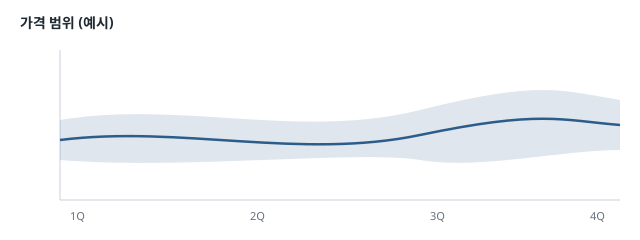

<!-- _class: lead -->
<!-- _paginate: false -->
<!-- _footer: "" -->

# 장이 놓인 자리로 이야기하는 html 발표

구리 시장 2분기 리뷰 · html 로 전환 예제

<!--
이 문서 옆의 07-html-발표.html 이 이 발표를 html 로 전환한 결과다.
브라우저에서 열면 장이 한 캔버스 위에 놓여 화면이 장 사이를 옮겨 다닌다.
Lectern 안에서 열면 스크립트가 돌지 않아 장이 위에서 아래로 놓인 문서로 보인다.
-->

---

<!-- layout: two -->
## 받은 사람은 브라우저 하나로 연다

::: a card center
### 파일 하나
- 그림·차트·글꼴이 파일 안에 든다
- 인터넷이 없어도 열린다
- Lectern 도 PowerPoint 도 없어도 된다
:::

::: b card center
### 넘기는 키
| 키 | 하는 일 |
|---|---|
| → · Space | 다음 장 |
| ← | 앞 장 |
| Home · End | 처음 · 전체 보기 |
| P | 발표자 콘솔 |
:::

<!-- 발표자 콘솔은 새 창으로 뜨고 이 노트를 보인다. 브라우저가 새 창을 막으면 이 파일에만 허용한다. -->

---

## 만드는 법은 네 단계다

1. 슬라이드 창 상태줄의 **html 로 전환**을 누른다
2. 배치를 고른다 — **격자**(기본)나 **가로 한 줄**
3. **만들기**를 누르면 문서 옆에 새 html 하나가 생긴다
4. **브라우저로 열기**로 확인하고 그 파일을 보낸다

> [!TIP]
> 옆의 `07-html-발표.html` 이 이 발표의 결과다. 사이드바에서 우클릭 → **탐색기에서 보기**로 찾아 브라우저로 연다. 설치한 예제는 보기만 하므로 직접 만들려면 이 폴더를 복사해서 연다.

<!-- 같은 이름이 있으면 덮어쓰지 않고 '07-html-발표 2.html' 처럼 새 이름으로 만든다. 앞의 세 장은 자리를 적지 않아 격자의 규칙대로 첫 줄에 놓였다. -->

---

<!-- impress: x=0 y=1100 -->
<!-- eyebrow: 가격 -->
<!-- layout: three -->
## 2분기 평균 가격은 3.9% 올랐다

::: a kpi center
**10,593**
1분기 평균 (USD/t)
:::

::: b kpi accent center
**11,007**
2분기 평균 (USD/t)
:::

::: c kpi center
**+3.9%**
분기 변화
:::

<!-- 이 장부터 md 에 자리를 적었다 (impress: x=0 y=1100). 가격 절의 세 장은 y 가 같아 둘째 줄에 한 줄로 이어진다. 숫자는 예제용으로 만든 값이다. -->

---

<!-- impress: x=1500 y=1100 -->
<!-- eyebrow: 가격 -->
## 6월 가격이 자료를 모은 뒤 가장 높았다

```vega-lite
{
  "width": "container",
  "data": { "url": "../../data/월별-가격.csv" },
  "mark": { "type": "area", "line": true, "opacity": 0.25 },
  "encoding": {
    "x": { "field": "월", "type": "temporal", "title": null, "axis": { "format": "%y.%m" } },
    "y": { "field": "가격", "type": "quantitative", "title": "USD/t", "scale": { "zero": false } }
  }
}
```

<!-- 차트는 전환할 때 그림으로 들어간다. 값을 바꾸면 data/월별-가격.csv 를 고치고 다시 전환한다. -->

---

<!-- impress: x=3000 y=1100 -->
<!-- eyebrow: 가격 -->


## 가격은 밴드의 위쪽에서 움직였다

- 분기 평균에서 위아래로 한 표준편차
- 2분기는 줄곧 밴드의 위쪽이었다
- 3분기에는 가운데로 돌아올 것으로 본다

<!-- 그림도 파일 안에 들어가 받은 사람의 PC 에 이 그림이 없어도 보인다. -->

---

<!-- impress: x=4550 y=550 rotate=90 -->
<!-- eyebrow: 공급 -->
## 거래소 재고는 10% 줄었다

| 지표 | 1분기 | 2분기 |
|---|---:|---:|
| 재고 (천 t) | 268 | 241 |
| 변화 | | -10.1% |

- 공급 차질로 재고가 쌓이지 못했다

<!-- 절이 바뀌는 곳에서 장을 돌렸다 (rotate=90). 화면이 따라 돌아 글은 바로 서서 보인다. 돌리기는 한두 번만 쓴다. -->

---

<!-- impress: x=5420 y=550 rotate=90 -->
<!-- eyebrow: 공급 -->
## 중국 수입은 5.7% 늘었다

| 지표 | 1분기 | 2분기 |
|---|---:|---:|
| 수입 (만 t) | 141 | 149 |
| 변화 | | +5.7% |

- 수요는 꺾이지 않았다

<!-- 공급 절의 두 장은 같은 각도로 나란히 놓아 한 묶음으로 보이게 했다. -->

---

<!-- impress: x=2200 y=2550 scale=2 -->
<!-- _class: invert -->
<!-- layout: two -->
## 3분기에는 오름폭이 줄 것이다

::: a card center
### 본 것
- 가격 +3.9%, 6월이 가장 높았다
- 재고 -10.1%, 중국 수입 +5.7%
- 공급 차질이 풀리면 오름폭이 준다
:::

::: b accent center
### 할 것
1. 3분기 자료를 매주 모은다
2. 재고·수입도 CSV 로 모은다
3. 이 html 을 보고서와 함께 보낸다
:::

<!-- 요약 장은 scale=2 로 두 배 크게 놓았다. 이 장으로 오면 화면이 멀리서 보는 것처럼 물러난다. 맨 끝의 전체 보기(End)에서 이 장이 다른 장보다 두 배 큰 것이 보인다. -->

---

<!-- impress: x=4600 y=2550 -->
## 장의 자리는 주석 한 줄로 적는다

| 적는 것 | 하는 일 |
|---|---|
| `<!-- impress: x=0 y=1100 -->` | 그 장의 가운데 자리 (px, 장은 1280×720) |
| `rotate=90` | 장을 돌린다 — 화면이 따라 돈다 |
| `scale=2` | 두 배 크게 놓는다 — 그 장으로 가면 물러난다 |
| 맨 앞 설정 `impress: line` | 적지 않은 장을 가로 한 줄로 |

> [!TIP]
> 자리를 정하기 어려우면 html 로 전환 창의 **Claude 에게 배치 요청**으로 이야기 흐름에 맞춘 자리를 맡긴다. 맨 끝의 전체 보기 장은 앱이 만든다.

<!-- 적지 않은 축은 규칙대로다. 자리는 슬라이드 창의 모양을 바꾸지 않으므로 고친 뒤 html 로 전환을 다시 누른다. -->
