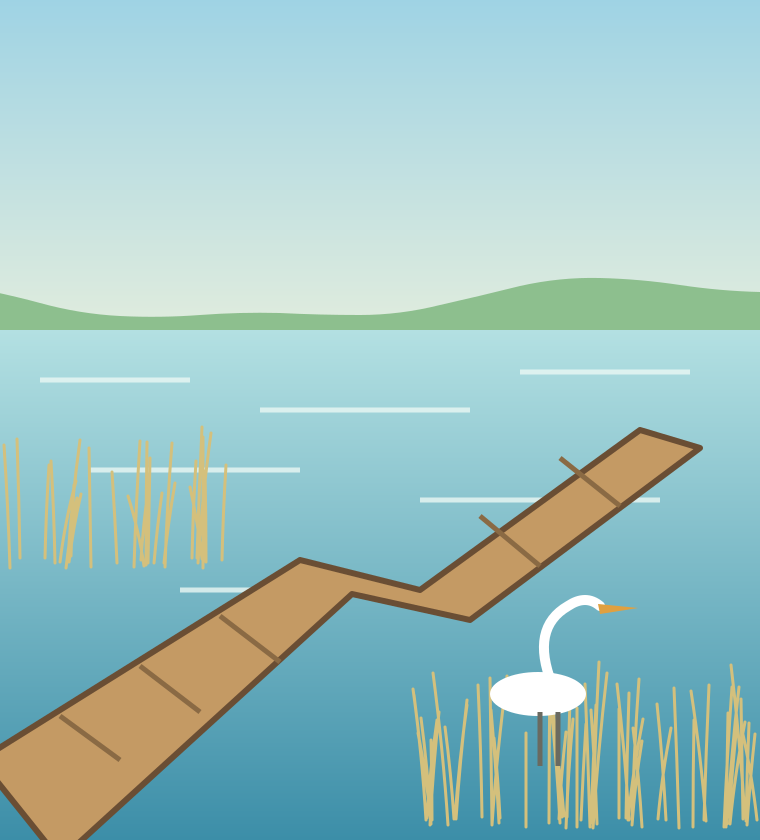

<!-- _class: lead -->
<!-- _paginate: false -->
<!-- _footer: '' -->

# 늘봄호수공원, 다시 걷다

계간 공원 2026 가을호 특집

---

<!-- grid: t t t / a a b / a a b / c d b -->
<!-- cols: 1fr 1fr 375px -->
<!-- rows: auto 1fr 1fr 106px -->
<!-- eyebrow: 특집 -->

## 호수는 3년 만에 도시의 거실이 됐다

::: a

:::

::: b dark 16
### 물을 되살리다

늘봄호수는 십 년 넘게 녹조로 덮여 있었다. 시민들은 호숫가를 걷는 대신 돌아서 갔다.

복원은 물길을 잇는 일에서 시작했다. 막혀 있던 수로 세 곳을 열자 여름 수온이 2도 내렸다.

지금은 하루 1만 2천 명이 호수를 찾는다. 공원은 이제 지나가는 곳이 아니라 머무는 곳이다.
:::

::: c 14
**그림** 동쪽 전망대에서 본 호수.
왼쪽이 복원한 수로다.
:::

::: d 14
**수치** 수질은 5등급에서 2등급으로
올랐다. 녹조 경보는 0회다.
:::

<!-- 출처: 공원관리사업소 자료를 다듬은 예시다. -->

---

<!-- grid: t / a / b -->
<!-- rows: auto 350px 1fr -->
<!-- eyebrow: 걷기 -->

## 산책로 4km 는 끊긴 곳 없이 이어진다

::: a

:::

::: b cols-3 14
산책로는 호수 둘레를 따라 네 구간으로 나뉜다. 예전에는 주차장과 배수 시설이 길을 끊어 세 번이나 찻길로 나와야 했다. 공사는 이 끊긴 자리를 잇는 일부터 했다.

새 길의 폭은 3m 다. 유모차와 휠체어가 마주쳐도 비켜설 수 있는 폭이다. 바닥은 물이 스미는 흙 포장으로 바꿔 비 온 뒤에도 고인 물이 없다.

길가에는 300m 마다 쉼터를 두었다. 느티나무 그늘이 있는 쉼터에는 등받이 의자를, 호숫가 쉼터에는 낮은 데크를 놓았다. 걷는 사람의 속도에 맞춘 구성이다.
:::

---

<!-- grid: t t t / a q c / b r d -->
<!-- cols: 240px 1fr 240px -->
<!-- rows: auto 1fr 130px -->
<!-- eyebrow: 인터뷰 -->

## 설계자는 비워 두는 일을 가장 오래 고민했다

::: a center

:::

::: q center text-center 32
“공원은 채우는 곳이 아니라 비워 두는 곳이다.”
:::

::: c center

:::

::: b 14
### 숲 구역

참나무 그늘을 그대로 남겼다.
:::

::: r center text-center 16
조경가 김서연 · 늘봄호수공원 총괄 설계
:::

::: d 14
### 호수 구역

호안의 콘크리트를 걷어 냈다.
:::

---

<!-- grid: t t t t / p p h h / b c d e -->
<!-- cols: 240px 240px 1fr 1fr -->
<!-- rows: auto 1fr 200px -->
<!-- eyebrow: 공원신문 제1호 · 2026년 11월 -->
<!-- _backgroundColor: #f7f3ea -->
<!-- _color: #1f2933 -->

## 늘봄호수공원, 전면 개장 첫해 방문객 400만 명

::: p
.svg>)
:::

::: h cols-2 14
시는 전면 개장 뒤 열 달 동안 방문객이 400만 명을 넘었다고 밝혔다. 개장 전 한 해 방문객의 네 배다.

방문객은 주말 오전과 평일 저녁에 몰렸다. 호수 둘레 산책로가 가장 붐볐고 숲 구역이 그 뒤를 이었다.

인근 상권도 달라졌다. 공원 동쪽 상가의 공실률은 18% 에서 6% 로 내렸다.

시는 내년 봄 느티나무 길을 마저 열고 서쪽 주차장을 줄여 마당을 넓힌다.
:::

::: b 14
### 야간 개장

6월부터 밤 10시까지 연다. 조명은 호수 쪽을 피했다.
:::

::: c 14
### 철새 귀환

논병아리 12쌍이 올해 처음 둥지를 틀었다.
:::

::: d 14
### 시민 정원사

자원봉사자 240명이 구역을 나눠 맡는다. 매달 첫 토요일에 모인다.
:::

::: e 14
### 내년 예산

시의회가 유지비 38억을 의결했다. 수질 관리가 절반이다.
:::

---

<!-- grid: t t / a b / c c -->
<!-- rows: auto 1fr 1fr -->
<!-- eyebrow: 다음 계절 -->

.svg>)

## 봄이면 느티나무 길이 다시 열린다

::: a kpi
**1.2km**
느티나무 길
:::

::: b kpi accent
**320그루**
새로 심은 나무
:::

::: c card
### 찾아오는 길

- 늘봄역 2번 출구에서 걸어서 8분
- 버스 72번, 호수공원 정류장 하차
- 동쪽 주차장은 주말 오전에 붐빈다
:::

<!-- 나무 수와 거리는 예시 값이다. -->
