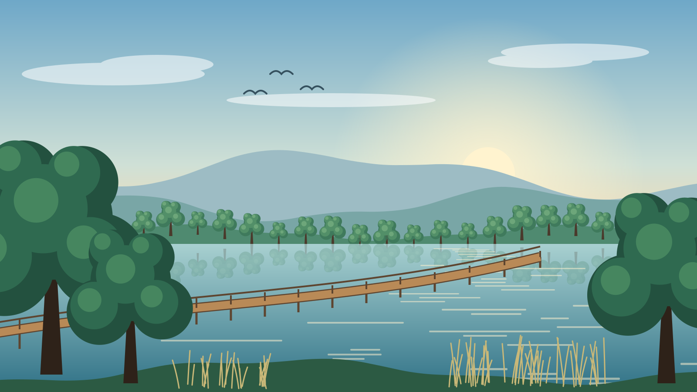
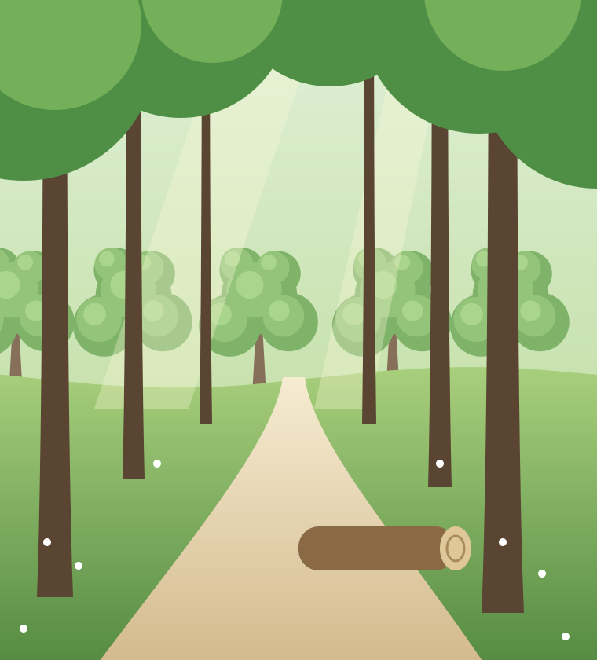
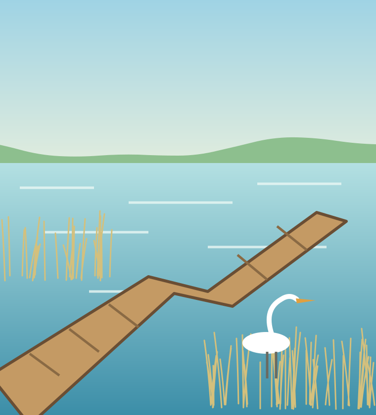
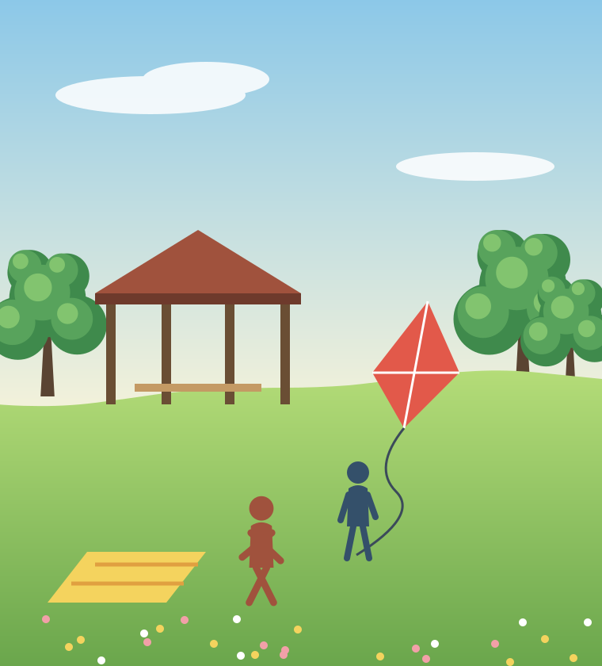
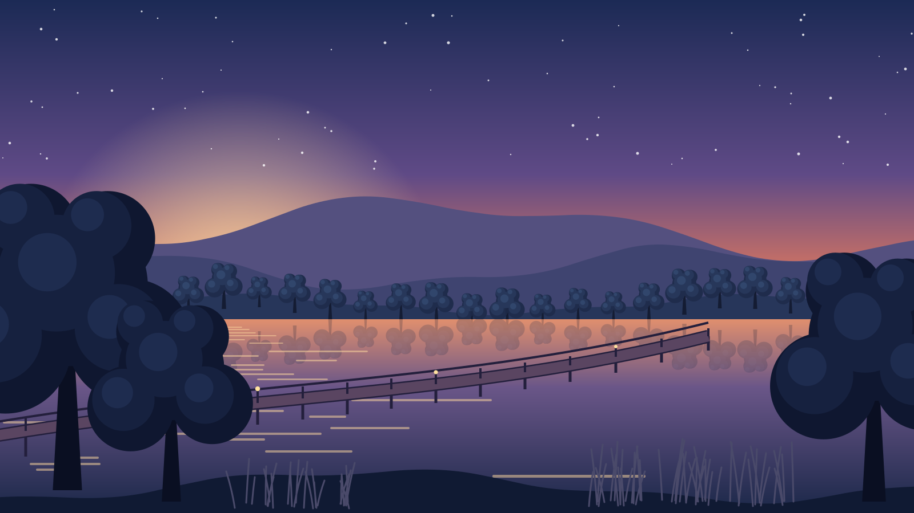

<!-- _class: lead invert -->
<!-- _paginate: false -->
<!-- _footer: '' -->



# 호수공원 재정비 중간 보고

공정 62%, 세 구역이 내년 봄에 함께 열린다

---

<!-- grid: t t t / a b c -->
<!-- rows: auto 1fr -->

## 세 구역이 내년 봄에 함께 열린다

::: a card


**숲 구역** · 산책로 2.4km
:::

::: b card


**호수 구역** · 데크 900m
:::

::: c card


**마당 구역** · 광장 1.2ha
:::

::: pop note center text-center at 440 270 400 140
### 개장 2027년 4월

세 구역을 같은 날 연다
:::

<!-- 자리 칸은 일부러 세 칸 위에 겹쳐 놓았다. -->

---

<!-- _class: invert -->
<!-- grid: t t t / a b c / d d e -->
<!-- rows: auto 1fr 1.5fr -->



## 저녁 이용객이 낮보다 빠르게 늘었다

::: a dark kpi
**+38%**
저녁 이용객 증가
:::

::: b dark kpi
**+11%**
낮 이용객 증가
:::

::: c dark kpi
**420개**
새 보행등
:::

::: d dark
### 저녁에 늘어난 까닭

- 호수 둘레에 보행등을 새로 달았다
- 수변 데크가 밤 10시까지 열린다
- 퇴근 뒤 걷기 모임이 늘었다
:::

::: e dark center text-center
### 다음 달 할 일

조명 밝기를 조정한다
:::

---

<!-- grid: t t / a b / c c -->
<!-- cols: 2fr 1fr -->
<!-- rows: auto 1fr 1fr -->

## 공사는 일정대로, 민원은 소음에 몰렸다

::: a card cols-2
### 공정 현황

숲 구역은 식재만 남았다. 호수 구역은 데크 공사가 끝나 시험 개방을 준비한다. 마당 구역은 잔디가 자리 잡는 중이다.

11월 말까지 배수로를 마치면 겨울 공사 없이 봄 개장을 맞는다.
:::

::: b card center
.svg>)
:::

::: c card cols-3
### 민원 요약

소음 민원이 41건으로 가장 많다. 대부분 아침 8시 전 장비 가동이다.

먼지 민원은 17건이다. 살수차를 하루 두 번으로 늘린 뒤 줄었다.

통행 민원은 9건이다. 우회 안내판을 남문에 더 세웠다.
:::

---

<!-- grid: t t t / a b b / a c d -->
<!-- cols: 1.2fr 1fr 1fr -->

## 개장까지 남은 일은 세 가지다

::: a card center 28
**식재**, **조명**, **안내판**만 끝내면 문을 연다
:::

::: b accent center 20
겨울 전에 식재를 끝내야 봄에 잎이 난다. 12월 첫 주가 마지막 시기다.
:::

::: c card center 14
- 식재 12월 5일
- 조명 1월 20일
- 안내판 2월 28일
- 시험 개방 3월 14일
:::

::: d kpi center 36
**62%**
전체 공정
:::

---

<!-- layout: two-left -->

## 공정은 62%, 예산은 58% 썼다

::: a card
### 구역별 진행

| 구역 | 공정 | 예산 | 완료 예정 |
|---|---:|---:|---:|
| 숲 | 78% | 71% | 12월 |
| 호수 | 64% | 60% | 1월 |
| 마당 | 44% | 43% | 3월 |

```vega-lite
{
  "width": "container",
  "data": {"values": [
    {"월": "7월", "공정": 21},
    {"월": "8월", "공정": 33},
    {"월": "9월", "공정": 44},
    {"월": "10월", "공정": 55},
    {"월": "11월", "공정": 62}
  ]},
  "mark": {"type": "line", "point": true},
  "encoding": {
    "x": {"field": "월", "type": "ordinal", "sort": null},
    "y": {"field": "공정", "type": "quantitative", "title": "공정 (%)"}
  }
}
```

공정이 예산보다 4%p 앞서 있다. 겨울 공사가 없어 이 차이는 유지된다.
:::

::: b card


### 현장 사진

9월 말에 찍은 호수 구역이다.
:::
