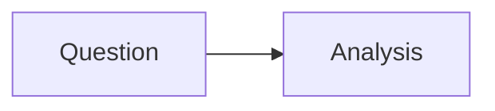
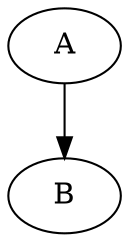
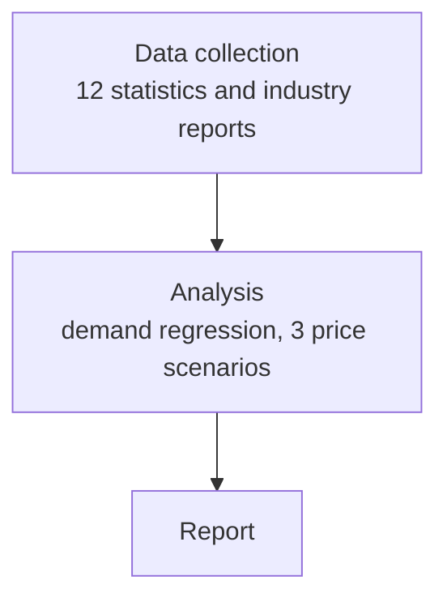
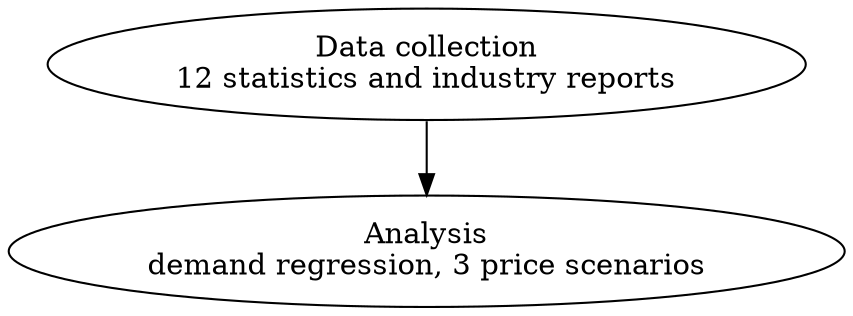
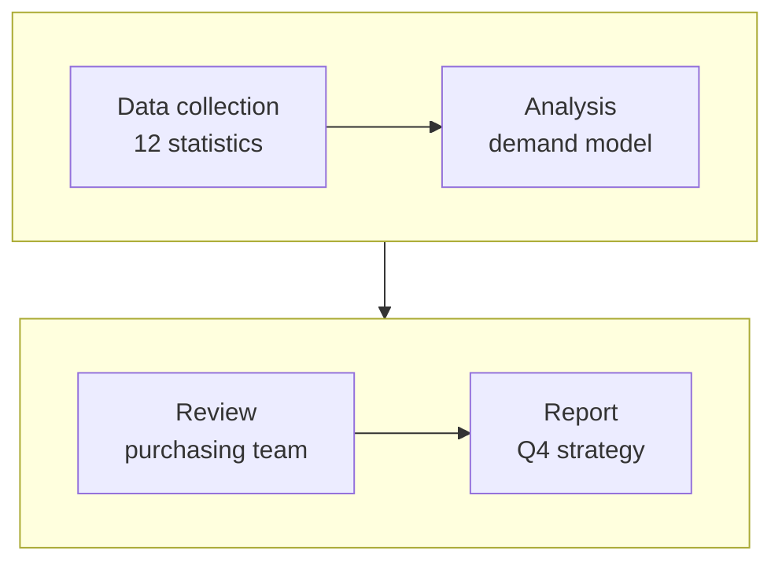

# Lectern diagram styles and color sets — guide for AI

Lectern picks the **look** of Mermaid (```` ```mermaid ````) and Graphviz (```` ```dot ````) diagrams by a number 1–10, and the **colors** of charts and diagrams by a color set number 1–8. When a person says "Mermaid style 3", "colors 2", or "title band style in report navy", write one marker line in the block as described here. Lectern paints the colors and shapes, so do not write colors or fonts in diagrams or charts.

## 1. Look numbers (diagram styles)

Numbers never change. Text, background and lines follow the document style the person picked (light, dark, paper); the number decides only the shape.

| No. | Name | Look | Use it for |
|---:|---|---|---|
| 1 | Default | Lectern's original look (the default when there is no line) | nothing was asked |
| 2 | Report lines | white boxes, dark borders, right-angle connectors | reports printed in black and white |
| 3 | Card | rounded corners, soft shadow, roomy | screens, presentations |
| 4 | Solid | dark boxes with light text | big pictures with five or six boxes |
| 5 | Line only | thin lines, no fill | papers, books |
| 6 | Sketch | hand-drawn lines (Mermaid only — Graphviz uses 1 Default) | drafts, ideas |
| 7 | Zones | a different pale color per group (subgraph, cluster) | architecture with several areas or stages |
| 8 | Title band | dark title band on top, content below | flows where each step has a description |
| 9 | Light title band | pale band with a dark title, content below | many boxes with titles and content |
| 10 | Title rule | bold title, thin rule, muted content below | calm, table-like title/content boxes |

## 2. Color set numbers

Picked separately from the look. They change chart series colors (Vega-Lite, ECharts, Plotly, Mermaid pie and xy charts — a single-series bar or line takes the set's first color, a heatmap takes shades of it) and diagram box colors, the key (`key`) accent, zone colors (7) and title bands (8, 9).

| No. | Name | Colors | Use it for |
|---:|---|---|---|
| 1 | Document style | as now — charts use the library colors, diagrams the document style colors | nothing was asked |
| 2 | Report navy | shades of navy + one orange accent | reports, black-and-white print |
| 3 | Gray + accent | only the first series in color, the rest gray | showing one series — put it first in the data |
| 4 | Vivid | ten colors that tell apart well | charts with many series |
| 5 | Colorblind safe | the Okabe-Ito palette | readers with color vision deficiency |
| 6 | Warm | orange and rust | costs, risks, demand |
| 7 | Cool | navy, teal and violet | technology, supply, infrastructure |
| 8 | Pastel | pale colors | presentation screens, big boxes |

- **Write no colors in diagrams or charts.** Colors written in the source (`"color": "#…"` and `{"value": …}`, `"mark": {"color": …}`, `"scale": {"range": …}` and `{"scheme": …}`, ECharts `color` and `itemStyle.color`, Plotly `marker.color` and `layout.template`, Mermaid `classDef`, `style` and `%%{init}%%`, Graphviz `fillcolor` and `color`) come before color sets, so they stay even when the person picks a number. Tell apart what colors used to tell apart (bars and a line, emphasis, actual vs forecast) as 'Telling things apart without colors' in section 4 of the writing guide (`writing.en.md`) says — series as a data column, a datum per layer for bars and a line, emphasis by opacity, forecasts dashed, diagrams with the emphasis marks in 5 below. Write colors only when the color itself carries meaning (red for increase, blue for decrease), and tell the person.
- The up/down colors of candlestick and waterfall charts are fixed by the library, so color sets do not change them. For such charts, and for charts that set their own colors, every tile in the 'Color set…' window looks the same and the window says why.
- In dark styles, dark colors are lightened.

**Your own**: looks from 11 and colors from 9 are the person's own diagram styles and color sets (`diagram-styles` in Lectern's settings folder — made when the person asks with 'Make my diagram style from this look…'; how to make one is in `diagram-styles.en.md` in the same folder). Write them only when the person names that number or name — on a PC without the file, the default is drawn.

## 3. The marker line

One line inside the block. Write the name after the number — `3 Card`. Lectern reads only the leading number; the name lets a person reading the source tell what the number is (a right-click pick writes it this way too). A name alone also works. Look and colors can share one line joined with `·`. `style` and `스타일`, `colors` and `색` mean the same.

````md




```vega-lite
// colors: 3 Gray + accent
{ "mark": "bar", … }
```
````

- Mermaid uses `%%`; Graphviz and charts (Vega-Lite, ECharts, Plotly) use `//`. Put a chart's line at the very top of the block.
- If the Mermaid block has front matter (`---` … `---`), put the line below it.
- Without the line, the document default (section 4) is used, then the number the person chose in Lectern settings. If the person did not name a number, do not write a line.
- Do not combine it with `%%{init: …}%%` or front matter `theme`, `themeVariables`, `look` — those override the marker line and break the look.
- The `//` line makes a chart block no longer strict JSON. Lectern reads it; remove the line before pasting the block into another tool.

## 4. The document default line

To give every diagram and chart in one document the same numbers, put one line near the top (below the title). It is not shown on screen.

```md
<!-- diagram: style 8 · colors 2 -->
```

- The order is: the block's marker line → the document default line → settings. To make one diagram different, write a marker line in that block.
- When the person says "all diagrams in this report …", write this one line instead of a line per block.

## 5. Emphasis marks

Mark a **role** instead of a color. The number decides how it is painted.

| Mark | Meaning | Mermaid | Graphviz |
|---|---|---|---|
| `key` | key — the box a conclusion or decision depends on | `D[Analysis]:::key` or `class D key` | `D [label="Analysis", class="key"]` |
| `warn` | caution — risk, blocker, rework | `R[Recheck]:::warn` | `R [class="warn"]` |
| `muted` | secondary — reference, note, later | `M[Note]:::muted` | `M [class="muted"]` |

- Use `key` on one or two boxes per diagram. If everything is emphasized, nothing is.
- Do not write colors such as `classDef key …`, `style D fill:…`, `fillcolor=`. They ignore the document style and color set and can become unreadable in dark styles.

## 6. Title boxes (8, 9, 10)

In a box with a line break, **the first line is the title and the rest is the content**. A one-line box becomes a title-only box.

````md



````

- Break lines with `<br>` in Mermaid and `\n` in Graphviz.
- Keep titles short (about three words); a long title wraps and its second line looks like content. Keep content to one or two lines — move longer text to the body.
- Diamonds (decisions), circles, and stadium boxes are not split into title and content. Write a decision as one short question.
- In styles 1–7, `<br>` is just a line break.

## 7. Direction (horizontal and vertical)

The direction comes from the diagram's first line, not from a number — Mermaid `flowchart LR` (horizontal) or `flowchart TD` (vertical), Graphviz `rankdir=LR` (horizontal; vertical without it). An md document is about 800px wide, so a long horizontal diagram shrinks and its text gets small (six boxes side by side end up at about 60% of the body text).

| Boxes | Direction |
|---|---|
| a single flow of up to 4 (3–4 title boxes) | horizontal `LR` |
| more, or many branches | vertical `TD` |
| many but too tall vertically | vertical with horizontal rows — `direction LR` per group (below) |
| Lectern slides | horizontal first (slides are wide) — vertical if it overflows |

````md

````

- When the person says "vertical" or "in two rows", change it as above. People can also right-click the diagram and choose 'Make it vertical' or 'Make it horizontal'.

## 8. Choosing

- If the person names a number or a name, write the number and the name ("number 3" → `3 Card`). Suggest look 2 and colors 2 for "for a report", look 3 for "for a presentation", look 8 for "steps with descriptions", colors 3 for "make just this stand out".
- Use the same numbers for all diagrams in a document — use the document default line (section 4). Use another number for one diagram only with a clear reason (for example 6 for an idea-stage sketch).
- 7 Zones only means something with two or more groups (subgraph, cluster).
- You can add the line to other Mermaid diagrams (sequence, state, mind map), but the shape changes mostly in flowcharts and architecture diagrams.

## 9. Don't

- Don't describe the style or colors in the body text outside the block — people see them in the diagram.
- Don't write colors, background colors or fonts in diagrams and charts (2 above — the number the person picks would not apply).
- Don't write the marker line twice (only the first is read).
- Don't make up numbers — unknown ones draw the default. Looks 11+ and colors 9+ are the person's own, used only when the person names them.
