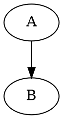
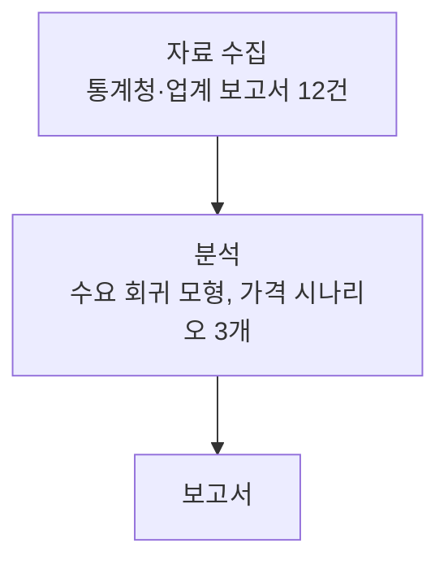
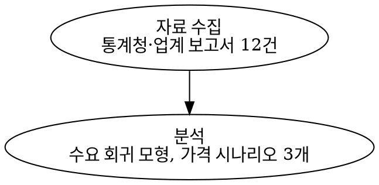
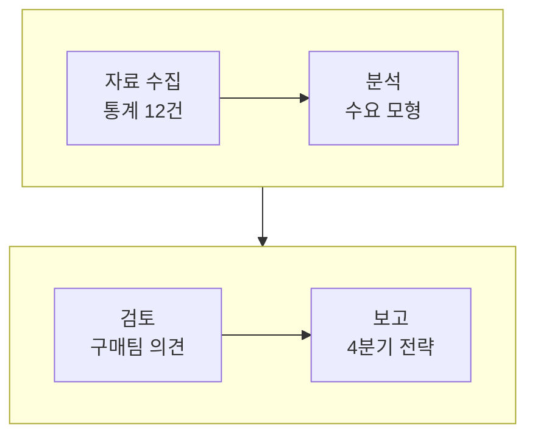

# Lectern 도해 스타일·색 조합 — AI 용 안내

Lectern 은 Mermaid(```` ```mermaid ````)와 Graphviz(```` ```dot ````) 그림의 **모양**을 번호 1~10 으로, 차트와 그림의 **색**을 색 조합 번호 1~8 로 고른다. 사람이 "Mermaid 3번 스타일로", "색은 2번으로", "제목 띠 스타일, 보고서 남색으로"라고 하면 이 안내대로 블록에 표시 줄 하나를 적는다. 색과 모양은 Lectern 이 칠하므로 그림·차트에 색·글꼴을 적지 않는다.

## 1. 모양 번호 (도해 스타일)

번호는 바뀌지 않는다. 글자·바탕·선은 사람이 고른 문서 스타일(밝은·어두운·종이)을 따르고, 번호는 모양만 정한다.

| 번호 | 이름 | 모양 | 이럴 때 |
|---:|---|---|---|
| 1 | 기본 | Lectern 의 원래 모양 (줄이 없을 때의 설정 기본값) | 따로 말이 없을 때 |
| 2 | 보고서 선 | 흰 상자, 진한 테두리, 직각으로 꺾는 선 | 흑백으로 인쇄할 보고서 |
| 3 | 카드 | 둥근 모서리, 옅은 그림자, 넉넉한 여백 | 화면·발표 |
| 4 | 진한 채움 | 진한 상자에 밝은 글자 | 상자가 대여섯 개인 큰 그림 |
| 5 | 선만 | 채움 없는 가는 선 | 논문·책 |
| 6 | 손그림 | 손으로 그린 듯한 선 (Mermaid 만 — Graphviz 는 1) | 초안·구상 |
| 7 | 단계 색 | 묶음(subgraph·cluster)마다 다른 옅은 색 | 영역·단계가 여럿인 구성도 |
| 8 | 제목 띠 | 상자 위에 진한 제목 띠, 아래에 내용 | 단계마다 설명이 붙는 흐름 |
| 9 | 옅은 제목 띠 | 옅은 띠에 진한 제목 글자, 아래에 내용 | 상자가 많은 제목·내용 그림 |
| 10 | 제목 줄 | 굵은 제목 아래 가는 줄, 그 아래 흐린 내용 | 표처럼 차분한 제목·내용 그림 |

## 2. 색 조합 번호

모양과 따로 고른다. 바뀌는 것은 차트의 계열 색(Vega-Lite·ECharts·Plotly, Mermaid 의 원그래프·xy 차트)과 도해의 상자 색·핵심(`key`) 강조색·단계 색(7)·제목 띠(8·9)다.

| 번호 | 이름 | 색 | 이럴 때 |
|---:|---|---|---|
| 1 | 문서 스타일 | 지금 그대로 — 차트는 라이브러리의 기본색, 도해는 문서 스타일의 색 | 따로 말이 없을 때 |
| 2 | 보고서 남색 | 남색 농담 + 주황 강조 하나 | 보고서·흑백 인쇄 |
| 3 | 회색 + 강조 | 첫 계열만 색, 나머지는 회색 | 한 계열만 보여 줄 때 — 그 계열을 데이터의 맨 앞에 |
| 4 | 선명한 구분 | 서로 잘 갈리는 열 가지 색 | 계열이 많은 차트 |
| 5 | 색약 친화 | Okabe-Ito 색표 | 색각 이상이 있는 사람도 볼 때 |
| 6 | 따뜻한 | 주황·적갈 계열 | 비용·위험·수요 |
| 7 | 차가운 | 남·청록·보라 계열 | 기술·공급·인프라 |
| 8 | 파스텔 | 옅은 색 | 발표 화면, 상자가 큰 그림 |

- 차트가 색을 직접 정했으면(`"color": {"value": …}`, `"scale": {"range": …}`, ECharts 의 `color`, Plotly 의 `marker.color`) 그 색이 먼저다. 색 조합을 쓰려면 색을 적지 않는다.
- 어두운 스타일에서는 진한 색을 밝게 바꿔 그린다.

## 3. 표시 줄

블록 안에 한 줄. 번호, 이름, `3 카드` 처럼 둘 다 적어도 된다. 모양과 색을 한 줄에 `·` 로 이어 적어도 된다. `스타일`·`style`, `색`·`colors` 는 같다.

````md




```vega-lite
// 색: 3
{ "mark": "bar", … }
```
````

- Mermaid 는 `%%`, Graphviz 와 차트(Vega-Lite·ECharts·Plotly)는 `//` 로 시작한다. 차트의 줄은 블록 맨 앞에 둔다.
- Mermaid 의 머리 설정(`---` … `---`)이 있으면 그 아래에 적는다.
- 줄이 없으면 문서의 기본 줄(아래 4), 그것도 없으면 사람이 Lectern 설정에서 고른 번호로 그린다. 사람이 번호를 말하지 않았으면 줄을 적지 않는다.
- `%%{init: …}%%`·머리 설정의 `theme`·`themeVariables`·`look` 은 함께 쓰지 않는다 — 표시 줄과 겹치면 그것이 이겨 번호의 모양이 깨진다.
- 차트의 `//` 줄 때문에 그 블록은 엄격한 JSON 이 아니게 된다. Lectern 은 읽지만, 블록을 다른 도구에 그대로 붙이려면 그 줄을 뺀다.

## 4. 문서의 기본 줄

한 문서의 그림·차트를 모두 같은 번호로 하려면 문서 위쪽(제목 아래)에 한 줄을 둔다. 화면에는 보이지 않는다.

```md
<!-- 도해: 스타일 8 · 색 2 -->
```

- 순서는 블록의 표시 줄 → 문서의 기본 줄 → 설정이다. 한 그림만 다르게 하려면 그 블록에 표시 줄을 적는다.
- 사람이 "이 보고서의 그림은 모두 …"라고 하면 블록마다 적지 말고 이 줄 하나를 적는다.

## 5. 강조 표시

색 대신 **역할**을 붙인다. 칠하는 법은 번호가 정한다.

| 표시 | 뜻 | Mermaid | Graphviz |
|---|---|---|---|
| `key` | 핵심 — 결론·판단이 걸린 상자 | `D[분석]:::key` 또는 `class D key` | `D [label="분석", class="key"]` |
| `warn` | 주의 — 위험·막힘·재작업 | `R[재조사]:::warn` | `R [class="warn"]` |
| `muted` | 보조 — 참고·메모·나중 | `M[메모]:::muted` | `M [class="muted"]` |

- 그림 하나에 `key` 는 한두 개만. 다 강조하면 아무것도 강조되지 않는다.
- `classDef key …`·`style D fill:…`·`fillcolor=` 처럼 색을 직접 적지 않는다. 문서 스타일·색 조합을 바꾸면 그 색만 따로 놀고, 어두운 스타일에서 글자가 안 보일 수 있다.

## 6. 제목 상자 (8·9·10)

줄을 바꾼 상자는 **첫 줄이 제목, 나머지가 내용**이다. 한 줄짜리 상자는 제목만 있는 상자가 된다.

````md



````

- Mermaid 는 `<br>`, Graphviz 는 `\n` 으로 줄을 바꾼다.
- 제목은 12자 안팎으로 짧게 (길면 두 줄로 꺾여 둘째 줄이 내용처럼 보인다). 내용은 한두 줄 — 길면 본문으로 옮긴다.
- 마름모(판단)·원·둥근 끝 상자는 제목·내용으로 나누지 않는다. 판단은 짧은 물음 한 줄로.
- 1~7 번에서 `<br>` 은 그냥 줄바꿈이다.

## 7. 방향 (가로·세로)

방향은 번호가 아니라 그림의 첫 줄이 정한다 — Mermaid `flowchart LR`(가로)·`flowchart TD`(세로), Graphviz `rankdir=LR`(가로, 없으면 세로). md 문서의 폭은 약 800px 이라 가로로 길면 그림이 줄어 글자가 작아진다 (상자 여섯 개를 가로로 놓으면 글자가 본문의 60% 쯤).

| 상자 | 방향 |
|---|---|
| 한 줄 흐름 4개까지 (제목 상자는 3~4개) | 가로 `LR` |
| 그보다 많거나 갈래가 많을 때 | 세로 `TD` |
| 많지만 세로로 길어지면 | 세로 안에 가로 줄 — 묶음마다 `direction LR` (아래) |
| Lectern 슬라이드 | 가로가 먼저 (장이 가로로 넓다) — 넘치면 세로 |

````md

````

- 사람이 "세로로", "두 줄로"라고 하면 위처럼 바꾼다. 사람은 그림을 우클릭해 '세로로 바꾸기'·'가로로 바꾸기'로도 바꾼다.

## 8. 고르는 법

- 사람이 번호나 이름을 말하면 그대로 적는다. "보고서용"이면 모양 2·색 2, "발표용"이면 모양 3, "설명이 붙은 단계"면 모양 8, "이것만 눈에 띄게"면 색 3 을 권한다.
- 한 문서의 그림은 같은 번호로 맞춘다 — 문서의 기본 줄(4)을 쓴다. 한 그림만 다른 번호가 필요하면 그 까닭(예: 구상 단계의 그림은 6)이 분명할 때만.
- 7 단계 색은 묶음(subgraph·cluster)이 둘 이상일 때만 뜻이 있다.
- Mermaid 의 시퀀스·상태·마인드맵 같은 다른 그림에도 줄을 적을 수 있지만, 모양이 바뀌는 것은 주로 흐름도·구성도다.

## 9. 하지 않을 것

- 그림 블록 밖(본문)에 스타일·색 설명을 적지 않는다 — 사람은 그림으로 본다.
- 표시 줄을 두 번 적지 않는다 (처음 것만 읽는다).
- 없는 번호(모양 11 이상, 색 9 이상)를 적지 않는다 — 기본으로 그린다.
