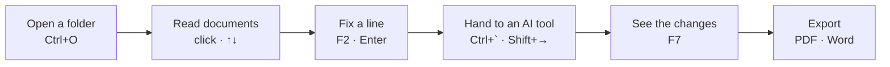

# Getting started

> From opening Lectern for the first time to opening a folder, reading and fixing documents, and handing work to AI tools — your first 30 minutes.

## The first 30 minutes

| Step | What to do | Keys | More |
|---|---|---|---|
| 1 | Open your work folder | **Ctrl+O** | [Project tabs](2.2-project-tabs.en.md) |
| 2 | Click a document in the sidebar and read it | **↑**·**↓** (current line) | [Current line and picking](3.1-current-line-and-picking.en.md) |
| 3 | Fix a line right where it is | **F2** or **Enter**, and **Enter** to save | [Choosing how to edit](4.1-choosing-how-to-edit.en.md) |
| 4 | Open the terminal and start an AI tool (Claude Code and others) | **Ctrl+\`** | [Terminal](7.1-terminal.en.md) |
| 5 | Send the location to fix to the AI tool | **Shift+→** | [Sending and requests](7.2-sending-and-requests.en.md) |
| 6 | Go through the places the AI tool changed | **F7** · **Shift+F7** | [Find and search](3.2-find-and-search.en.md) |
| 7 | Export to PDF or Word | **Print** in the tab bar | [Export](6-export.en.md) |

## Opening a folder

| Method | Where | Result |
|---|---|---|
| **Ctrl+O** · **+** in the tab bar | In Lectern | The chosen folder opens as a new project tab. If it is already open, Lectern goes to its tab |
| **∨** next to **+** | Tab bar | Recent folders · Open samples |
| Right-click a folder, **Open with Lectern** | Windows Explorer | If Lectern is running, a new tab in that window |
| Start again | — | The tabs you left open, each at the document and position you were reading |

## The screen

| Area | What | More |
|---|---|---|
| Toolbar (top) | Sidebar · back, forward · Quick open · text size · document width · line numbers · style · section focus · settings · keyboard shortcuts · work board · All terminals | [Toolbar](2.1-toolbar.en.md) |
| Tab bar | One tab per open project · at the right end, Insert · Edit · Contents · Print · Notes · Terminal | [Project tabs](2.2-project-tabs.en.md) |
| Document tab row | Just above the text — the documents open in this project | [Document tabs](2.3-document-tabs.en.md) |
| Sidebar (left) | Files · Recent · Search · Elements · Clip | [Sidebar](2.4-sidebar.en.md) |
| Main area (center) | Documents · folder overviews · code | [Reading](3-reading.en.md) |
| Contents (right) | The current document's headings and elements. When you open the terminal, the terminal takes this place | [Contents](2.5-contents.en.md) |
| Status bar (bottom) | Document path · modified time · changes · change watching | [Status bar](2.6-status-bar.en.md) |

## Where to learn

| What | How to open | When |
|---|---|---|
| User guide (this document) | **F1** — in its own window | To look up how a feature works |
| Keyboard shortcuts | **Ctrl+/** · **?** in the toolbar | To see just the keys quickly |
| Find a command | **Ctrl+Shift+P** | To type a name, find a feature and run it right away — its shortcut shows beside it |
| Example guide | **Shift+F1** — in its own window | To follow along with a real project |
