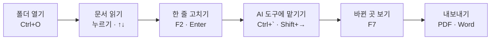

# 시작하기

> Lectern 을 처음 열어 폴더를 열고, 문서를 읽고, 고치고, AI 도구에 맡기기까지 — 처음 30분의 길.

## 처음 30분

| 차례 | 할 일 | 키 | 자세히 |
|---|---|---|---|
| 1 | 작업 폴더를 연다 | **Ctrl+O** | [프로젝트 탭](2.2-프로젝트-탭.md) |
| 2 | 사이드바에서 문서를 누르고 읽는다 | **↑**·**↓** (현재 줄) | [현재 줄과 고르기](3.1-현재-줄과-고르기.md) |
| 3 | 고칠 줄에서 그 자리에서 고친다 | **F2** 또는 **Enter**, 저장도 **Enter** | [고치는 길 고르기](4.1-고치는-길-고르기.md) |
| 4 | 터미널을 열고 AI 도구(Claude Code 등)를 띄운다 | **Ctrl+\`** | [터미널](7.1-터미널.md) |
| 5 | 고칠 곳의 위치를 AI 도구에 보낸다 | **Shift+→** | [보내기와 요청 글](7.2-보내기와-요청-글.md) |
| 6 | AI 도구가 고친 곳을 차례로 본다 | **F7** · **Shift+F7** | [찾기와 검색](3.2-찾기와-검색.md) |
| 7 | PDF·Word 로 낸다 | 탭 막대 **인쇄** | [내보내기](6-내보내기.md) |

## 폴더 열기

| 방법 | 어디서 | 결과 |
|---|---|---|
| **Ctrl+O** · 탭 막대의 **+** | Lectern 안 | 고른 폴더가 새 프로젝트 탭으로. 이미 열린 폴더면 그 탭으로 |
| **+** 옆 **∨** | 탭 막대 | 최근 연 폴더 · 예제 열기 |
| 폴더 우클릭 **Lectern으로 열기** | Windows 탐색기 | Lectern 이 떠 있으면 그 창의 새 탭으로 |
| 다시 실행 | — | 지난번에 열어 둔 탭이 보던 문서·위치 그대로 |

## 화면

| 자리 | 무엇 | 자세히 |
|---|---|---|
| 툴바 (맨 위) | 사이드바 · 뒤로·앞으로 · 문서 열기 · 글자 크기 · 문서 폭 · 줄 번호 · 스타일 · 하이라이트 · 설정 · 단축키 · 업무 · 터미널 모음 | [툴바](2.1-툴바.md) |
| 탭 막대 | 열린 프로젝트마다 탭 하나 · 오른쪽 끝에 넣기 · 편집 · 목차 · 인쇄 · 메모 · 터미널 | [프로젝트 탭](2.2-프로젝트-탭.md) |
| 문서 탭 줄 | 본문 바로 위 — 이 프로젝트에서 열어 둔 문서들 | [문서 탭](2.3-문서-탭.md) |
| 사이드바 (왼쪽) | 파일 · 최근 변경 · 검색 · 모아 보기 · 담기 | [사이드바](2.4-사이드바.md) |
| 본문 (가운데) | 문서 · 폴더 개요 · 코드 | [읽기](3-읽기.md) |
| 목차 (오른쪽) | 지금 문서의 제목과 구성 요소. 터미널을 열면 그 자리에 터미널 | [목차](2.5-목차.md) |
| 상태줄 (맨 아래) | 문서 경로 · 수정 시각 · 바뀐 곳 · 변경 감시 | [상태줄](2.6-상태줄.md) |

## 배우는 곳

| 무엇 | 여는 법 | 이럴 때 |
|---|---|---|
| 사용설명서 (이 문서) | **F1** — 따로 창 | 기능이 어떻게 동작하는지 찾아볼 때 |
| 단축키 표 | **Ctrl+/** · 툴바 **?** | 키만 빨리 볼 때 |
| 명령 찾기 | **Ctrl+Shift+P** | 이름을 쳐서 기능을 찾고 바로 할 때 — 옆에 단축키가 보인다 |
| 예제 가이드 | **Shift+F1** — 따로 창 | 실제 프로젝트를 보며 따라 해 볼 때 |
