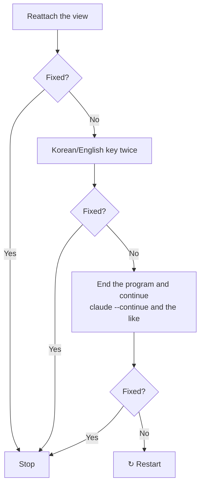

# Troubleshooting

> When something stops, does not show or cannot be changed — for each symptom, the cause and what to do.

## Installing and starting

| Symptom | Cause | What to do |
|---|---|---|
| A 'Windows protected your PC' warning on first run | There is no code signature | **More info → Run anyway** |
| Setup says WebView2 is missing | The Microsoft Edge WebView2 Runtime that draws the window is missing (Windows 11 and most Windows 10 PCs have it) | Follow the notice and install the WebView2 Runtime |
| Installing a new version asks you to close Lectern | Lectern is running | Close it and continue — it installs over the same place and your settings stay |
| Settings open with default values | A syntax error in the settings file (a single backslash, a trailing comma and the like) | Fix the place Lectern points to — until you fix it, Lectern does not save settings, so your fix is not overwritten |
| The terminal does not open | The terminal needs Windows 10 (1809) or later | Update Windows |

## Terminal and AI tools

| Symptom | Cause | What to do |
|---|---|---|
| A program started from the shell gets stuck while starting, with a red strip under the header | Security software on a company PC (DRM and the like) blocked the program from starting — an AI tool (Claude Code and others) calls git and then stops taking input | **Restart** in the strip — Ctrl+C or Task Manager often cannot end it. In the new shell, `claude --continue` picks up the conversation |
| A red 'Stuck' on a pane in All terminals | The same | That pane's **↻** |
| Typing Korean misbehaves in a terminal used for a long time | The view, or the input state | 'When Korean input misbehaves' below |
| After restarting Lectern, the terminal history is gone | A shell's screen history disappears when the app closes — it starts with a new shell | `claude --continue` picks up the conversation |
| **Ctrl+P** · **Ctrl+F** · **F1** do nothing inside the terminal | Keys inside the terminal go to the shell | Click the main area, or move to the document with **F6**, first |
| Lectern asks before putting in several lines | At a PowerShell prompt each line may run as a command | Check and put them in — while an AI tool is running, they go into its input box as is, without asking |
| Sending by number shows a notice instead of putting the text in | There is no terminal with that number — none is created | Open more terminals with **+** in the header |
| ▣ in Settings puts the text into a different terminal | It goes into the terminal you used last | Click the terminal where the AI tool runs once before opening Settings, or hold a number key (1~5) while clicking ▣ |
| Only the bottom of OpenCode shows | It is a tool that uses the whole screen, and the stacked pane is short | Drag the border between panes to make it taller, or put the terminal below the document (as tabs) |
| Codex · Antigravity ask whether to allow something | They are about to read outside the working folder (Lectern's writing guide · skill folders) | Allow it and they continue |
| A writing style or voice note was added but nothing changed | Claude Code reads them only after a restart | Quit with `/exit` and start it again |

To pick up a conversation, Codex uses `codex resume --last`, Antigravity `agy --continue` and OpenCode `opencode --continue`.

## When Korean input misbehaves

Try these in order and stop once it is fixed.

| Step | What you do |
|---|---|
| Reattach the view | Right-click the terminal header · a terminal tab · the header of a stacked pane and choose **Reattach terminal N view** (or **Reattach the terminal view** in Find a command). Only the view is rebuilt and attached to the same shell — the shell and the programs in it do not end, and the recent output (about 520,000 characters) comes back. If this fixes it, the problem was in the view |
| ↻ Restart | **↻** in the header — starts the shell anew |

## Viewing

| Symptom | Cause | What to do |
|---|---|---|
| Web images show as links | The 'Show web images' setting is off, they are blocked on the company network, or they took more than 15 seconds | If it is off, turn it on under 'View' in Settings. If they are blocked, click the link to see the image in a browser |
| Charts in an html document do not show | Scripts in html documents are not run — charts drawn by scripts do not show | Find it with **Show in Explorer** in the sidebar's right-click menu and open it in a browser |
| The tree shows file names instead of titles | The sidebar's **Titles** button is off, or the settings at the very top of the document (frontmatter) are very long — titles are looked for near the start of a document | Turn the **Titles** button on |
| A change is not on screen | Change watching missed it | **F5** |
| Something changed inside an excluded folder but the view is the same | Excluded folders are read when you expand them and do not follow changes on their own | Collapse and expand it again, or **F5** |
| Lectern tells you to open a code file in an editor instead | It is over 4MB or not a text file | Open it in an external editor |
| Only part of a CSV shows | Up to 2,000 rows are shown (counts and statistics use every row) | Narrow it down with a filter |
| An Excel file does not open, or only part of it shows | `xls` · `xlsb` are old formats, and up to 50,000 rows · 1,000,000 cells per sheet are shown | Open it in Excel |
| A link is struck through and does not open | It points outside the project folder | Open the folder that holds that file in Lectern |

## Editing and saving

| Symptom | Cause | What to do |
|---|---|---|
| There is no terminal, editing, new document or renaming | Like the samples, anything inside the Lectern program folder is a view-only project | Copy the folder to Documents or the like and open the copy — find it with **Show this folder in Explorer** in the terminal area |
| You cannot edit in the User guide window or the Example guide window | They are view-only windows | Open the file in the main window (for the samples, copy them first) |
| You cannot edit a document or code file that is not UTF-8 | Editing would garble the text — files written in a Windows encoding, such as EViews `prg` files | Edit it in an external editor. CSV · TSV · text files can be edited in their original encoding |
| You cannot edit a file over 2MB | Editing works up to 2MB | Edit it in an external editor |
| A CSV is not saved and Lectern points to a character | A character that CP949 does not have (an emoji and the like) was put into a CP949 file | Remove that character |
| What you typed in the cell was not saved | That line changed in the meantime, or the same line appears more than once | The edited line is on the clipboard — paste it |
| **Ctrl+Z** shows a notice instead of undoing | The file changed in the meantime — so that someone else's change is not overwritten | Look at the screen and edit again |
| Saving asks whether to overwrite | While you were editing, another program such as an AI tool changed the same file | Overwrite, or cancel and keep editing |
| You pressed a change key and nothing changed | On a single current line, the first press only marks the line | Press it once more |
| **B** · **M** do nothing | Format keys work only on selected text or picked lines | First select a word by double-clicking, or select the line with **Ctrl+Enter** |
| '… press Esc to release them first' | Writing and inserting happen at the current line — not while several lines are picked | **Esc** |
| Renaming or creating does not work | The name is taken, or it cannot be used (starts with a dot, `\ / : * ? " < > \|` and the like) | Change the name |
| Renaming or deleting a document does not work | The file has unsaved edits. Deleting a document also does not happen where there is no Recycle Bin (network drives and the like) | Save first or close the editor |
| A clip went into another box | Clips go to the **●** box in the sidebar Clip tab — not the box you laid out | Right-click the clip, **Move to another box…**; choose where to clip with **○** or **Alt+Shift+C** |
| You need a clip you removed | Undo covers only the last removal | Clip it again from the original document — a deleted box is in the Windows Recycle Bin |

## Export

| Symptom | Cause | What to do |
|---|---|---|
| Changing margin numbers in the print dialog does nothing | It prints a PDF whose pages are already laid out | Type them in **Custom** under **Margins** in the Export window |
| A PDF cannot be saved | A PDF viewer has the file open | Close it and save again |
| Word asks whether to update the fields | The document has a `[TOC]` line | **Yes** — the contents and page numbers are filled in |
| A small ▪ to the left of section headings in Word | It is not a character but the mark for 'Keep with next' — one of Word's paragraph marks (it does not appear in print or PDF) | Turn off 'Paragraph marks' in Word's **File > Options > Display** |
| Lectern says the pptx style is missing | Only the document was moved to another PC | Choose the style again |
| An open presentation, a `.ppt` or a DRM file cannot be converted | PowerPoint is needed | On a PC with PowerPoint — open a DRM file in PowerPoint, keep it open, and convert |
| A password-protected file cannot be converted | The password must be removed first | Remove the password and ask again |

## Work

| Symptom | Cause | What to do |
|---|---|---|
| 'Folders that could not be read' on the work board | The folder was moved or deleted, or the drive is not connected. Or the WORK.md is not UTF-8 (ANSI from old Notepad and the like) or is over 2MB | Fix it, or **Remove from list** (the files stay) |
| 'Lines to check' on the work board | Lines that could not be read because of a typo or something deleted | Click to go to that line of that WORK.md — fix it |
| A change made from the top did not go in | That line or the file changed in the meantime | Look at the redrawn view and choose once more |
| Lectern asks you to choose the common folder again | The common folder was moved or deleted | Choose it again — the work folder list stays |

## Related

| Document | What |
|---|---|
| [Terminal](7.1-terminal.en.md) | Stuck program notice · reattaching the view |
| [When files change](10.2-when-files-change.en.md) | What is saved when |
| [Settings](9-settings.en.md) | Show web images · the settings file |
