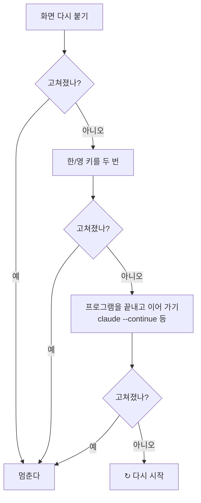

# 문제 해결

> 멈추거나 보이지 않거나 고쳐지지 않을 때 — 증상마다 까닭과 할 일.

## 설치와 시작

| 증상 | 까닭 | 할 일 |
|---|---|---|
| 처음 실행할 때 'Windows의 PC 보호' 경고 | 코드 서명이 없다 | **추가 정보 → 실행** |
| 설치 중에 WebView2 가 없다고 알린다 | 창을 그리는 Microsoft Edge WebView2 런타임이 없다 (Windows 11 과 대부분의 Windows 10 에는 있다) | 알림을 따라 WebView2 런타임을 설치한다 |
| 새 판을 설치하려니 Lectern 을 닫으라고 한다 | Lectern 이 실행 중이다 | 닫고 이어 간다 — 같은 자리에 덮어 설치되고 설정은 그대로 |
| 설정이 기본 값으로 열린다 | 설정 파일에 문법 오류 (역슬래시 하나, 마지막 쉼표 등) | 알려 준 위치를 고친다 — 고칠 때까지 설정을 저장하지 않아 고친 것이 지워지지 않는다 |
| 터미널이 열리지 않는다 | 터미널은 Windows 10(1809) 이상에서 된다 | Windows 를 새 판으로 |

## 터미널과 AI 도구

| 증상 | 까닭 | 할 일 |
|---|---|---|
| 셸에서 띄운 프로그램이 시작하다 멈추고, 머리줄 아래에 붉은 띠 | 회사 PC 의 보안 프로그램(DRM 등)이 프로그램 실행을 막았다 — AI 도구(Claude Code 등)가 git 을 부르다 입력을 받지 않게 된다 | 띠의 **다시 시작** — Ctrl+C · 작업 관리자로 끝나지 않을 때가 많다. 새 셸에서 `claude --continue` 로 하던 대화를 잇는다 |
| 터미널 모음의 칸에 붉은 '멈춤' | 같다 | 그 칸의 **↻** |
| 오래 쓴 터미널에서 한글 입력이 이상하다 | 화면 쪽이거나 입력 상태 | 아래 '한글 입력이 이상할 때' |
| 다시 실행했더니 터미널 기록이 없다 | 셸의 화면 기록은 앱을 닫으면 사라진다 — 새 셸로 시작한다 | `claude --continue` 로 하던 대화를 잇는다 |
| 터미널 안에서 **Ctrl+P** · **Ctrl+F** · **F1** 이 듣지 않는다 | 터미널 안의 키는 셸로 간다 | 본문을 누르거나 **F6** 으로 문서로 간 뒤 |
| 여러 줄을 넣으려니 묻는다 | PowerShell 프롬프트에서는 줄마다 명령으로 실행될 수 있다 | 확인하고 넣는다 — AI 도구가 떠 있으면 묻지 않고 입력 칸에 그대로 들어간다 |
| 번호로 보냈더니 넣지 않고 알린다 | 그 번호의 터미널이 없다 — 새로 만들지 않는다 | 머리줄 **+** 로 터미널을 더 연다 |
| 설정 창의 ▣ 가 다른 터미널에 넣는다 | 마지막에 쓴 터미널에 넣는다 | AI 도구가 뜬 터미널을 한 번 누른 뒤 설정 창을 열거나, 숫자 키(1~5)를 누른 채 ▣ |
| OpenCode 의 아래쪽만 보인다 | 화면 전체를 쓰는 도구라 쌓은 칸이 좁다 | 칸 사이 경계를 끌어 키우거나 터미널을 문서 아래(탭)에 둔다 |
| Codex · Antigravity 가 허용할지 묻는다 | 작업 폴더 밖(Lectern 의 작성 안내 · 스킬 폴더)을 읽으려 한다 | 허용하면 이어서 한다 |
| 글쓰기 스타일 · 내 문체를 넣었는데 그대로다 | Claude Code 는 다시 시작해야 읽는다 | `/exit` 로 끝내고 다시 띄운다 |

하던 대화를 잇는 명령은 Codex 가 `codex resume --last`, Antigravity 가 `agy --continue`, OpenCode 가 `opencode --continue` 다.

## 한글 입력이 이상할 때

차례대로 해 보고, 고쳐지면 멈춘다.

| 단계 | 하는 일 |
|---|---|
| 화면 다시 붙기 | 터미널 머리줄 · 터미널 탭 · 쌓은 칸의 머리줄 우클릭 **N번 터미널 화면 다시 붙기** (명령 찾기의 **터미널 화면 다시 붙기**도). 화면만 새로 만들어 같은 셸에 붙는다 — 셸과 그 안의 프로그램은 끝나지 않고, 최근 출력(약 52만 글자)을 다시 받는다. 이것으로 고쳐지면 화면 쪽 문제였다 |
| ↻ 다시 시작 | 머리줄의 **↻** — 셸을 새로 시작한다 |

## 보기

| 증상 | 까닭 | 할 일 |
|---|---|---|
| 인터넷 그림이 링크로 보인다 | 설정 '인터넷 그림 표시'가 꺼졌거나, 사내망에서 막혔거나, 15초가 넘었다 | 꺼져 있으면 설정 창 '보기'에서 켠다. 막혔으면 링크를 눌러 브라우저로 본다 |
| html 문서의 차트가 보이지 않는다 | html 문서의 스크립트는 돌리지 않는다 — 스크립트로 그리는 차트는 보이지 않는다 | 사이드바 우클릭 **탐색기에서 보기**로 찾아 브라우저로 연다 |
| 트리에 제목 대신 파일 이름이 나온다 | 사이드바 **제목** 버튼이 꺼졌거나, 문서 맨 앞 설정(frontmatter)이 아주 길다 — 제목은 문서 앞부분에서 찾는다 | **제목** 버튼을 켠다 |
| 바뀐 내용이 화면에 없다 | 변경 감시가 놓쳤다 | **F5** |
| 제외 폴더 안이 바뀌었는데 그대로다 | 제외 폴더는 펼칠 때 읽고 저절로 따라오지 않는다 | 접었다 다시 펼치거나 **F5** |
| 코드 대신 편집기로 열라고 알린다 | 4MB 가 넘거나 글자가 아닌 파일 | 외부 편집기로 연다 |
| CSV 가 일부만 보인다 | 2,000행까지 보인다 (개수 · 통계는 모든 행으로 센다) | 거르기로 좁힌다 |
| 엑셀 파일이 열리지 않거나 일부만 보인다 | `xls` · `xlsb` 는 옛 형식이고, 시트마다 5만 행 · 100만 칸까지 보인다 | 엑셀로 연다 |
| 링크에 취소선이 있고 열리지 않는다 | 프로젝트 폴더 밖을 가리킨다 | 그 파일이 든 폴더를 Lectern 으로 연다 |

## 고치기와 저장

| 증상 | 까닭 | 할 일 |
|---|---|---|
| 터미널 · 편집 · 새 문서 · 이름 바꾸기가 없다 | 예제처럼 Lectern 프로그램 폴더 안은 보기만 하는 프로젝트다 | 폴더를 문서 폴더 등에 복사해 그 복사본을 연다 — 터미널 자리의 **탐색기에서 이 폴더 보기**로 찾는다 |
| 사용설명서 창 · 예제 가이드 창에서 고칠 수 없다 | 보기만 하는 창이다 | 메인 창에서 연다 (예제는 복사해서) |
| UTF-8 이 아닌 문서 · 코드를 고칠 수 없다 | 고치면 글자가 깨진다 — EViews 의 `prg` 처럼 Windows 인코딩으로 쓴 파일 | 외부 편집기로 고친다. CSV · TSV · 텍스트는 원래 인코딩 그대로 고칠 수 있다 |
| 2MB 가 넘는 파일을 고칠 수 없다 | 편집은 2MB 까지 | 외부 편집기로 고친다 |
| CSV 를 저장하지 않고 글자를 알린다 | CP949 파일에 CP949 에 없는 글자(이모지 등)를 넣었다 | 그 글자를 뺀다 |
| 칸에 쓴 글이 저장되지 않았다 | 그사이 그 줄이 바뀌었거나 같은 줄이 둘 이상이다 | 고친 줄이 클립보드에 있다 — 붙여 넣는다 |
| 담은 것이 다른 담기함에 들어갔다 | 담기는 사이드바 담기 탭의 **●** 로 간다 — 펼쳐 본 담기함이 아니다 | 조각 우클릭 **다른 담기함으로 옮기기…**, 담을 곳은 **○** 를 누르거나 **Alt+Shift+C** |
| 담기함에서 뺀 조각이 필요하다 | 되돌리기는 마지막에 뺀 것만 | 원래 문서에서 다시 담는다 — 지운 담기함은 Windows 휴지통에 있다 |
| **Ctrl+Z** 가 되돌리지 않고 알린다 | 그사이 파일이 바뀌었다 — 남이 고친 것을 덮지 않게 | 화면을 보고 다시 고친다 |
| 저장할 때 덮어쓸지 묻는다 | 편집하는 동안 AI 도구 같은 다른 프로그램이 같은 파일을 고쳤다 | 덮어쓰거나, 취소하고 편집을 이어 간다 |
| 바꾸는 키를 눌렀는데 그대로다 | 현재 줄 하나에서 처음 누른 키는 그 줄을 잡기만 한다 | 한 번 더 누른다 |
| **B** · **M** 이 듣지 않는다 | 서식 키는 고른 글 · 고른 줄에서만 | 두 번 눌러 낱말을 고르거나 **Ctrl+Enter** 로 줄을 고른 뒤 |
| 'Esc 로 풀고 누르세요' | 쓰고 넣는 것은 현재 줄에서 한다 — 여러 줄을 고른 동안은 안 된다 | **Esc** |
| 이름 바꾸기 · 새로 만들기가 안 된다 | 같은 이름이 있거나 쓸 수 없는 이름(점으로 시작, `\ / : * ? " < > \|` 등)이다 | 이름을 고친다 |
| 이름 바꾸기 · 문서 삭제가 안 된다 | 그 파일에 저장하지 않은 편집이 있다. 문서 삭제는 휴지통이 없는 곳(네트워크 드라이브 등)에서도 하지 않는다 | 먼저 저장하거나 편집을 닫는다 |

## 내보내기

| 증상 | 까닭 | 할 일 |
|---|---|---|
| PDF 를 저장하지 못한다 | PDF 보기 프로그램이 그 파일을 열고 있다 | 닫고 다시 저장한다 |
| 인쇄 창에서 여백 숫자를 바꿔도 그대로다 | 이미 쪽까지 지은 PDF 를 찍는다 | 내보내기 창의 **여백**에서 **직접** 칸에 적는다 |
| Word 가 '필드를 업데이트할까요?' 를 묻는다 | 문서에 `[목차]` 줄이 있다 | **예** — 목차와 쪽 번호가 채워진다 |
| Word 의 절 제목 왼쪽에 작은 ▪ | 글자가 아니라 '다음 단락과 함께'의 표시다 — Word 의 단락 기호 (인쇄 · PDF 에는 나오지 않는다) | Word 의 **파일 > 옵션 > 표시**에서 '단락 기호'를 끈다 |
| pptx 스타일이 없다고 알린다 | 문서만 다른 PC 로 옮겼다 | 스타일을 다시 고른다 |
| 띄워 둔 발표 · `.ppt` · DRM 파일을 옮기지 못한다 | PowerPoint 가 있어야 한다 | PowerPoint 가 있는 PC 에서 — DRM 파일은 PowerPoint 로 열어 띄워 두고 옮긴다 |
| 암호가 걸린 파일을 옮기지 못한다 | 암호를 먼저 풀어야 한다 | 암호를 풀고 다시 시킨다 |

## 업무

| 증상 | 까닭 | 할 일 |
|---|---|---|
| 업무 현황에 '읽지 못한 폴더' | 폴더를 옮겼거나 지웠거나 드라이브가 연결되지 않았다. WORK.md 가 UTF-8 이 아니거나(옛 메모장의 ANSI 등) 2MB 를 넘는다 | 고치거나 **목록에서 빼기** (파일은 그대로) |
| 업무 현황에 '확인할 줄' | 오타나 지운 곳 때문에 읽지 못한 줄이다 | 누르면 그 WORK.md 의 그 줄로 간다 — 고친다 |
| 상위에서 고친 것이 들어가지 않았다 | 그사이 그 줄이나 파일이 바뀌었다 | 다시 그린 것을 보고 한 번 더 고른다 |
| 공통 폴더를 다시 고르라고 묻는다 | 공통 폴더를 옮기거나 지웠다 | 다시 고른다 — 업무 폴더 목록은 그대로 |

## 관련

| 문서 | 무엇 |
|---|---|
| [터미널](7.1-터미널.md) | 멈춘 프로그램 알림 · 화면 다시 붙기 |
| [파일이 바뀌는 경우](10.2-파일이-바뀌는-경우.md) | 무엇이 언제 저장되나 |
| [설정](9-설정.md) | 인터넷 그림 표시 · 설정 파일 |
