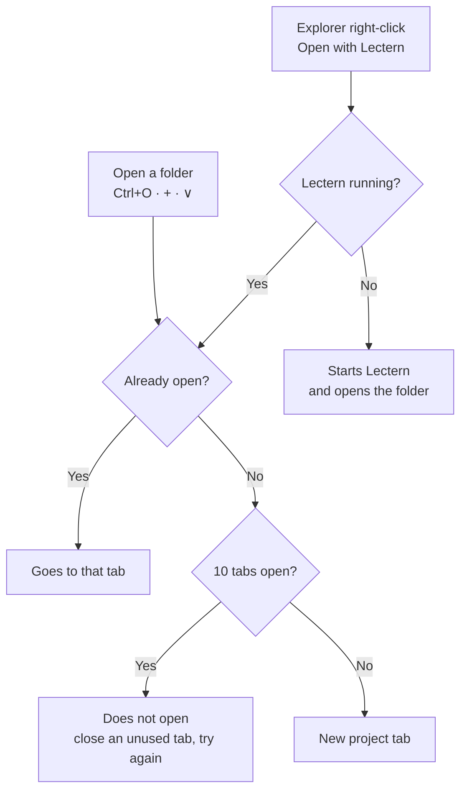

# Project tabs

> One tab per open folder — open, switch between and close projects in the tab bar below the toolbar. At the right end of the tab bar are the Insert, Edit, Contents, Print, Notes and Terminal buttons.

## At a glance

| To do | Mouse | Keys |
|---|---|---|
| Open a folder in a new tab | **+** in the tab bar | **Ctrl+O** |
| Open a recent folder · the samples | **∨** next to **+** | — |
| Pick a tab | Click the tab | **Ctrl+1~8** · **Ctrl+9** (last tab) |
| Next · previous tab | — | **Alt+PageDown** · **Alt+PageUp** |
| Project overview | Click the selected tab again · right-click, **Project overview** | — |
| Reorder tabs | Drag a tab sideways (Esc cancels) | — (mouse only) |
| Close a tab | The tab's **×** · middle-click | **Ctrl+Shift+W** |
| Close all other tabs | Right-click a tab | — |

## Opening a folder

| Method | Where | Result |
|---|---|---|
| **+** · **Ctrl+O** | Tab bar | Choose a folder and it opens in a new tab |
| **∨** — Recent folders | Tab bar | Opens that folder ('(open tab)' beside it if it is already open in a tab) |
| **∨** — Open another folder… | Tab bar | The same as **Ctrl+O** |
| **∨** — Open samples | Tab bar · start screen | Opens the sample project in a tab and shows the example guide window |
| **Open with Lectern** | Right-click a folder in Explorer | If Lectern is running, a tab in that window instead of a new window |
| Start again | — | The tabs you left open, each at the document and position you were reading |

## What tabs keep and show

| What | Description |
|---|---|
| What each tab keeps | The document you were reading and the scroll position — clicking a tab switches the sidebar and main area to that project |
| Tab name | The folder name — folders with the same name also show the parent folder's name |
| Dot next to the name | A document in a background tab changed |
| Number of tabs | Up to 10 |
| Moved order | While you drag, a vertical bar shows where the tab will land. The order is kept for the next start, and **Ctrl+1~9** follow it |

## Right-click menu

| Item | What it does |
|---|---|
| Project overview | Overview of the top folder |
| New document… · New folder… | In the project's top folder |
| Make work card… | A `WORK.md` in the top folder — if there is one, **Open work card** |
| Elements in the project (tables, figures…) | The sidebar 'Elements' tab |
| Copy full path · Show in Explorer | The project folder's path |
| Close all open documents | Closes only this project's document tabs and leaves the folder overview — the project stays |
| Close tab · Close other tabs | Closes project tabs |

## The sample project is view-only

The samples are a project with a tour of Lectern and how to write documents. They live inside Lectern's program folder, so they are view-only — so that no commands run and no files change next to the program files.

| Not available | Instead |
|---|---|
| Terminal · edit mode · new documents · renaming | Copy the samples folder elsewhere (Documents, for example) and open the copy |
| Finding the samples folder | **Show this folder in Explorer** in the terminal area |

## Right end of the tab bar

| Button | What it does | Keys | More |
|---|---|---|---|
| Insert | The Insert window below the current line — elements such as tables, images, callouts and page breaks | **/** | [Insert](4.5-insert.en.md) |
| Edit | Edit mode for the document or code you are viewing — click again to close; while on, it shows in the accent color with an underline | **Ctrl+E** | [Full editor](4.7-full-editor.en.md) |
| Contents | Show or hide the contents on the right | **Alt+O** | [Contents](2.5-contents.en.md) |
| Print | The Export window — PDF, print, html, Word | — | [Print and PDF](6.1-print-and-pdf.en.md) |
| Notes | This project's notes — they cover the document from the right | **Alt+M** | [Highlights, notes and clip](3.5-highlights-notes-clip.en.md) |
| Terminal | PowerShell in this project folder — a separate shell per tab; the shell keeps running when you close it | **Ctrl+\`** | [Terminal](7.1-terminal.en.md) |

## Related

| Document | What |
|---|---|
| [Document tabs](2.3-document-tabs.en.md) | The documents open within one project |
| [Separate windows](2.7-separate-windows.en.md) | Windows that belong to a project · the example guide window |
| [Sidebar](2.4-sidebar.en.md) | The list on the left that changes when you pick a tab |
