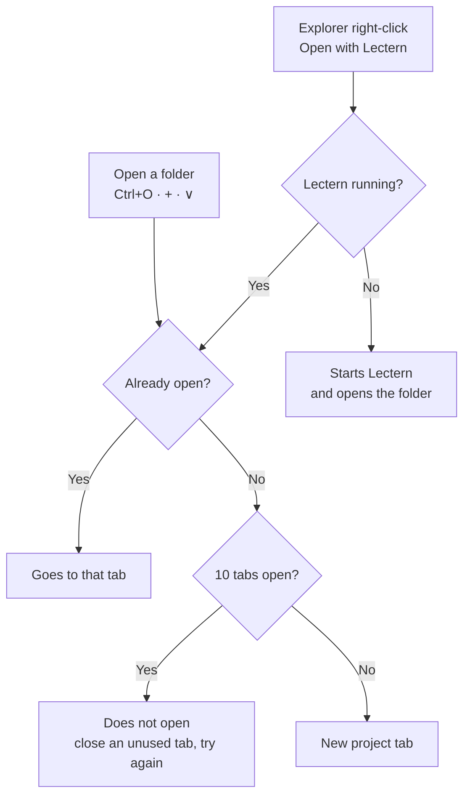

# Project tabs

> One tab per open folder — open, switch between and close projects in the tab bar below the toolbar. At the right end of the tab bar are eleven icon buttons — for this project (Overview, Changed, Work card), for the current document (Insert, Edit, Contents, Style, Export), and AI requests with the panels (Notes, Terminal).

## At a glance

| To do | Mouse | Keys |
|---|---|---|
| Open a folder in a new tab | **+** in the tab bar | **Ctrl+O** |
| Open a recent folder · the samples | **∨** next to **+** | — |
| Pick a tab | Click the tab | **Ctrl+1~8** · **Ctrl+9** (last tab) |
| Next · previous tab | — | **Alt+PageDown** · **Alt+PageUp** |
| Project overview | Click the selected tab again · right-click, **Project overview** | — |
| Reorder tabs | Drag a tab sideways (Esc cancels) | — (mouse only) |
| Close a tab | The tab's **×** · middle-click | **Ctrl+Shift+W** |
| Close all other tabs | Right-click a tab | — |

## Opening a folder

| Method | Where | Result |
|---|---|---|
| **+** · **Ctrl+O** | Tab bar | Choose a folder and it opens in a new tab |
| **∨** — Recent folders | Tab bar | Opens that folder ('(open tab)' beside it if it is already open in a tab) |
| **∨** — Open another folder… | Tab bar | The same as **Ctrl+O** |
| **∨** — Open samples | Tab bar · start screen | Opens the sample project in a tab and shows the example guide window |
| **Open with Lectern** | Right-click a folder in Explorer | If Lectern is running, a tab in that window instead of a new window |
| Start again | — | The tabs you left open, each at the document and position you were reading |

## What tabs keep and show

| What | Description |
|---|---|
| What each tab keeps | The document you were reading and the scroll position — clicking a tab switches the sidebar and main area to that project |
| Tab name | The folder name — folders with the same name also show the parent folder's name |
| Dot next to the name | A document in a background tab changed |
| Number of tabs | Up to 10 |
| Moved order | While you drag, a vertical bar shows where the tab will land. The order is kept for the next start, and **Ctrl+1~9** follow it |

## Right-click menu

| Item | What it does |
|---|---|
| Project overview | Overview of the top folder |
| New document… · New folder… | In the project's top folder |
| Make work card… | A `WORK.md` in the top folder — if there is one, **Open work card** |
| Elements in the project (tables, figures…) | The sidebar 'Elements' tab |
| Copy full path · Show in Explorer | The project folder's path |
| Close all open documents | Closes only this project's document tabs and leaves the folder overview — the project stays |
| Close tab · Close other tabs | Closes project tabs |

## The sample project is view-only

The samples are a project with a tour of Lectern and how to write documents. They live inside Lectern's program folder, so they are view-only — so that no commands run and no files change next to the program files.

| Not available | Instead |
|---|---|
| Terminal · edit mode · new documents · renaming | Copy the samples folder elsewhere (Documents, for example) and open the copy |
| Finding the samples folder | **Show this folder in Explorer** in the terminal area |

## Right end of the tab bar

Eleven icon buttons in three groups. They carry no names — **hover over a button and its name and description appear just below it** (also when you reach it with Tab). A short vertical line separates the groups.

| Group | Button | What it does | Keys | More |
|---|---|---|---|---|
| Project | Overview | The project overview — the documents and subfolders at the top folder. Shown pressed while you view it | — | [Reading](3-reading.en.md#folder-overview) |
| Project | Changed | The number of documents edited outside Lectern (by an AI tool, for example) that you have not opened yet. Click to go to the next change (see "Changed" below) | **F7** (within this document) | [Reading](3-reading.en.md) |
| Project | Work card | Opens the `WORK.md` at the top of this project. Dimmed when there is none — clicking then opens the **Make work card** window | — | [Work management](8-work-management.en.md) |
| Document | Insert | The Insert window below the current line — elements such as tables, images, callouts and page breaks | **/** | [Insert](4.5-insert.en.md) |
| Document | Edit | Edit mode for the document or code you are viewing — click again to close; while on, it shows in the accent color with an underline | **Ctrl+E** | [Full editor](4.7-full-editor.en.md) |
| Document | Contents | Show or hide the contents on the right | **Alt+O** | [Contents](2.5-contents.en.md) |
| Document | Style | The md document style window — document form and heading look (same as **md document style** in the status bar) | — | [Numbers, references, contents, style](4.6-numbers-references-contents-styles.en.md) |
| Document | Export | Every way out in one menu — print, save as PDF, html or Word; convert Lectern slides to pptx or html | — | [Export](6-export.en.md) |
| AI · panels | AI requests | A menu of requests for the current document — picking one puts it in the terminal (see "AI requests" below) | — | [Sending and requests](7.2-sending-and-requests.en.md) |
| AI · panels | Notes | This project's notes — they cover the document from the right | **Alt+M** | [Highlights, notes and clip](3.5-highlights-notes-clip.en.md) |
| AI · panels | Terminal | PowerShell in this project folder — a separate shell per tab; the shell keeps running when you close it | **Ctrl+\`** | [Terminal](7.1-terminal.en.md) |

### Changed

| Situation | Clicking |
|---|---|
| The current document has changes you have not visited | Goes to the next change in that document (same as **F7**) |
| You have visited them all, and there are changed documents you have not opened | Opens the most recently changed one in a new document tab — the number drops by one |
| No changed documents, only changes in the current document | Cycles back to the first change |
| Nothing | Tells you there are no changed documents |

The number matches the dot beside the tab name and the count on the sidebar **Recent** tab. Opening a document removes it from the count.

### AI requests

Picking an item puts the request text in the terminal. **Enter is not pressed** — read it, add to it, then press Enter yourself. Lectern does not run the AI tool.

| Item | Text it puts in | Where it appears |
|---|---|---|
| Point to this document | `@path` — type what you want to say after it | Documents · code view |
| Request a polish check | Asks for wrong wording and hard-to-read places, as a table first | md documents · Lectern slides |
| Send as a sample of my voice | Asks to create or extend your voice notes | md documents |
| Request applying planning notes | Asks to move the planning notes into to-dos, schedule and decisions | Work card (`WORK.md`) |
| Document check list… · Slide check list… | Opens the check list from the status bar — send the list to the terminal from there | When there is something to check |
| AI tool settings… | **AI tool** in the settings window | Always |

These were in the document right-click menu and the status bar; this menu gathers them. In a folder overview only **AI tool settings…** appears.

### In separate windows

The three project buttons (Overview, Changed, Work card) and Notes and Terminal are absent. AI requests is there — the text goes into the main window's terminal.

## Related

| Document | What |
|---|---|
| [Document tabs](2.3-document-tabs.en.md) | The documents open within one project |
| [Separate windows](2.7-separate-windows.en.md) | Windows that belong to a project · the example guide window |
| [Sidebar](2.4-sidebar.en.md) | The list on the left that changes when you pick a tab |
