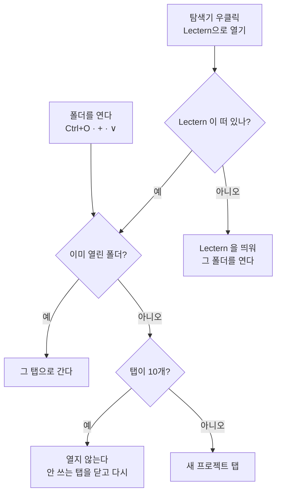

# 프로젝트 탭

> 열어 둔 폴더마다 탭 하나 — 툴바 아래 탭 막대에서 프로젝트를 열고 오가고 닫는다. 탭 막대 오른쪽 끝에는 아이콘 단추 열하나가 있다 — 이 프로젝트의 것(개요·바뀜·업무 카드), 지금 문서의 것(넣기·편집·목차·스타일·내보내기), AI 요청과 패널(메모·터미널).

## 한눈에

| 하려는 일 | 마우스 | 키 |
|---|---|---|
| 폴더를 새 탭으로 열기 | 탭 막대의 **+** | **Ctrl+O** |
| 최근 연 폴더 · 예제 열기 | **+** 옆 **∨** | — |
| 탭 고르기 | 탭 누르기 | **Ctrl+1~8** · **Ctrl+9** (마지막 탭) |
| 다음 · 이전 탭 | — | **Alt+PageDown** · **Alt+PageUp** |
| 프로젝트 개요 | 탭 막대의 **개요** · 고른 탭을 또 누르기 · 우클릭 **프로젝트 개요** | — |
| 탭 차례 바꾸기 | 탭을 옆으로 끌기 (Esc 로 그만두기) | — (마우스로만) |
| 탭 닫기 | 탭의 **×** · 가운데 버튼 | **Ctrl+Shift+W** |
| 다른 탭 모두 닫기 | 탭 우클릭 | — |

## 폴더 열기

| 방법 | 어디서 | 결과 |
|---|---|---|
| **+** · **Ctrl+O** | 탭 막대 | 폴더를 고르면 새 탭 |
| **∨** — 최근 연 폴더 | 탭 막대 | 그 폴더를 연다 (이미 열린 탭이면 옆에 '열린 탭') |
| **∨** — 다른 폴더 열기… | 탭 막대 | **Ctrl+O** 와 같다 |
| **∨** — 예제 열기 | 탭 막대 · 시작 화면 | 예제 프로젝트를 탭으로 열고 예제 가이드 창을 띄운다 |
| **Lectern으로 열기** | 탐색기의 폴더 우클릭 | Lectern 이 떠 있으면 새 창 대신 그 창의 탭으로 |
| 다시 실행 | — | 지난번에 열어 둔 탭들이 보던 문서·위치 그대로 |

## 탭에 남고 보이는 것

| 무엇 | 설명 |
|---|---|
| 탭마다 남는 것 | 보던 문서와 스크롤 위치 — 탭을 누르면 사이드바와 본문이 그 프로젝트의 것으로 바뀐다 |
| 탭 이름 | 폴더 이름 — 이름이 같은 폴더는 상위 폴더 이름도 함께 |
| 이름 옆의 점 | 뒤에 있는 탭의 문서가 바뀌었다 |
| 탭 수 | 10개까지 |
| 옮긴 차례 | 끄는 동안 놓일 자리에 세로 막대. 다음 실행에도 남고 **Ctrl+1~9** 도 그 차례를 따른다 |

## 우클릭 메뉴

| 항목 | 하는 일 |
|---|---|
| 프로젝트 개요 | 맨 위 폴더의 개요 |
| 새 문서 만들기… · 새 폴더 만들기… | 프로젝트 맨 위 폴더에 |
| 업무 카드 만들기… | 맨 위 폴더에 `WORK.md` — 있으면 **업무 카드 열기** |
| 프로젝트의 표·그림 등 모아 보기 | 사이드바 '모아 보기' 탭 |
| 전체 경로 복사 · 탐색기에서 보기 | 프로젝트 폴더의 경로 |
| 열린 문서 모두 닫기 | 이 프로젝트의 문서 탭만 닫고 폴더 개요를 남긴다 — 프로젝트는 그대로 |
| 탭 닫기 · 다른 탭 모두 닫기 | 프로젝트 탭을 닫는다 |

## 예제 프로젝트는 보기만

예제는 Lectern 둘러보기와 문서 쓰는 법을 담은 프로젝트다. Lectern 프로그램 폴더 안에 있어 보기만 한다 — 프로그램 파일 옆에서 명령이 돌거나 파일이 바뀌지 않게.

| 없는 것 | 대신 |
|---|---|
| 터미널 · 편집 모드 · 새 문서 · 이름 바꾸기 | 예제 폴더를 다른 곳(문서 폴더 등)에 복사해 그 복사본을 연다 |
| 예제 폴더가 어디인지 | 터미널 자리의 **탐색기에서 이 폴더 보기** |

## 탭 막대 오른쪽 끝

아이콘 단추 열하나가 세 묶음으로 놓인다. 이름은 적혀 있지 않다 — **마우스를 올리면 단추 바로 아래에 이름과 설명이 뜬다** (Tab 으로 가도 뜬다). 묶음 사이에 짧은 세로줄이 있다.

| 묶음 | 단추 | 하는 일 | 키 | 자세히 |
|---|---|---|---|---|
| 프로젝트 | 개요 | 프로젝트 개요 — 맨 위 폴더의 문서와 하위 폴더. 보는 동안 눌린 모양 | — | [읽기](3-읽기.md#폴더-개요) |
| 프로젝트 | 바뀜 | 밖에서(AI 도구 등) 고쳐졌는데 아직 열어 보지 않은 문서의 수. 누르면 다음 바뀐 곳으로 (아래 '바뀜') | **F7** (이 문서 안) | [읽기](3-읽기.md) |
| 프로젝트 | 업무 카드 | 이 프로젝트 맨 위의 `WORK.md` 를 연다. 없으면 흐리고, 누르면 **업무 카드 만들기** 창 | — | [업무 관리](8-업무-관리.md) |
| 문서 | 넣기 | 현재 줄 아래에 넣기 창 — 표·그림·강조글·쪽 나눔 같은 구성 요소 | **/** | [넣기](4.5-넣기.md) |
| 문서 | 편집 | 보고 있는 문서·코드를 편집 모드로 — 다시 누르면 닫힌다, 켜져 있으면 강조색과 밑줄 | **Ctrl+E** | [전체 편집](4.7-전체-편집.md) |
| 문서 | 목차 | 오른쪽 목차 보이기·감추기 | **Alt+O** | [목차](2.5-목차.md) |
| 문서 | 스타일 | md 문서 스타일 창 — 문서 방식과 머리글 모양 (상태줄의 **md 문서 스타일** 과 같다) | — | [번호·참조·목차·스타일](4.6-번호-참조-목차-스타일.md) |
| 문서 | 내보내기 | 밖으로 내는 길을 한 메뉴로 — 인쇄, PDF · html · Word 로 저장, Lectern 슬라이드는 pptx · html 로 전환 | — | [내보내기](6-내보내기.md) |
| AI·패널 | AI 요청 | 지금 문서에 쓸 요청 글의 메뉴 — 고르면 터미널에 넣는다 (아래 'AI 요청') | — | [보내기와 요청 글](7.2-보내기와-요청-글.md) |
| AI·패널 | 메모 | 이 프로젝트의 메모 — 오른쪽에서 문서 위를 덮는다 | **Alt+M** | [형광펜·메모·담기](3.5-형광펜-메모-담기.md) |
| AI·패널 | 터미널 | 이 프로젝트 폴더의 PowerShell — 탭마다 셸이 따로, 닫아도 셸은 돈다 | **Ctrl+\`** | [터미널](7.1-터미널.md) |

### 바뀜

| 상황 | 누르면 |
|---|---|
| 지금 문서에 아직 보지 않은 바뀐 곳이 있다 | 그 문서의 다음 바뀐 곳으로 (**F7** 과 같다) |
| 지금 문서를 다 보았고, 열어 보지 않은 바뀐 문서가 있다 | 가장 최근에 바뀐 문서를 새 문서 탭에 연다 — 수가 하나 준다 |
| 바뀐 문서는 없고 지금 문서에 바뀐 곳만 있다 | 첫 바뀐 곳으로 돈다 |
| 아무것도 없다 | 바뀐 문서가 없다고 알린다 |

수는 탭 이름 옆의 점, 사이드바 **최근 변경** 탭의 수와 같다. 문서를 열어 보면 빠진다.

### AI 요청

고르면 요청 글이 터미널에 들어간다. **Enter 는 누르지 않는다** — 읽어 보고 덧붙인 뒤 직접 누른다. Lectern 이 AI 도구를 실행하지는 않는다.

| 항목 | 넣는 글 | 나오는 곳 |
|---|---|---|
| 이 문서 가리키기 | `@경로` — 이어서 할 말을 적는다 | 문서 · 코드 화면 |
| 다듬기 점검 요청 | 틀린 말과 읽기 어려운 곳을 표로 먼저 찾아 달라는 요청 | md 문서 · Lectern 슬라이드 |
| 내 문체 견본으로 보내기 | 내 문체 노트를 만들거나 보태 달라는 요청 | md 문서 |
| 기획 메모 반영 요청 | 기획 메모를 할 일·일정·결정에 옮겨 달라는 요청 | 업무 카드(`WORK.md`) |
| 문서 점검 목록… · 슬라이드 점검 목록… | 상태줄의 점검 목록을 연다 — 거기서 목록을 터미널에 | 점검할 곳이 있을 때 |
| AI 도구 설정… | 설정 창의 **AI 도구** | 늘 |

문서 우클릭 메뉴와 상태줄에 있던 것을 한곳에 모은 것이다. 폴더 개요에서는 **AI 도구 설정…** 만 나온다.

### 독립창에서는

프로젝트의 셋(개요·바뀜·업무 카드)과 메모·터미널이 없다. AI 요청은 있다 — 글은 메인 창의 터미널에 들어간다.

## 관련

| 문서 | 무엇 |
|---|---|
| [문서 탭](2.3-문서-탭.md) | 한 프로젝트 안에서 열어 둔 문서들 |
| [따로 창](2.7-따로-창.md) | 프로젝트에 속한 창 · 예제 가이드 창 |
| [사이드바](2.4-사이드바.md) | 탭을 고르면 바뀌는 왼쪽 목록 |
