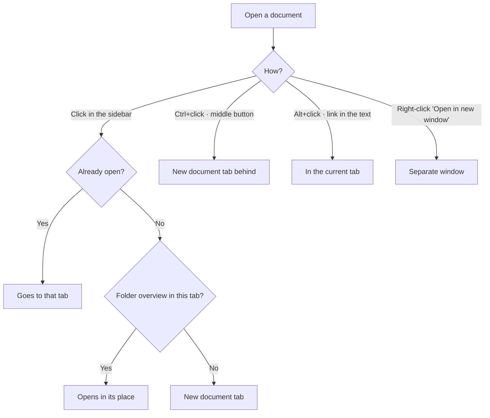

# Document tabs

> Keep up to 40 documents of a project open as tabs and switch between them. They appear in the document tab row just above the text.

## At a glance

| To do | Mouse | Keys |
|---|---|---|
| Open a document in a new tab | Click it in a sidebar list | — |
| Open behind, keeping the current tab | **Ctrl+click** · middle-click | — |
| Open in the current tab | **Alt+click** | — |
| Pick a document to open in a new tab | **+** in the document tab row | **Ctrl+T** |
| Next · previous tab | Click a tab | **Ctrl+Tab** · **Ctrl+Shift+Tab** |
| Tab by position · last tab | — | **Alt+1~8** · **Alt+9** |
| Close a tab | The tab's **×** · middle-click | **Ctrl+W** |
| Reopen a closed tab | — | **Ctrl+Shift+T** |
| Reorder tabs | Drag a tab sideways (Esc cancels) | — |
| Pick from the list of open tabs | **∨** at the right end of the row | — |
| Move the current document to a new window | Right-click a tab, **Move to new window** | **Ctrl+Shift+N** |
| Spread the tabs over the whole window | **▦** at the right end of the row | — |

## Where it opens

| Case | What happens |
|---|---|
| Opening the same document twice | Goes to the tab already open — a document is in one tab only |
| All 40 in use | Opens in the tab you looked at least recently (tabs with unsaved edits are left alone) |
| Opened in the current tab from a link | **Alt+←** comes back |

## What each tab keeps

| Kept | Description |
|---|---|
| Reading position | Scroll and current line |
| Back · forward history | **Alt+←** · **Alt+→** — they also undo jumps from the contents, section links, footnotes and find |
| Text being edited | A tab with unsaved edits shows **●** |
| Next start | Your open tabs come back (setting 'Resume where I left off') — only the selected tab is drawn at once, the others when you click them |

## Closing

| To do | How | Note |
|---|---|---|
| Close one tab | **×** · middle-click · **Ctrl+W** (**Ctrl+F4** too) | Closing the last tab shows the folder overview |
| Close all other tabs | Right-click a tab | — |
| Close all open documents | Right-click a tab · **∨** | If there are unsaved edits, you are asked once |
| Close the whole project tab | **Ctrl+Shift+W** | All its document tabs close too |

## Spread all

Click **▦** next to **∨** at the right end of the document tab row to spread this project's document tabs over the whole window as a grid. Click it again to go back to the usual view.

| What | How |
|---|---|
| Cells | One cell per document tab (in tab order); **the bottom-right cell is this project's terminal** — if it was closed it opens (starting a shell if there is none), and it is hidden again when the spread ends |
| When the cells don't fit the grid | A document cell beside or above widens to fill the gap. The sidebar and contents are hidden |
| Picking a cell | Clicking a cell selects that document tab (highlighted border) — the status bar, **Ctrl+F**, right-click menus and **Alt+1~9** work on the selected cell |
| Changed documents | Redrawn at once, whichever cell they are in |
| Showing only one | **⤢** in the cell header (or double-click the header) — ends the spread and shows only that document. Clicking the sidebar or contents button (**Ctrl+B**) also ends it |
| Another project tab | Picking one while spread spreads that project's document tabs. View-only projects (the samples) have no terminal cell |

## Related

| Document | What |
|---|---|
| [Project tabs](2.2-project-tabs.en.md) | A tab for each open folder |
| [Separate windows](2.7-separate-windows.en.md) | Moving documents to other windows · sending between windows |
| [Links and opening files](3.4-links-and-opening-files.en.md) | Where links in the text open |
