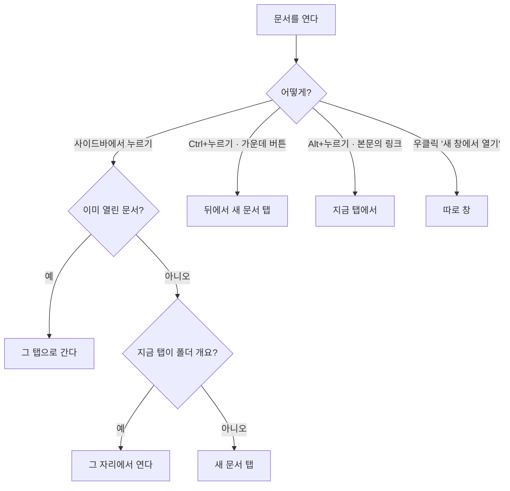

# 문서 탭

> 한 프로젝트에서 문서를 40개까지 탭으로 열어 두고 오간다. 본문 바로 위의 문서 탭 줄에 보인다.

## 한눈에

| 하려는 일 | 마우스 | 키 |
|---|---|---|
| 문서를 새 탭에서 열기 | 사이드바 목록에서 누르기 | — |
| 보던 탭을 두고 뒤에서 열기 | **Ctrl+누르기** · 가운데 버튼 | — |
| 지금 탭에서 열기 | **Alt+누르기** | — |
| 새 탭에 문서를 골라 열기 | 문서 탭 줄의 **+** | **Ctrl+T** |
| 다음 · 이전 탭 | 탭 누르기 | **Ctrl+Tab** · **Ctrl+Shift+Tab** |
| 그 순번 · 마지막 탭 | — | **Alt+1~8** · **Alt+9** |
| 탭 닫기 | 탭의 **×** · 가운데 버튼 | **Ctrl+W** |
| 닫은 탭 다시 열기 | — | **Ctrl+Shift+T** |
| 탭 차례 바꾸기 | 탭을 옆으로 끌기 (Esc 로 그만두기) | — |
| 열린 탭 목록에서 고르기 | 줄 오른쪽 끝 **∨** | — |
| 지금 문서를 새 창으로 | 탭 우클릭 **새 창으로 옮기기** | **Ctrl+Shift+N** |
| 탭들을 창 전체에 펼치기 | 줄 오른쪽 끝 **▦** | — |

## 어디에 열리나

| 경우 | 어떻게 되나 |
|---|---|
| 같은 문서를 두 번 열면 | 이미 열린 탭으로 간다 — 같은 문서는 한 탭에만 |
| 40개가 찼으면 | 가장 오래 안 본 탭에서 연다 (저장하지 않은 편집이 있는 탭은 건드리지 않는다) |
| 링크로 지금 탭에서 열었으면 | **Alt+←** 로 돌아온다 |

## 탭마다 남는 것

| 남는 것 | 설명 |
|---|---|
| 읽던 위치 | 스크롤과 현재 줄 |
| 뒤로 · 앞으로 기록 | **Alt+←** · **Alt+→** — 목차·절 링크·각주·찾기로 뛴 것도 되돌린다 |
| 편집 중인 글 | 저장하지 않은 편집이 있는 탭에는 **●** |
| 다음 실행 | 열어 둔 탭이 그대로 돌아온다 (설정 '마지막 위치에서 시작') — 고른 탭만 바로 그리고 나머지는 누를 때 |

## 닫기

| 하려는 일 | 방법 | 메모 |
|---|---|---|
| 한 탭 닫기 | **×** · 가운데 버튼 · **Ctrl+W** (**Ctrl+F4** 도) | 마지막 탭을 닫으면 폴더 개요 |
| 다른 탭 모두 닫기 | 탭 우클릭 | — |
| 열린 문서 모두 닫기 | 탭 우클릭 · **∨** | 저장하지 않은 편집이 있으면 한 번 묻는다 |
| 프로젝트까지 닫기 | **Ctrl+Shift+W** | 폴더 개요만 남았을 때 |

## 관련

| 문서 | 무엇 |
|---|---|
| [프로젝트 탭](2.2-프로젝트-탭.md) | 열린 폴더마다 탭 |
| [따로 창](2.7-따로-창.md) | 문서를 다른 창으로 옮기기 · 창 사이로 보내기 |
| [링크와 파일 열기](3.4-링크와-파일-열기.md) | 본문의 링크가 어디에 열리나 |
