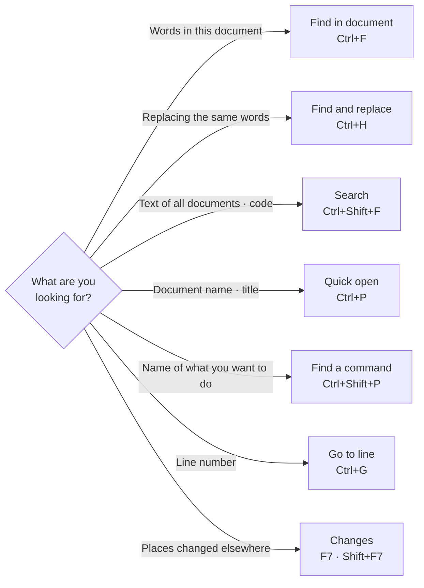

# Find and search

> Find in the current document with Ctrl+F, across the project with Ctrl+Shift+F, by name with Ctrl+P, features with Ctrl+Shift+P, and places changed elsewhere with F7.

## What are you looking for

## Find in document

Finds in the document or code you are viewing (in the User guide too). It finds text even across formatting such as bold or code. In a PDF it searches every page and goes to that page — [Viewing PDFs](3.8-pdf.en.md).

| What you want to do | Key |
|---|---|
| Opening the find bar — on a folder overview, filtering the tree | **Ctrl+F** |
| Next · previous result | **Enter** · **Shift+Enter** |
| Closing find | **Esc** |
| Next · previous place of the last search — even after the bar is closed | **F3** · **Shift+F3** |
| Going to a line — type the line number and press Enter | **Ctrl+G** |
| With vi keys on | **/** · **n** · **N** · **:** — [vi keys](3.1-current-line-and-picking.en.md#vi-keys) |

## Find and replace

Works in md documents. The code view, html documents and view-only folders have no button (find only).

| What you want to do | Mouse | Key |
|---|---|---|
| Opening · closing the replace row | **Replace** on the find bar — type the replacement right away | **Ctrl+H** (in the find box too) |
| Replacing the first match after the current line | **Replace** | **Enter** |
| Replacing in the whole document | **Replace all** | **Ctrl+Enter** |
| Undoing | — | **Ctrl+Z** |

Replacing saves to the source at once. When many places change at once, a notice appears at the bottom of the screen.

## Search — the whole project

This is the **Search** tab in the sidebar. It searches the text of all documents and code, and file names. Case doesn't matter.

| What you want to do | How | Result |
|---|---|---|
| To the search box | **Ctrl+Shift+F** | Press it to come back when you change the search too |
| Choosing where to search | **Documents** · **Code** · **Other files** under the box | Other files (PDF · Excel and so on) are searched by name only |
| Reading the results | — | Files whose names match at the top (titles too for documents), then text results — documents first, then a 'Code' group |
| Going to a result | Click a result line · **Enter** in the box (first result) | Goes to that line and marks the search text. That line becomes the current line, and focus moves to the document |
| Opening while keeping the document you were reading | **Ctrl+click** · middle button | In a new document tab, behind |

After going to a result, press **/** (insert below), **F2** (line edit) or **F3** (next match) right away.

## Quick open and find a command

| What you want to do | Key | Result |
|---|---|---|
| Opening by name · title · path | **Ctrl+P** (**Quick open** in the toolbar) | Matching documents first, then code |
| Finding a feature by name | **Ctrl+Shift+P** · `>` in the **Ctrl+P** box | The Quick open box opens with `>` already typed. Type the name of what you want to do (print, fold all, contents …) for the matching commands, with their shortcuts on the right — **Enter** runs one |

Actions without a key (Print & PDF, Spread all, Close all open documents, View settings source and so on) are in Find a command too. For the ones you use often, learn the key shown beside them.

## Auto refresh and changes

While AI tools (Claude Code and others) write a document, the screen changes within a second and your reading position stays where it was.

| Situation | Behavior |
|---|---|
| When a paragraph · table changes | It is marked briefly with a background color |
| When it changed off screen | The **changes** button in the status bar takes you through them in turn |
| Next · previous change | **F7** · **Shift+F7** — works even when they are all on screen and there is no button. The current line moves to that block too, so press **F2** to edit or **Shift+→** to send right away |
| When the text is unchanged | Not redrawn — selected text stays selected |
| While you drag to select text | Waits until you release the mouse |
| When the text really changes | Redrawn — the selection is cleared |
| When the code you are viewing changes | Redrawn within two seconds, with the changed lines marked briefly |
| A change the watcher missed | Press **F5** to reload |

## Related

| Document | What |
|---|---|
| [Current line and picking](3.1-current-line-and-picking.en.md) | Picking and copying at the line you found |
| [Sidebar](2.4-sidebar.en.md) | Search tab · Recent |
| [Status bar](2.6-status-bar.en.md) | Changes button · change watching |
| [Choosing how to edit](4.1-choosing-how-to-edit.en.md) | Find and replace and other ways to edit |
