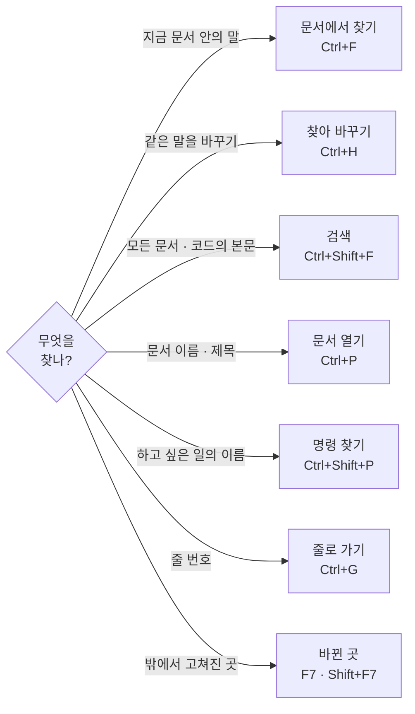

# 찾기와 검색

> 지금 문서는 Ctrl+F, 프로젝트 전체는 Ctrl+Shift+F, 이름은 Ctrl+P, 기능은 Ctrl+Shift+P, 밖에서 고쳐진 곳은 F7 로 찾는다.

## 무엇을 찾나

## 문서에서 찾기

지금 보는 문서나 코드에서 찾는다 (사용설명서에서도). 굵게 · 코드 같은 서식이 섞여도 찾는다.

| 하려는 일 | 키 |
|---|---|
| 찾기 막대 열기 — 폴더 개요에서는 트리 거르기 | **Ctrl+F** |
| 다음 · 이전 결과 | **Enter** · **Shift+Enter** |
| 찾기 닫기 | **Esc** |
| 마지막에 찾은 말의 다음 · 앞 곳 — 막대를 닫은 뒤에도 | **F3** · **Shift+F3** |
| 줄로 가기 — 줄 번호를 치고 Enter | **Ctrl+G** |
| vi 키를 켰을 때 | **/** · **n** · **N** · **:** — [vi 키](3.1-현재-줄과-고르기.md#vi-키) |

## 찾아 바꾸기

md 문서에서 된다. 코드 화면 · html 문서 · 보기만 하는 폴더에서는 단추가 없다 (찾기만).

| 하려는 일 | 마우스 | 키 |
|---|---|---|
| 바꿀 글 줄 열기 · 닫기 | 찾기 막대의 **바꾸기** — 바로 바꿀 글을 친다 | **Ctrl+H** (찾는 말 칸에서도) |
| 현재 줄 뒤의 첫 곳 바꾸기 | **바꾸기** | **Enter** |
| 문서 전체 바꾸기 | **모두 바꾸기** | **Ctrl+Enter** |
| 되돌리기 | — | **Ctrl+Z** |

바꾸면 원문에 바로 저장한다. 여러 곳을 한 번에 바꾸면 화면 아래에 알림이 뜬다.

## 검색 — 프로젝트 전체

사이드바 **검색** 탭이다. 모든 문서와 코드의 본문, 그리고 파일 이름에서 찾는다. 대소문자는 가리지 않는다.

| 하려는 일 | 방법 | 결과 |
|---|---|---|
| 검색 칸으로 | **Ctrl+Shift+F** | 검색어를 고칠 때도 이 키로 돌아온다 |
| 찾을 곳 고르기 | 칸 아래 **문서** · **코드** · **자료** | 자료(PDF · 엑셀 등)는 이름으로만 찾는다 |
| 결과 읽기 | — | 맨 위에 이름이 맞는 파일(문서는 제목도), 그 아래 본문 결과 — 문서 먼저, 그다음 '코드' 묶음 |
| 결과로 가기 | 결과 줄 누르기 · 칸에서 **Enter** (첫 결과) | 그 줄로 가서 검색어를 표시한다. 현재 줄도 그 줄, 초점은 문서로 |
| 보던 문서를 두고 열기 | **Ctrl+누르기** · 가운데 버튼 | 뒤에서 새 문서 탭에 |

결과로 간 뒤에는 바로 **/**(아래에 넣기) · **F2**(한 줄 편집) · **F3**(다음 찾은 곳)를 누른다.

## 문서 열기와 명령 찾기

| 하려는 일 | 키 | 결과 |
|---|---|---|
| 이름 · 제목 · 경로로 열기 | **Ctrl+P** (툴바 **문서 열기**) | 맞는 문서가 먼저, 그다음 코드 |
| 기능을 이름으로 찾기 | **Ctrl+Shift+P** · **Ctrl+P** 칸에서 `>` | 문서 열기 칸이 `>` 를 넣은 채 열린다. 일의 이름(인쇄, 모두 접기, 목차 …)을 치면 맞는 명령과 오른쪽에 그 단축키 — **Enter** 로 바로 한다 |

키가 없는 일(인쇄 · PDF, 모두 펼치기, 열린 문서 모두 닫기, 설정 원문 보기 등)도 명령 찾기에서 한다. 자주 쓰는 것은 옆의 키를 익혀 둔다.

## 자동 새로고침과 바뀐 곳

AI 도구(Claude Code 등)가 문서를 쓰는 동안 화면은 1초 안에 바뀌고, 보던 위치는 그대로다.

| 상황 | 동작 |
|---|---|
| 문단 · 표가 바뀌면 | 잠깐 배경색으로 표시한다 |
| 화면 밖에서 바뀌었으면 | 상태줄의 **바뀐 곳** 단추로 차례로 간다 |
| 다음 · 앞 바뀐 곳 | **F7** · **Shift+F7** — 모두 화면 안이라 단추가 없어도 된다. 현재 줄도 그 블록으로 옮겨 가니 바로 **F2** 로 고치거나 **Shift+→** 로 보낸다 |
| 글이 그대로면 | 다시 그리지 않는다 — 고른 글이 남는다 |
| 글을 끌어 고르는 동안 | 마우스를 놓을 때까지 기다린다 |
| 글이 실제로 바뀌면 | 다시 그린다 — 고른 글은 풀린다 |
| 보고 있는 코드가 바뀌면 | 2초 안에 다시 그리고 바뀐 줄을 잠깐 표시한다 |
| 감시가 놓친 변경 | **F5** 를 누르면 다시 불러온다 |

## 관련

| 문서 | 무엇 |
|---|---|
| [현재 줄과 고르기](3.1-현재-줄과-고르기.md) | 찾은 줄에서 고르고 복사하기 |
| [사이드바](2.4-사이드바.md) | 검색 탭 · 최근 변경 |
| [상태줄](2.6-상태줄.md) | 바뀐 곳 단추 · 변경 감시 |
| [고치는 길 고르기](4.1-고치는-길-고르기.md) | 찾아 바꾸기와 다른 고치는 길 |
