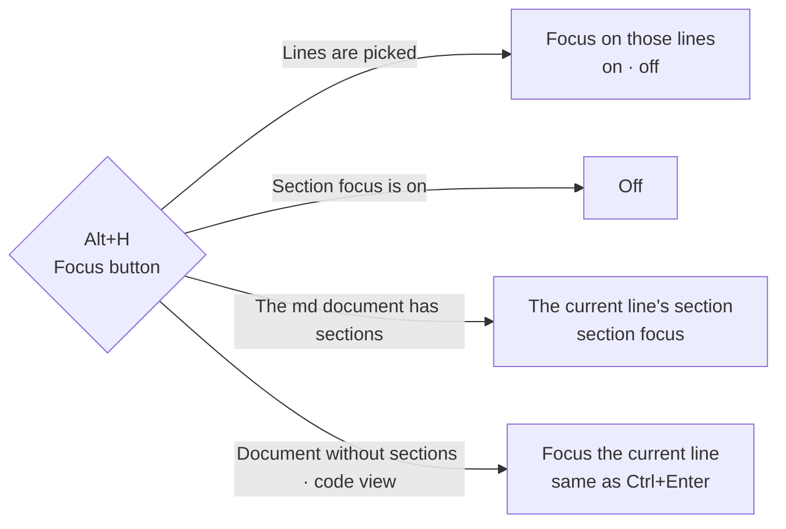

# Folding and focus

> Fold sections to see only the structure, and use section focus or select lines to keep only what you are reading sharp. Neither changes the file.

## Folding sections

Works in md documents. The arrow in the margin left of a heading shows when you hover over the heading.

| What you want to do | Mouse | Key |
|---|---|---|
| Folding · unfolding that section | The arrow left of the heading | **Alt+Enter** on the heading line |
| Folding the section with the current line — if it is already folded, the outer section | — | **Ctrl+Shift+[** |
| Unfolding the section with the current line — if it is already open, the folded subsections inside | — | **Ctrl+Shift+]** |
| Folding · unfolding all headings of the same level | Right-click the body: **Fold all at this level (H2)** · **Unfold all at this level (H2)** | — |
| Folding · unfolding everything | Right-click the body: **Fold all** · **Unfold all** | **Ctrl+Alt+[** · **Ctrl+Alt+]** |
| Folding · unfolding a box | The arrow at the right of the title band | — |
| Opening · closing the front matter (metadata) at the top of a document — closed at first; once opened it stays open through automatic refreshes | Click **Metadata** | — |
| With vi keys on | — | **zc** · **zo** · **za** · **zM** · **zR** |

## Folded sections

| Situation | Behavior |
|---|---|
| Clicking the heading text | Doesn't fold — that line becomes the current line |
| Folding everything | The current line goes to the heading of the section it is in |
| Going inside a folded section with the contents · Find · Search · changes | The section unfolds and shows the place |
| Auto refresh | Stays folded |
| Restarting the app | Everything is unfolded |
| Printing | Folded boxes print in full too |

## Section focus

Keeps only the section with the current line sharp and dims the rest. The sections here are the document's top-level sections — if the only H1 is the document title, each H2 section is one.

| What you want to do | Mouse | Key |
|---|---|---|
| Turning on | **Focus** in the toolbar · right-click the body: **Focus this section** | **Alt+H** |
| Previous · next section | **∧** · **∨** next to the toolbar button | **↑** · **↓** · **PageUp** · **PageDown** |
| To another section | Click a dimmed area | — |
| Turning that section into picked lines | — | **Shift+↑** · **Shift+↓** |
| Turning off | **Focus** in the toolbar · right-click **Clear focus** | **Esc** · **Alt+H** |

If you go somewhere with the contents, Find or Search while it is on, the section there becomes sharp. If you edit a line during section focus, the grey lifts so the text above and below reads normally, and it turns grey again when you finish.

## Select lines — Ctrl+Enter

**Ctrl+Enter** keeps the current line sharp — or the picked lines, if there are any — and dims the rest.

| Situation | Behavior |
|---|---|
| The lines turned on | The same as picked lines — copy · send · delete · move · line kinds work as usual (at once, even on one line) |
| **Shift+↑** · **Shift+↓** | Widen and shrink |
| **↑** · **↓** | Scroll the view without releasing |
| Turning off | **Ctrl+Enter** · **Esc** · a click on a dimmed area — back to the picked lines (or to the current line, if it was one line) |
| Right-clicking a dimmed area | Only **Turn off focus** appears |
| **Ctrl+Enter** inside a cell | Saves and selects that line |
| Opening a cell | A one-line focus is released (section focus stays) |

**Esc** first closes popups, menus and Find, then turns off focus, then releases picked lines.

## What Alt+H does

**Focus** in the toolbar and **Alt+H** do different things depending on the current state.

## Related

| Document | What |
|---|---|
| [Current line and picking](3.1-current-line-and-picking.en.md) | Current line · picked lines · cells |
| [Contents](2.5-contents.en.md) | Going to headings · moving sections |
| [Toolbar](2.1-toolbar.en.md) | Focus button |
