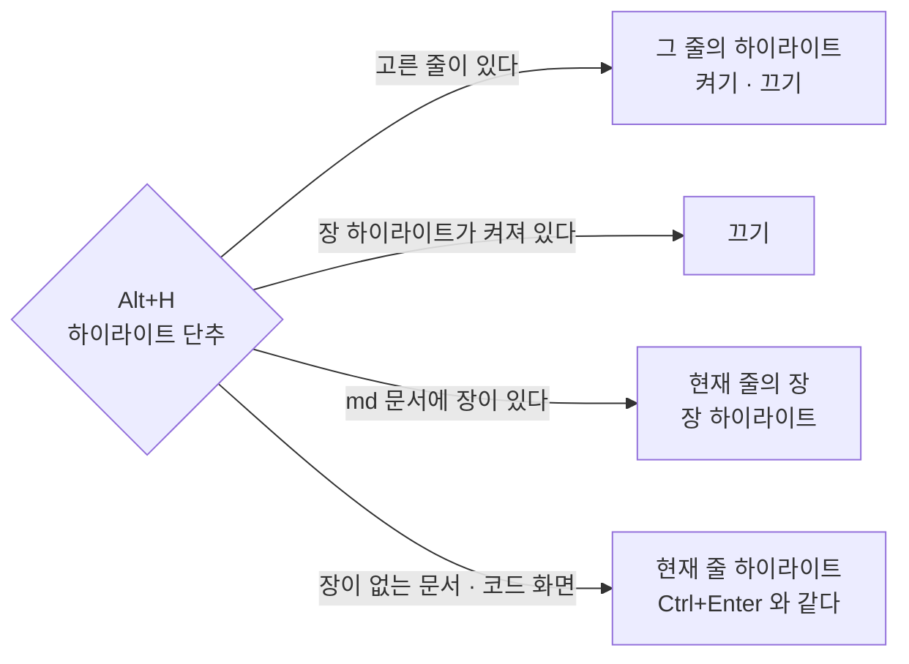

# 접기와 하이라이트

> 절을 접어 구조만 보고, 장 하이라이트나 줄 선택으로 읽는 곳만 또렷하게 한다. 둘 다 파일은 바꾸지 않는다.

## 절 접기

md 문서에서 된다. 제목 왼쪽 여백의 화살표는 제목 위에 마우스를 올리면 보인다.

| 하려는 일 | 마우스 | 키 |
|---|---|---|
| 그 절 접기 · 펴기 | 제목 왼쪽의 화살표 | 제목 줄에서 **Alt+Enter** |
| 현재 줄이 든 절 접기 — 이미 접혔으면 바깥 절 | — | **Ctrl+Shift+[** |
| 현재 줄이 든 절 펴기 — 펴져 있으면 그 안의 접힌 하위 절 | — | **Ctrl+Shift+]** |
| 같은 수준의 제목 모두 접기 · 펴기 | 본문 우클릭 **같은 수준(H2) 모두 접기** · **모두 펴기** | — |
| 모두 접기 · 펴기 | 본문 우클릭 **모두 접기** · **모두 펴기** | **Ctrl+Alt+[** · **Ctrl+Alt+]** |
| 박스글 접기 · 펴기 | 제목 띠 오른쪽의 화살표 | — |
| vi 키를 켰을 때 | — | **zc** · **zo** · **za** · **zM** · **zR** |

## 접힌 절은

| 상황 | 동작 |
|---|---|
| 제목 글자를 누르면 | 접히지 않고 그 줄이 현재 줄이 된다 |
| 모두 접으면 | 현재 줄은 그 줄이 든 절의 제목으로 간다 |
| 목차 · 찾기 · 검색 · 바뀐 곳으로 접힌 절 안에 가면 | 그 절을 펴고 보여 준다 |
| 자동 새로고침 | 접은 채 남는다 |
| 앱을 다시 실행하면 | 모두 펼쳐진다 |
| 인쇄 | 접은 박스글도 모두 나온다 |

## 장 하이라이트

현재 줄이 있는 장만 또렷하게 하고 나머지를 흐리게 한다. 장은 문서의 맨 위 수준 절이다 — H1 이 문서 제목 하나뿐이면 H2 절이 장이다.

| 하려는 일 | 마우스 | 키 |
|---|---|---|
| 켜기 | 툴바 **하이라이트** · 본문 우클릭 **이 장 하이라이트** | **Alt+H** |
| 앞 · 뒤 장 | 툴바 단추 옆 **∧** · **∨** | **↑** · **↓** · **PageUp** · **PageDown** |
| 다른 장으로 | 흐린 곳 누르기 | — |
| 그 장을 고른 줄로 바꾸기 | — | **Shift+↑** · **Shift+↓** |
| 끄기 | 툴바 **하이라이트** · 우클릭 **하이라이트 해제** | **Esc** · **Alt+H** |

켜 둔 채 목차 · 찾기 · 검색으로 가면 그곳의 장이 또렷해진다. 장 하이라이트 중에 한 줄을 고치면 회색이 걷혀 위아래 글이 그대로 보이고, 끝내면 다시 회색이 된다.

## 줄 선택 — Ctrl+Enter

**Ctrl+Enter** 는 현재 줄이면 그 한 줄을, 고른 줄이면 그 줄들을 또렷하게 하고 나머지를 흐리게 한다.

| 상황 | 동작 |
|---|---|
| 켠 줄 | 고른 줄과 같다 — 복사 · 보내기 · 지우기 · 옮기기 · 줄 종류가 그대로 된다 (한 줄이어도 한 번에) |
| **Shift+↑** · **Shift+↓** | 넓히고 줄인다 |
| **↑** · **↓** | 풀지 않고 화면만 스크롤한다 |
| 끄기 | **Ctrl+Enter** · **Esc** · 흐린 곳 누르기 — 고른 줄로(한 줄이면 현재 줄로) 돌아온다 |
| 흐린 곳 우클릭 | **하이라이트 끄기**만 나온다 |
| 칸 안에서 **Ctrl+Enter** | 저장하고 그 줄을 선택한다 |
| 칸을 열면 | 한 줄의 하이라이트는 풀린다 (장 하이라이트는 그대로) |

**Esc** 는 팝업 · 메뉴 · 찾기를 먼저 닫고, 그다음 하이라이트를 끄고, 고른 줄을 푼다.

## Alt+H 가 하는 일

툴바 **하이라이트** 와 **Alt+H** 는 지금 상태에 따라 하는 일이 다르다.

## 관련

| 문서 | 무엇 |
|---|---|
| [현재 줄과 고르기](3.1-현재-줄과-고르기.md) | 현재 줄 · 고른 줄 · 칸 |
| [목차](2.5-목차.md) | 제목으로 가기 · 절 옮기기 |
| [툴바](2.1-툴바.md) | 하이라이트 단추 |
