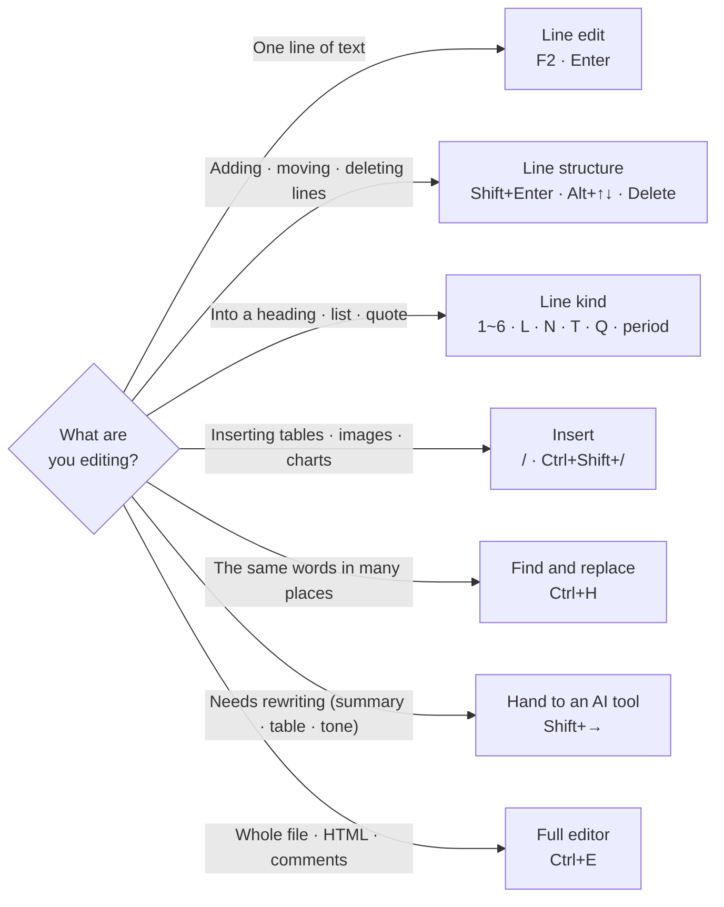

# Choosing how to edit

> The way to edit depends on what you change and how much. Most edits happen right in the reading view — with line edit and line structure.

## How to choose

## Each way

| Way | Key to open | What it changes | Saving | Undo | More |
|---|---|---|---|---|---|
| Line edit | **F2** · **Enter** | One line (one cell in a table) | **Enter** — straight to the source | **Ctrl+Z** | [Line edit](4.2-line-edit.en.md) |
| Line structure | **Shift+Enter** · **Alt+↑**·**Alt+↓** · **Delete** | Adding · splitting · joining · moving · deleting lines | At once | **Ctrl+Z** | [Adding, moving and deleting lines](4.3-adding-moving-deleting-lines.en.md) |
| Line kind · formatting | **1~6** · **L** · **N** · **T** · **Q** · **C** · **.** · **B** · **M** | Headings · lists · to-dos · quotes · callouts · bold · highlight | At once | **Ctrl+Z** | [Line kinds and formatting](4.4-line-kinds-and-formatting.en.md) |
| Insert | **/** (blank line) · **Ctrl+Shift+/** | Tables · images · charts · math · callouts · boxes | At once | **Ctrl+Z** | [Insert](4.5-insert.en.md) |
| Find and replace | **Ctrl+H** | The same words in the document | At once, when replacing | **Ctrl+Z** | [Find and search](3.2-find-and-search.en.md) |
| Full editor | **Ctrl+E** | The whole file — the source as it is | **Ctrl+S** | **Ctrl+Z** inside the editor | [Full editor](4.7-full-editor.en.md) |
| Handing to an AI tool | **Shift+→** (the location to the terminal) | Text that needs rewriting | The AI tool saves — the screen changes at once | **F7** to see the changes | [Sending and requests](7.2-sending-and-requests.en.md) |

## What works where

| File | Line edit · line structure | Full editor | Note |
|---|---|---|---|
| md document | Yes | Yes | — |
| Lectern slides | Yes | Yes | [Lectern slides](5-lectern-slides.en.md) |
| HTML document | No | Yes | Viewed without scripts |
| Code | Yes (code view) | Yes | — |
| CSV · TSV · text | **F2** · **Enter** opens the full editor at that line | Yes — saved in the original encoding | [Code and data files](3.6-code-and-data-files.en.md) |
| Excel · log | No | No | View only |

## Where you can't edit

| Place | Why | Instead |
|---|---|---|
| The sample project · inside the Lectern program folder | Reinstalling overwrites it | Copy the folder elsewhere and open the copy |
| The User guide window · Example guide window | They are windows for viewing | Open it in the main window |
| Documents · code that aren't UTF-8 | Editing would break the characters | View only (data files are edited in their original encoding) |
| Files over 2 MB | The editor gets slow | An external editor |

## Related

| Document | What |
|---|---|
| [When files change](10.2-when-files-change.en.md) | Lectern changes files only when you choose to |
| [Shortcuts](10.1-shortcuts.en.md) | Every key |
