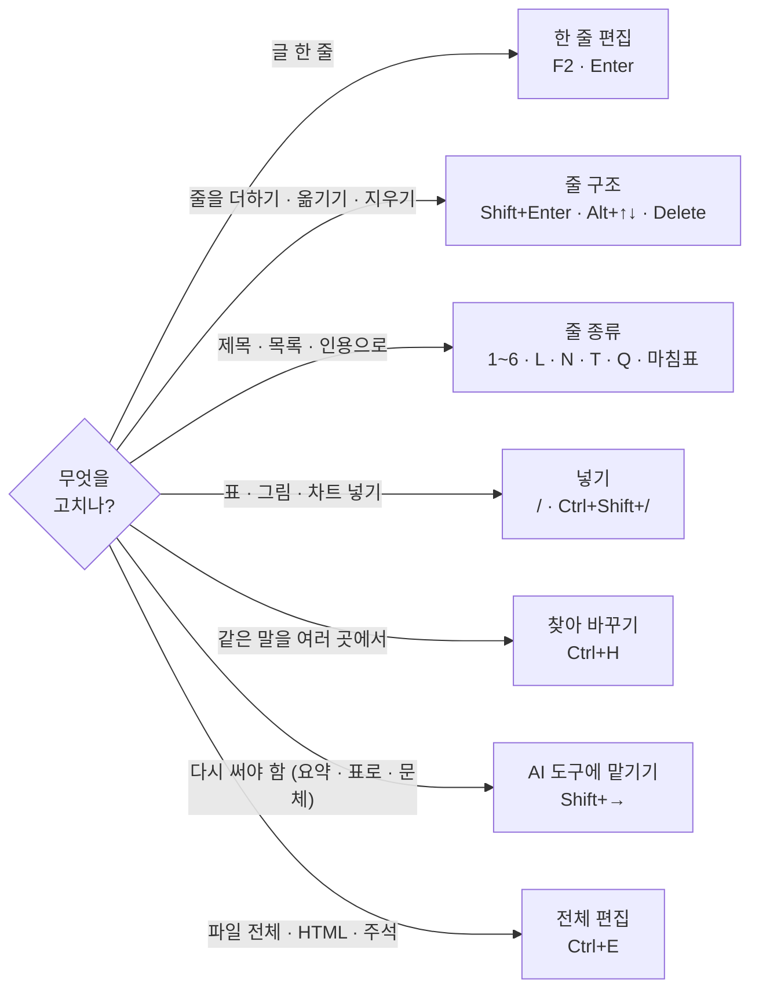

# 고치는 길 고르기

> 무엇을 얼마나 고치는지에 따라 길이 다르다. 대부분은 읽는 화면에서 바로 — 한 줄 편집과 줄 구조로 된다.

## 고르는 흐름

## 길마다

| 길 | 여는 키 | 고치는 범위 | 저장 | 되돌리기 | 자세히 |
|---|---|---|---|---|---|
| 한 줄 편집 | **F2** · **Enter** | 한 줄 (표는 한 칸) | **Enter** — 원문에 바로 | **Ctrl+Z** | [한 줄 편집](4.2-한-줄-편집.md) |
| 줄 구조 | **Shift+Enter** · **Alt+↑**·**Alt+↓** · **Delete** | 줄을 더하기·나누기·합치기·옮기기·지우기 | 바로 | **Ctrl+Z** | [줄 더하기·옮기기·지우기](4.3-줄-더하기-옮기기-지우기.md) |
| 줄 종류 · 서식 | **1~6** · **L** · **N** · **T** · **Q** · **C** · **.** · **B** · **M** | 제목·목록·할 일·인용·강조글 · 굵게·형광펜 | 바로 | **Ctrl+Z** | [줄 종류와 서식](4.4-줄-종류와-서식.md) |
| 넣기 | **/** (빈 줄) · **Ctrl+Shift+/** | 표 · 그림 · 차트 · 수식 · 강조글 · 박스글 | 바로 | **Ctrl+Z** | [넣기](4.5-넣기.md) |
| 찾아 바꾸기 | **Ctrl+H** | 문서 안의 같은 말 | 바꿀 때 바로 | **Ctrl+Z** | [찾기와 검색](3.2-찾기와-검색.md) |
| 전체 편집 | **Ctrl+E** | 파일 전체 — 원문 그대로 | **Ctrl+S** | 편집기 안에서 **Ctrl+Z** | [전체 편집](4.7-전체-편집.md) |
| AI 도구에 맡기기 | **Shift+→** (위치를 터미널로) | 다시 써야 하는 글 | AI 도구가 저장 — 화면이 바로 바뀐다 | **F7** 로 바뀐 곳 보기 | [보내기와 요청 글](7.2-보내기와-요청-글.md) |

## 무엇에서 어떤 길이 되나

| 파일 | 한 줄 편집 · 줄 구조 | 전체 편집 | 메모 |
|---|---|---|---|
| md 문서 | 된다 | 된다 | — |
| Lectern 슬라이드 | 된다 | 된다 | [Lectern 슬라이드](5-Lectern-슬라이드.md) |
| HTML 문서 | 안 된다 | 된다 | 보기는 스크립트 없이 |
| 코드 | 된다 (코드 화면) | 된다 | — |
| CSV · TSV · 텍스트 | **F2** · **Enter** 가 그 줄에서 전체 편집을 연다 | 된다 — 원래 인코딩 그대로 저장 | [코드와 자료 보기](3.6-코드와-자료-보기.md) |
| 엑셀 · 로그 | 안 된다 | 안 된다 | 보기만 |

## 고치지 않는 곳

| 곳 | 까닭 | 대신 |
|---|---|---|
| 예제 프로젝트 · Lectern 프로그램 폴더 안 | 다시 설치하면 덮인다 | 폴더를 다른 곳에 복사해 연다 |
| 사용설명서 창 · 예제 가이드 창 | 보기 창이다 | 메인 창에서 연다 |
| UTF-8 이 아닌 문서·코드 | 고치면 글자가 깨진다 | 보기만 (자료 파일은 원래 인코딩으로 고친다) |
| 2MB 가 넘는 파일 | 편집기가 느려진다 | 외부 편집기 |

## 관련

| 문서 | 무엇 |
|---|---|
| [파일이 바뀌는 경우](10.2-파일이-바뀌는-경우.md) | Lectern 이 파일을 바꾸는 때는 사용자가 고를 때뿐 |
| [단축키](10.1-단축키.md) | 모든 키 |
