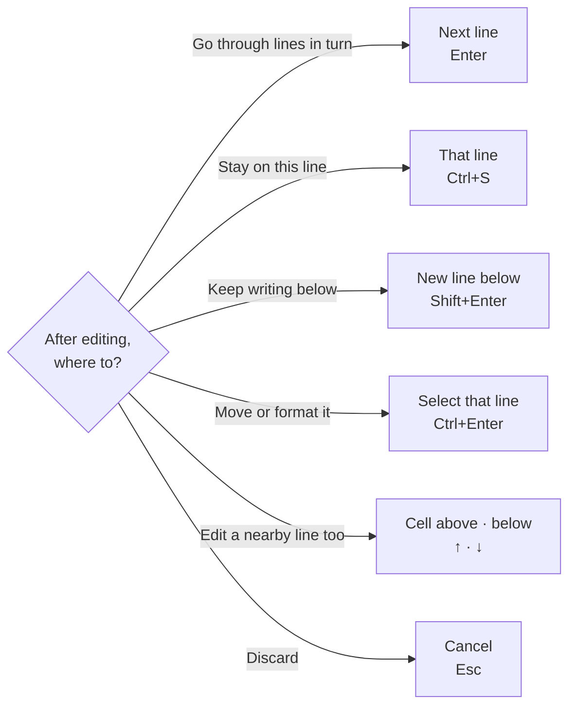

# Line edit

> Press Enter or F2 on the current line and that line opens as a text box (a cell) right where it is on screen. There is no save button — Enter saves straight into the source file.

## At a glance

| To | Mouse | Keys |
|---|---|---|
| Open the current line as a cell | — | **Enter** · **F2** |
| Open with a selected word still selected | Double-click a word to select it, then right-click **Edit here** | **F2** with the word selected |
| Save and close — the current line moves to the next line | — | **Enter** |
| Save and close — the current line stays on that line | — | **Ctrl+S** |
| Save and select that line (focus) | — | **Ctrl+Enter** |
| Save and add a new line below | — | **Shift+Enter** |
| Save and go on editing the line above · below | — | **↑** · **↓** |
| Cancel — drop your change | — | **Esc** |
| Open the full editor at that line | Right-click **Open in the full editor** | **Ctrl+E** |
| Undo · redo | — | **Ctrl+Z** · **Ctrl+Y** |

A double-click only selects a word; it does not open the cell. While several lines are picked, the cell does not open — release them with **Esc** first, then press the key.

## Keys that close the cell

**Enter** does not open the next line — it only moves the current line (on the last line it stays). So **Enter**, **Enter** opens and closes the lines one after another as you go through and fix them.

## What the cell shows

| Line | In the cell |
|---|---|
| Heading · list · callout | Heading size · bullet · inside the callout, as on screen |
| Markers such as `#` · `-` · `>` · `1.` · `[ ]` | Locked — you edit only the text |
| Inline formatting such as bold and links | As source text, like `**bold**` · `[link](url)` — with the look applied too |

A line's kind is not changed in the cell but with keys — [Line kinds and formatting](4.4-line-kinds-and-formatting.en.md).

## When it is saved

| What you do | File |
|---|---|
| Enter in a cell · moving lines · deleting · line kind · level · table rows and columns · checkboxes · pasting an image | Saved the moment you press |
| Clicking outside the cell | Saved only if you changed something |
| New line | Saved when you write in it — the file stays as it is until then |
| **Esc** in a cell | Drops your change |
| Moving the current line · picking lines · focus · folding | Do not change the file |
| Full editor | Saved only when you press **Ctrl+S** — only there |

Lectern slides work the same way. Saving redraws the view and briefly highlights the change. Saving is not announced each time — the 'Modified' time in the status bar changes. The notice at the bottom of the screen appears only for things you may have missed — something deleted, lines outside your pick that changed too (such as the numbers of following items), many places changed at once (find and replace), and something that could not be done, with the reason.

## Undo

| Situation | What happens |
|---|---|
| **Ctrl+Z** | Restores the line as it was before the edit and saves — press again for earlier edits |
| **Ctrl+Y** | Redoes what you undid — editing again after an undo clears the redo |
| After editing another document | Undo is kept per file — go back to the earlier document and undo there |
| The undone line is off screen | Moves to that line and tells you |
| Picked lines · focus | Stay on the lines you undid |

## By block

| Block | Pressing **F2** · **Enter** |
|---|---|
| Paragraph written over several lines | Only that line |
| Code block · code view | That line |
| Table | One cell ('Tables' below) |
| Image | The image's source line |
| Math · diagrams · charts | The source opens in a panel beside the view, line by line — [Insert](4.5-insert.en.md) |
| Front matter (the info at the top of the document) | Right-click **Edit document info** — keys are locked, only values change |
| HTML · comments | **Source lines** in the status bar — [Full editor](4.7-full-editor.en.md) |
| CSV · TSV · text | Edit mode opens at that line |
| Excel · log | View only |
| To-do checkbox | Clicking switches `[ ]` · `[x]` in the source and saves at once (nothing changes in view-only projects) |

## Tables

| To | Keys |
|---|---|
| Open the first cell | **F2** on a row |
| Open that cell | Double-click a word in the cell to select it, then **F2** |
| Next cell · previous cell | **Tab** · **Shift+Tab** — Tab in the last cell goes to the first cell of the next row, Shift+Tab in the first cell to the last cell of the row above |
| Same cell in the row above · below | **↑** · **↓** |

Tab alone fills a table row by row. A `|` typed into a cell is saved as `\|`, so the cell is not split.

## Inside the cell

| Situation | What happens |
|---|---|
| The text wraps over several lines on screen | **↑** · **↓** move inside it first, one screen line at a time (also from the start of a screen line, and when pressed quickly), and go to the next line from the top or bottom screen line |
| **↓** on the last line | Stops — a new line is **Shift+Enter** |
| App keys such as **F1** · **Ctrl+/** · **Ctrl+W** · **Ctrl+Tab** · **Alt+1~9** · **Ctrl+P** | Save and close the cell, then do their job |
| Sending the line to an AI tool (Claude Code and others) | Close with **Enter** (or **Esc**) and press **Shift+→** |
| When the cell opens | The change band and a one-line focus are released |
| During section focus | The grey lifts so the text above and below shows, and comes back when you finish |

## Files that are not edited

Files that are not UTF-8 are view only. Files written in a Windows encoding, such as EViews programs (`prg`), show Korean text in the code view and in search, but line edit and edit mode do not change them. A `prg` written only in English can be edited; adding Korean to it is not saved, because the file would turn into UTF-8 and EViews would show broken characters. HTML documents and view-only projects have no line edit.

## Related

| Document | What |
|---|---|
| [Choosing how to edit](4.1-choosing-how-to-edit.en.md) | Which way to go when line edit is not enough |
| [Adding, moving and deleting lines](4.3-adding-moving-deleting-lines.en.md) | Adding, splitting and moving lines from the cell |
| [Line kinds and formatting](4.4-line-kinds-and-formatting.en.md) | Turning lines into headings or lists, bold · highlight |
| [Current line and picking](3.1-current-line-and-picking.en.md) | Current line · picked lines · focus |
