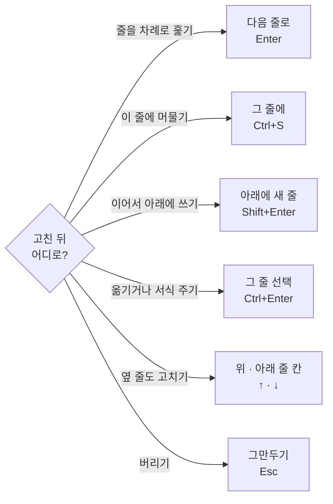

# 한 줄 편집

> 현재 줄에서 Enter 나 F2 를 누르면 그 줄이 화면의 그 자리에서 글 칸으로 열린다. 저장 단추는 없다 — Enter 를 누르면 원문 파일에 바로 저장된다.

## 한눈에

| 하려는 일 | 마우스 | 키 |
|---|---|---|
| 현재 줄을 칸으로 열기 | — | **Enter** · **F2** |
| 고른 낱말을 고른 채 열기 | 낱말을 두 번 눌러 고르고 우클릭 **여기서 편집** | 낱말을 고른 채 **F2** |
| 저장하고 닫기 — 현재 줄은 다음 줄로 | — | **Enter** |
| 저장하고 닫기 — 현재 줄은 그 줄 | — | **Ctrl+S** |
| 저장하고 그 줄 선택 (하이라이트) | — | **Ctrl+Enter** |
| 저장하고 아래에 새 줄 | — | **Shift+Enter** |
| 저장하고 위 · 아래 줄을 이어 고치기 | — | **↑** · **↓** |
| 그만두기 — 고친 것을 버린다 | — | **Esc** |
| 그 줄에서 전체 편집기 열기 | 우클릭 **전체 편집으로 열기** | **Ctrl+E** |
| 되돌리기 · 다시 하기 | — | **Ctrl+Z** · **Ctrl+Y** |

두 번 누르기는 낱말을 고를 뿐 칸을 열지 않는다. 여러 줄을 고른 동안에는 칸이 열리지 않는다 — **Esc** 로 풀고 누른다.

## 칸을 닫는 키

**Enter** 는 다음 줄을 열지 않는다 — 현재 줄만 옮긴다 (마지막 줄이면 그대로). 그래서 **Enter** · **Enter** 로 줄을 열고 닫으며 훑어 고친다.

## 칸에서 보이는 것

| 줄 | 칸의 모양 |
|---|---|
| 제목 · 목록 · 강조글 | 제목 크기 · 글머리표 · 강조글 안 그대로 |
| `#` · `-` · `>` · `1.` · `[ ]` 같은 표시 | 잠겨 있다 — 글만 고친다 |
| 굵게 · 링크 같은 문장 속 서식 | `**굵게**` · `[링크](주소)` 처럼 원문 글자로 — 모양도 입혀 보인다 |

줄의 종류는 칸에서 고치지 않고 키로 바꾼다 — [줄 종류와 서식](4.4-줄-종류와-서식.md).

## 언제 저장되나

| 하는 일 | 파일에 |
|---|---|
| 칸의 Enter · 줄 옮기기 · 지우기 · 줄 종류 · 레벨 · 표의 행과 열 · 체크 칸 · 그림 붙여 넣기 | 누르는 순간 저장 |
| 칸 밖 누르기 | 고친 것이 있을 때만 저장 |
| 새 줄 | 글을 쓸 때 저장 — 쓰기 전에는 파일이 그대로 |
| 칸의 **Esc** | 고친 것을 버린다 |
| 현재 줄 옮기기 · 줄 고르기 · 하이라이트 · 접기 | 파일을 바꾸지 않는다 |
| 전체 편집 | **Ctrl+S** 를 눌러야 저장 — 그 길만 |

Lectern 슬라이드도 같다. 저장하면 화면이 다시 그려지고 바뀐 곳이 잠깐 강조된다. 저장할 때마다 알리지는 않는다 — 상태줄의 '수정' 시각이 바뀐다. 화면 아래 알림은 보지 못했을 수 있는 것만 띄운다 — 지운 것, 고른 줄 밖이 함께 바뀐 것(뒤 항목의 번호 같은), 여러 곳을 한 번에 바꾼 것(찾아 바꾸기), 되지 않은 일과 그 까닭.

## 되돌리기

| 상황 | 동작 |
|---|---|
| **Ctrl+Z** | 그 줄을 고치기 전으로 되돌려 저장 — 거듭 누르면 그 앞 것도 |
| **Ctrl+Y** | 되돌린 것을 다시 — 되돌린 뒤 새로 고치면 다시 하기는 없어진다 |
| 다른 문서를 고친 뒤 | 되돌리기는 파일마다 따로 — 앞 문서로 돌아가 되돌린다 |
| 되돌린 줄이 화면 밖 | 그 줄로 옮겨 가며 알린다 |
| 고른 줄 · 하이라이트 | 되돌린 줄들에 그대로 남는다 |

## 블록마다

| 블록 | **F2** · **Enter** 를 누르면 |
|---|---|
| 여러 줄로 나눠 쓴 문단 | 그 줄만 |
| 코드 블록 · 코드 화면 | 그 줄 |
| 표 | 칸 하나 (아래 '표') |
| 그림 | 그림의 원문 줄 |
| 수식 · 다이어그램 · 차트 | 화면 옆 패널에 원문을 펼쳐 줄마다 — [넣기](4.5-넣기.md) |
| 머리 설정 (문서 맨 위의 정보) | 우클릭 **문서 정보 고치기** — 키는 잠그고 값만 |
| HTML · 주석 | 상태줄 **원문 줄 보기** — [전체 편집](4.7-전체-편집.md) |
| CSV · TSV · 텍스트 | 그 줄에서 편집 모드가 열린다 |
| 엑셀 · 로그 | 보기만 |
| 할 일의 체크 칸 | 누르면 원문의 `[ ]` · `[x]` 가 바뀌어 바로 저장 (보기만 하는 프로젝트에서는 바뀌지 않는다) |

## 표

| 하려는 일 | 키 |
|---|---|
| 첫 칸 열기 | 행에서 **F2** |
| 그 칸 열기 | 칸의 낱말을 두 번 눌러 고르고 **F2** |
| 옆 칸 · 앞 칸 | **Tab** · **Shift+Tab** — 끝 칸의 Tab 은 다음 행 첫 칸, 첫 칸의 Shift+Tab 은 앞 행 끝 칸 |
| 위 · 아래 행의 같은 칸 | **↑** · **↓** |

Tab 만으로 표를 줄줄이 채운다. 칸 글에 쓴 `|` 는 `\|` 로 저장되어 칸이 나뉘지 않는다.

## 칸 안에서

| 상황 | 동작 |
|---|---|
| 글이 화면에서 여러 줄로 꺾임 | **↑** · **↓** 는 먼저 그 안에서 움직이고, 맨 윗줄 · 맨 아랫줄에서 옆 줄로 |
| 마지막 줄에서 **↓** | 멈춘다 — 새 줄은 **Shift+Enter** |
| **F1** · **Ctrl+/** · **Ctrl+W** · **Ctrl+Tab** · **Alt+1~9** · **Ctrl+P** 같은 앱 키 | 칸을 저장하고 닫은 뒤 그 일을 한다 |
| 그 줄을 AI 도구(Claude Code 등)에 보내기 | **Enter** (또는 **Esc**) 로 닫고 **Shift+→** |
| 칸을 열 때 | 바꾸기 띠와 한 줄의 하이라이트가 풀린다 |
| 장 하이라이트 중 | 회색이 걷혀 위아래 글이 보이고, 끝내면 다시 회색 |

## 고치지 않는 파일

UTF-8 이 아닌 파일은 볼 수만 있다. EViews 프로그램(`prg`)처럼 Windows 인코딩으로 쓴 파일은 코드 화면 · 검색에서 한글이 보이지만 한 줄 편집 · 편집 모드로 고치지 않는다. 글이 모두 영문인 `prg` 는 고칠 수 있고, 한글을 넣으면 파일이 UTF-8 로 바뀌어 EViews 에서 깨지므로 저장하지 않는다. HTML 문서와 보기만 하는 프로젝트에서는 한 줄 편집을 하지 않는다.

## 관련

| 문서 | 무엇 |
|---|---|
| [고치는 길 고르기](4.1-고치는-길-고르기.md) | 한 줄 편집으로 안 될 때 어느 길로 |
| [줄 더하기·옮기기·지우기](4.3-줄-더하기-옮기기-지우기.md) | 칸에서 줄을 더하고 나누고 옮기기 |
| [줄 종류와 서식](4.4-줄-종류와-서식.md) | 제목 · 목록으로 바꾸기, 굵게 · 형광펜 |
| [현재 줄과 고르기](3.1-현재-줄과-고르기.md) | 현재 줄 · 고른 줄 · 하이라이트 |
