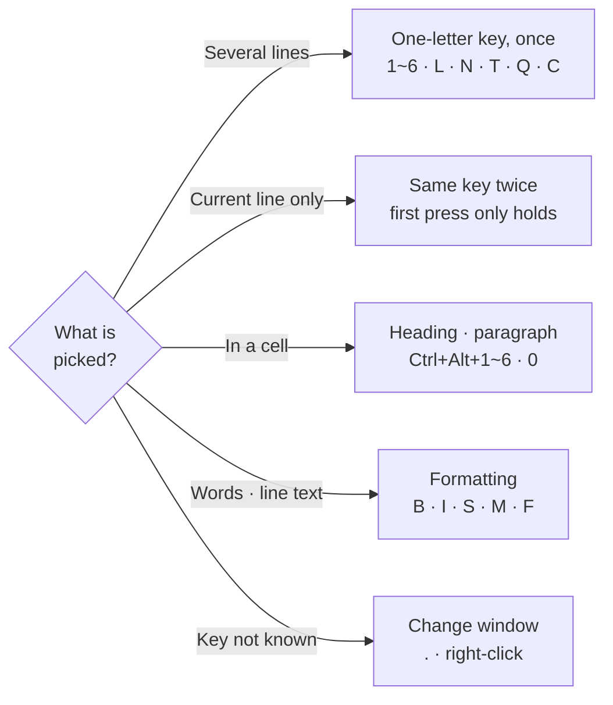

# Line kinds and formatting

> Turn lines into headings, lists, quotes and callouts, and give text bold, highlight and text color. Markers such as `#`·`-`·`>` are locked, so you change them with keys and the Change window.

## Which key to use

## Line kind keys

| Key | Becomes | Pressed again |
|---|---|---|
| **1~6** | Heading 1–6 | Paragraph |
| **0** · **P** | Paragraph | — |
| **H** | Heading levels in turn — heading 2 → 3 → 1 → paragraph | Next level |
| **L** · **-** | List | Paragraph |
| **N** | Numbered list | Paragraph |
| **T** | To-do | List |
| **Q** | Quote | Paragraph — leaves the quote |
| **C** | Callout | Next kind — note → tip → important → warning → caution |
| **Ctrl+Alt+1~6** · **Ctrl+Alt+0** | Heading · paragraph in a cell · on picked lines | The same level makes a paragraph |

On the current line alone, press the same key twice — the first press only holds the line ([Two presses on the current line](4.3-adding-moving-deleting-lines.en.md#two-presses-on-the-current-line)). They work without switching the keyboard between Korean and English input, and they are the same keys as in Lectern mobile. With several lines picked, they change them all at once — **L** on several paragraphs makes one list, **C** one callout. The lines stay picked afterwards, so you can go on changing the level with **Tab**. With vi keys on, numbers on picked lines are counts, so use **H** or **Ctrl+Alt+1~6**.

## Levels

| Keys | Lines | Moved along |
|---|---|---|
| **Alt+Shift+←** · **Alt+Shift+→** | Headings · lists | Headings take their subsections, lists their sub-items |
| **Tab** · **Shift+Tab** | Lists | Sub-items too — headings are not changed (pressing it tells you the keys) |
| Number keys · vi keys `>>` · `<<` | Headings | Only that line's level |
| Pick several lines and use the keys above | From the top down | Sub-items · subsection headings already moved along with a line above are not moved again |

## Neighbors that change along

| Line you change | Neighbors |
|---|---|
| A line of a numbered list to a paragraph · heading · another list | The following items' numbers continue from the item before (left as is if all are `1.`) |
| To a list — with a list of the same kind right above · below | Joins it — with its marker and the next number (a to-do joins a bullet list too). Between list items (**N** · **L** · **T**) the indentation is kept |
| An item with sub-items to a heading · paragraph | The sub-items move up into its place — turning only a sub-item into a paragraph makes a paragraph inside the parent item |
| Lines in a callout · quote | Change inside it (the callout's head line stays). Lines picked both inside and outside are not changed |

Neighbors are changed only when the meaning would break. Caption lines (`Table 1. …`) keep their kind. If lines outside your pick change too, you are told — 'Also moved 2 subsection headings', 'Renumbered 3 following items', '1 link still points to a heading that is gone'. One **Ctrl+Z** undoes it all.

## Change window

Outside a cell, press **.** (period) on the current line or picked lines, or right-click **Change this line…** · **Change picked lines…**. Tables, callouts and code blocks are not in the right-click menu, so open it with **.** there. It is the same board as the Insert window, and the current kind is marked 'current'. The first column holds what fits this line, and the columns after it are text, callouts and whole-line formatting. Each item shows its key; items that cannot be done are dimmed, and clicking one tells you why.

| Line | For this line | Rules |
|---|---|---|
| List | **Whole list to numbers** (to bullets · to to-dos) · **List to table** | One table row per item — cells split at a tab · ' — ' · ': ', and the header row is 'Item · Value'. Lists with sub-items are not converted |
| Table | **Table to list** · **Turn this table into a chart** | One list item per body row, cells joined with ' — ', header row left out (asks whether to remove the caption). For a chart, the first column is the items and the next columns the values |
| Callout · code block | **Remove callout** · **Unwrap code** | The text stays as it is, markers and all |
| Callout · box | **Change to a box** · **Change to a callout** (for a box, also **Unwrap box**) | Only the markers change, the text stays — a new box gets a `Box n. Title` line at the top, and a new callout gets the box title as a bold first line without the number (left out when it is only the placeholder 'Title'). Callouts inside a box, callouts with a heading and boxes with a callout inside are not changed. Slides have no boxes |
| Lines that are not a table or code block | **Wrap as code** | The text stays as it is, markers and all |
| Any line | **Ask to rewrite** | Sends changes that need rewriting, such as 'make these three paragraphs a table', to an AI tool (Claude Code and others) — a request with the line location goes into the terminal. Write after 'New form:' at the end and press Enter yourself |

## Formatting

| Format | Selected text · picked lines | In a cell | Source |
|---|---|---|---|
| Bold | **B** · **Ctrl+B** | **Ctrl+B** | `**text**` |
| Italic | **I** · **Ctrl+I** | **Ctrl+I** | `*text*` |
| Strikethrough | **S** · **Ctrl+Shift+X** | **Ctrl+Shift+X** | `~~text~~` |
| Code | — | **Ctrl+\`** | `` `text` `` |
| Highlight | **M** · **Ctrl+Shift+H** | **Ctrl+Shift+H** | `<mark>text</mark>` |
| Text color | **F** · **Ctrl+Shift+C** | **Ctrl+Shift+C** | `text` |

| Situation | What happens |
|---|---|
| The same key again | Removes bold · italic · strikethrough · code |
| Highlight · text color again | Next color — highlight yellow → green → pink → sky blue, text color red → blue → green → yellow; after the last, it comes off |
| Current line with nothing selected | **B** · **I** · **S** · **M** · **F** do nothing, even pressed twice (**Ctrl+B** is the sidebar) |
| On a whole line | Select it with a triple-click or **Ctrl+Enter**, then press the key — list and heading markers stay and only the text is wrapped |
| In a cell, nothing selected | The cursor goes between empty markers — if it is already inside that format, the format is removed |
| The moment you press | Saved and shown in that look. The selection stays. **Ctrl+Z** undoes it |

**H** and **C** are line kind keys, so highlight and text color are **M** and **F**. Don't hold Shift. These are the only colors, in a shade that suits the style, so they read in dark styles too, and they carry over to PDF, print and pptx conversion. Formatting shows inside the cell too — the characters stay as the source, markers such as `**` and `<mark>` are dimmed, and italic alone shows as a wavy underline (it is slanted once saved). It works in table cells too.

## Selecting words

| To | Mouse | Keys |
|---|---|---|
| Select a word | Double-click | **→** on the current line (first word) · **←** (last word) |
| To the next word | — | **→** · **←** with a selection |
| Extend · shrink | Drag to select | **Shift+→** · **Shift+←** with a selection |
| To the first · last word | — | **Home** · **End** with a selection (with Shift, extends) |

**Esc** · **↑** · **↓** clear it (↑ · ↓ also move the current line). Words are split at spaces, and moving stays within one source line — **→** on the last word does not go on to the next line. While something is selected, **Shift+→** extends it (to send to the terminal, clear it with **Esc** first). Text over several lines, text across table cells, a selection from the middle of a format to outside it, and lines with math or footnotes are not formatted, and you are told — pick the lines and format whole lines, or open the cell with **F2** and do it there.

## Right-click

| Where | Items | What it does |
|---|---|---|
| Selected text | Copy selected text (the ▣ terminal button beside it) · formats and colors · **Clear formatting** · **Edit here** · Clip selected text · Send selected text… · Send to new note · **Menu for this block…** at the bottom | Acts on that text — choosing the same color again removes the color |
| Selected text inside a highlight | **Add a note** · **Remove this highlight** | [Highlights, notes and clip](3.5-highlights-notes-clip.en.md) |
| In a cell | Formats and colors · link · footnote · **Clear formatting** | Acts on the selected text, or if there is none, on the whole text of the line — the selection stays |

## Pasting

| What you paste | Result |
|---|---|
| Several lines | Split into separate lines — items in a list. One undo |
| An Excel range | A table |
| An image | A new file in the `<name>-images` folder next to the document — [Insert](4.5-insert.en.md#images) |

## Related

| Document | What |
|---|---|
| [Adding, moving and deleting lines](4.3-adding-moving-deleting-lines.en.md) | The two-press rule on the current line |
| [Insert](4.5-insert.en.md) | Inserting new tables · callouts · boxes |
| [Numbers, references, contents and styles](4.6-numbers-references-contents-styles.en.md) | Heading numbers and heading shape |
