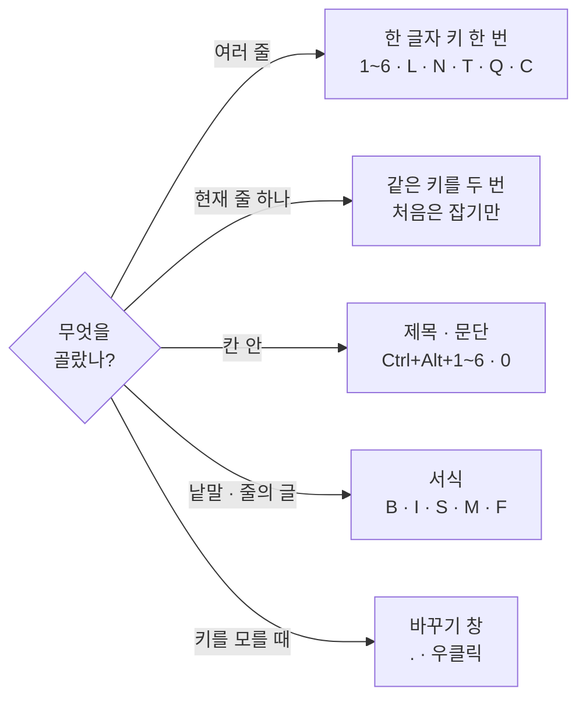

# 줄 종류와 서식

> 줄을 제목·목록·인용·강조글로 바꾸고, 글에 굵게·형광펜·글자색을 준다. `#`·`-`·`>` 같은 표시는 잠겨 있으니 키와 바꾸기 창으로 바꾼다.

## 어느 키를 쓰나

## 줄 종류 키

| 키 | 바뀌는 것 | 다시 누르면 |
|---|---|---|
| **1~6** | 제목 1~6 | 문단 |
| **0** · **P** | 문단 | — |
| **H** | 제목 수준을 차례로 — 제목 2 → 3 → 1 → 문단 | 다음 수준 |
| **L** · **-** | 목록 | 문단 |
| **N** | 번호 목록 | 문단 |
| **T** | 할 일 | 목록 |
| **Q** | 인용 | 문단 — 인용 밖으로 나온다 |
| **C** | 강조글 | 다음 종류 — 참고 → 팁 → 중요 → 경고 → 주의 |
| **Ctrl+Alt+1~6** · **Ctrl+Alt+0** | 칸 안 · 고른 줄에서 제목 · 문단 | 같은 수준이면 문단 |

현재 줄 하나면 같은 키를 두 번 누른다 — 처음은 그 줄을 잡기만 한다 ([현재 줄에서는 두 번](4.3-줄-더하기-옮기기-지우기.md#현재-줄에서는-두-번)). 한/영을 바꾸지 않아도 되고 Lectern 모바일과 같은 키다. 여러 줄을 고르면 한 번에 바꾼다 — 문단 여럿에 **L** 은 목록 하나, **C** 는 강조글 하나가 된다. 바꾼 뒤에도 고른 채 남아 **Tab** 으로 레벨을 이어 바꾼다. vi 키를 켜면 고른 줄의 숫자는 횟수라서 **H** 나 **Ctrl+Alt+1~6** 을 쓴다.

## 레벨

| 키 | 줄 | 함께 옮기는 것 |
|---|---|---|
| **Alt+Shift+←** · **Alt+Shift+→** | 제목 · 목록 | 제목은 하위 절까지, 목록은 하위 항목까지 |
| **Tab** · **Shift+Tab** | 목록 | 하위 항목까지 — 제목은 바꾸지 않는다 (누르면 키를 알려 준다) |
| 숫자 키 · vi 키 `>>` · `<<` | 제목 | 그 줄의 수준만 |
| 여러 줄을 고르고 위의 키 | 위에서부터 | 앞 줄과 함께 옮겨진 하위 항목 · 하위 절 제목은 다시 옮기지 않는다 |

## 이웃이 따라 바뀌는 것

| 바꾸는 줄 | 이웃 |
|---|---|
| 번호 목록의 줄을 문단 · 제목 · 다른 목록으로 | 뒤 항목의 번호를 앞 항목에 잇는다 (모두 `1.` 이면 그대로) |
| 목록으로 — 바로 위 · 아래가 같은 종류 목록 | 거기에 붙는다 — 그 표시와 다음 번호로 (할 일은 글머리 목록에도). 목록 항목끼리(**N** · **L** · **T**)는 들여쓰기를 지킨다 |
| 하위가 있는 항목을 제목 · 문단으로 | 하위 항목이 그 자리로 올라온다 — 하위 항목만 문단으로 하면 부모 항목 안의 문단 |
| 강조글 · 인용 안의 줄 | 안에서 바뀐다 (강조글의 머리 줄은 그대로). 안과 밖의 줄을 함께 고르면 바꾸지 않는다 |

이웃은 뜻이 깨질 때만 고친다. 캡션 줄(`표 1. …`)은 종류를 바꾸지 않는다. 고른 줄 밖이 함께 바뀌면 알린다 — '하위 절 제목 2개도 함께 옮겼습니다', '뒤 항목 3개의 번호를 다시 매겼습니다', '없어진 제목을 가리키는 링크 1곳이 남았습니다'. **Ctrl+Z** 한 번으로 모두 되돌린다.

## 바꾸기 창

칸 밖의 현재 줄 · 고른 줄에서 **.**(마침표), 또는 우클릭 **이 줄 바꾸기…** · **고른 줄 바꾸기…**. 표 · 강조글 · 코드 블록은 우클릭 메뉴에 없으니 **.** 으로 연다. 넣기 창과 같은 판이고 지금 종류에 '지금' 표시가 있다. 맨 앞 열은 이 줄에 맞는 것, 그 뒤 열은 글 · 강조글 · 줄 전체의 서식이다. 항목 옆에 키가 보이고, 바꿀 수 없는 것은 흐리며 누르면 까닭을 알린다.

| 줄 | 이 줄에 맞는 것 | 규칙 |
|---|---|---|
| 목록 | **이 목록 전체를 번호 목록으로** (글머리 목록으로 · 할 일로) · **목록을 표로** | 표는 항목마다 한 행 — 탭 · ' — ' · ': ' 에서 칸을 나누고 머리행은 '항목 · 값'. 하위 항목이 있으면 바꾸지 않는다 |
| 표 | **표를 목록으로** · **이 표를 차트로** | 목록은 본문 행마다 한 항목, 칸을 ' — ' 로 잇고 머리행은 뺀다 (캡션은 지울지 묻는다). 차트는 첫 열이 항목, 다음 열들이 값 |
| 강조글 · 코드 블록 | **강조글 풀기** · **코드 풀기** | 글은 표시까지 그대로 |
| 표 · 코드 블록이 아닌 줄 | **코드로 감싸기** | 글은 표시까지 그대로 |
| 모든 줄 | **바꿔 쓰기 요청** | '이 문단 셋을 표로' 처럼 다시 써야 하는 바꾸기를 AI 도구(Claude Code 등)에 — 줄 위치를 담은 요청 글이 터미널에 들어간다. 끝의 '바꿀 모양:' 뒤에 적고 Enter 는 직접 |

## 서식

| 서식 | 고른 글 · 고른 줄 | 칸 안 | 원문 |
|---|---|---|---|
| 굵게 | **B** · **Ctrl+B** | **Ctrl+B** | `**글**` |
| 기울임 | **I** · **Ctrl+I** | **Ctrl+I** | `*글*` |
| 취소선 | **S** · **Ctrl+Shift+X** | **Ctrl+Shift+X** | `~~글~~` |
| 코드 | — | **Ctrl+\`** | `` `글` `` |
| 형광펜 | **M** · **Ctrl+Shift+H** | **Ctrl+Shift+H** | `<mark>글</mark>` |
| 글자색 | **F** · **Ctrl+Shift+C** | **Ctrl+Shift+C** | `글` |

| 상황 | 동작 |
|---|---|
| 같은 키를 다시 | 굵게 · 기울임 · 취소선 · 코드는 푼다 |
| 형광펜 · 글자색을 거듭 | 다음 색 — 형광펜 노랑 → 초록 → 분홍 → 하늘, 글자색 빨강 → 파랑 → 초록 → 노랑, 마지막 다음은 풀림 |
| 아무것도 고르지 않은 현재 줄 | **B** · **I** · **S** · **M** · **F** 는 두 번 눌러도 하지 않는다 (**Ctrl+B** 는 사이드바) |
| 한 줄 통째에 | 세 번 누르기나 **Ctrl+Enter** 로 고르고 키 — 목록 · 제목의 표시는 두고 글만 감싼다 |
| 칸 안, 고른 글이 없음 | 빈 표시 사이에 커서 — 이미 그 서식 안이면 푼다 |
| 누르는 순간 | 저장되고 그 모양으로 보인다. 고른 글은 남는다. **Ctrl+Z** 로 되돌린다 |

**H** · **C** 는 줄 종류 키라서 형광펜 · 글자색은 **M** · **F** 다. Shift 는 누르지 않는다. 색은 이 몇 가지뿐이고 스타일에 맞는 농도라 어두운 스타일에서도 읽히며, PDF · 인쇄와 pptx 전환에도 그대로 나온다. 칸 안에서도 서식이 보인다 — 글자는 원문 그대로, `**` · `<mark>` 같은 표시는 흐리고, 기울임만은 물결 밑줄이다 (저장하면 기울어진다). 표의 칸에서도 된다.

## 낱말 고르기

| 하려는 일 | 마우스 | 키 |
|---|---|---|
| 낱말 고르기 | 두 번 누르기 | 현재 줄에서 **→** (첫 낱말) · **←** (마지막 낱말) |
| 옆 낱말로 | — | 고른 채 **→** · **←** |
| 넓히기 · 줄이기 | 끌어 고르기 | 고른 채 **Shift+→** · **Shift+←** |
| 첫 · 마지막 낱말까지 | — | 고른 채 **Home** · **End** (Shift 와 함께면 넓힌다) |

**Esc** · **↑** · **↓** 로 푼다 (↑ · ↓ 는 현재 줄도 옮긴다). 낱말은 띄어쓰기로 나누고 원문 한 줄 안에서만 움직인다 — 끝 낱말에서 **→** 는 다음 줄로 넘어가지 않는다. 고른 동안 **Shift+→** 는 넓히기다 (터미널로 보내려면 **Esc** 로 풀고). 여러 줄에 걸친 글, 표의 칸을 넘는 글, 서식의 가운데부터 밖까지 고른 글, 수식 · 각주가 든 줄에는 서식을 주지 않고 알린다 — 줄을 골라 줄 전체에 하거나 **F2** 로 열어 칸 안에서 한다.

## 우클릭

| 우클릭 위치 | 항목 | 하는 일 |
|---|---|---|
| 고른 글 | 고른 글 복사 (옆의 ▣ 터미널) · 서식과 색 · **서식 풀기** · **여기서 편집** · 담기 · 문서로 보내기 · 새 메모로 보내기 · 맨 아래 **이 블록의 메뉴…** | 그 글에 — 같은 색을 다시 고르면 색을 걷는다 |
| 형광펜 안의 고른 글 | **메모 달기** · **이 형광펜 지우기** | [형광펜·메모·담기](3.5-형광펜-메모-담기.md) |
| 칸 안 | 서식과 색 · 링크 · 주 · **서식 풀기** | 고른 글에, 없으면 그 줄의 글 통째에 — 고른 글이 남는다 |

## 붙여 넣기

| 붙여 넣는 것 | 결과 |
|---|---|
| 여러 줄 | 줄마다 나눠 넣는다 — 목록에서는 항목. 되돌리기 한 번 |
| 엑셀 범위 | 표 |
| 그림 | 문서 옆 `문서이름-그림` 폴더에 새 파일 — [넣기](4.5-넣기.md#그림) |

## 관련

| 문서 | 무엇 |
|---|---|
| [줄 더하기·옮기기·지우기](4.3-줄-더하기-옮기기-지우기.md) | 현재 줄에서 두 번 누르는 규칙 |
| [넣기](4.5-넣기.md) | 표 · 강조글 · 박스글을 새로 넣기 |
| [번호·참조·목차·스타일](4.6-번호-참조-목차-스타일.md) | 제목 번호와 머리글 모양 |
