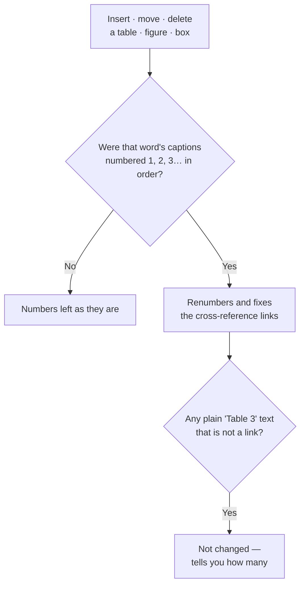

# Numbers, references, contents and styles

> Caption numbers, cross-references, numbered lists and heading numbers fix themselves as you add, move and delete. Contents lines and md document styles set the look of the document.

## Numbers that follow along

| Numbers | When | Fixed along | Left as is |
|---|---|---|---|
| Numbered lists | Adding · moving · deleting · changing the kind of items | The numbers of the following items | Lists written with `1.` throughout |
| Heading numbers | Adding · moving · deleting headings in a document that numbers them | Section links within this document | Sections such as `References` · `Appendix` · `Attachments` · `Summary` |
| Caption numbers | Inserting · moving · deleting tables · figures · boxes | The cross-reference links that point to them | See the flowchart below |

It is all one save, so one **Ctrl+Z** brings the numbers back too. Heading numbers are locked in the cell. If lines outside your pick change too, you are told — 'Renumbered 3 following items', 'Renumbered 4 headings'.

Plain text like 'Table 3' that is not a link may point to another document, so it is not changed — find and check it with **Ctrl+F**. A single caption number you changed by hand is also left alone.

## Captions

| Source | What |
|---|---|
| `Table 1. Title` | Table caption — right above the table |
| `Figure 1. Title` | Figure caption — right below the image |
| `Box 1. Title` | A box's title — the first line of the box |
| `Figure 2: Title` · `**Table 3.** Title` · `<Table 4> Title` | Counted as the same captions |
| `표 1.` · `그림 1.` · `박스 1.` | Korean captions |
| `Table 2-1` · `Table 2.1` | Captions with a chapter number — numbered by hand, so they are not touched |

Numbers are counted separately for each word (Table · Figure · Box). Inserting a table or an image from the Insert window adds its caption with the next number ([Insert](4.5-insert.en.md)).

## Cross-references

| To | How | Result |
|---|---|---|
| Point to a table · figure · box · section | **Cross-reference** in the Insert window — pick a caption or section | A link like `[Table 3](#table-3)` |
| In the middle of a sentence | **Ctrl+Shift+/** in a cell → **Cross-reference** | At the cursor |
| Go there | Click the link | To that caption · section — **Alt+←** comes back |

## Citations

| To | How | Result |
|---|---|---|
| Insert a citation | **Citation** in the Insert window — pick from the list in the `## References` (or `## 참고문헌`) section | `(Kim, 2026)` |
| See citation counts | The same window | How many times each source is cited in the body, and how many sources are not cited yet |
| Match a style such as APA | Ask an AI tool (Claude Code and others) | — |

## Contents lines

| Source | What is drawn |
|---|---|
| `[TOC]` | A contents of the headings in its place — without the document title, three levels deep |
| `[List of Tables]` | A collection of the numbered table captions |
| `[List of Figures]` | A collection of the numbered figure captions |

Insert them from the Page group of the Insert window. They are for print and PDF; the contents on the right stays as it is. Saving as Word turns `[TOC]` into a Word table of contents — when the file opens, answer **Yes** to 'update the fields?' ([Word](6.3-word.en.md)).

## md document style

Open it from **md document style** in the status bar or **md document style…** in the right-click menu of the document margin. Pick a **Document type** and a **heading shape**.

| What you pick | What it is |
|---|---|
| Document type | Prose is written in sentences, outline in short items — the current type is read from the body and shown |
| Heading shape | Numbers and symbols — picking one shows a preview, and applying it really changes the heading lines in the md file |

| Document type | Heading shape | Level 1 | Level 2 | Level 3 |
|---|---|---|---|---|
| Prose | No numbers (articles, columns) | Overview | Market | Prices |
| Prose | Paper (humanities, social science) | Ⅰ. Overview | 1. Market | 1) Prices |
| Prose | Numbers (science papers, technical docs) | 1. Overview | 1.1 Market | 1.1.1 Prices |
| Prose | Chapters (theses, books) | `제1장` Overview | `제1절` Market | `1.` Prices |
| Prose | Rules (regulations, guidelines) | `제1장` Overview | `제1조` Market | `①` Prices |
| Outline | Report (reports) | `Ⅰ.` Overview | `1.` Market | `가.` Prices |
| Outline | Numbers (plans) | 1. Overview | 1.1 Market | 1.1.1 Prices |
| Outline | Symbols (official notices, summaries) | □ Overview | ○ Market | - Prices |
| Outline | No numbers (minutes, memos) | Overview | Market | Prices |

| Situation | What happens |
|---|---|
| Changing the heading shape within the same type | Changes straight away — **Ctrl+Z** undoes it |
| Changing the document type | Always asks first — Lectern changes the headings, but the body needs judgment about its content |
| Then **Headings, and ask Claude about the body** | A request goes into the terminal — press Enter yourself |
| Then **Headings only** | The body stays as it is — the type does not change |
| Document title (a single `#`) · body · code blocks | Left as they are — the document title gets no number |
| Numbers already there | Removed and numbered again — a number in a title like `2026 outlook` is not treated as numbering |
| Section links | Those within this document are fixed too — links from other documents to this section stay as they are |

## My styles

| To | How | Result |
|---|---|---|
| Make this document's numbering a style | **Make a style from this document** (in a document with numbered headings) | A **My styles** entry under the type picked now (prose · outline) — used across all of Lectern, not just this project |
| Complex numbering that is not picked up well | **Ask Claude for a style** | A request in the terminal — type a name and press Enter, and the AI tool makes it from the document |
| Delete | **Open style folder** | Delete the file in `%APPDATA%\Lectern\md-styles` |
| Find | A name · use (`paper`) · number characters in the search box | Styles you used lately gather at the top |

The name in place of 'Claude' follows the AI tool setting. You also pick these styles when making a new document ([Creating](4.8-creating.en.md)).

## Related

| Document | What |
|---|---|
| [Insert](4.5-insert.en.md) | Inserting tables · figures · boxes with their captions |
| [Line kinds and formatting](4.4-line-kinds-and-formatting.en.md) | Changing heading levels · list kinds |
| [Print and PDF](6.1-print-and-pdf.en.md) | How contents lines look on paper |
| [Word](6.3-word.en.md) | Captions become Word number fields, cross-references links to those captions |
