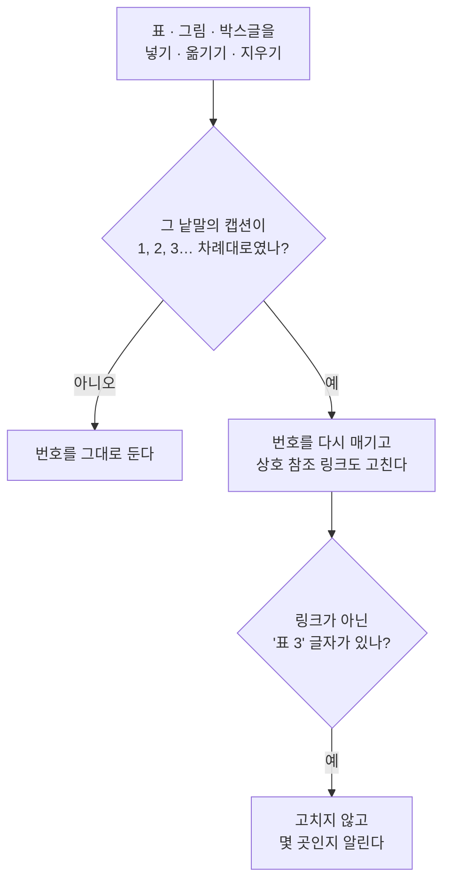

# 번호·참조·목차·스타일

> 캡션 번호·상호 참조·번호 목록·제목 번호는 더하고 옮기고 지울 때 저절로 맞는다. 목차 줄과 md 문서 스타일로 문서의 모양을 정한다.

## 저절로 맞는 번호

| 번호 | 언제 | 함께 고치는 것 | 그대로 두는 것 |
|---|---|---|---|
| 번호 목록 | 항목을 더하기 · 옮기기 · 지우기 · 종류 바꾸기 | 뒤 항목의 번호 | 모두 `1.` 로 쓴 목록 |
| 제목 번호 | 번호를 쓰는 문서에서 제목을 더하기 · 옮기기 · 지우기 | 이 문서 안의 절 링크 | `참고문헌` · `부록` · `붙임` · `요약` 같은 절 |
| 캡션 번호 | 표 · 그림 · 박스글을 넣기 · 옮기기 · 지우기 | 그것을 가리키는 상호 참조 링크 | 아래 흐름도 |

모두 같은 저장이라 번호까지 **Ctrl+Z** 한 번으로 되돌아온다. 칸에서는 제목 번호가 잠긴다. 고른 줄 밖이 함께 바뀌면 알린다 — '뒤 항목 3개의 번호를 다시 매겼습니다', '제목 번호 4곳을 다시 매겼습니다'.

링크가 아닌 '표 3' 같은 글자는 다른 문서를 가리킬 수 있어 고치지 않는다 — **Ctrl+F** 로 찾아 확인한다. 캡션 하나의 번호만 손으로 고친 것도 그대로 둔다.

## 캡션

| 원문 | 무엇 |
|---|---|
| `표 1. 제목` | 표 캡션 — 표 바로 위 |
| `그림 1. 제목` | 그림 캡션 — 그림 바로 아래 |
| `박스 1. 제목` | 박스글의 제목 — 박스글의 첫 줄 |
| `그림 2: 제목` · `**표 3.** 제목` · `<표 4> 제목` | 같은 캡션으로 센다 |
| `Table 1.` · `Figure 1.` · `Box 1.` | 영어 캡션 |
| `표 2-1` · `표 2.1` | 장 번호가 든 캡션 — 사람이 매긴 것이라 손대지 않는다 |

번호는 낱말(표 · 그림 · 박스)마다 따로 센다. 넣기 창으로 표 · 그림을 넣으면 캡션이 다음 번호로 함께 들어간다 ([넣기](4.5-넣기.md)).

## 상호 참조

| 하려는 일 | 방법 | 결과 |
|---|---|---|
| 표 · 그림 · 박스글 · 절 가리키기 | 넣기 창 **상호 참조** — 캡션이나 절을 고른다 | `[표 3](#표-3)` 같은 링크 |
| 문장 가운데서 | 칸 안에서 **Ctrl+Shift+/** → **상호 참조** | 커서 자리에 |
| 그 자리로 가기 | 링크 누르기 | 그 캡션 · 절로 — **Alt+←** 로 돌아온다 |

## 본문 인용

| 하려는 일 | 방법 | 결과 |
|---|---|---|
| 문헌 인용 넣기 | 넣기 창 **본문 인용** — `## 참고문헌`(또는 `## References`) 절의 목록에서 고른다 | `(김영삼, 2026)` |
| 인용 수 보기 | 같은 창 | 문헌마다 본문에 인용한 수, 아직 쓰지 않은 문헌의 수 |
| APA 같은 서식 맞추기 | AI 도구(Claude Code 등)에 요청 | — |

## 목차 줄

| 원문 | 그려지는 것 |
|---|---|
| `[목차]` | 그 자리에 제목 목차 — 문서 제목은 빼고 세 단계까지 |
| `[표 목차]` | 번호가 붙은 표 캡션의 모음 |
| `[그림 목차]` | 번호가 붙은 그림 캡션의 모음 |

넣기 창의 쪽 묶음에서 넣는다. 인쇄 · PDF 를 위한 것이고 오른쪽 목차는 그대로다. Word 로 저장하면 `[목차]` 는 Word 의 목차가 된다 — 열 때 '필드를 업데이트할까요?' 에 **예** ([Word](6.3-Word.md)).

## md 문서 스타일

상태줄 **md 문서 스타일** 이나 문서 여백 우클릭 **md 문서 스타일…** 로 연다. **문서 방식** 과 **머리글 모양** 을 고른다.

| 고르는 것 | 무엇 |
|---|---|
| 문서 방식 | 서술식은 문장으로, 개조식은 짧은 항목으로 쓴다 — 지금 방식은 본문을 보고 알려 준다 |
| 머리글 모양 | 번호와 기호 — 고르면 미리보기가 나오고, 적용하면 md 파일의 제목 줄이 실제로 바뀐다 |

| 문서 방식 | 머리글 모양 | 1단계 | 2단계 | 3단계 |
|---|---|---|---|---|
| 서술식 | 번호 없음 (기고문 · 칼럼) | 개요 | 시장 현황 | 가격 |
| 서술식 | 논문형 (인문 · 사회 논문) | Ⅰ. 개요 | 1. 시장 현황 | 1) 가격 |
| 서술식 | 숫자형 (이공계 논문 · 기술 문서) | 1. 개요 | 1.1 시장 현황 | 1.1.1 가격 |
| 서술식 | 장·절형 (학위 논문 · 단행본) | 제1장 개요 | 제1절 시장 현황 | 1. 가격 |
| 서술식 | 규정형 (규정 · 지침) | 제1장 개요 | 제1조 시장 현황 | ① 가격 |
| 개조식 | 보고서형 (보고서) | Ⅰ. 개요 | 1. 시장 현황 | 가. 가격 |
| 개조식 | 숫자형 (기획안 · 계획서) | 1. 개요 | 1.1 시장 현황 | 1.1.1 가격 |
| 개조식 | 기호형 (공문 · 요약) | □ 개요 | ○ 시장 현황 | - 가격 |
| 개조식 | 번호 없음 (회의록 · 메모) | 개요 | 시장 현황 | 가격 |

| 상황 | 동작 |
|---|---|
| 같은 방식 안에서 머리글 모양 바꾸기 | 바로 바뀐다 — **Ctrl+Z** 로 되돌린다 |
| 문서 방식 바꾸기 | 꼭 묻는다 — 머리글은 앱이 바꾸지만 본문은 내용을 판단해야 한다 |
| 그때 **머리글을 바꾸고 본문은 Claude 에게 요청** | 터미널에 요청 글이 들어간다 — Enter 는 직접 |
| 그때 **머리글만 바꾸기** | 본문은 그대로 — 방식은 바뀌지 않는다 |
| 문서 제목 (`#` 하나) · 본문 · 코드 블록 | 그대로 — 문서 제목에는 번호를 달지 않는다 |
| 이미 붙은 번호 | 떼고 새로 매긴다 — `2026년 전망` 같은 제목의 숫자는 번호로 보지 않는다 |
| 절 링크 | 이 문서 안의 것은 함께 고친다 — 다른 문서에서 이 절로 오는 링크는 그대로 |

## 내 스타일

| 하려는 일 | 방법 | 결과 |
|---|---|---|
| 이 문서의 번호 모양을 스타일로 | **이 문서를 스타일로 만들기** (머리글에 번호를 단 문서에서) | 지금 고른 방식(서술식 · 개조식)의 **내 스타일** — 프로젝트가 아니라 Lectern 전체에서 쓴다 |
| 잘 뽑히지 않는 복잡한 번호 | **Claude 에게 스타일 요청** | 터미널에 요청 글 — 이름을 적어 Enter 를 누르면 AI 도구가 문서를 보고 만든다 |
| 지우기 | **스타일 폴더 열기** | `%APPDATA%\Lectern\md-styles` 의 파일을 지운다 |
| 찾기 | 찾기 칸에 이름 · 용도(`논문`) · 번호 글자 | 최근에 쓴 스타일은 맨 위에 모인다 |

'Claude' 자리의 이름은 설정의 쓰는 AI 도구를 따른다. 새 문서를 만들 때도 이 스타일을 고른다 ([만들기](4.8-만들기.md)).

## 관련

| 문서 | 무엇 |
|---|---|
| [넣기](4.5-넣기.md) | 표 · 그림 · 박스글과 캡션 넣기 |
| [줄 종류와 서식](4.4-줄-종류와-서식.md) | 제목 수준 · 목록 종류 바꾸기 |
| [인쇄와 PDF](6.1-인쇄와-PDF.md) | 목차 줄이 종이에 나오는 모양 |
| [Word](6.3-Word.md) | 캡션은 Word 의 번호 필드로, 상호 참조는 그 캡션으로 가는 링크로 |
