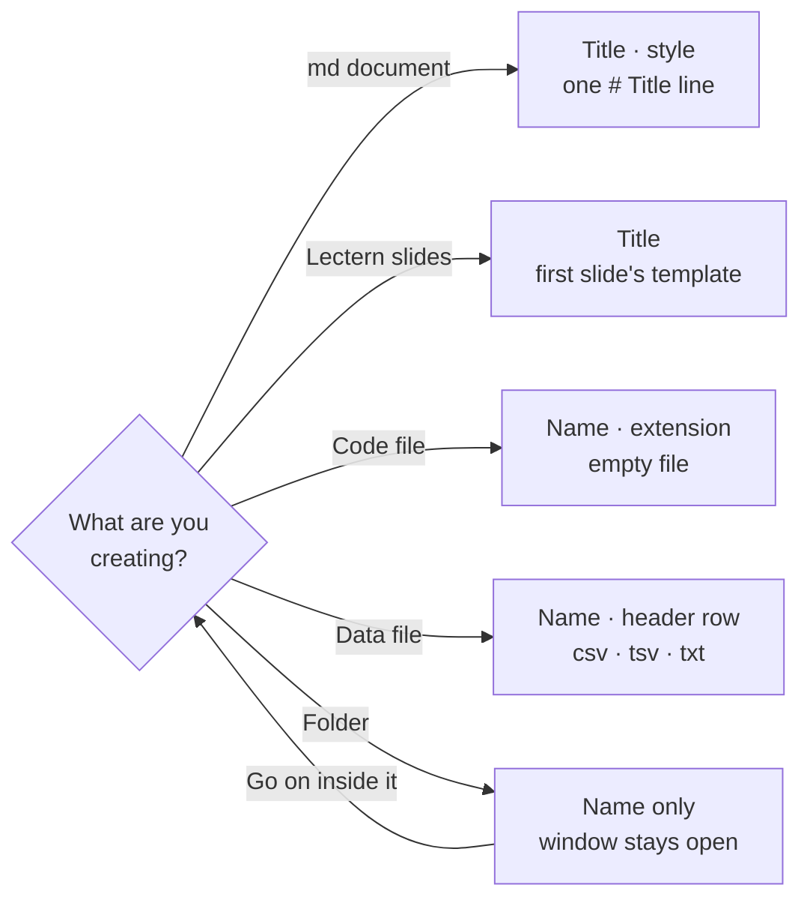

# Creating

> Create a new md document, Lectern slides, code file, data file or folder. Which kinds you can pick depends on where you open it, and nothing is created if the name already exists.

## Where to open it and what kinds

| Where you open it | Kinds you can pick |
|---|---|
| **Create** on the 'Documents' group of the sidebar's 'Files' tab · right-click in the document tree **New document…** | md document · Lectern slides |
| **Create** on the 'Code' group · right-click a folder in the code list **New code file…** | Code file |
| **Create** on the 'Other files' group · right-click a folder in the other files list **New data file…** | Data file |
| **Create** on the 'Folders' group · right-click in that list **New…** | All five — folders too |
| **Ctrl+N** · **New document…** at the top of **+** in the document tab row · right-click a project tab · the command finder (**Ctrl+Shift+P**) | The four other than folder |

**Folders are made only in the 'Folders' group** — its **Create**, or right-click a folder or empty space there **New folder…**. Windows opened elsewhere have no **New folder…** button either. **Create** shows only on the header of the open group. 'New code file…' · 'New data file…' in the command finder open the create window on that kind. View-only projects such as the samples have no Create.

## Choosing

## Location

| Opened from | Starting location |
|---|---|
| **Ctrl+N** · **Create** in 'Documents' | The folder of the document or folder overview you are viewing |
| **Create** in 'Code' · 'Other files' · 'Folders' | The folder picked in that list — the file's folder if a file is picked, the top of the project if nothing is |
| Right-click in the tree | The folder you right-clicked |

Choose the top of the project or another folder in **Location** — empty folders show too. **New folder…** (only in a window opened from the 'Folders' group) creates a folder inside the chosen location and selects it. **New folder…** in the right-click menu of the 'Folders' group makes the folder and then opens the create window inside it.

## By kind

| Kind | What you type | What is created | After it opens |
|---|---|---|---|
| md document | **Title** — becomes the file name (starts as 'New document', with a number added if that exists). **Style** — the most recent one is picked; change it with **↑** · **↓** | One `# Title` line — with a numbered style, two sample heading lines too | A cell opens under the title in a new document tab, so you can write right away |
| Lectern slides | **Title** | With the first slide you pick in the template gallery | [Lectern slides](5-lectern-slides.en.md) |
| Code file | **Name** with its extension (`tidy.py` · `settings.json`) | An empty file | Edit mode in a new document tab — it is only created, never run |
| Data file | **Name** (`.csv` · `.tsv` · `.txt`) · **Header rows** (may be left empty) | See 'Data files' below | Edit mode in a new document tab |
| Folder | Name only | An empty folder | The window stays open with that folder as the location — then pick what to create inside it |

With a numbered style, the first heading is selected, so typing changes the text and keeps the number. The styles are those of [md document style](4.6-numbers-references-contents-styles.en.md#md-document-style).

The starting name of a code file has the most common extension in that project, and if you leave the extension out, that one is added. You can create the formats that show in the sidebar's 'Code' list (except html and ipynb).

## Data files

| File | With header rows typed (`Date, Item, Amount`) | Left empty |
|---|---|---|
| CSV | Those column names are the first line — with a UTF-8 BOM too | The BOM only |
| TSV | Those column names are the first line | An empty file |
| Text | — | An empty file |

Separate column names with commas. The CSV BOM is there so Korean Excel opens the file directly without garbling Korean text, and it stays when you edit and save in edit mode.

## Cases

| Situation | What happens |
|---|---|
| The same name exists | Not created — the reason is shown, so change the name |
| Switching the kind | Keeps the name you typed and changes only the extension to that kind's (`analysis notes` → code file `analysis notes.js`) — if you did not change the name, that kind's starting name |
| Cancel · close the window (even after making a folder) | **Esc** |
| Closing the document before writing | The file stays — if you don't need it, right-click it in the tree **Delete document…** (to the Recycle Bin) |

## Related

| Document | What |
|---|---|
| [Sidebar](2.4-sidebar.en.md) | The Documents · Code · Other files · Folders groups of the 'Files' tab |
| [Numbers, references, contents and styles](4.6-numbers-references-contents-styles.en.md) | md document style, which sets a new document's heading shape |
| [Code and data files](3.6-code-and-data-files.en.md) | Editing a new CSV · text file in edit mode |
| [Lectern slides](5-lectern-slides.en.md) | The first slide of new slides and templates |
