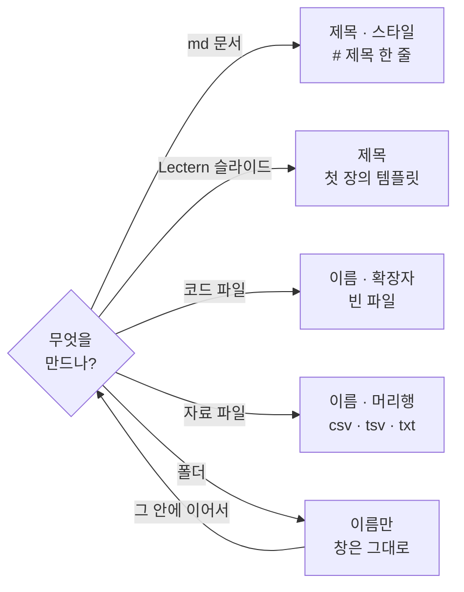

# 만들기

> 새 md 문서·Lectern 슬라이드·코드 파일·자료 파일·폴더를 만든다. 연 곳에 따라 고를 수 있는 종류가 다르고, 같은 이름이 있으면 만들지 않는다.

## 여는 곳과 종류

| 여는 곳 | 고를 수 있는 종류 |
|---|---|
| 사이드바 '파일' 탭 '문서' 묶음의 **만들기** | md 문서 · Lectern 슬라이드 · 폴더 |
| '코드' 묶음의 **만들기** · 코드 목록의 폴더 우클릭 **새 코드 파일 만들기…** | 코드 파일 · 폴더 |
| '자료' 묶음의 **만들기** · 자료 목록의 폴더 우클릭 **새 자료 파일 만들기…** | 자료 파일 · 폴더 |
| '폴더' 묶음의 **만들기** · **Ctrl+N** · 문서 탭 줄 **+** 의 맨 위 **새 문서 만들기…** · 트리의 문서 · 폴더 · 빈 곳 우클릭 **새 문서 만들기…** · 명령 찾기(**Ctrl+Shift+P**) | 다섯 모두 |

**만들기** 는 펼친 묶음의 머리줄에만 보인다. 명령 찾기의 '새 코드 파일 만들기…' · '새 자료 파일 만들기…' · '새 폴더 만들기…' 는 만들기 창을 그 종류로 연다. 예제처럼 보기만 하는 프로젝트에는 만들기가 없다.

## 고르는 흐름

## 위치

| 연 곳 | 처음 위치 |
|---|---|
| **Ctrl+N** · '문서'의 **만들기** | 지금 보는 문서나 폴더 개요의 폴더 |
| '코드' · '자료' · '폴더'의 **만들기** | 그 목록에서 고른 폴더 — 파일을 골랐으면 그 폴더, 고른 것이 없으면 프로젝트 맨 위 |
| 트리 우클릭 | 우클릭한 그 폴더 |

창의 **위치** 에서 프로젝트 맨 위나 다른 폴더를 고른다 — 비어 있는 폴더도 나온다. **새 폴더…** 는 고른 위치 안에 폴더를 만들고 그 폴더를 고른다. 트리 · 프로젝트 탭의 우클릭 **새 폴더 만들기…** 도 같다 — 빈 폴더는 트리에 나오지 않으므로 만든 뒤 바로 새 문서 창이 열린다.

## 종류마다

| 종류 | 적는 것 | 만드는 것 | 연 뒤 |
|---|---|---|---|
| md 문서 | **제목** — 파일 이름이 된다 (처음 값 '새 문서', 있으면 번호를 붙여). **스타일** — 최근에 쓴 것이 골라져 있고 **↑** · **↓** 로 바꾼다 | `# 제목` 한 줄 — 번호가 있는 스타일이면 보기 머리글 두 줄도 | 새 문서 탭에서 제목 아래 칸이 열려 바로 쓴다 |
| Lectern 슬라이드 | **제목** | 템플릿 갤러리에서 고른 첫 장으로 | [Lectern 슬라이드](5-Lectern-슬라이드.md) |
| 코드 파일 | **이름** 에 확장자까지 (`정리.py` · `설정.json`) | 빈 파일 | 새 문서 탭의 편집 모드 — 만들기만 하고 실행하지 않는다 |
| 자료 파일 | **이름** (`.csv` · `.tsv` · `.txt`) · **머리행** (비워도 된다) | 아래 '자료 파일' | 새 문서 탭의 편집 모드 |
| 폴더 | 이름만 | 빈 폴더 | 창을 닫지 않고 그 폴더를 위치로 — 이어서 그 안에 만들 것을 고른다 |

번호가 있는 스타일로 만들면 첫 머리글을 골라 두니, 치면 번호는 두고 글만 바뀐다. 스타일은 [md 문서 스타일](4.6-번호-참조-목차-스타일.md#md-문서-스타일)의 것이다.

코드 파일 이름의 처음 값은 그 프로젝트에 가장 많은 확장자이고, 확장자를 빼고 적으면 그것이 붙는다. 만들 수 있는 것은 사이드바 '코드' 목록에 나오는 형식이다 (html · ipynb 는 뺀다).

## 자료 파일

| 파일 | 머리행에 적으면 (`날짜, 품목, 금액`) | 비워 두면 |
|---|---|---|
| CSV | 그 열 이름이 첫 줄 — UTF-8 BOM 도 붙인다 | BOM 만 |
| TSV | 그 열 이름이 첫 줄 | 빈 파일 |
| 텍스트 | — | 빈 파일 |

열 이름은 쉼표로 나눠 적는다. CSV 의 BOM 은 한국어 엑셀이 바로 열어도 한글이 깨지지 않게 하려는 것이고, 편집 모드로 고쳐 저장해도 그대로 남는다.

## 이럴 때

| 상황 | 동작 |
|---|---|
| 같은 이름이 있음 | 만들지 않는다 — 까닭이 나오니 이름을 고친다 |
| 종류를 바꿈 | 쓴 이름은 그대로 두고 확장자만 그 종류의 것으로 (`분석 메모` → 코드 파일 `분석 메모.js`) — 이름을 고치지 않았으면 그 종류의 처음 값 |
| 그만두기 · 창 닫기 (폴더를 만든 뒤에도) | **Esc** |
| 쓰기 전에 문서를 닫음 | 파일은 남는다 — 필요 없으면 트리에서 우클릭 **문서 삭제…** (휴지통으로) |

## 관련

| 문서 | 무엇 |
|---|---|
| [사이드바](2.4-사이드바.md) | '파일' 탭의 문서 · 코드 · 자료 · 폴더 묶음 |
| [번호·참조·목차·스타일](4.6-번호-참조-목차-스타일.md) | 새 문서의 머리글 모양을 정하는 md 문서 스타일 |
| [코드와 자료 보기](3.6-코드와-자료-보기.md) | 만든 CSV · 텍스트를 편집 모드로 고치기 |
| [Lectern 슬라이드](5-Lectern-슬라이드.md) | 새 슬라이드의 첫 장과 템플릿 |
