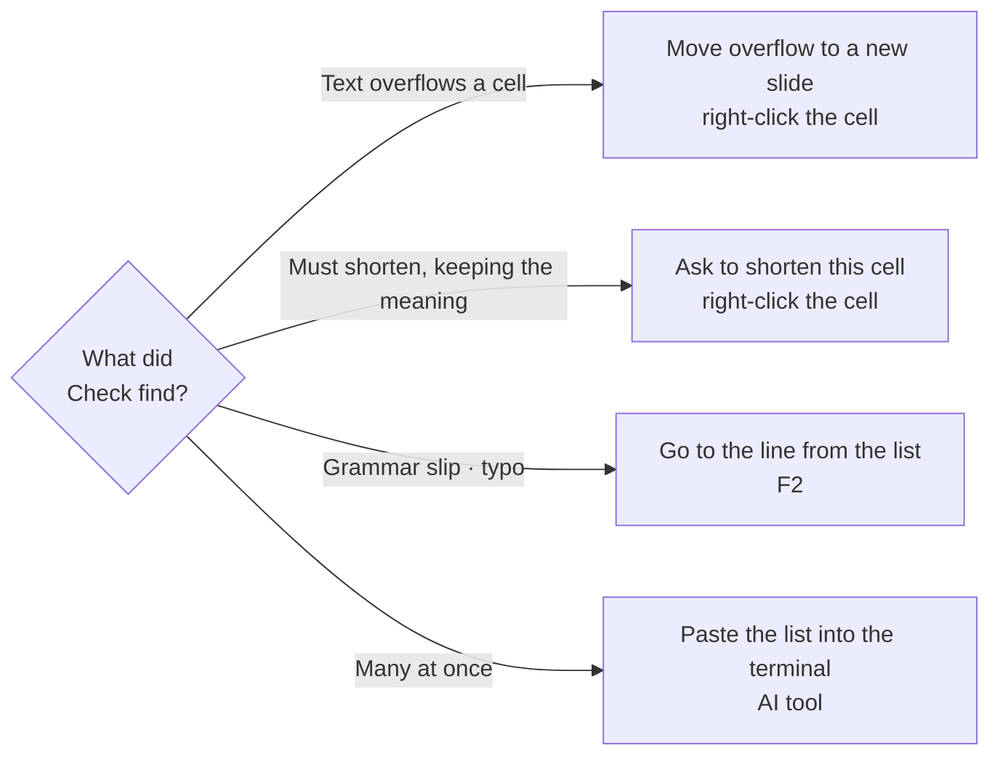

# Presenting and checking

> Lectern slides open in the current window like md documents. Use the tools on the status bar to present, show the hidden lines, and check for overflow and mistakes.

## Where to view them

| Where | How to open | Style | Notes |
|---|---|---|---|
| Document pane of the current window | Click it in the sidebar — the same tab rules as md documents | The main window's style | The slide tools are on the status bar |
| Slide window | Sidebar right-click **Open in new window** · document tab right-click **Move to new window** (**Ctrl+Shift+N**) | Chosen separately from the main window — the **Present** style by default | If one is already open, it comes to the front. The terminal is the main window's |

A new window opens only when you choose one. Changing the screen style does not change the pptx style.

## Slide tools on the status bar

| Button | What it does | More |
|---|---|---|
| **Present** | One slide at a time across the whole window, from the slide in view (**Shift+F5**) | [Presenting](#presenting) |
| **View as document** | Opens up the cells and reads on like an ordinary document | — |
| **Structure** | Shows cell head lines, directive lines and note lines as tags | [Structure view](#structure-view) |
| **Check** (shown like 'Check 3') | A list of overflow and mistakes. With nothing to fix but shrunk text, **Shrunk text** (shown like 'Shrunk text 2') | [Check](#check) |
| **Convert to pptx** · **Convert to html** | A pptx · presentation html file next to the document | [pptx and html presentations](6.4-pptx-and-html-presentations.en.md) |

## Presenting

| What to do | Mouse | Keys |
|---|---|---|
| Start presenting — from the slide in view | **Present** on the status bar · **▶** on a slide | **Shift+F5** |
| Next slide | Click · wheel down | **→** · **Space** · **PageDown** · **↓** |
| Previous slide | Wheel up | **←** · **PageUp** · **↑** |
| First slide · last slide | — | **Home** · **End** |
| Show · hide speaker notes | — | **N** |
| Full screen on · off | — | **F** |
| End the presentation | **✕** on the bar | **Esc** |

Hidden slides (`<!-- hidden: true -->`) are left out of the presentation. During a presentation, clicking a checkbox does not change the source.

## Structure view

| What to do | How |
|---|---|
| See the hidden lines | **Structure** on the status bar — cell head lines, directive lines and note lines appear as tags |
| Edit that line | Click the tag and press **F2** — this is how you change a cell's look or the layout |

## Check

When something overflows or is written wrong, **Check** appears on the status bar. Click it for a list, and pick an item to go to that line. Slides to check are also marked in the contents on the right.

| What it checks | What |
|---|---|
| Overflow | A cell that still overflows at the floor size — it is cut off and gets a red dotted line ([When it overflows](#when-it-overflows)) |
| Grammar slips | Cell names, a missing `:::`, typos in directives and words, bad grids, unclosed comments · code blocks, text right above `---`, unresolved `**` |
| Measured on screen | Text close to the background color, code · tables cut off at the side, missing images, charts that could not be drawn — text over a photo cannot be measured, so check it by eye |
| Small text | Below 12pt for tables · 14pt for body text (with `reading: true`, 10pt for tables · 12pt for body text). Chart text is measured at its size on the slide, against the table limit |

| In the list | What it does |
|---|---|
| Pick an item | Goes to that line |
| **Paste the list into the terminal** | A request to fix them goes into the AI tool (Claude Code and others) in the terminal (**Enter** is not pressed) |
| **Copy the list** | Copies the list |

## When it overflows

When the text in a cell overflows, Lectern fits it in this order, like PowerPoint's 'shrink text on overflow'.

| Order | What happens |
|---|---|
| 1 | Images · diagrams shrink to the height left. Charts are not shrunk but redrawn for the space left — legend · axis text does not get smaller |
| 2 | If it still overflows, the text of that cell shrinks, down to 14pt for body text · 12pt for tables and code (12pt · 10pt with `reading: true`). The slide title does not shrink |
| 3 | Cells side by side in the same row with the same look (two cards, say) shrink to the same size |
| 4 | Code that is still too wide wraps its lines |
| 5 | If it still overflows, it is cut off and gets a red dotted line — it shows in Check |

A slide with shrunk text gets no mark on its frame. It is listed under **Text shrunk to fit** in the Check list and is left out of the list sent to the terminal. To show the text at its full size, cut the text of that cell or split the slide.

## PDF and printing

| What to do | How | Result |
|---|---|---|
| PDF | Right-click the body margin → **Save as PDF…** | One slide per slide-sized page, in the screen colors — hidden slides and speaker notes are left out |
| Print | Right-click the body margin → **Print…** | One slide per page |

## Related

| Document | What |
|---|---|
| [Writing slides](5.1-writing-slides.en.md) | Cells · layouts · text size |
| [Separate windows](2.7-separate-windows.en.md) | Separate windows such as the slide window |
| [Print and PDF](6.1-print-and-pdf.en.md) | The Export window |
| [pptx and html presentations](6.4-pptx-and-html-presentations.en.md) | The two conversions on the status bar |
